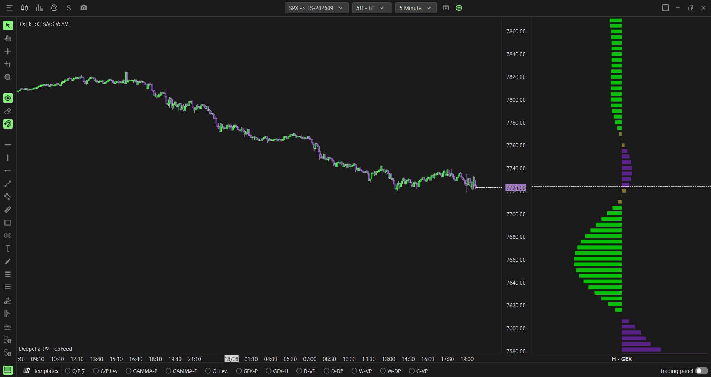
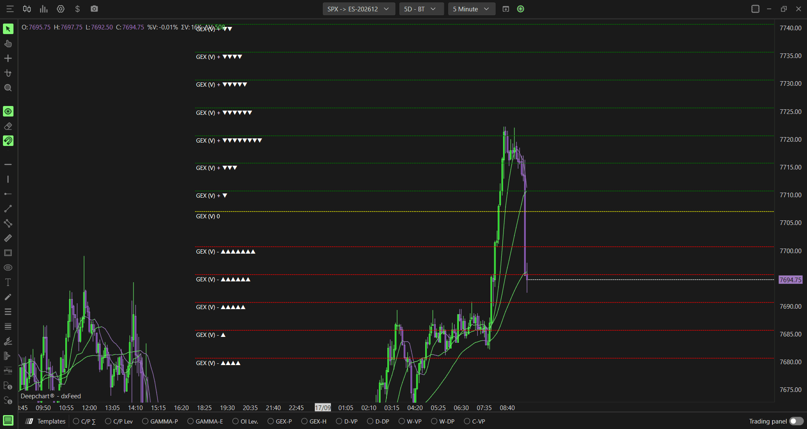
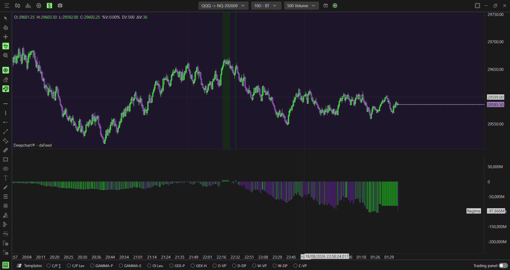
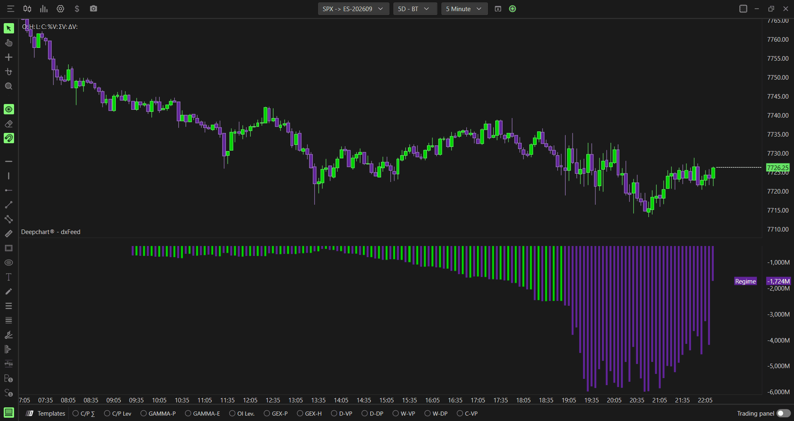
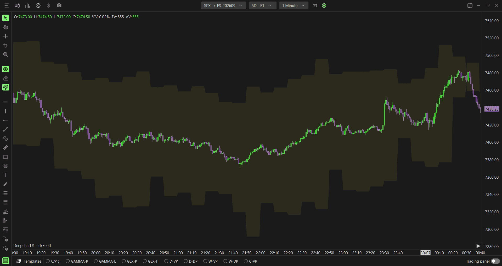
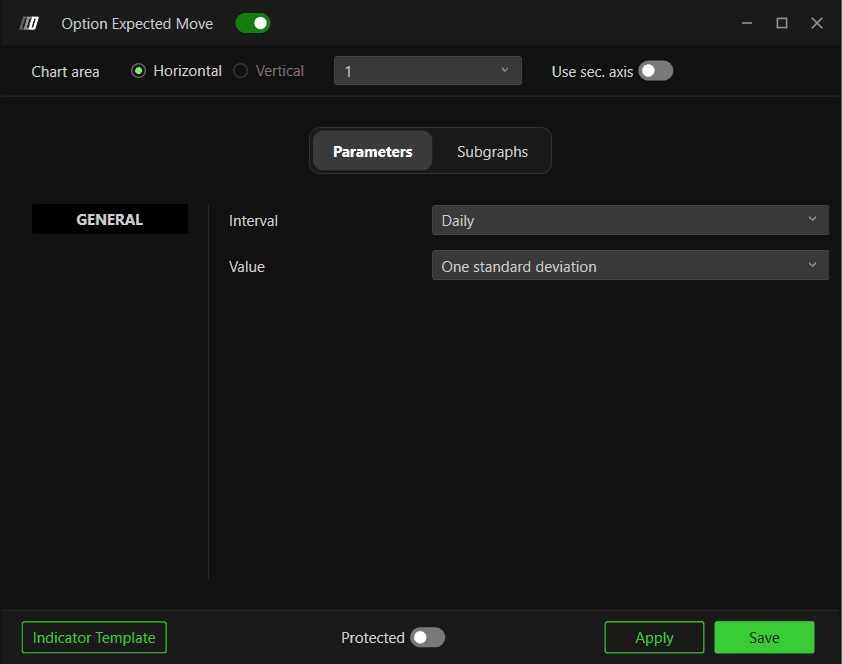
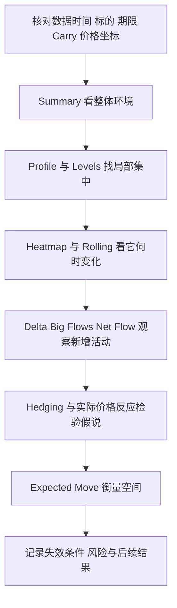

# DeepGamma完整手册

核验日期：2026-10-29。由分篇指南自动合并；源文件与独立查阅入口见[README](README.md)。所有交易情景为教学假设。

## 阅读目录
1. [从哪里开始：产品、数据与图表配置](#chapter-1)
2. [DeepGamma 所需的期权与期货基础：经一手资料核验的研究底稿](#chapter-2)
3. [做市商分析主线：从数据、持仓到对冲与价格验证](#chapter-3)
4. [通用参数词典：先统一口径，再调整画面](#chapter-4)
5. [DeepGamma Web 平台配置与使用指南](#chapter-5)
6. [Option Volume：期权成交量](#chapter-6)
7. [Option Delta：方向流量、客户视角与做市商视角](#chapter-7)
8. [Option Big Flows：大额权利金交易与开平仓](#chapter-8)
9. [Option Profile：原始量、Gamma模型与日终持仓的剖面](#chapter-9)
10. [Option GEX Profile：做市商Gamma的行权价分布](#chapter-10)
11. [Option GEX Profile Hedging：价格移动时的对冲放大与衰减](#chapter-11)
12. [Option Levels：把统计峰提炼为少量水平位](#chapter-12)
13. [Option Levels Advanced：做市商与实时持仓关键位](#chapter-13)
14. [Option Envelopes：Zero、Major、Minor Gamma动态参考线](#chapter-14)
15. [Option Envelopes Advanced：OI-R口径的动态Gamma参考](#chapter-15)
16. [Option Summary：传统Gamma模型的总量时间序列](#chapter-16)
17. [Option Summary Gex：做市商总Gamma、Delta与净流](#chapter-17)
18. [Option Expected Move：隐含波动范围与超预期移动](#chapter-18)
19. [Option Gex Heatmap：按价格与时间观察风险区](#chapter-19)
20. [DeepGamma Web 与桌面版：14 项共同指标的配置差异及补充指南](#chapter-20)
21. [Option Net Flow：累计期权净流配置与使用](#chapter-21)
22. [Option Dynamic Walls：动态墙配置与使用](#chapter-22)
23. [Option Market Maker Pressure：做市商压力配置与使用](#chapter-23)
24. [Option Market Maker Sentiment：环境、方向与波幅状态](#chapter-24)
25. [Option Exhaustion Detector：衰竭检测配置与使用](#chapter-25)
26. [把DeepGamma用于交易研究：布局、场景、期货映射与复盘](#chapter-26)
27. [DeepGamma图像和多媒体识读记录](#chapter-27)
28. [DeepGamma功能覆盖与证据边界](#chapter-28)
29. [做市商指标的独立来源复核](#chapter-29)


<a id="chapter-1"></a>

源文件：[guides/00-start-here.md](guides/00-start-here.md)

## 从哪里开始：产品、数据与图表配置

核验日期：2026-10-29。本文区分公开文档证据、截图观察与研究者建议。所有价格和交易情景例子均为假设，不是当日行情，也没有经过盈利回测。

若主要研究SPX／ES日内交易，建议先完成本篇的基础设置，再读[做市商分析主线](guides/market-maker-framework.md)：从Summary与Profile建立环境和位置，再学习Hedging、Pressure、Sentiment，避免一开始堆满全部指标。

### 1. DeepGamma 到底提供什么

DeepGamma把期权市场信息放到价格图上，回答五类问题：哪里有活动集中、净风险怎样分布、环境偏稳定还是偏放大、正在发生什么流量，以及价格相对隐含波动范围走到了哪里。它不是一个“看见大单就跟单”的系统。

官方入口包含两套文档：原链接的桌面版目录有14项指标，Web目录有19项；新增5项是Net Flow、Dynamic Walls、Market Maker Pressure、Market Maker Sentiment与Exhaustion。Web有独立入口与界面，所以本指南为14项共通指标保留桌面配置，再用[Web差异表](research/web-desktop-differences.md)补充Web配置；5项新增指标另有专篇。[桌面目录](https://www.deepcharts.com/helpcenter/deepgamma)、[Web目录](https://www.deepcharts.com/helpcenter/deepgamma-web/indicators)。

| 信息层 | 主要工具 | 首先回答的问题 |
|---|---|---|
| 活跃度 | Option Volume | 此时交易是否活跃？Calls还是Puts多？ |
| 交易流 | Option Delta、Big Flows、Net Flow | 哪类流量正在改变？是哪一方视角？ |
| 结构 | Profile、Levels、Envelopes及Advanced版本 | 哪些行权价重要？集中点是否迁移？ |
| 做市商风险 | GEX Profile、Heatmap、Summary Gex | 估计风险在哪些价格及期限集中？ |
| 条件反应 | Hedging Profile、Web模型 | 若价格继续移动，对冲可能顺势还是逆势？ |
| 波动范围 | Expected Move | 当前幅度相对期权隐含范围是否偏大？ |

### 2. 四个标的与两类数据

普通指标支持SPX、SPY、NDX、QQQ。CBOE参与者数据功能限定SPX；不要把SPX支持扩写成“全部美股、全部期权、ES期权均支持”。指数期权SPX与CME的ES期权是不同产品。

桌面选择器中，SPX/SPY行的Symbol为ES-CME，NDX/QQQ行为NQ-CME，Exchange为CME。这是官方图表选择器的关联显示，不能推出SPY等于ES、QQQ等于NQ，更不能用同一数值行权价直接下期货单。[官方选择步骤](https://www.deepcharts.com/helpcenter/article/option-levels)。


上图用于核对SPX选择行；其他指标页也有包含四个标的的选择器。最终以界面实际标的名、图表标题、坐标单位和合约月份同时确认。

数据口径分成三层：

1. **成交量与EOD OI模型**：交易量说明发生过多少交易；EOD OI是最近已发布的未平仓合约存量。用Call减Put并赋Gamma权重的传统模型有持仓符号假设。
2. **参与者分类数据**：官方称可识别SPX做市商参与者，避免只按Call/Put猜对手方。但Greek、聚合、对冲工具及市场影响仍需要估计，不能把营销中的“actual”翻译成“未来订单确定”。
3. **OI-R / OI (R.T.)**：DeepCharts根据实时分类流构建的持仓口径。它不等于交易所实时发布了清算OI。普通买卖净额也不等于全市场OI变化；开平分类、初始存量及覆盖范围是关键。

进一步推导见[期权与期货基础研究](research/market-foundations.md)。来源：[GEX Profile](https://www.deepcharts.com/helpcenter/article/option-gex-profile)、[Levels Advanced](https://www.deepcharts.com/helpcenter/article/option-levels-advanced)。

### 3. 桌面首次配置

1. 在顶部 **New → Option Chart** 新建期权图表。
2. 选标的。需要做市商功能时选 **SPX**，再点Select。
3. 打开图表工具栏 **Indicator Add / Indicator List**，搜索指标名，点 **+**。
4. 点指标旁齿轮；先调Data source、Expiration和Carry，再调画面样式。
5. 先点Apply检查结果，再保存设置。截图中有Apply、Save、Indicator Template等控件，但公开指标文档没有完整说明所有保存作用域；不要把单指标保存与工作区保存混为一谈。
6. 在屏幕上标清“标的、Data source、期限、Carry状态、价格是否期货转换”。比较两个指标时，先令这些口径一致。

SPX数据为约1分钟层级，不能因为把图表切成更小周期就把它当成逐笔期权数据。[v16发布说明](https://www.deepcharts.com/changelog/v16)。桌面行情连接、订单流或交易权限由已有平台配置决定；没有登录用户账号或检查实际订阅，因此不承诺某个套餐自动包含所有行情。

### 4. 桌面模板快捷入口

| 底部按钮 | 功能 | 下一步检查 |
|---|---|---|
| C/P Σ | 普通Call/Put Profile | 当前源是原始量还是Gamma？ |
| C/P L / C/P Lev | Call/Put Levels | 线数、到期日、排名 |
| GAMMA-P | 普通Gamma Profile | 是Volume模型还是OI？ |
| GAMMA-E | Gamma Envelopes | Zero/Major/Minor显示 |
| OI (RT) / OI Lev. | 实时OI关键位入口 | 在设置核对是否Advanced及OI-R源 |
| GEX-P | 做市商Gamma剖面 | Gex MM还是MM C/P？ |
| GEX-H | 做市商热图 | 截断阈值与颜色标尺 |

这些是预置快捷入口，不是每个按钮对应一套新的Greek。右键模板按钮可进设置。官方发布说明与后续截图的短标签略有不同，因此按实际功能和数据源辨认。[模板栏和共享模板说明](https://www.deepcharts.com/changelog/v16)。

Option Chart共享模板的官方路径为 **Option Chart → Template → Shared**。工作区共享路径是 **Open → Shared**，可见内容依订阅等级而不同。普通Orderflow共享模板路径为 **Templates → Shared → OF Version**；不要把普通ES/NQ/GC模板当作已经包含DeepGamma权限。

### 5. 最小观察布局：研究者建议

**学习阶段**：一个SPX图表，1分钟或5分钟价格展示，添加Summary Gex、Levels Advanced、GEX Profile。先只保留一种期限，例如0DTE；手动统一Carry状态。记下开盘后、午间和尾盘同一行权价的变化。

**研究流量阶段**：增加Option Delta或Big Flows。一个显示净变化，一个筛大额交易；两者不是互相独立的证据。先用默认买卖颜色并读Tooltip，熟悉后才改Put配色。

**研究波动阶段**：再加Expected Move。若画面过密，分图显示，而不是继续提高热图透明度掩盖价格。

**跨期对比**：两个图分别用0DTE和All expirations。它们回答不同问题；不要因数值相反就认定某个坏了。0DTE属于All中的一部分，两个读数并非独立样本。

### 6. 最基本的读图顺序

先确认数据时间和价格坐标，再看总环境，再定位具体集中区，最后观察到达该区域后的真实价格反应。假设Summary Gex为负、下方存在负Gamma集中、Hedging也显示Amplifying，含义是“下行过程可能更不稳定”；只有价格真正下行并获得成交确认后，才构成研究中的顺势条件。若价格反而上行，同一负Gamma环境也可能放大上涨。

不把颜色当买卖指令，不把一个墙当不会破的支撑，不把一分钟数据当能够解释每个Tick。每篇后续指南都有反例、失效条件和可记录的复盘问题。

### 7. 文档边界

本次完成的是公开资料与媒体研究，没有进入付费账号实测，也未验证服务器精确计算、实时延迟分布、回填修正、提醒接口或自动交易能力。官方称桌面约9个月SPX历史、Web约1个月且持续扩充；这是截至核验日的产品描述，不是永久历史保证。[产品说明](https://www.deepcharts.com/features/deepgamma)。回放的具体操作看[Web平台指南](guides/web-platform.md)，研究评估看[组合使用与复盘](guides/15-workflows-and-risk.md)。


<a id="chapter-2"></a>

源文件：[research/market-foundations.md](research/market-foundations.md)

## DeepGamma 所需的期权与期货基础：经一手资料核验的研究底稿

核验日期：2026-10-29（Asia/Shanghai）。本文件是为 DeepGamma 使用指南提供的市场知识底稿，并不声称下列通用公式就是 DeepGamma 的内部实现。产品公式、数据时效、交易商持仓推断、颜色含义及筛选范围须由 DeepGamma 自己的文档另行确认。文中的价格、数量、波动率和交易过程除特别标明外均为教学假设，不是历史业绩、实时行情或收益承诺。

### 1. 从期权合约到 Greeks

#### 1.1 Call、Put、买方、卖方是两组不同概念

Call 是看涨期权，Put 是看跌期权；买入或卖出决定持仓方向。不能把“Call=多头持仓”“Put=空头持仓”当成定义。对于普通香草期权，买入 Call 的 Delta 为正，买入 Put 的 Delta 为负，卖出持仓的方向则反转。Delta 描述期权理论价格对标的微小变动的敏感度，不是该交易一定盈利的概率。[OIC：Delta](https://www.optionseducation.org/advancedconcepts/delta)

| 普通香草期权持仓 | Delta 方向 | Gamma 方向 | 标的上涨时的主要局部影响 |
| --- | --- | --- | --- |
| 买入 Call | 正 | 正 | 期权价值通常上升，Delta 通常变得更正 |
| 卖出 Call | 负 | 负 | 负 Delta 通常扩大，卖方风险增加 |
| 买入 Put | 负 | 正 | 期权价值通常下降，Delta 向零靠近 |
| 卖出 Put | 正 | 负 | 正 Delta 通常缩小 |

Gamma 的正负来自期权持仓方向。OIC 明确指出普通买入 Call 和买入 Put 均为正 Gamma，卖出 Call 和卖出 Put 均为负 Gamma。[OIC：Gamma](https://www.optionseducation.org/advancedconcepts/gamma)

#### 1.2 用同一套单位理解 Delta、Gamma

令期权报价为 `V`，标的价格或指数点位为 `S`：

```text
Delta = ∂V/∂S
Gamma = ∂Delta/∂S = ∂²V/∂S²
ΔDelta ≈ Gamma × ΔS
ΔV ≈ Delta × ΔS + 0.5 × Gamma × (ΔS)²
```

这些是数学定义和局部 Taylor 近似，适用于小幅移动、其他输入暂时不变的教学分析。它们没有把未来的 IV、时间、利率、分红或跳跃价格变化算成已知。OIC 对 Greeks 的定位也是理论估计，而非实际报价保证。[OIC：Understanding Options Greeks](https://prd-web.optionseducation.org/advancedconcepts/understanding-options-greeks)

**自拟例子**：某指数 Call 报价为 15.00 点，Delta=0.50，Gamma=0.004/指数点。若指数上涨 10 点，局部近似为：

```text
新 Delta ≈ 0.50 + 0.004 × 10 = 0.54
期权报价变化 ≈ 0.50 × 10 + 0.5 × 0.004 × 100 = 5.20 点
```

若合约乘数为每报价点 100 美元，单张期权约增加 520 美元。这里的 `Gamma=0.004` 不是“标的每上涨 1%，Delta 上升 0.004”，而是“标的每上涨 1 个指数点，Delta 上升约 0.004”。把点数、百分比及美元混用会让 GEX 放大或缩小几个数量级。

#### 1.3 为什么到期附近、平值附近更敏感

对于普通香草期权，Gamma 往往集中在接近到期的平值区域；远虚值和深实值期权的 Delta 更靠近边界，局部 Gamma 较低。Gamma 会随标的移动而改变，不能把当前 Gamma 外推到很远的价格。[OIC：Gamma](https://www.optionseducation.org/advancedconcepts/gamma)

**使用含义（由上述原理推导）**：一个看似很窄的高 Gamma 行权价区，在价格接近时可能变得重要；但价格远离后，该区影响可以降低。比较两个 Gamma 峰时应固定标的、到期范围、时间和单位。单看峰高无法回答价格下一步朝哪个方向走。

### 2. 做市商 Delta 对冲：必须满足哪些条件

#### 2.1 正 Gamma、负 Gamma的条件性机制

Cboe 的解释是：净正 Gamma 的做市商若用期货维持 Delta 中性，标的上涨时通常卖出对冲、下跌时通常买入对冲；净负 Gamma 时则相反，可能形成顺势对冲。这是对冲流可能抑制或放大波动的机制，而不是市场必然均值回归或必然突破的定律。[Cboe：Much Ado About 0DTEs，2023-09-08](https://www.cboe.com/insights/posts/volatility-insights-evaluating-the-market-impact-of-spx-0-dte-options/)

**自拟推导**：设期权组合的标的等价 Delta 为 `D`，对冲头寸为 `H=-D`，组合 Gamma 为 `G`：

```text
ΔH ≈ -G × ΔS
```

因此：

| 已知条件 | 标的上涨 | 标的下跌 |
| --- | --- | --- |
| 交易商期权组合 G > 0 且持续 Delta 对冲 | 增加卖出对冲 | 增加买入对冲 |
| 交易商期权组合 G < 0 且持续 Delta 对冲 | 增加买入对冲 | 增加卖出对冲 |

使用这张表前，必须确实知道 `G` 是谁的净持仓、是否覆盖相关对冲工具、是否使用相同符号。仅知道市场存在大量期权不足以套用它。

#### 2.2 为什么高期权成交量不等于大额对冲需求

Cboe 指出，成交总量和对冲风险之间并非等号关系；客户买入和卖出可以相互抵消。其研究之所以比公开链条推断更接近真实头寸，是因为交易所能识别交易身份、买卖及开平。该研究也说明交易商可能在别的到期日、SPY、E-mini 等产品上有抵消持仓。[Cboe：同上](https://www.cboe.com/insights/posts/volatility-insights-evaluating-the-market-impact-of-spx-0-dte-options/)

**使用含义（综合推断）**：看到“总 Gamma 很大”“某行权价成交十万张”时，先检查它是绝对量、带符号净量、客户量、交易商量还是由 OI 建模得到的代理量。没有这些信息，最多把它当成风险集中区，不能写成“做市商必须买入多少手期货”。

#### 2.3 对冲机制的边界

以下是分析条件，不是已验证的 DeepGamma 行为：

- 交易商可采用阈值或离散对冲，真实流并非每次价格变化都立即出现。
- 持仓可在跨期、跨行权价、跨产品之间抵消。单一看涨/看跌链不是整个组合。
- 同时发生的现货资金流、宏观信息、流动性变化和波动率变动可能盖过 Gamma 对冲。
- 正 Gamma 环境仍可出现趋势；负 Gamma 环境也可出现盘整。Gamma 是条件变量，不是单独交易信号。

这些限制与期权模型的共同边界一致：理论价格取决于输入假设，实际成交价由市场决定。[OIC：Black-Scholes Formula](https://prd-web.optionseducation.org/advancedconcepts/black-scholes-formula)

### 3. GEX 的单位、符号和估算边界

#### 3.1 一个可核算的通用定义，不冒充产品公式

设某期权 `i` 的长仓单位 Gamma 为 `Γᵢ`，合约乘数为 `mᵢ`，带符号净张数为 `qᵢ`（多头正、空头负）：

```text
组合 Gamma = Σ qᵢ × mᵢ × Γᵢ
```

如果 `S` 是指数点数、`V` 是期权报价点数、`m` 是美元/报价点，则组合 Gamma 的单位为“美元/指数点²”。指数上涨 `ΔS` 时，组合美元 Delta 对标的点数的敏感度约变化 `组合Gamma × ΔS`。

市场展示常将其进一步换算为“标的移动 1% 时的 Delta 对冲名义金额变化”：

```text
Dollar GEX for 1% move ≈ Σ qᵢ × mᵢ × Γᵢ × S² × 0.01
```

这一步额外乘一个 `S`，是把 Delta 等价数量换成标的名义金额；`0.01S` 是假设的 1% 价格变动。该公式是单位分析推导，并非 DeepGamma 的官方口径。Cboe 将市场做市商净 Gamma 解释为 SPX 移动 1% 时可能需要调整的对冲规模，为这种口径提供了交易含义背景。[Cboe：做市商 Gamma 分析](https://www.cboe.com/insights/posts/volatility-insights-evaluating-the-market-impact-of-spx-0-dte-options/)

**自拟算例**：`S=6000`，`Γ=0.001/点`，`m=100美元/点`，假设已知某主体净多 `q=1000张`：

```text
组合 Gamma = 1000 × 100 × 0.001 = 100 美元/点²
标的涨 1% = 60 点
美元 Delta 敏感度变化 ≈ 100 × 60 = 6000 美元/点
按 S=6000 换算的对冲名义量变化 ≈ 6000 × 6000 = 3600万美元
```

这个“3600万美元”不是期权权利金，不是该主体已经成交的期货金额，也不是固定未来买卖单。若用每点 50 美元的 ES 粗略对冲上述 Delta 变化，在 `dF/dS≈1` 的假设下，变化量约为 `6000/50=120手ES`。只用于解释单位，真实执行需考虑基差、组合其他风险与对冲工具。

#### 3.2 Call GEX 为正、Put GEX 为负可能是模型约定

有些外部模型给 Call、Put 分别设置正负符号，用 OI 作为头寸规模近似。这样得到的是带假设的暴露代理，而不是由“Put 的 Gamma 天生为负”得来的结论。普通买入 Put 的 Gamma 与普通买入 Call 一样为正。[OIC：Gamma](https://www.optionseducation.org/advancedconcepts/gamma)

因此检查一个 GEX 工具，至少应知道：

| 要核对的项目 | 为什么影响解读 |
| --- | --- |
| 展示主体 | 客户净头寸与交易商净头寸方向可能相反 |
| 多空符号来源 | 来自真实净持仓、逐笔分类、经验假设还是仅按 Call/Put 分类 |
| 张数输入 | 昨日 OI、当日累计成交量或估算净流量的意义不同 |
| Gamma 单位 | 每点、每美元、每 1% 或合约级会影响数值 |
| 到期范围 | 只看 0DTE 与全到期聚合可以得出不同结论 |
| 场景再定价 | 曲线是否随假设价格、IV、剩余时间重新计算 |

#### 3.3 Gamma Flip/Zero Gamma 是条件化的模型交点

若对每个假设价格 `S*` 重算 Gamma，再加总得到 `G(S*)`，某个 `G(S*)=0` 的价格可称为该模型、该持仓范围下的零 Gamma 交点。它不必等于当前价格下按行权价分组柱子的正负分界。

这是数学解释，不能据此认定任何产品的“Gamma Flip”具体公式。若模型换了 IV 曲面、到期范围、OI 日期或持仓符号，交点可能移动、消失或出现多个。产品若未公开计算法，应在指南里标明“名称已确认，精确算法未公开”。

### 4. OI、成交量和 0DTE

#### 4.1 Open Interest 是存量，Volume 是期间流量

OI 是一个期权系列尚未平掉的合约数。一份未平仓合约同时对应多头与空头，不能把 OI 自身解释成方向。OCC 只有在收盘后的清算配对后，才能报告新的 OI。双方同时开仓，OI 增一；一方开一方平，OI 不变；双方同时平仓，OI 减一。[OIC：General Information](https://www.optionseducation.org/referencelibrary/faq/general-information)

| 一笔 1 张交易 | 当日成交量变化 | OI 变化 |
| --- | --- | --- |
| 买方开仓、卖方开仓 | +1 | +1 |
| 买方开仓、卖方平仓 | +1 | 0 |
| 买方平仓、卖方开仓 | +1 | 0 |
| 买方平仓、卖方平仓 | +1 | -1 |

**自拟例子**：某行权价早盘 OI=20,000，盘中累计 Volume=50,000。不能计算“新 OI=70,000”；这 50,000 张可能包含大量日内反复换手和平仓，也可能包含价差组合的一个腿。OI 的方向归属与交易商身份仍然未知。

**数据来源补充**：Cboe Open-Close的公开盘中产品与日终产品提供的字段不同，不能因为有参与者分类流就假定有实时清算OI。具体规范及其与DeepGamma之间不能直接画等号的原因，见[来源复核](research/market-maker-source-review.md)。

#### 4.2 0DTE 是剩余期限，不代表合约今天才新上市

0DTE 指在当个交易日到期的期权；该系列可能在更早已经挂牌。到期附近的平值期权对标的移动敏感，交易者用于短期对冲、事件或日内观点，但剩余反应时间极短。[Cboe：0DTE Trading Resources](https://www.cboe.com/tradable-products/0dte/)

**对 DeepGamma 筛选的意义（推导）**：

1. 只看 0DTE：更接近今天的短期结构，但忽略其他到期日的抵消。
2. 看全到期：覆盖较长持仓结构，但可能掩盖今日临近到期的局部集中。
3. 将两者并排：用于观察“整体环境”与“当日局部结构”是否一致。
4. 用昨日 OI 配合今日 Gamma：是“存量张数 × 当下敏感度”的混合时点估算，不能称为完整盘中真实持仓。

#### 4.3 时间价值衰减不等于卖方稳定收入

Theta 是其他条件不变时，期权理论价格随时间流逝的变化；衰减通常不是线性的，不同模型对时间的处理也可能不同。临近到期并不意味着可以将一天的 Theta 均匀除成每分钟再作保证预测。[OIC：Theta](https://www.optionseducation.org/advancedconcepts/theta)

**自拟对照**：假设同一位置指数缓慢上行，买入短期 Call 仍可能因 IV 下跌和时间衰减而亏损。反过来，卖出期权即使起初赚取衰减，一次大幅移动也可使 Gamma 风险占主导。用 DeepGamma 判断标的交易环境，与判断某张期权是否值得买卖，是两个需要连接但不能混同的步骤。

### 5. IV、Vega、偏斜和期限结构

#### 5.1 IV 是从期权价格倒推的模型输入

历史波动率来自过去价格，IV 从当前期权价格和定价模型反推，通常以年化百分比表示。不同的行权价、期限可有不同 IV。偏斜反映同一到期日不同位置的隐含波动率差异；它体现定价结构，不能直接等同于真实未来概率。[OIC：Technical Information](https://www.optionseducation.org/referencelibrary/faq/technical-information)

**自拟例子**：某标的同到期平值 IV=20%，下方虚值 Put IV=27%，上方虚值 Call IV=21%。可以说市场为下行期权收取更高波动率定价，不能只凭 27% 判定标的一定下跌。买方的需求、保险溢价和报价差异都可能参与形成这个价格。

#### 5.2 Vega 与 Gamma 不同

Vega 衡量 IV 变化对权利金的敏感度。市场通常按 IV 上升一个百分点（例如 20%→21%）给出 Vega；较长期限的期权常有较高 Vega，IV 也能在标的几乎不动时改变。[OIC：Vega](https://www.optionseducation.org/advancedconcepts/vega)

**自拟例子**：期权 Delta=0.40、Vega=0.20报价点/波动率百分点。标的上涨1点贡献约+0.40，但 IV 从25%跌到22%贡献约-0.60，忽略其他项后净变化约-0.20点。对方向判断正确并不自动等于期权盈利。

#### 5.3 期限结构需要保持可比口径

期限结构展示不同到期日的 IV，常用平值 IV 作为可比基准。CME 的工具明确展示一年内不同到期的平值波动率，并可与前一周比较。[CME：Volatility Term Structure Tool User Guide](https://www.cmegroup.com/tools-information/quikstrike/quikstrike-volatility-term-structure-tool-user-guide.html)

Cboe 的 SPX 隐含波动率期限结构用于观察不同未来期限的市场定价；其 VIX9D、VIX、VIX3M 等指标对应不同目标期限。VIX 本身不是任意一张期权的 IV，也不是某条 Gamma 曲线。[Cboe：VIX Term Structure](https://www.cboe.com/tradable-products/vix/term-structure)

**自拟场景**：本周存在重要公告，2DTE ATM IV=30%，30DTE=20%。可将其解释为近期风险被更高定价；不能用 30% 与 20% 的差直接说某一张期权“高估10%”。期限越短，少量事件方差对年化 IV 的放大越明显。

在同一时间基准与可加方差的简化假设下，两个期限间的远期方差可作教学计算：

```text
σ_forward² = (σ₂²T₂ - σ₁²T₁)/(T₂-T₁)
```

这是数学推导，不是 DeepGamma 参数公式。若得到负值，首先检查报价、期限单位、交易时间及是否使用一致的平值/远期平值口径，而不是把负方差解释成真实可交易波动率。

#### 5.4 用 IV 估计波动量级的局限

在独立同分布、波动率不变等简化假设下：

```text
期间标准差量级 ≈ S × 年化IV × sqrt(T)
```

`T` 必须以与年化方式一致的年数表示。按252交易日口径，`S=6000、IV=20%` 的一日量级约为 `6000×0.20/√252≈75.6点`。这是量级演示；若采用日历日计时、含隔夜时段或0DTE剩余小时，结果会不同。它不是“今天必在上下75.6点内”，也不等同于保证覆盖率；跳跃和尾部风险并未消失。OIC 也将模型定位为条件性理论估值。[OIC：Black-Scholes Formula](https://prd-web.optionseducation.org/advancedconcepts/black-scholes-formula)

### 6. 从 SPX/NDX 期权结构映射到 ES/NQ

#### 6.1 指数与期货具有关系，但不是相同价格

SPX 是 S&P 500 现金指数体系，ES/MES 是 CME 的相关期货；NDX 对应 Nasdaq-100 指数体系，NQ/MNQ 是相关期货。CME 明确把股指基差定义为期货价格减现货指数价格，基差受融资成本、分红和剩余期限影响，可能为正也可能为负。[CME：What is Equity Index Basis?](https://www.cmegroup.com/education/courses/introduction-to-equity-index-products/what-is-equity-index-basis)

```text
B(t,到期月) = F(t,到期月) - S(t)
期货观察位 L_F ≈ 指数观察位 L_S + 同步基差 B
```

以上第二式是把同步观察到的价差用于映射的简单推导。它不是跨时段固定常数。必须匹配指数与期货的时间戳、所交易月份、延迟与是否属于现金市场更新时段。

#### 6.2 两个映射算例

**SPX→ES 自拟例子**：同一时刻 SPX=6000，所交易的12月 ES=6024，基差=+24。SPX 期权结构位6020可暂时映射为 ES 约6044。若后续基差变成+19，映射位随之约为6039。

**NDX→NQ 自拟例子**：同一时刻 NDX=21000，指定月份NQ=21070，基差=+70。NDX结构位21100约映射为NQ21170。不能因为两个产品都跟踪 Nasdaq-100 就原样使用21100作为NQ价位。

**ETF 的额外边界**：SPY、QQQ 与相应指数存在比例关系，但并非固定、永久不变的精确除数。映射ETF结构时还要考虑分红、跟踪差异、ETF自身期权持仓，不能把“SPY≈SPX/10”或“QQQ≈NDX/40”写成恒等式。

#### 6.3 理论公允价解释了基差来源

CME 给出的简化股指期货公允价为：

```text
F_fair = S × [1+r × (天数/360)] - 到期前分红的指数点数
```

实际期货价可围绕理论价格波动，供需和套利参与使其关系并非每秒精确成立。[CME：Calculating Fair Value](https://www.cmegroup.com/trading/equity-index/fairvalue.html)

**自拟例子**：`S=6000、r=4%、30天、预计分红10点`，则 `F_fair≈6000×(1+0.04×30/360)-10=6010`。用该式解释价差来源即可；盘中映射更需要同步实际价格，因为利率、分红预测与供需条件会变。

#### 6.4 换月与连续合约

Micro E-mini 按股指期货季度周期挂牌，季度月份为3、6、9、12月。[CME：Micro E-mini Equity Index Futures FAQ](https://www.cmegroup.com/articles/faqs/frequently-asked-questions-micro-e-mini-equity-index-futures.html)

**使用含义（推导）**：换月后新旧期货合约可以有不同基差。同一 SPX/NDX 结构位映射到近月和远月会不同；连续合约若经过回溯调整，历史图表中的绝对点位还可能变化。交易前需要确认所下单合约和图表引用合约一致，不能把一个连续合约图上的历史绝对水平不加核对地用于另一月份。

### 7. ES、MES、NQ、MNQ 合约规格与金额换算

下表针对普通单腿期货报价，不是期权报价或日历价差的最小跳动规则。产品规格可能调整，实际交易仍以交易所和经纪商当前规则为准。

| 合约 | 指数体系 | 每指数点价值 | 普通最小跳动 | 每跳价值 | 与 E-mini 大小关系 |
| --- | --- | ---: | ---: | ---: | --- |
| ES | S&P 500 | 50美元 | 0.25点 | 12.50美元 | 标准 E-mini |
| MES | S&P 500 | 5美元 | 0.25点 | 1.25美元 | ES的1/10 |
| NQ | Nasdaq-100 | 20美元 | 0.25点 | 5美元 | 标准 E-mini |
| MNQ | Nasdaq-100 | 2美元 | 0.25点 | 0.50美元 | NQ的1/10 |

ES 的乘数和跳动根据 CME 规则第358章的官方申报文件核对；NQ 根据 CME 产品规格核对；Micro 合约根据 CME 产品资料卡及FAQ核对。[CME Rulebook 第358章（CFTC保存的交易所申报）](https://www.cftc.gov/sites/default/files/filings/ptc/16/03/ptc030416cmedcm002.pdf)、[CME：NQ规格](https://www.cmegroup.com/markets/equities/nasdaq/e-mini-nasdaq-100.contractSpecs.html)、[CME：Micro E-mini产品资料卡](https://www.cmegroup.com/trading/equity-index/files/cme-micro-e-mini-futures-fact-card.pdf)

```text
单笔期货盈亏 ≈ (退出价格 - 进入价格) × 每点价值 × 多头手数
空头持仓方向相反；费用及滑点另计。
名义金额 = 期货价格 × 每点价值 × 手数
```

**自拟金额比较**：

| 假设逆向移动 | 1手ES | 1手MES | 1手NQ | 1手MNQ |
| --- | ---: | ---: | ---: | ---: |
| 10点 | -500美元 | -50美元 | -200美元 | -20美元 |
| 30点 | -1500美元 | -150美元 | -600美元 | -60美元 |

ES和NQ的日常点数波动不同，所以这张表只比较相同点数，不表示 NQ 的风险必然低于 ES。某合约每点价值较低，也不意味着按相同手数交易就有相同风险。

#### 7.1 将结构位距离转成风险预算

下面是仓位计算示例，不是建议用多少风险：

```text
计划风险金额 R
计划止损距离 d（点）
每点价值 M
每手预留费用和滑点 c
最大计划手数 n = floor[R/(d×M+c)]
```

自拟条件：`R=300美元，d=12点，c=10美元`。1手ES计划风险为610美元，超过预算；1手MES为70美元，算术上最多4手。这只是计划值，跳空、流动性不足及交易限制可能造成实际损失大于计划。DeepGamma 水平可以帮助决定观察区和失效条件，不能代替金额计算。

### 8. 保证金、结算和不同产品风险

#### 8.1 保证金不是最大亏损

CME 将期货保证金解释为开仓及持仓需要保留的资金，并非购买标的的首付款。初始、维持保证金有不同作用；经纪商可收取额外资金，波动增加时保证金可能提高，余额不足时可能被要求补资或被平仓。[CME：Margin—Know What's Needed](https://www.cmegroup.com/education/courses/introduction-to-futures/margin-know-what-is-needed)

因此不宜在长期使用指南里写死一个“当前ES保证金”。合约的每点盈亏是规格问题；保证金门槛是随时间和账户规则变化的要求；计划止损又是第三件事。

#### 8.2 指数期权、ETF期权、期货期权不能混用交割逻辑

SPX 期权的合约乘数为100美元，采用欧式行权和现金结算；传统 SPX 与 SPXW 的结算时点、最后交易时点存在差别，不能把所有SPX系列都认作“当天收盘结算”。[Cboe：SPX Product Specifications](https://www.cboe.com/tradable-products/sp-500/spx-options/spx-specifications)、[Cboe：SPX Fact Sheet](https://res-certification.cboe.com/resources/spx/spx-fact-sheet.pdf)

CME 的 Micro E-mini 期权与 E-mini 期权也存在行权、结算安排差异，必须逐产品、逐系列查看，不能从“名称都带S&P”推断相同交割结果。[CME：Micro E-mini S&P 500 and Nasdaq-100 Options FAQ](https://www.cmegroup.com/articles/faqs/faq-options-on-micro-e-mini-s-p-500-and-nasdaq-100-futures.html)

**与指南相关的边界**：DeepGamma 如展示的是指数期权结构、使用者交易的是期货，则分析对象和执行工具不同。若使用者改为直接交易期权，还需额外核对该具体期权的乘数、最后交易时间、行权方式、结算依据与经纪商截止时间。

### 9. 把这些知识转为可重复观察流程

以下为基于基础知识的教学流程，不代表 DeepGamma 原生提供这些按钮或自动化：

1. **确定对象**：记录标的是SPX、NDX、SPY、QQQ还是期货期权，明确最终下单工具。
2. **固定口径**：记录日期、时区、数据更新时间、OI日期、到期范围、Gamma符号和金额单位。
3. **分看期限**：分别观察全到期结构和0DTE结构，找一致与冲突。
4. **标注区域**：把明显集中位置当作待观察区域，写出可能反应和失效情形。
5. **映射工具**：若交易ES/NQ，用同步基差转换指数结构位，核对合约月份。
6. **观察确认**：记录价格是否接受、拒绝、突破后回测；不要把接近水平本身视为确认。
7. **计算金额**：由失效位置、执行工具点值与成本预算得到计划仓位。
8. **事后复盘**：将入场前保存的结构与后续结果比较，避免用事后更新图解释过去信号。

#### 9.1 三个可写入产品指南的教学场景

**场景A：净正Gamma假设下的区间反应**。若某工具的符号确实代表交易商净正Gamma，且高Gamma区附近出现多次价格拒绝，可将“短期对冲流可能压制波动”作为解释之一。若价格持续接受在区域外，该情景已失效；不能因正Gamma标签不断逆势加仓。

**场景B：净负Gamma假设下的突破跟随**。若已确认净负Gamma口径，价格在事件后离开原区间且成交/流动性支持移动，可把顺势对冲作为可能的放大器。突破失败仍可能出现；负Gamma不提供方向，也不保证突破延续。

**场景C：0DTE与全到期冲突**。全到期净Gamma为正、0DTE为负时，可记录为“结构分歧”，关注当日期限在剩余时间和价格附近是否占主导。不可简单把两个不同单位、不同归一化的数字相加。若平台没有权重或单位说明，应保留为定性对比。

### 10. 官方来源索引与证据边界

以下均已在本次研究中通过网络检索或打开核验。官方材料支持通用市场知识；它们不背书 DeepGamma 的指标算法或策略效果。

| 编号 | 官方来源 | 支持的核心内容 |
| --- | --- | --- |
| M01 | [OIC：Delta](https://www.optionseducation.org/advancedconcepts/delta) | Delta定义、普通Call/Put及买卖方向 |
| M02 | [OIC：Gamma](https://www.optionseducation.org/advancedconcepts/gamma) | Gamma定义、长短持仓符号、平值及临近到期特征 |
| M03 | [OIC：Understanding Options Greeks](https://prd-web.optionseducation.org/advancedconcepts/understanding-options-greeks) | Greeks为条件性理论估计 |
| M04 | [Cboe：Much Ado About 0DTEs](https://www.cboe.com/insights/posts/volatility-insights-evaluating-the-market-impact-of-spx-0-dte-options/) | 对冲方向机制、净量与总量区别、头寸数据边界；文章日期2023-09-08，不能当作2026实时结果 |
| M05 | [OIC：General Information](https://www.optionseducation.org/referencelibrary/faq/general-information) | OI方向中性、开平配对及清算后更新 |
| M06 | [Cboe：0DTE Trading Resources](https://www.cboe.com/tradable-products/0dte/) | 0DTE含义和短期期权敏感度 |
| M07 | [OIC：Theta](https://www.optionseducation.org/advancedconcepts/theta) | 时间衰减非线性与模型时间处理差异 |
| M08 | [OIC：Technical Information](https://www.optionseducation.org/referencelibrary/faq/technical-information) | IV/历史波动率及偏斜 |
| M09 | [OIC：Vega](https://www.optionseducation.org/advancedconcepts/vega) | Vega与IV变化 |
| M10 | [CME：Volatility Term Structure Tool User Guide](https://www.cmegroup.com/tools-information/quikstrike/quikstrike-volatility-term-structure-tool-user-guide.html) | 不同到期平值IV比较 |
| M11 | [Cboe：VIX Term Structure](https://www.cboe.com/tradable-products/vix/term-structure) | SPX波动率期限结构和不同目标期限指标 |
| M12 | [OIC：Black-Scholes Formula](https://prd-web.optionseducation.org/advancedconcepts/black-scholes-formula) | 模型输入及实际市场定价边界 |
| M13 | [CME：What is Equity Index Basis?](https://www.cmegroup.com/education/courses/introduction-to-equity-index-products/what-is-equity-index-basis) | 基差定义与成因 |
| M14 | [CME：Calculating Fair Value](https://www.cmegroup.com/trading/equity-index/fairvalue.html) | 股指期货简化公允价值公式 |
| M15 | [CME：Micro E-mini FAQ](https://www.cmegroup.com/articles/faqs/frequently-asked-questions-micro-e-mini-equity-index-futures.html) | Micro合约、跳动与季度周期 |
| M16 | [CME：Micro E-mini产品资料卡](https://www.cmegroup.com/trading/equity-index/files/cme-micro-e-mini-futures-fact-card.pdf) | MES/MNQ乘数与单腿tick |
| M17 | [CME：E-mini Nasdaq-100规格](https://www.cmegroup.com/markets/equities/nasdaq/e-mini-nasdaq-100.contractSpecs.html) | NQ乘数20美元、tick0.25点 |
| M18 | [CME：E-mini S&P 500规格入口](https://www.cmegroup.com/markets/equities/sp/e-mini-sandp500.contractSpecs.html) | ES规格入口；动态网页本次文本抽取没有完整规格表 |
| M19 | [CME第358章规则申报（CFTC保存）](https://www.cftc.gov/sites/default/files/filings/ptc/16/03/ptc030416cmedcm002.pdf) | ES50美元乘数及0.25点单腿tick；文件年代较早，用于交叉核对而非当前交易时段依据 |
| M20 | [CME：Margin—Know What's Needed](https://www.cmegroup.com/education/courses/introduction-to-futures/margin-know-what-is-needed) | 保证金定义及动态要求 |
| M21 | [Cboe：SPX规格](https://www.cboe.com/tradable-products/sp-500/spx-options/spx-specifications) | SPX/SPXW乘数与交易时段差异 |
| M22 | [Cboe：SPX资料卡](https://res-certification.cboe.com/resources/spx/spx-fact-sheet.pdf) | SPX欧式、现金结算与AM/PM差异 |
| M23 | [CME：Micro E-mini Options FAQ](https://www.cmegroup.com/articles/faqs/faq-options-on-micro-e-mini-s-p-500-and-nasdaq-100-futures.html) | 期货期权的结算安排不能一概而论 |

#### 编辑时应保留的三项区别

- **官方事实**：出处明确的定义与合约规则。
- **数学推导/自拟例子**：为帮助理解而计算，假设已写明，不是交易所公布的某日实际流量。
- **产品待核实**：DeepGamma的实际GEX符号、头寸来源、场景再定价、数据延迟与指标内部公式。只有DeepGamma官方说明或实际界面证据才能确认。


<a id="chapter-3"></a>

源文件：[guides/market-maker-framework.md](guides/market-maker-framework.md)

## 做市商分析主线：从数据、持仓到对冲与价格验证

核验日期：2026-10-29。本篇把分散的指标串成学习与研究流程；排序、配置组合和数字算例是研究者设计，不是官方交易系统或胜率排名。若主要研究 SPX／ES 日内行情，建议先读本篇，再查各指标参数。

### 1. 做市商视角为什么值得优先学习

期权成交量告诉你活动规模；参与者分类有助于区分谁在买卖；带符号头寸与 Greeks 则帮助分析这些活动如何影响风险。做市商若调整对冲，可能给标的带来买卖需求。分析价值来自这条机制链，不能由“MM”“Advanced”这样的名称推导预测优势。

Cboe 的研究强调买卖净额、Gamma 的符号与规模，并指出大量交易可以相互抵消。因此，学习重点应是净风险及其变化，而不是寻找最大的成交数字。[Cboe：SPX 0DTE 与做市商对冲研究](https://www.cboe.com/insights/posts/volatility-insights-evaluating-the-market-impact-of-spx-0-dte-options/)

对于期权组合交易，还需要研究 IV、期限结构、Theta、执行价格与结算制度；做市商指标并不能独自回答某张期权是否便宜。相关基础见[期权与期货基础](research/market-foundations.md)。

### 2. 一条不能跳步的数据链

| 层次 | 能提供的信息 | 在 DeepGamma 中如何辨认 | 不能直接推出什么 |
|---|---|---|---|
| 参与者分类活动 | 某类主体的买卖与交易量 | 官方称基于 CBOE 数据的 MM 流量源 | 该主体完整跨市场持仓、最终交易意图 |
| 头寸与风险聚合 | 净数量、Delta、Gamma，受期限和结转范围影响 | GEX／DEX MM、OI-R 等不同源 | 已发生的期货成交 |
| 平台派生结果 | 压力序列、环境分类、放大／衰减类别 | Pressure、Sentiment、Hedging | 校准后的上涨概率或确定执行数量 |
| 实际市场反应 | 价格是否突破、成交是否延续、流动性是否变化 | 结合对应执行市场的价格与订单流观察 | 这些交易一定由某个做市商发起 |

官方把 GEX Profile 的 MM 源描述为真实做市商数据，同时提供净额、C/P、DEX、净流及 OI-R 模式。模式之间统计对象不同，不能仅因都来自 CBOE 就互换。[官方 GEX Profile 数据源](https://www.deepcharts.com/helpcenter/deepgamma-web/article/option-gex-profile-deepgamma-web)

**来源真实与计算完整是两个问题。** 公开资料未充分披露 DeepGamma 使用的具体数据产品、初始库存、完整单位及净额流程。Cboe 自身可获取的交易信息，也不能直接等同某个供应商获授权接收的全部字段。关于公开数据文件能确认什么，见[本次来源复核](research/market-maker-source-review.md)。

### 3. 必须分开的四种量

| 类型 | 所回答的问题 | 相关工具 | 使用时最关键的区别 |
|---|---|---|---|
| 期间交易净流 | 这段时间增加或减少了什么活动？ | Delta 的 MM 源、Market Maker Net Flow | 日内净买入可能是在平此前空仓 |
| 当前范围内的风险 | 所选头寸在当前估值下有多少 Delta／Gamma？ | GEX Profile、Summary Gex 的对应源 | Carry、期限及估值时点影响含义，未必覆盖全簿 |
| 条件对冲需求 | 若价格变化或新增交易被中性化，目标对冲如何变化？ | Hedging，以及对 GEX／DEX 的机制解释 | 目标头寸与待执行订单不同 |
| 实际执行流 | 市场中真正成交了多少？ | 对应期货／现货市场的成交数据 | DeepGamma 的 MM 风险读数不能代替它 |

Pressure 是单独的派生压力序列。官方将其类比为期权数据构造的累计指标，但没有给出可与 DEX 或 Net Flow 直接相等的公式。[官方 Pressure 说明](https://www.deepcharts.com/helpcenter/deepgamma-web/article/option-market-maker-pressure-deepgamma-web)

#### 算例：净买入与负 Gamma 可以同时存在

仅考虑同一普通 Call 期权系列，假设开盘做市商净空 100 张，随后买入 30 张、卖出 10 张，忽略到期、行权与其他调整：

```text
日内净数量变化 = +30 - 10 = +20 张
当前净头寸     = -100 + 20 = -80 张
```

日内活动偏买，当前头寸仍为净空。以正的长仓单位 Gamma 加权，日内买卖贡献可以为正，含初始库存的当前 Gamma 仍可为负。若这段交易的 Call Delta 近似不变，净 Delta 流也可以为正；因此正的 MM 净流不必与负的风险汇总矛盾。上述库存恒等式不是 DeepGamma 的 Carry 或 OI-R 公式。

同理，`0DTE` 只说明今天到期，不说明今天才开仓，不能因此自动忽略隔夜结转。[0DTE 与持仓基础](research/market-foundations.md)

#### 算例：目标对冲已经持有，就不需要再下一遍单

假设期权簿 Delta 为 −1,000 美元／SPX 点，ES 每点 50 美元，所选月份满足局部近似 `dF/dS≈1`。只用 ES 对冲时，目标为多 20 张。若已有多 20 张，当前新增需求为零；若已有多 15 张，才需要补买约 5 张。

若组合 Gamma 为 +200 美元／点²，SPX 再涨 1 点、其他输入暂不变，期权 Delta 变为约 −800，目标转为多 16 张。从已有多 20 张出发，调整是卖 4 张。由此可以同时出现“期权 Delta 为负、期货仍净多、最新调整为卖出”。规格与单位推导见[Summary Gex 算例](guides/12-option-summary-gex.md)。

这是教学账本，平台显示的 M、Contracts 或 Premium 不能未经单位确认直接代入。

### 4. 先学哪些指标，怎样配置

以下是学习顺序。初期同时启用前两组即可，掌握后再增加其余组件；多个同源指标一致不会增加独立样本数。

| 顺序 | 组件与建议配置 | 本阶段要学会什么 |
|---|---|---|
| 1：环境 | Summary Gex 选择 Gex (Market Maker)，明确 0DTE，手动记录 Carry | 读符号、大小、变化，区别负值收敛与转正 |
| 2：位置 | GEX Profile 同源、同期限、同 Carry；先显示 1 个 Profile | 把总量拆到行权价；必要时另开 C/P 模式查看抵消 |
| 3：局部反应 | 添加 Hedging Profile，保留 Amplifying／Attenuating／Neutral | 把颜色解释为对既有价格方向的条件反应 |
| 4：盘中路径 | Web 加 Pressure：独立副图、EMA15、第二均线先关 | 分开记录零轴位置、斜率、相对均线位置 |
| 5：状态摘要 | Web 加 Sentiment，Regime 与 Direction 分别用 Strip | 分清 Gamma 环境、方向类别、波幅提示与空白 |
| 6：复核工具 | 需要时选 Heatmap、Levels Advanced 或 Delta MM 源 | 分别补时间轨迹、少量参考位或新增活动信息 |

参数逐项见 [Summary Gex](guides/12-option-summary-gex.md)、[GEX Profile](guides/05-option-gex-profile.md)、[Hedging](guides/06-option-gex-profile-hedging.md)、[Pressure](guides/web-market-maker-pressure.md)、[Sentiment](guides/web-market-maker-sentiment.md)及[Web 配置差异](research/web-desktop-differences.md)。

**必须对齐的是有公开控件的实例。** 不能假定 Pressure、Sentiment、Hedging 都继承了同一个 0DTE／Carry 范围；它们的公开专页没有给出足够信息来确认完整继承关系。没有字段时记录“模型范围未公开”，不要为了凑齐一致性自行补造设置。

同时保留一个 All expirations 的背景图有助于跨期观察；0DTE 属于 All 的一部分，不是两份独立证据。Advanced Envelopes 的默认是 OI-R 加权模式，也不应仅凭 Advanced 名称列入 MM 净 Gamma 组。

### 5. Gamma 的变化为何不等于新开仓

组合风险不仅由数量决定，还由每张合约当时的敏感度决定。OIC 说明 Gamma 会随价格和剩余期限变化，临近到期的平值区域尤其敏感。[OIC：Gamma](https://www.optionseducation.org/advancedconcepts/gamma)

下面是忽略乘数的教学算例：同一参与者持有 100 张，单位 Gamma 从 0.010 变成 0.015，即使没有新交易，总 Gamma 也从 1.0 变成 1.5。反之，新买入正 Gamma 合约，也可能不足以抵消其他头寸的负 Gamma 或估值变化。

这对两个常见操作有直接影响：

- **Rolling 截面相减**：可以记录风险变动，但不能把差值全部称为新开仓。
- **累计 Net MM x gamma**：首先是交易流按 Greek 加权的累计口径；没有起始持仓、历史头寸当前重估等信息，不能直接当成 Summary Gex 的当前净 Gamma。官方 Delta 专页定义了加权模式，但未充分解释历史权重是否重估。[官方 Delta 数据模式](https://www.deepcharts.com/helpcenter/deepgamma-web/article/option-delta-deepgamma-web)

对冲变化还可能受到 IV、时间及新增持仓影响。这里是通用风险分析，不意味着 Hedging／Pressure 已经公开输出了 Vanna 或 Charm。

### 6. 指标冲突时，先定位冲突属于哪一层

| 看到的组合 | 可能成立的解释 | 下一步应检查什么 |
|---|---|---|
| Summary 为正，现价附近有负 GEX 档 | 总体净额与局部贡献不同 | 负档规模、距离、期限；不要把总体符号贴给每个档 |
| 0DTE 为负，All 为正 | 较远期限的正贡献抵消了当日负贡献 | 同时间、同源、同 Carry；不要对嵌套范围多数表决 |
| MM 净流为正，含结转 GEX 仍负 | 买入可能只减少原有空仓；流与存量不同 | 初始库存与 Carry，另查 Greeks 是否变动 |
| Pressure 上升，Sentiment Direction 向下或空白 | 连续序列与分类状态定义不同 | 数值时点、更新、显示状态；内部模型未公开时不强行解释 |
| Summary 为正，局部 Hedging 放大 | 聚合范围不同，模型也可能使用不同风险因素 | 先排设置与时间差，不能仅凭两者颜色认定数据错误 |
| 热图色块消失，但 Profile 还有该档 | 归一化、Cutoff 或显示范围造成过滤 | 查看绝对读数和显示配置，不能直接判为全部平仓 |

**无法解释的差异可以保留为未知。** 记录原始读数比编造“主力诱多”更有用。逐项说明见[热图](guides/14-option-gex-heatmap.md)与[组合排错](guides/15-workflows-and-risk.md)。

行权价剖面还要与假设价格扫描区分：在当前现价下，6000 行权价的 Gamma 贡献，不等于“当现价变成 6000 时整个组合的 Gamma”。所以不能从两根正负柱之间直接画出全市场 Zero Gamma；涉及全簿场景再定价与求根的细节，产品未公开就保持未知。[Zero Gamma 的数学边界](research/market-foundations.md)

### 7. 一个完整的观察例子

以下数字仅为教学，不设置通用阈值。

| 时间 | 当时可见事实 | 可记录的假说与处理 |
|---|---|---|
| 09:45 | SPX 5995；同口径 Summary 为负；6000 附近 Hedging 为放大；Pressure 仍在零下但抬升 | 上行若发生，可能处于放大环境；尚未形成突破，负 Pressure 余额也不等于最近正在恶化 |
| 09:50 | 价格到 6003；Pressure 最新数据继续抬升 | 可登记上行延续候选；若研究 ES，先核同步基差，不把 SPX 6000 直接当 ES 下单价 |
| 09:55 | 价格回到 5997；Pressure 新读数转为下降 | 原突破解释减弱；保留失败样本，不因仍负 Gamma 就宣称“必然再次上涨” |
| 10:00 | Sentiment 方向为空白 | 记录缺少分类支持；不沿用上一条 Up，也不把空白记为 Down |

“突破后站稳”的判定、观察时间和失效价必须在看后续行情前写下。价格确认来自市场行为，不是要求五个同源图标同时变绿。正 Gamma 环境同样可能被更强的外部流突破；相同 Gamma 规模在不同流动性下也未必造成相同价格影响。单位和时段不明时，不把 GEX 数字直接除以 ES 成交量来计算所谓对冲占比。

### 8. 做市商专题复盘记录

在[通用复盘表](guides/15-workflows-and-risk.md)上补充以下字段即可：

```text
数据身份：客户／MM；直接分类源／取反展示／平台派生
统计类型：逐柱流／累计流／当前风险截面／分类状态
范围：期限、Carry、行权价；未公开的继承关系单列
实际数值：符号、绝对大小、最近增量；不只记颜色
对冲解释：目标头寸还是增量；既有对冲是否未知
同步情况：每个读数的数据时间；执行标的与合约月份
冲突：全局vs局部、存量vs流量，或尚未解释
验证：原假说、事先写下的确认/失效条件、后续结果
```

研究指标是否有用时，应比较同一套价格规则“加入 MM 条件前后”的样本表现，记录收益以外的回撤、错过的机会、费用与滑点；同时保留没有触发和判断失败的时段。公开说明与演示截图不足以得出某指标更准或增加几个指标就有更高胜率的结论。


<a id="chapter-4"></a>

源文件：[guides/00-common-settings.md](guides/00-common-settings.md)

## 通用参数词典：先统一口径，再调整画面

核验日期：2026-10-29。适用于各篇明确列出的桌面字段；Web字段以[差异表](research/web-desktop-differences.md)及各Web指南为准。不是所有指标都有这里的全部开关。

### Expiration：期限桶不是时间周期

桌面较简期限集合是 **0 DTE、≤1d、≤7d、≤31d、≤91d、All expirations**；Volume、Delta、Big Flows、Heatmap还列有≤2/3/4/5/6d。0DTE只看当日到期；≤7d是“包括0DTE在内”的期限集合，不是只看第7天。日历日、交易日与交易所截止时间的精确实现没有公开，不自行假定。

Expiration不会把5分钟K线变成日线。切换它改变纳入的期权合约集合；改图表周期改变显示聚合。Web还有Default继承全局快栏，到期日默认0DTE；桌面多数指标默认All，但Big Flows、Heatmap和Envelopes Advanced默认0DTE。来源见每篇官方专页与[Web总览](https://www.deepcharts.com/helpcenter/deepgamma-web/article/deepgamma-web-platform-overview)。

### Data source：同一条柱可以代表完全不同的经济量

| 标签家族 | 在研究中的含义 | 不能推导什么 |
|---|---|---|
| Call/Put Σ | Call、Put原始成交量 | 主动买卖、净持仓、做市商符号 |
| Call Σ − Put Σ | 两类量的差 | 买盘减卖盘；Put多不等于所有人买Put |
| Gamma / Gex (Call − Put) | Gamma加权的传统Call减Put模型 | 做市商实际净Gamma已被直接观测 |
| OI (Eod)、OI-E | 最近发布的日终持仓 | 当天新流入或实时仓位 |
| Gamma (Call OI-E − Put OI-E) | 用EOD存量而非成交量作底的Gamma模型 | 参与者分类已经确定 |
| OI-R / OI (R.T.) | 平台构造的实时持仓统计 | 官方清算OI即时发布 |
| Gex (Market Maker) | 官方定义的做市商Gamma数据口径 | 所有对冲一定在期货市场按模型执行 |
| Gex (Market Maker C/P) | 做市商Gamma按Call/Put拆开 | 必然左右对称，或每个Put都是负Gamma |
| Dex (Market Maker) | Delta存量风险口径 | Gamma环境；正Delta不等于立刻买期货 |
| Market Maker Net Flow / Δ | 分类交易流的净Delta口径 | 与Delta存量完全等价 |

别名如classic、state、convexity ladder来自官方跨平台解释，不能保证另一家同名模型的分母、单位和覆盖范围相同。[官方数据源示例](https://www.deepcharts.com/helpcenter/article/option-gex-heatmap)。

### Include Carry or Open Interest

官方将其解释为是否纳入前期结转/持仓，关闭偏当前交易日，开启偏带入存量。**不要手工把开启结果再加上一份昨天OI**，否则可能重复计入。不同数据源下的种子、结转时点、到期剔除和负仓位处理未公开。

两个图的Carry不同，峰值和总量可以不同；这不是画线错误。做日内新增流研究可用关，做包含前期风险的情景研究可用开；这些是研究用途选择，并非哪一个永远更准。桌面Envelopes Advanced默认开，其余不少专页写关，截图有时已被改为开；Web多项默认开。

教学例：同一系列期初净空100张，盘中买30、卖10，则净交易为+20张，当前净仓仍为−80张。日内买入贡献与含结转风险可以反号；买入也可能是平空。这里是净头寸算术，不是OI总量公式，也不证明平台恰按此法计算Carry。关闭Carry后的风险仍可能随Greeks重新估值，不能无条件等同于逐笔Greek加权值的历史累计。完整区别见[做市商分析主线](guides/market-maker-framework.md)。

### Number of Strikes、Number of levels、Number of profile

三者不能互换：Strikes控制计算纳入的行权价范围，0表示不限；Levels控制从中绘制多少关键位；Profile控制显示多少交易日的剖面（数量是否包含当前日，以实际界面确认）。限制Strikes可能改变计算结果及Zero Gamma，不是仅隐藏远处图形。官方没有明确有限Strikes是双侧各N还是总N，需在版本中核对，不预设。

### 桌面Subgraphs全字段

以下是各指标重复出现的显示字段，默认值不同的部分写在各篇表里。来源：[Volume](https://www.deepcharts.com/helpcenter/article/option-volume)、[Delta](https://www.deepcharts.com/helpcenter/article/option-delta)、[Envelopes](https://www.deepcharts.com/helpcenter/article/option-levels-envelopes)。

| 字段 | 调什么 | 使用建议 |
|---|---|---|
| Color、2° Color | 主色、第二色 | 记录第二色由什么条件触发 |
| Line、Background、2° Line、2° Background | 区间线与填充及备用颜色 | 降低填充遮挡，保留边界 |
| Subgraph Style | Line / Bars / StackedBars / Range / Hidden / BrokerLine / Ignore，依指标可用项 | 只从本指标列出的选项选；Hidden不应被当作删掉算法 |
| Auto Color | None、Slope、+/− | Slope按变化方向上色；+/−按数值符号。符号与斜率是两件事 |
| Line Style | Solid、Dash；部分还有Dot、Dash dot、Dash dot dot | 不同期限用不同线型 |
| Line Width | 线或柱宽 | 加粗只影响画面，不增加数据权重 |
| Short Name | 自定义序列名 | 写入来源、期限、Carry、单位，如MM-GEX-0DTE-C1 |
| Name Label、Value Label | 名称、当前值显示 | 保留关键位数值便于映射 |
| Name Background、Value Background | 标签背景 | 图层拥挤时用背景提高对比 |
| Chart color for marker | 使用图表颜色画标记 | 属显示设定，不是Marker阈值 |
| Include on Auto Center | 本序列参与自动缩放/居中 | 远距离关键位把价格压扁时检查此项 |

BrokerLine的精确连接/断段规则，官方正文未解释；只能确认它是Major/Minor等序列可选样式，不能把它解释为“向经纪商发送订单”。有些截图演示Line，有些文字写BrokerLine默认，遇到冲突以新建实例和实际设置为准。

特别注意 **Auto Color=Slope**：负值从−10升到−5可以显示绿色，却仍然是负值。因此读Gamma状态先看零轴和数值。不能只凭绿色判断正Gamma。

### Profile类画面全字段

适用于Option Profile、GEX Profile、Hedging Profile，后者没有前两者全部Peak/Rolling/Summary分组。官方来源：[Profile](https://www.deepcharts.com/helpcenter/article/option-profile-deepchart)、[GEX Profile](https://www.deepcharts.com/helpcenter/article/option-gex-profile)、[Hedging](https://www.deepcharts.com/helpcenter/article/option-gex-profile-hedging-de)。

| 分组／字段 | 桌面公开默认／选项 | 配置含义 |
|---|---|---|
| Width type | Automatic；另有Percentual period、Window width、Fixed bars | 自动、按可见期间比例、窗口宽度、固定柱数；数值单位随模式而变 |
| Current Width / Offset | 10 / 0 | 当前交易日剖面宽度和横向偏移 |
| Previous Width / Offset | 15 / 0 | 历史剖面宽度和偏移 |
| Number of profile | 5 | 交易日剖面显示数量；非5分钟，是否含当前以界面确认 |
| Vbp opacity | 90 | 剖面不透明度 |
| Border width | 1.00 | 边框宽度 |
| Show above bars | 关 | 是否在价格柱上层绘制 |
| Visual style | Solid；可Hollow | 实心/空心条 |
| Align to the right | 关 | 靠右显示 |
| Always visible | 关 | 滚动离开原区间也保持可见 |
| Strike Ticks Height (%) | 75 | 每档条的垂直厚度，不是报价Tick价值 |

用Automatic时，缩放窗口会改变柱的视觉长度，不能据屏幕像素判断实际风险同比增长。比较历史截面要读数值并固定尺度。

Background/Text包含Call/Positive背景（绿）、Put/Negative背景（紫），Text Enabled（关）、Text size（11）、两类文本色（白）。官方某些界面将两种色控都标成Call/Positive，是标签重复，不代表两种都是Call。

Disputed有Highlight（关）及两类高亮色（绿/紫）。官方说用于重叠/争议区域，没有公开判定公式。因此它不证明交易所数据无效，也不等于套利机会。

Peak分正、负两组；每组有Enable、Highlight、Highlight Color、Show Line、Line Color、Line Width、Line Style。普通Profile两侧Enable默认开，GEX Profile默认关；两者Highlight默认关、Show Line默认开、线宽1、线型Dash。**Enable关时，仅Show Line开不保证会出现线。**

Rolling Values的M1/M5/M15/M30是1/5/15/30分钟前的截面，不是移动平均。正文默认全部关、线宽1，线型分别Dot/Dot/Dash/Solid，颜色自定；示例图中常已开启并改线宽，所以不要照图误认默认。Web可能额外提供Flip only，见差异表。

Summary：净值及Call/Put分项依当前Data source计算。GEX Profile明确列出Enable Summary关、文本白、正绿负红、字号12；普通Profile正文虽解释汇总，开关默认未完整列出，截图可见Enable Summary，故应手动确认。汇总不是独立新指标，也不是与Summary Gex完全不同的数据证据。

### 截图中的指标容器控件

桌面各指标窗口还有共用外壳：顶部指标启停；Chart area的Horizontal/Vertical及区域下拉；部分指标可见Use sec. axis；底部Indicator Template、Protected、Apply、Save。它们属于指标摆放、轴和保存的控件，不是新的期权统计模型。

可根据画面确认Horizontal/Vertical用于不同区域布置，区域数字用于选择显示区域；要把风险值放副图时核对轴单位，不能让统计值被误认成指数价格。Use sec. axis是二轴显示开关；具体与自动缩放、区域类型的联动未完整公开。Protected的精确保护对象、Indicator Template保存/加载作用域，以及Apply与Save在不同版本的持久化差别，官方指标正文未完整说明。应通过临时模板在自己的版本验证，不把Protected猜成锁仓、风控或数据加密功能。

### 推荐的配置核对记录

每次截图旁写：版本／日期／数据时间／时区／标的／期货月份／价格模式／Data source／Expiration／Carry／Strikes／图表周期／Auto Color／单位。用模板保存后重新打开核对一次。跨指标不一致时，先排查这张记录，再讨论市场解释。


<a id="chapter-5"></a>

源文件：[guides/web-platform.md](guides/web-platform.md)

## DeepGamma Web 平台配置与使用指南

核验日期：2026-10-29。依据公开帮助中心、官方操作截图与免费演示入口；本次没有登录账户、注册演示或检验付费后的实时数据。产品行为与交易场景分开说明，示例均为教学假设。

### 1. 先选对版本与数据范围

DeepGamma Web 是浏览器产品，需要单独的有效订阅；从 DeepCharts 账户面板进入，不必另外连接交易所行情供应商。桌面软件与 Web 的设置界面、默认值存在差异，不能按同一套截图操作。[官方平台总览](https://www.deepcharts.com/helpcenter/deepgamma-web/article/deepgamma-web-platform-overview)

标准期权指标用于 SPX、SPY、NDX、QQQ；带 CBOE 参与者数据的组用于 SPX。Symbol 菜单还列出 VIX，但“可以打开 VIX 图”不等于“全部期权指标支持 VIX”。Web 指标大约每分钟刷新一次，放大图形或改为 1 分钟周期并不会得到逐笔更新。[官方平台总览](https://www.deepcharts.com/helpcenter/deepgamma-web/article/deepgamma-web-platform-overview)

交易上的直接含义：用它判断分钟级结构、到期日差异和潜在对冲区域；若要识别某一笔期货主动成交或订单簿队列变化，需要另外的相应数据，不能把热图色块误认成交易所挂单。

### 2. 进入平台与连接检查

1. 打开自己的 DeepCharts dashboard 并登录。
2. 左侧选择 **Deepgamma Web**。
3. 查看顶部 **Server status: connected** 及绿点，再检查图表日期与数据时间。
4. 默认符号是 SPX；先保留 SPX，便于学习 CBOE 组的全部功能。


连接状态只证明平台连接到服务器，不能证明正在看实时交易日。进入图表后仍需确认右侧 **Session = Latest**；历史日期代表回放。这个额外核对步骤是本指南的操作建议。[官方入口与连接说明](https://www.deepcharts.com/helpcenter/deepgamma-web/article/deepgamma-web-platform-overview)

免费演示的官方入口是 [Try DeepGamma Web for FREE](https://www.deepcharts.com/gamma-demo)。2026-10-29 实际页面要求填写姓名、邮箱并同意条款，明确限定 **replay mode only**。本次只查看该页面，没有提交信息，所以不能将演示注册后的行为写作已实测。

### 3. 顶栏：平台状态与个人显示

| 控件 | 配置与用途 | 学习/交易场景 |
|---|---|---|
| Server status | 绿点和 connected 表示连接 | 图形停滞时先检查连接，再核对时间和交易时段 |
| Theme | 深色/浅色切换 | 截图分享、不同显示器下提高线条可读性 |
| 齿轮 | General Settings、HotKey Settings | 统一字号、拖动方式和快捷键 |
| Help 问号 | Guides、Release notes、Calendar Events | 查说明、版本变化和事件日历；日历事件不等于已生成交易信号 |
| Logout | 退出 Web | 结束共用设备上的会话 |

General Settings 的 **Text size** 默认 Small；**Move X and Y axes on chart drag** 默认开，拖图时可移动时间和价格轴。官方截图显示窗口底部有 **Save**，修改后需保存。[官方设置说明及截图](https://www.deepcharts.com/helpcenter/deepgamma-web/article/deepgamma-web-platform-overview)


操作建议：先把文字调到能清楚读取行权价和指标单位的大小。若拖动导致价格轴偏离参考区，恢复视野后再判断“墙是否消失”，不要把显示位置变化当成数据变化。

### 4. 菜单栏：符号、周期、图形与外观

| 菜单 | 可用项目/默认值 | 如何使用 |
|---|---|---|
| Symbol | NDX、QQQ、SPX、SPY、VIX；启动默认 SPX | 搜索或选择符号；换符号后检查指标兼容性 |
| Timeframe | 1、5、10、15、30、45 分钟 | 选周期后点 Apply；较长周期合并显示，不增加基础数据精度 |
| Chart type | Candlesticks、Line、OHLC Bars；默认 Line | Line 适合观察期权区域；K线更方便定位高低点 |
| Countdown timer | 当前柱倒计时开关 | 提醒当前柱尚未完成，避免把形成中的图形当作收盘确认 |
| Auction filter | 开/关 | 官方未公开具体过滤算法，不能自行解释为某类期权成交过滤器 |
| ETH | 选中显示延长时段，关闭仅 RTH | 比较相同时段；RTH 与 ETH 的累计和可见范围可能不同 |
| Price settings / Property | 同一个价格图外观窗口 | 修改背景、边框、文字、最后价颜色与网格 |

Price settings 分 **General** 与 **Grid**：General 含 Back color、Border color、Text size、Text color、Last price color；Grid 控制是否显示网格、网格颜色和线型，线型默认 dotted。官方没有在总览中给出所有颜色值或交易时段定义；本指南不补造。[官方菜单说明](https://www.deepcharts.com/helpcenter/deepgamma-web/article/deepgamma-web-platform-overview)

例：研究 SPX 在某个行权价附近的走势时，用 1m 观察接近过程，再开 15m 图看整体方向。两图都必须核对 Session、Expiration 和价格坐标，不能只因符号相同就认为统计范围相同。

### 5. 多图、布局、同步与独立窗口

图表标签旁的 **+** 添加新图，选择符号后会出现如 `SPX · 1m` 的新标签。**Layout** 决定同时可见的图表排列；官方截图展示多种 1—6 图布局，但没有公开说明所有组合及上限，按实际菜单选择。[多图与布局说明](https://www.deepcharts.com/helpcenter/deepgamma-web/article/deepgamma-web-platform-overview)

**Sync** 的已确认作用是同步符号：一个图加载某符号，布局中的其他图随之加载该符号。官方没有说它会同步全部周期、到期日、回放时间或鼠标，所以不要据此假设这些也一致。需要比较 SPX 与 QQQ 时关闭符号同步；需要用同一 SPX 的不同周期时再打开。

**Detach window** 把当前符号图打开到独立窗口，适合第二块屏幕；**Fullscreen** 让平台占满屏幕。这两者影响显示方式，不改变数据口径。[官方窗口说明](https://www.deepcharts.com/helpcenter/deepgamma-web/article/deepgamma-web-platform-overview)


建议的三图学习布局：第一图为 SPX 1m，叠加 Levels 与 Heatmap；第二图为 SPX 较长周期，观察 Summary Gex；第三图查看 Profile 与 Hedging。先使用同一到期范围和 Carry 设置，再逐项比较。此为教学布局，并非官方预设或获利保证。

### 6. 保存：Template、Workspace、Save 的分工

| 功能 | 官方确认保存的对象 | 建议使用时机 |
|---|---|---|
| Template | 当前图表设置，包括已启用指标及参数 | 保存“0DTE 结构观察”“全到期 OI”等单图方案 |
| Workspace | 多个图表、指标和设置，下次打开恢复 | 保存日常多屏/多图研究环境 |
| Save | 保存当前 Workspace | 参数和排列确认完成后手动保存 |

推荐流程：先设置单图并保存 Template，再安排多图布局并保存 Workspace，最后点 Save。命名中写清数据源、到期范围与坐标，例如 `SPX_GEX-MM_0DTE_spot`。这个命名方法由本指南提出，有助于区分统计口径；官方未公开模板文件格式、云同步冲突规则和全部恢复细节。[官方保存说明](https://www.deepcharts.com/helpcenter/deepgamma-web/article/deepgamma-web-platform-overview)

目前 [Layouts & Templates](https://www.deepcharts.com/helpcenter/deepgamma-web/layouts-templates)、[How To](https://www.deepcharts.com/helpcenter/deepgamma-web/how-to)、[Features](https://www.deepcharts.com/helpcenter/deepgamma-web/features) 分类仍显示待补充文章。不能把分类名称当作已有更细操作文档。

### 7. Settings 快捷栏与 Session 回放

图表右侧绿色 **Settings** 按钮展开快捷栏，再点一次收起。这里集中放置 Session、回放、To futures price、全局 Expirations 与指标快捷开关。

**回放步骤**：Session 从 Latest 改成历史日期 → 等待数据加载 → 在时间轴设置起点 → 点 Play。返回实时查看时，重新选择 Latest。官方截图还可见 Speed 下拉、时间读数、播放/暂停按钮和时间滑杆；其中一张示例为 `x60 seconds`，它是截图中的设置，不能据此宣称全部可选倍速。[官方回放说明](https://www.deepcharts.com/helpcenter/deepgamma-web/article/deepgamma-web-platform-overview)


回放的交易含义在于验证“当时看到了什么”。建议在价格接近某墙前暂停，记录当时的正负 gamma、热图和流量，然后继续播放；不要先看全天结果再倒推当时必然应该做多/做空。每次至少记录：历史日期、回放时刻、符号、是否转换期货价格、到期范围、Carry、指标数据源。历史可选范围受产品当前提供的数据约束，不能由菜单截图的日期推断长期保证。

### 8. To Futures Price：现货与期货坐标转换

**默认关闭**。关闭时 SPX 图显示指数价格；开启后按指数与期货之间的差值平移到期货价格坐标。官方明确说期货到期合约由系统自动选择、不能手动改变；换月附近可能与自己的交易平台相差一两天。[官方转换说明](https://www.deepcharts.com/helpcenter/deepgamma-web/article/deepgamma-web-platform-overview)


教学例：同一时刻 SPX 为 6000，系统选定 ES 为 6020，假设转换差值为 +20，则 SPX 行权价 6050 的参考区在相同期货坐标中约为 6070。这个算例只说明“偏移”的读法；不证明所有符号都使用相同变换，也不公开平台的完整换算算法。

使用顺序：先确认交易的是哪一个 ES 到期合约 → 比较平台转换后最新价 → 记录偏差 → 再把墙和热图区转到执行图。不要固定使用 `SPY × 10`、`QQQ × 某常数`，也不要把指数行权价直接贴到未经核对的期货图。**To Futures Price 是坐标转换，不是把 SPX 期权变成 CME 的期货期权。**

### 9. 全局 Expirations 与单指标覆盖

快捷栏 **Expirations 默认 0 DTE**。大多数指标的设置里有 **Expiration = Default**，此时继承全局选择；明确选择 `0 DTE`、`<= 7d` 或 `All expirations` 则固定该指标的范围。[全局选择说明](https://www.deepcharts.com/helpcenter/deepgamma-web/article/deepgamma-web-platform-overview)

注意两个例外/边界：第一，Advanced Envelopes 的当前帮助页直接写默认 0DTE，没有列出 Default，不应硬说所有指标都能继承；第二，截图快捷菜单可显示 `7 DTE` 一类简写，而指标正文用 `<= 7d`，前者不能擅自解释成“仅第7天到期”。具体以该控件当前说明为准。各指标核验见 [Web 与桌面配置差异](research/web-desktop-differences.md)。

例：全局 0DTE，GEX Profile 保持 Default，用于当天结构；另加一个 Profile 明确选 All expirations，观察跨到期持仓。给两者加不同名称。若一条墙来自 0DTE、另一条来自 All，两者不重合可能只是范围不同。

### 10. 指标添加、快捷开关与别名映射

统一入口：**Indicators → Add indicator → Options / Options (Cboe) / Technical analysis → 搜索 → 添加 → 齿轮设置 → Apply**。长设置窗口需向下滚动，不能把第一屏当成全部参数。Technical analysis 分类包括 ATR、Bollinger bands 等通用技术指标，不属于 DeepGamma 专有算法。[官方指标添加说明](https://www.deepcharts.com/helpcenter/deepgamma-web/article/deepgamma-web-platform-overview)


快捷栏名称常是同一个指标的特定数据源，不是另一套独立算法：

| 快捷栏名称 | 对应指标/数据源 | 适用符号 |
|---|---|---|
| Call / Put Profile | Option Profile，Call / put ∑ | SPX、SPY、NDX、QQQ |
| Gamma Profile | Option Profile，Gamma (call - put) | 同上 |
| Call / Put Levels | Option Levels 的成交量墙视图 | 同上 |
| Gamma Envelopes | Option Envelopes | 同上 |
| Dex Profile (M.M) | Option Gex Profile，Dex (market maker) | SPX |
| Gex Profile (M.M) | Option Gex Profile，Gex (market maker) | SPX |
| Gex Heatmap (M.M) | Option Gex Heatmap | SPX |
| Hedging Profile (M.M) | Option Gex Profile Hedging | SPX |
| O.I. Profile (RT) | 实时 OI 逐行权价视图 | SPX |
| O.I. Levels (RT) | Option Levels Advanced，OI (R.T.) | SPX |
| Dynamic Walls | Option Dynamic Walls | SPX |
| M.M. Sentiment | Option Market Maker Sentiment | SPX |
| M.M. Pressure | Option Market Maker Pressure | SPX |
| Exhaustion | Option Exhaustion Detector | SPX |

别名和快捷预设以平台总览及相应指标文章为据。例如从指标面板添加 Levels Advanced 默认是 GEX，而从 O.I. Levels (RT) 快捷开关添加则是 OI，名称相近并不表示数据源相同。[Levels Advanced 官方说明](https://www.deepcharts.com/helpcenter/deepgamma-web/article/option-levels-advanced-deepgamma-web)

切换到非 SPX 时，CBOE 开关会禁用、不能编辑；切回 SPX 后原设置保留。若从添加面板强行加到不支持的符号上，会没有数值。总览中一句“Only CBOE sourced indicators work on SPX”字面可能误导；结合标准组也支持 SPX 的多处说明，正确理解为 **CBOE 组仅支持 SPX**，不能据此排除标准组的 SPX 支持。[官方兼容性说明](https://www.deepcharts.com/helpcenter/deepgamma-web/article/deepgamma-web-platform-overview)

### 11. 绘图、标注与快捷键

左侧竖栏和图表右键菜单提供同一批常用工具：指针、十字线、手形拖动，以及水平线、垂直线、水平射线、趋势线、平行线、矩形、椭圆、文字、斐波那契回撤/投射、计数工具；还可显示/隐藏标注、吸附标注、清除绘图。[官方标注说明](https://www.deepcharts.com/helpcenter/deepgamma-web/article/deepgamma-web-platform-overview)

| 动作 | 官方列出的默认键 |
|---|---|
| Pointer / Crosshair / Hand / Zoom range | Alt+P / Alt+C / Alt+H / Alt+R |
| Line / Horizontal line / Parallel line | Shift+L / Shift+H / Shift+P |
| Rectangle / Text | Shift+R / Shift+T |
| Snap annotations | Ctrl+S |
| Indicators / Price settings (Property) | Ctrl+I / Ctrl+P |

HotKey Settings 中点击 **Record** 录入自己的键，**Clear** 清除，截图还显示 **Save**。截图能看到 Fibo Retracement 的 `Shift F`，但其余未明示键值不在此编造。浏览器或系统可能占用 Ctrl+S、Ctrl+P 等组合，若触发浏览器对话框，用菜单或自行重设快捷键；这属于操作上的兼容性考虑，并非官方保证的跨系统行为。

教学场景：在某行权价画水平线并写上 `GEX-MM / 0DTE / spot / 10:30`，后续对比时就知道线来自哪个时刻。手画线是自己的记录，不能视为自动更新的实时 gamma 水平。隐藏标注只改变显示；清除绘图会丢失当前手工标记，使用前先确认记录是否需要保留。

### 12. 常见排错顺序与资料边界

| 现象 | 先检查 | 下一步 |
|---|---|---|
| CBOE 指标空白 | 是否 SPX、订阅及连接状态 | 切 SPX，再检查 Session、到期范围和数值显示 |
| 指标不同步更新 | 约1分钟更新的设计、是否回放暂停 | 核对时间，不把一分钟间隔写成逐笔行情 |
| 两图墙不同 | Data Source、Expiration、Carry、Number of Strikes、回放时刻 | 统一计算范围，再比较差异 |
| 期货价对不上 | 转换开关、实际期货月份、换月 | 比较当前基差，不手动套固定倍数 |
| 改设置没生效 | 是否点 Apply | 再保存 Workspace，避免下次恢复旧配置 |
| 切到 QQQ 后开关变灰 | CBOE 组仅 SPX | 换标准组，或返回 SPX |
| 图形太挤/被遮挡 | Layout、profile宽度、透明度、Show above bars | 调显示参数；显示调整本身不增加或减少市场头寸 |

上表是基于已确认控件整理的排错流程，不表示本次逐个制造并复现了故障。本指南未核实付费后的额度、浏览器支持矩阵、数据授权明细、完整回放保留期、自动保存时机和专有模型计算公式。遇到这些问题应以当前账户界面和官方回复为准。

### 13. 识图记录与证据

已实际打开并识读官方平台总览的21幅操作截图，覆盖账户入口、顶栏、菜单、多图、设置、快捷键、回放、期货转换、到期范围和添加指标面板；其中状态绿点、平台齿轮菜单等窄幅图由相邻总图交叉核验。资源原始 URL 与本地路径保存在 [资源索引](assets/web-platform/manifest.json)，本文内嵌了关键原图。

从截图确认的细节包括：General Settings 有 Save；回放控件含 Speed、时间和滑杆；Layout 示意多种分屏；添加面板按 Chart Area / Vertical Chart Area 分组；快捷栏每个指标旁有齿轮与开关。这些是界面观察，不代表其后台算法已被验证。平台总览没有教学视频；本文件没有声称观看未提供的视频。

主要一手来源：[平台总览](https://www.deepcharts.com/helpcenter/deepgamma-web/article/deepgamma-web-platform-overview)、[入门目录](https://www.deepcharts.com/helpcenter/deepgamma-web/getting-started)、[指标目录](https://www.deepcharts.com/helpcenter/deepgamma-web/indicators)、[免费演示页](https://www.deepcharts.com/gamma-demo)。


<a id="chapter-6"></a>

源文件：[guides/01-option-volume.md](guides/01-option-volume.md)

## Option Volume：期权成交量

**适用**：桌面SPX、SPY、NDX、QQQ。**回答**：何时活跃、哪类期权成交多。**来源**：[官方专页](https://www.deepcharts.com/helpcenter/article/option-volume)。核验日2026-10-29；Web差异另见[对照表](research/web-desktop-differences.md)。


### 含义与添加

每根价格柱下统计期权活动，区分Call、Put，也有总量序列。成交量是一定时间内交易过的合约数量，不能直接等同净买入、开仓量或未平仓量。Call成交多可以来自卖Call策略，Put成交多也可以来自卖Put策略；只靠此指标无法判定方向。

桌面 **New → Option Chart → 选标的 → Indicator Add → 搜索Option Volume → + → 齿轮**。把它放副图，不要与价格混用坐标轴。完整通用显示字段见[参数词典](guides/00-common-settings.md)。

### 计算与配置

| 字段 | 桌面公开设置 | 如何使用 |
|---|---|---|
| Expiration | All expirations默认；0DTE、≤1/2/3/4/5/6/7/31/91d可选 | 0DTE看当日到期活动；All看总体参与度 |
| Value | Contracts默认；Premium、Future contracts | 先用合约数；研究资金规模用Premium；期货等价量须确认换算口径 |
| Display mode | Splitted正文默认；可Stacked | 并排比两侧，堆叠比总量；官方截图显示Stacked，不能据此证明默认 |
| Total Volume (1) | Hidden默认，可Line；线宽1 | 想看合计趋势可打开，避免再与堆叠总高度重复理解 |
| Call Volume (2) | 绿、StackedBars、宽5 | 原始Call活动 |
| Put Volume (3) | 紫、StackedBars、宽5 | 原始Put活动 |
| 三序列共同 | Auto Color=None、Solid、Auto Center开 | 保持Call/Put颜色稳定；其余标签及背景按通用词典 |

在Contracts口径下，教学式为 `总量 = Call成交张数 + Put成交张数`。Premium应包含报价单位与合约乘数；例如SPX报价2.50、100张、乘数100时，名义权利金是25,000美元，不是250美元。官方帮助有简略“价格×量”表述，不能忽略其报价究竟已是美元还是点数。此例不代表产品底层实现已被验证。[乘数与单位研究](research/market-foundations.md)。

Future contracts不表示期货市场已经成交这些张数；公开文档未给Delta、标的与合约乘数的具体换算式，不能把显示值直接与CME逐笔成交量一比一相减。

### 场景一：识别参与度扩张

假设同一5分钟柱，前一段Call 8,000、Put 7,000，这一段变为Call 25,000、Put 23,000，总量从15,000增到48,000。价格也突破已记录的Gamma位，说明参与度同步扩张；**不能只因Call略多就说净看涨**。接着用Delta或Big Flows核对买卖及开平，用价格回测是否接受突破区。

若价格突破、量不升，可能是流动性薄、低成交推动或过滤的期限不同，不等于突破必假。先核查数据刷新及期限，再记录后续走势。

### 场景二：把“量多”和“风险大”分开

假设A段10,000张、平均权利金0.20；B段2,000张、平均权利金5.00，均假设乘数100。A名义权利金200,000美元，B为1,000,000美元。Contracts视图A更大，Premium视图B更大。两者都没直接量出Gamma、Vega或最大亏损，不能把“更贵”简单解释为“更影响期货”。

0DTE与All对比可以判断新增热度是否主要来自当日到期；但两者重叠，不能当成两个独立确认信号。跨日比较最好选同一时段并保持周期一致，避免开盘与午间直接比柱高。

### 失效条件与复盘

重要数据发布后的跳价、到期前报价变化、多腿策略、交易所回补和分钟聚合都会削弱简单解释。看不到大柱也可能是筛选条件太窄。

每次记录：总量扩张发生在价格移动前还是后？Call/Put优势在Delta口径是否仍成立？换Premium后排序是否改变？若取消这一个量条件，研究规则的结果是否变化？用这些问题检验其增量信息，避免把所有行情都事后归因于期权量。

### 图像核验

已查看本页总览、参数及三个Subgraphs截图。截图显示Total Hidden、Call/Put StackedBars，参数示例为Stacked；这些是可见状态，默认值冲突已在表中保留。完整图见[图像联系表](assets/contact-sheets/option-volume.jpg)。


<a id="chapter-7"></a>

源文件：[guides/02-option-delta.md](guides/02-option-delta.md)

## Option Delta：方向流量、客户视角与做市商视角

**适用**：桌面SPX专用。**来源**：[官方专页](https://www.deepcharts.com/helpcenter/article/option-delta)。核验日2026-10-29。Web版本的Value和Option type变化较大，必须再读[Web配置差异](research/web-desktop-differences.md)。


### 它测量什么

显示期权活动的净方向统计，可按每根柱或按交易日累计。名字中的Delta不能让所有Value选项都自动成为数学上的 `∂V/∂S`。桌面同时提供Contracts、Premium及Future contracts，经济单位不同。官方没有公布完整交易签名、分母及归一化公式，因此本篇用它观察方向统计的变化，不把每个数值都认定成完整存量Delta。

常见期权近似为 `期权价格变化 ≈ Delta × 标的变化`，Call多头Delta通常正、Put多头通常负；交易买卖和持仓多空还会改变符号。详见[基础研究](research/market-foundations.md)。

添加路径：**New → Option Chart → SPX → Indicator Add → Option Delta → + → 齿轮**。

### 参数逐项配置

| 字段 | 桌面默认与选项 | 研究用途 |
|---|---|---|
| Expiration | All；另有0DTE、≤1/2/3/4/5/6/7/31/91d | 同一日内策略先固定一个期限桶 |
| Value | Contracts默认；Premium、Future contracts | 数量、美元、期货等价单位，不混用阈值 |
| Option type | Cumulative默认；可Call、Put | 这里Cumulative指合并两侧的净口径，不代表时间累加 |
| Revert | 关 | 关为客户视角；开为取反后的估计做市商视角 |
| Cumulative开关 | 关 | 关逐柱；开为交易日running total |
| Delta (1) | 绿/紫、Bars、Auto Color=+/−、Solid、宽5、Auto Center开 | 通用名称/数值标签、背景、第二色见词典 |

特别区分两个同名近似概念：**Option type=Cumulative**是Call/Put合并；**Cumulative开关**才是沿时间相加。只把前者设成Cumulative不会自动得到CVD式曲线。

| Revert | 时间累计 | 应如何命名读数 |
|---|---|---|
| 关 | 关 | 客户逐柱净流 |
| 关 | 开 | 客户本日累计净流 |
| 开 | 关 | 对手方取反的逐柱估计 |
| 开 | 开 | 对手方取反的本日累计估计 |

### 为什么Revert负值不代表做市商将卖期货

假设客户本次增加 `+600` 个“标的每点美元Delta”单位，做市商确为唯一对手且未通过别处抵消，则其期权新增Delta是−600。若同一时点用已核对到期月份的ES对冲，且近似 `dF_ES/dS_SPX≈1`，按每点50美元，建立约 `+12张ES` 才能回到中性。Revert显示负期权Delta，与对冲买期货的正Delta是相反的。

这说明：**期权簿敞口的符号**与**中性化交易的符号**不能混淆。现实还存在既有对冲、客户对客户、多工具风险抵销，不能从Revert一键反推实际买卖订单。该算例解释金融机制，不声称产品Contracts等于上述美元Delta单位。

### 逐柱与累计的数值练习

假设逐柱客户值依次 `+120、−50、+80`。时间累计为 `+120、+70、+150`。开启Revert后逐柱是 `−120、+50、−80`，累计为 `−120、−70、−150`。累计仍为正但开始下降，仅说明最近流量偏负，不说明累计已经转负。

研究价格创新高而累计流不创新高时，可标成背离候选。若价格随后站稳新高，背离并未形成反转；不要连续逆势加仓。反过来，客户累计流持续偏正而价格横盘，也可能是供给吸收或对冲与其他流相抵，不能保证补涨。

### 配置建议与组合

Web的`Net MM x gamma`表示MM交易活动的Gamma加权口径。即使打开时间累计，也不能直接把它当作Summary Gex当前净Gamma：期初持仓、既有仓位按当前价格/IV/时间重估，以及历史权重是否重估，都会影响二者关系。Delta加权累计同样不自动等于当前完整DEX；具体对照见[做市商分析主线](guides/market-maker-framework.md)。

学习用Revert关、Cumulative关，核对单根流量与大额交易Tooltip。熟悉符号后另开第二个实例做时间累计，名称标清Customer-Cum；不要把两条取反曲线当两份证据。

结合Levels定位发生在哪里、Summary Gex判断风险反应环境。Delta流量是“新增方向活动”；Gamma是“方向风险对价格变化有多敏感”，两者不能替代。若转换Future contracts，先确认所对应的是ES还是其他规格，再考虑与期货比较。

### 图像与边界

已检查参数截图及Revert/Cumulative四种对比图。可以直接看到Revert开后柱符号翻转、Cumulative开后逐柱变为连续累积轮廓；截图无法证明实际对冲时刻或精确公式。[图像联系表](assets/contact-sheets/option-delta.jpg)。缺数据先查SPX、订阅和时间，Web还需检查其八种Value与是否使用Cumulative sum，见差异表。


<a id="chapter-8"></a>

源文件：[guides/03-option-big-flows.md](guides/03-option-big-flows.md)

## Option Big Flows：大额权利金交易与开平仓

**适用**：SPX，需CBOE分类数据。**来源**：[官方专页](https://www.deepcharts.com/helpcenter/article/option-big-flows)。核验日2026-10-29；[Web差异](research/web-desktop-differences.md)。


### 用它回答什么

把达到权利金阈值的交易画成标记，辅助辨认Call/Put、Buy/Sell、Open/Close。它描述交易事件，不直接公开交易者整个组合、真实意图或最终盈亏。大额期权交易可以用于保护、价差、滚仓，不能自动翻译成“机构知道方向”。

添加：**New → Option Chart → SPX → Indicator Add → Option Big Flows → + → 齿轮**。

### 标记语法先学会

| 视觉维度 | 官方桌面默认 | 要核对什么 |
|---|---|---|
| 形状 | Call=Diamond菱形；Put=Square方形 | 形状可自定义，不能只凭记忆 |
| 实心/空心 | 开仓Fill；平仓Hollow | Generic还有单独设置；示例图未必保持默认 |
| 颜色 | Buy绿、Sell红，两类期权相同 | 表示交易动作，不是自动看涨看跌 |
| Tooltip | 类型、买卖/开平、Volume、Premium、DTE等 | 这是识别动作最直接的可见证据 |

单腿新增风险的教学解释：买开Call偏正Delta、卖开Call偏负Delta；买开Put偏负Delta、卖开Put偏正Delta。买平Put是减少空Put正Delta风险，卖平Put是减少多Put负Delta风险；**平仓不能按开仓动机机械解读**。SPX是现金结算指数期权，“有权买入指数实物”也不是准确的结算描述，见基础研究。

部分官方示例中标记明显远离标的价格曲线。标记的纵向位置不能直接读成当时标的成交价；公开专页未完整解释所有摆放规则，应把交易事件的时间与Tooltip内容作为依据，不凭图上的点高低虚构期权或期货成交价。

### 全参数表

| 页签 | 字段 | 桌面公开默认／选项 |
|---|---|---|
| General | Expiration | 0DTE；可≤1/2/3/4/5/6/7/31/91d、All |
| General | Min. Premium (USD) | 1,000,000美元；只画超过门槛的交易 |
| General | Action - Enabled / Filter | 启用后按Buy或Sell筛；初始启用状态正文未明确，截图为关 |
| General | Hide call/put strike overlap | 开；隐藏同一行权价同时Call/Put活动 |
| Call Plot | Marker | Diamond默认，可Circle/Square/Text |
| Put Plot | Marker | Square默认，可Circle/Diamond/Text |
| 两Plot的Generic | Display mode、Buy、Sell | Fill/Hollow可选；颜色Buy绿、Sell红；Generic模式默认正文未指明 |
| 两Plot的Open | Display mode、Open buy、Open sell | Fill、绿、红 |
| 两Plot的Close | Display mode、Close buy、Close sell | Hollow、绿、红 |
| Size Settings | Text size / color | 12 / 白，仅Text型标记相关 |
| Size Settings | Marker min / max size | 60 / 120 |
| Size Settings | Marker max std dev | 1.0；缩放用的权利金标准差参数，非收益置信度 |

Overlap过滤可减少组合策略噪声，但不能证明被隐藏交易净Delta为零，也抓不全跨行权价、跨到期日或分时执行的多腿组合。需要研究完整流时关闭；需要简洁画面时开启并记录这个选择。

### 两种配色方案

默认方案保留“绿买红卖”，每次结合形状和Tooltip。另一个研究方案只把Put的Buy改红、Sell改绿，Call保持原色。这样更接近单腿开仓方向配色，但平仓与组合仍需解释；最好名称写“Put色已反转”。只改变显示不改变数据，不能让改色前后截图混用。

官方正文示例曾把红实心方形写作Put买开，而默认Put买色其实是绿；这一例只有在Put改色后才成立。实际截图还存在空心标记配“BUY TO OPEN”的情况，说明用户可修改样式。**读Tooltip优先于用填充颜色反猜交易。**

### 假设例子：看大额流是否改变结构

假设SPX在6000附近，出现Call BUY TO OPEN、2,000张、报价5.50点，按100乘数为110万美元权利金，足以超过100万美元门槛。它说明这笔交易规模大；不说明买方支付110万就一定有110万Delta风险。

先记录其DTE和发生时间，再看6000处GEX Profile是否改变、价格是否接受上方区间。若随后跌回6000且客户Delta持续走弱，原来的延续假设失效。若只是出现同色多点，但没有统计聚合、时间距离和重复成交去重口径，不能凭视觉声称“机构累计买了数千万”。

### 假设例子：平仓不是新增押注

看到PUT SELL TO CLOSE、950张，只知道原Put多头被减持；可能是获利了结、止损或换仓。必须与先前持仓和其他腿结合。若只把“Sell红”解释成新做空，将把平仓和开仓风险混为一谈。

### 阈值使用与局限

初学保留100万美元，先读出十个Tooltip；若整天无点，再排查0DTE、筛Buy/Sell、Overlap及数据，而不是立刻下结论市场没大单。降低阈值会多显示交易，增加阈值会漏掉分拆执行；两者都不直接提高预测准确率。

已识读总览、Call/Put设置、四个买开/卖开例子、Size和组合图。[图像联系表](assets/contact-sheets/option-big-flows.jpg)。请以官方图为界面证据，本文教学数字均为自拟，不把样例行情当历史交易验证。


<a id="chapter-9"></a>

源文件：[guides/04-option-profile.md](guides/04-option-profile.md)

## Option Profile：原始量、Gamma模型与日终持仓的剖面

**适用**：SPX、SPY、NDX、QQQ。**来源**：[官方专页](https://www.deepcharts.com/helpcenter/article/option-profile-deepchart)。核验日2026-10-29；Web配置见[差异表](research/web-desktop-differences.md)。


### 功能和读图

按行权价把活动画成横条，纵向是价格/行权价，横向长度是所选统计量。它与成交量剖面长得相似，却不一定是期货成交量。大Call集中称Call wall，大Put集中称Put wall；这些首先是统计峰，支撑阻力是需要验证的市场反应。

正文以Call绿、Put紫解释左右分布，但截图中有两侧反向、净值和堆叠等形态。**按图例、数据源、符号及设置认两侧，不把固定“左=Call”当跨模式规则。**

添加：**New → Option Chart → 选标的 → Indicator Add → Option Profile → + → 齿轮**。底部C/P Σ或GAMMA-P可快速加载不同预设，右键进设置。

### 数据源与基础设置

| Data source | 经济解释 | 适用问题 |
|---|---|---|
| Gex (Call − Put) | 传统Call减Put的Gamma模型；截图显示此选项 | 哪些成交具有较高Gamma权重？ |
| Call/Put Σ | 原始两侧成交量 | 今天哪些行权价最活跃？ |
| Call Σ − Put Σ | 两类成交量的差 | 哪些行权价的活动类型不均衡？ |
| Call/Put OI (Eod) | 前次日终未平仓存量 | 哪些行权价有较多遗留持仓？ |

专页只列这四种，不把其他指标有的Gamma-OI数据源擅自添到这里。桌面该页正文未明确标Data source默认；示例为Gex (Call−Put)，加载的模板可能不同。

| 字段 | 桌面公开默认 | 用法 |
|---|---|---|
| Expiration | All；0DTE、≤1/7/31/91d可选 | 当天活动和长期结构分图看 |
| Include Carry or Open Interest | 关 | 与别的Profile比较前统一 |
| Stack profile (if possible) | 关 | 只改变可支持模式的并排/叠放；不代表净额公式改变 |

### 画面配置全组

这里有Background/Text、Disputed、Plot Settings、Peak、Rolling Values、Summary；每个字段含义及所有默认数值见[通用Profile参数表](guides/00-common-settings.md)。主要差异如下：

- Background绿/紫，文本关、11号白字；Disputed关。
- Width Automatic；当前Width/Offset=10/0，前日15/0；5个Profile、Opacity90、边框1、Solid、Show above/Align right/Always visible均关、Strike Ticks Height75%。
- Peak：Call/Put两组Enable默认开，Highlight关、Show Line开、线宽1、Dash；对应绿/紫色。
- Rolling M1/M5/M15/M30默认关、宽1，线型Dot/Dot/Dash/Solid；不同颜色由用户指定。
- Summary显示Net/Call/Put，总量含义跟着Data source变。截图有Enable Summary开关及文本/正负色、字号；正文未完整定义默认，不假定截图是初始状态。

研究者建议从1个Profile、峰线开、文本按需开、Rolling只开M5或M15开始。上述是学习布局，不是官方默认。若同时放多个不同数据源实例，名称直接写Vol/GEX-Vol/EOD-OI。

### 假设例子：不同口径的“墙”为什么不同

假设6000 Call成交30,000张、Gamma 0.005；6020 Call成交10,000张、Gamma 0.03，先忽略Put和其他权重。原始量峰在6000，但简化的量×Gamma为150和300，Gamma峰反而在6020。并非一个指标错误，而是测的量不同。

如果昨天OI峰在6050，今天新成交峰在6020，三者可同时成立。EOD仓位未必仍由同一方持有，成交量也未必都保留到收盘。先把“历史存量”“今日活动”“风险敏感性”三个问题分开。

### Rolling与Peak场景

M15线显示15分钟前的截面。假设6020当前横条比M15参照明显增长，且Peak从6000移到6020，可研究集中区向上迁移。如果只是窗口缩放导致条变宽，没有读取实际值，就不能宣称仓位增长。

峰值也会因其他档减少而“被动成为第一”。因此记录峰的绝对数值、次峰、时间与价格关系。Peak线用于减少扫图负担，不能把排名当统计显著性或成功率。

### 在交易研究中如何用

盘前看EOD结构，盘中看当前活动是否接近这些区域。价格上行接近Call wall，可以准备“受阻”和“接受后延续”两种观察条件，而不是直接挂空；若成交接受上方，原墙也可能成为回踩观察区。价格接近Put wall同理。

若需要做市商真实分类的Gamma，SPX可看GEX Profile；普通Profile的传统模型不能因横条很长就升格成做市商实际仓位。多个Profile从同一数据变换得来，也不应被当作独立的三次确认。

### 媒体核验与常见问题

已检查四种数据源展示、Stack示例、峰线、Rolling与Summary截图。[完整联系表](assets/contact-sheets/option-profile-deepchart.jpg)。EOD剖面很小或看似空白时，先核期限、Carry、坐标范围和缩放；不能用放大画面“修复”缺失数据，也不能把Disputed当成交所错误提示。


<a id="chapter-10"></a>

源文件：[guides/05-option-gex-profile.md](guides/05-option-gex-profile.md)

## Option GEX Profile：做市商Gamma的行权价分布

**适用**：SPX。**来源**：[官方专页](https://www.deepcharts.com/helpcenter/article/option-gex-profile)。核验日2026-10-29。Web字段与默认值见[详细差异](research/web-desktop-differences.md)。


### 读懂剖面的三个层次

纵轴是行权价/价格，横条量化所选数据源，默认模型用绿和紫区分正负风险。一个很长的横条说明某档在当前口径下风险集中，并不直接告诉你下一根价格柱方向。

GEX是Delta对价格变化的敏感度聚合。**正Gamma做市商若动态维持Delta中性，一般上涨卖、下跌买；负Gamma一般上涨买、下跌卖**。这要以真实净仓位、其他风险变化和执行约束为条件。Call/Put分类与正负Gamma不是普遍同义词；Put多头本身Gamma也可为正，详见[基础研究](research/market-foundations.md)。

添加：**New → Option Chart → SPX → Indicator Add → Option Gex Profile → + → 齿轮**；或底部 **GEX-P**，右键Settings。

### 六个数据源

| Data source | 统计对象 | 如何使用 |
|---|---|---|
| Gex (Market Maker)，默认 | 做市商净Gamma | 先定位净风险峰及正负区 |
| Gex (Market Maker C/P) | 做市商Gamma按Call/Put拆开 | 研究同一档两侧抵消；净值小不等于两侧都小 |
| Market Maker Net Flow | 做市商分类的净Delta流 | 看新增交易流，别按Gamma环境解释 |
| Call/Put OI-R | 平台实时持仓两侧 | 看未Gamma加权的集中度 |
| Dex (Market Maker) | 做市商Delta风险 | 研究方向风险；对冲与存量符号相反 |
| Gex (Call OI-R − Put OI-R) | 用OI-R构建的Call减Put Gamma模型 | 区别于按参与者净头寸的MM口径 |

“real CBOE data”是产品的来源说明，不表示每个源都直接是交易所发布的最终GEX。Greek、聚合、符号、单位仍有模型环节。横条标签中的M也不能在单位未确认时自行解释为“百万美元每1%”。

### General与可视化的完整配置

桌面正文只完整列出上表六源，没有给General的Expiration、Carry及Stack默认值；但原图中确实能看到 **Expiration=All expirations、Carry开、Stack关**。这是已观察的示例状态，不冒充出厂默认。若界面有这些开关，应按研究对象明确指定；Number of Strikes桌面正文没有列出，不借用Web参数假定桌面也有。


Background/Text、Disputed、Plot Settings字段逐项见[通用参数词典](guides/00-common-settings.md)：绿/紫背景；文本关、11号白字；Disputed关；Automatic、当前10/0、前日15/0、Profile数5、Opacity90、边框1、Solid、Show above/Align right/Always visible关。截图还可见Strike Ticks Height75%，正文该段没有写出此字段，因此视作截图观察。

**Peak**：正负两组Enable关、Highlight关、Show Line开、线宽1、Dash，正绿负紫。**Rolling Values**：M1/M5/M15/M30默认关、宽1、Dot/Dot/Dash/Solid；截图演示开和宽2不代表默认。**Summary**：Enable Summary关、文字白、正绿负红、字号12。逐项用途见词典。

研究者建议：先用Gex MM，显示1个Profile、Peak两组启用，只开一条M5或M15滚动参照。另开MM C/P实例用于查抵消，避免在一个图不断改源忘了标记。

### 假设例子：净Gamma很小但两侧很大

同一行权价，假设参与者分类数据给Call部分+120、Put部分−110，单位一致。净GEX是+10，而不是+230。若Put部分稍后变成−150，净值转−30，Call并未消失。C/P拆分可以解释净值转号的来源；不能只看一个小净柱就认定该档“不重要”。这是教学算例，不重建平台隐藏公式。

### 假设例子：剖面在价上方不等于阻力

假设现价6000，上方6020有+500的Gamma集中。若做市商净长Gamma，价格从6000向6020上涨过程中对冲可能提供卖压，形成放缓候选。若新闻买盘远大于该卖压，价格仍可站上6020；若某档是负Gamma，继续上涨也可能伴随顺势买入。必须结合Summary Gex及Hedging，不能用“上方横条长”直接做空。

### Rolling、单位与失效条件

剖面按**行权价**分组：当前现价下6000行权价的贡献，不等于“假设现价变成6000时整个组合的Gamma”。将全簿按假设价格重新估值是另一种计算。因此两个异号柱之间的位置不能直接叫全市场Zero Gamma，单档符号也不能代表整体环境。公式边界见[市场基础](research/market-foundations.md)，冲突排查见[做市商分析主线](guides/market-maker-framework.md)。

M5是五分钟前的风险截面，变动可能来自新交易、价格移动导致Gamma变化、IV变化、到期时间缩短和筛选变化。不能把全部变化归为“机构新开仓”。同样，切换窗口改变横条视觉比例，不能用像素长度替代读数。

失效/弱解释环境包括重大消息、离散跳价、换月基差误配、数据延迟以及净头寸在其他市场被对冲。若与Heatmap/Summary冲突，先检查同源同期限同Carry同时间，再判断是空间与总量差异还是数据问题。

### 图像证据

已识读净/拆分图、General、Background/Text、Plot、Peak、Rolling、Summary。[本页图像联系表](assets/contact-sheets/option-gex-profile.jpg)。图中GEX (MM)与GEX (MM C/P)标签能区分模式；绿色紫色的左右方向不能跨模式固定。


<a id="chapter-11"></a>

源文件：[guides/06-option-gex-profile-hedging.md](guides/06-option-gex-profile-hedging.md)

## Option GEX Profile Hedging：价格移动时的对冲放大与衰减

**适用**：SPX。**来源**：[官方专页](https://www.deepcharts.com/helpcenter/article/option-gex-profile-hedging-de)。核验日2026-10-29；[Web差异](research/web-desktop-differences.md)。



### 它与GEX Profile的区别

GEX Profile告诉你风险在哪；Hedging Profile评估价格向某档移动时，对冲反应更可能**放大Amplifying**还是**衰减Attenuating**。官方称结合IV与Greeks，不只Gamma；没有公开详细Greek清单、权重和预测期限，因此不能声称它已分别输出Vanna或Charm，也不能推导出保证成交的期货张数。

添加：**New → Option Chart → SPX → Indicator Add → Option Gex Profile Hedging → + → 齿轮**。

### 三种颜色的条件含义

| 状态 | 默认色 | 价格上行抵达该档 | 价格下行抵达该档 |
|---|---|---|---|
| Amplifying | 紫 | 对冲可能进一步买入，放大上涨 | 对冲可能进一步卖出，放大下跌 |
| Attenuating | 绿 | 可能卖出，削弱上涨 | 可能买入，削弱下跌 |
| Neutral | 橄榄黄 | 模型没有清楚放大/衰减分类 | 同左 |

**紫色不等于看跌，绿色不等于看涨**。它表示对价格既有移动的反应方式。Neutral也不表示市场不会动，只表示这个模型不给明确的对冲放大/衰减判断。

### 全参数与推荐布局

Colors只有三项：Color amplifying紫、Color attenuating绿、Color neutral橄榄黄。Plot Settings有：

| 字段 | 桌面默认／选项 | 对画面的影响 |
|---|---|---|
| Width type | Automatic；Percentual period / Window width / Fixed bars | 宽度参照方式 |
| Current Width、Current Offset | 10、0 | 当前剖面宽及偏移 |
| Previous Width、Previous Offset | 15、0 | 历史剖面宽及偏移 |
| Number of profile | 5 | 显示几个交易日 |
| Vbp opacity、Border width | 90、1.00 | 不透明度及边框 |
| Show above bars | 关 | 是否覆盖价格柱 |
| Visual style | Solid；可Hollow | 实心/空心条 |
| Align to the right、Always visible | 均关 | 对齐与滚动时可见性 |
| Strike Ticks Height (%) | 75 | 每个行权价条的厚度 |

正文未提供Expiration、Carry、阈值或Data source调整项，不能照GEX Profile补出来。它可能受平台上下文影响，但未公开的继承关系不当作事实。Web可用字段看对照表。

研究者建议只显示当前一个Profile并与GEX Profile错开位置，保留三种默认色。缩小宽度解决遮挡，不通过隐藏Neutral把模型表现美化。宽度数值不代表胜率或概率。

### 场景一：放大上涨

假设价格从6000向6020上涨，6020附近Hedging为紫。研究假说是：“若价格获得上行接受，对冲可能顺势加速。”观察突破后回踩、成交和实际流量是否配合。若价格只短触6020后退回6000，并没有形成接受，放大上行的条件未发生。

同一个紫区域在6000下方，若价格正下跌抵达，含义是放大下跌，而不是此前“紫色上涨”判断突然失灵。这是条件模型，方向来自价格路径。

### 场景二：衰减区仍然被击穿

假设价格下行到5980绿色区域。对冲买压可能减缓下跌，但如果主动卖压更强，5980仍会失守。研究中可以先记录放缓是否出现，再等待价格重新接受5980上方；直接把绿区挂单买入没有体现该工具的条件性质。

若突破绿区后模型转紫，记录转换的实际时间，不能回放结束后把最终紫色套到此前绿色上。变化既可能来自仓位，也可能来自IV、时间及价格输入。

### 与其他指标组合

Summary Gex先判断整体Gamma环境；GEX Profile显示集中区；Levels Advanced提取少量水平位；Hedging解释接近时的反应方式。它们往往共享输入，四者一致不能解释成四个独立样本的“高胜率”。若GEX净值正而Hedging紫，先核数据时间和范围，再接受可能是模型考虑其他Greek的结果；公开公式不足以唯一解释差异。

### 媒体与验证范围

已查看总览、三色设置、Plot及综合图。[图像联系表](assets/contact-sheets/option-gex-profile-hedging-de.jpg)。截图展示上下多档绿/紫，支持其是“分价位反应剖面”；不能通过截图推断具体买卖单、精确阈值或历史命中率。


<a id="chapter-12"></a>

源文件：[guides/07-option-levels.md](guides/07-option-levels.md)

## Option Levels：把统计峰提炼为少量水平位

**适用**：SPX、SPY、NDX、QQQ。**来源**：[官方专页](https://www.deepcharts.com/helpcenter/article/option-levels)。核验日2026-10-29；Web默认有差异，见[对照表](research/web-desktop-differences.md)。



### 功能与读图

从所选统计中抽取关键行权价画水平线；三角形数量表达相对排名，越多代表在当前比较集合中更集中。绿色向下三角对应正侧，红色向上三角对应负侧；这不是向下/向上价格预测。黄色Zero Gamma另列，不受Number of levels控制。

添加：**New → Option Chart → 选标的 → Indicator Add → Option Levels → + → 齿轮**。模板C/P L可作快捷入口。要看完整分布而非只看头部几档，用Option Profile。

### 数据源选择

| 选项 | 默认／含义 | 场景 |
|---|---|---|
| Gamma (Call − Put) | 默认；按传统量×Gamma Call减Put | 看风险敏感的集中位 |
| Call/Put Σ | 原始Call/Put量 | 看当日活跃墙 |
| OI (Eod) | 以前次日终OI作底 | 看带入结构 |
| Gamma (Call OI-E − Put OI-E) | OI作底的Gamma模型 | 对比存量Gamma与当日活动 |

前三者和第四者的排序可能完全不同，不应沿用同一套“强度”解释。切到OI时，黄线的精确计算关系未公开；不要宣称原始量“自动知道”真实做市商Gamma翻转点。

### General与Plot完整表

| 字段 | 桌面默认／选项 | 使用含义 |
|---|---|---|
| Expiration | All；0DTE、≤1/7/31/91d | 固定期限才能横向比排名 |
| Include Carry or Open Interest | 关 | 是否带入前期存量 |
| Number of Strikes (0 - unlimited) | 0 | 计算行权价范围；不是画几条线 |
| Number of sessions | 1 | 历史交易日线延伸范围 |
| Number of levels | 2 | 绘制关键位数量；是否按正负两侧分别计数正文未精确定义，实际核对 |
| Extension mode | Till interaction默认；None / Till end window | 画当前；延伸到触碰；延伸到视窗末端 |
| Text size、Custom header | 11、可自定 | 名称标清源和期限 |
| Align previous/current values on right | 开／关 | 历史与当日标签位置 |
| Positive/Negative/Zero color | 绿／红／黄 | 只在此口径内解释正负 |
| Lines width、Lines style | 1、Dash | 还可Solid/Dot/Dash dot/Dash dot dot |

Till interaction是画线延伸规则，不是止损、自动成交或支撑失效检测。历史线仍可供复盘，但不保证其对应仓位仍存在。

### 假设例子：排名变化不等于新增仓位

假设6000统计值300、6020为200、6040为100；稍后6000降到150，6020仍200，则6020可能变成第一名。三角形增加但6020绝对值没增加。所以排名只表相对强度，必须回Profile核对绝对值与来源。

研究者建议先显示2到3个关键位，固定Strikes=0作为基准，记录Level、排名、值、时间。若范围太远影响画面，先调显示，研究有限Strikes前保存一套全范围对照。

### 假设例子：到达、拒绝与接受

现价6000，上方6020为强正侧线。价格首次触及6020停顿并回落，是“拒绝候选”；若随后在6020上方连续成交并回踩守住，则原先的阻力假设不成立。线上下方向不是最终结论，实际接受/拒绝才决定如何记录情景。

下方5980负侧线也不能默认“Put墙必支撑”。负Gamma对冲在下行中可能顺势卖出。先用Summary核对总环境，必要时看Hedging。Zero Gamma上方通常偏稳定、下方偏放大只是官方的简化启发式，详见[Envelopes](guides/09-option-envelopes.md)的适用条件。

### 图像核验与排错

已检查默认参数图、三角数量放大图和Plot图；确认线色、三角方向和排名，而非推测箭头含义。[联系表](assets/contact-sheets/option-levels.jpg)。线太多先查sessions和levels，黄线不出现先查坐标范围、计算数据及是否有可用翻转点；不能擅造“黄线等于零价格”。


<a id="chapter-13"></a>

源文件：[guides/08-option-levels-advanced.md](guides/08-option-levels-advanced.md)

## Option Levels Advanced：做市商与实时持仓关键位

**适用**：SPX。**来源**：[官方专页](https://www.deepcharts.com/helpcenter/article/option-levels-advanced)。核验日2026-10-29；[Web差异](research/web-desktop-differences.md)。


### 与普通Levels的差别

图形仍是带排名的水平位和黄色Zero Gamma，但计算源可选参与者分类Gamma、Delta、净流及OI-R。Advanced是数据口径升级，不能等同“每条线都会更准”或“触碰必反转”。

添加：**New → Option Chart → SPX → Indicator Add → Option Levels Advanced → + → 齿轮**。模板OI (RT)/OI Lev.可能加载实时OI预设，必须打开设置查看Data source，不能凭快捷按钮名称认定是MM GEX。

### 五种Data source

| 选项 | 含义 | 研究用途 |
|---|---|---|
| Gex (Market Maker)，默认 | 做市商Gamma集中 | 对价格变化最敏感的风险区 |
| Market Maker Net Flow | 做市商净Delta交易流 | 新增分类交易活动在哪 |
| OI (R.T.) | 平台实时持仓口径 | 当前存量集中在哪 |
| Dex (Market Maker) | 做市商Delta风险 | 方向风险集中，而非Gamma环境 |
| Gamma (Call OI-R − Put OI-R) | OI-R的传统两侧Gamma差 | 对比实时存量加权模型与MM口径 |

OI-R是平台统计，不能由“2卖1买”这个简化例子推出全市场OI=1；每笔交易都有买卖双方，清算OI变化取决于双方开平。[基础研究](research/market-foundations.md)。

### 参数完整配置

| 字段 | 桌面公开默认／选项 |
|---|---|
| Expiration | All；0DTE、≤1/7/31/91d |
| Include Carry or Open Interest | 关 |
| Number of Strikes | 0，不限 |
| Number of sessions / levels | 1 / 2 |
| Extension mode | Till interaction；可None / Till end window |
| Text size / Custom header | 11 / 自定 |
| Align previous/current values on right | 开 / 关 |
| Positive/Negative/Zero color | 绿 / 红 / 黄 |
| Lines width / style | 1 / Dash |

字段详细作用、其他线型、三角排名与画线延伸规则见[普通Levels](guides/07-option-levels.md)，不能把扩展到触碰误认为交易触发器。Zero Gamma独立于Number of levels，但在DEX、净流、OI等非Gamma源下其具体算法关系没有公开，建议使用MM GEX源来研究Gamma翻转，并与Summary Gex交叉核对。

研究者建议一个实例Gex MM、0DTE、明确Carry状态；第二个实例All/Carry开用于背景对照。为避免同名线重叠，在Custom header分别写MM0D-C0与MM-All-C1。普通与Advanced对比必须统一期限和Carry后再谈差异。

### 假设例子：用源切换区分新增流与存量

假设6000是OI-R最大档，但6020是当天Market Maker Net Flow最大档。含义是“原有存量集中在6000，新分类活动集中在6020”，不是两条线互相否定。若Gamma加权后峰又在6010，说明风险敏感度与张数不同。

若只关心交易日内新增活动，就不要把Carry开的数值与Carry关的净流机械比较大小。净流与库存也不能在单位不明时相加。

### 假设例子：同一线两种反应

假设价格5990，上方6000为MM正Gamma集中，Hedging绿色。接近后放缓符合逆势对冲的候选解释，但要观察实际拒绝；若突破站稳，记录“局部衰减不足以阻止外部买盘”。假设随后Summary转负、6000附近Hedging紫，则再次上行时可能加速。不能一直把6000叫“永恒阻力”。

负Gamma是方向放大倾向，不是做空信号；相同的6000被向上突破时也可能伴随买入对冲。

### 媒体与限制

已看General、Plot、三角方向和综合配置图，能直接辨认GEX (MM)标签与上下向三角。[联系表](assets/contact-sheets/option-levels-advanced.jpg)。官方称它相对传统模型更可靠是产品主张，本次没有独立逐笔数据或回测证明其预测优势，不将其转写为统计结论。


<a id="chapter-14"></a>

源文件：[guides/09-option-envelopes.md](guides/09-option-envelopes.md)

## Option Envelopes：Zero、Major、Minor Gamma动态参考线

**适用**：SPX、SPY、NDX、QQQ。**来源**：[官方专页](https://www.deepcharts.com/helpcenter/article/option-levels-envelopes)。核验日2026-10-29；[Web差异](research/web-desktop-differences.md)。


### 与Levels和Expected Move不同

Envelopes在主图显示三类随数据变化的参考线，围绕Gamma/活动结构；Levels只提炼若干排名水平位；Expected Move是IV波动范围。外形相近不表示算法相同，Envelopes不是布林带，也不是隐含波动一个标准差。

Zero Gamma：官方将它解释为Gamma由正转负的参考分界。Major Gamma：桌面正文说是当前价上方的主要集中位。Minor Gamma：次级集中位；正文没有完整公式证明其必在价下方，也不能把它理解成固定第二大或必然更低的行权价。

添加：**New → Option Chart → 选标的 → Indicator Add → Option Envelopes → + → 齿轮**；或GAMMA-E模板。三条参考线可以呈阶梯状，不要求平滑。

### Data source五种口径

| 选项 | 默认／含义 | 研究用途 |
|---|---|---|
| Gamma (Call − Put) | 默认，成交量与Gamma权重 | 按传统模型看风险集中 |
| Call Σ − Put Σ | 两类原始成交量差 | 只研究活动类型不平衡 |
| Call/Put Σ | 本页正文称Call/Put比例 | 比两类相对活动；同标签在别页称原始量，公式待核实 |
| Call/Put OI (Eod) | 前次日终持仓 | 背景存量参考 |
| Gamma (Call OI-E − Put OI-E) | 日终OI作底的Gamma模型 | 与当日量模型比较 |

非Gamma数据源下仍显示Zero Gamma标签，并不能证明使用纯量或比率就恢复了真实Gamma零点。官方未公开每个模式如何生成三条线，应把它视为对应模式的结构参考；要研究严格做市商Gamma翻转，需看MM源和模型边界。

### General设置

| 字段 | 桌面正文默认 | 使用提醒 |
|---|---|---|
| Expiration | All；0DTE、≤1/7/31/91d | 与Summary/Profile对比前统一 |
| Include Carry or Open Interest | 关 | 参数截图却是开；先按明确需要手动设 |
| Number of Strikes | 0，不限 | 限制范围可能改变Zero和主次峰 |


### 三条Subgraph的配置

| 序列 | 色 | 样式正文默认／可选 | Auto Color / Line / Width / Auto Center |
|---|---|---|---|
| Zero Gamma (1) | 黄/金 | Line；可Hidden | None / Solid / 1 / 关 |
| Major Gamma (2) | 绿 | BrokerLine；可Line、Hidden | 同上 |
| Minor Gamma (3) | 紫 | BrokerLine；可Line、Hidden | 同上 |

各自还有2° Color、Short Name、Name/Value Label、Name/Value Background、Chart color for marker；作用见[参数词典](guides/00-common-settings.md)。默认未明确的开关不补造。BrokerLine是显示方式，精确断线规则未公开，不能将它解释为经纪商订单线。

### Zero Gamma怎样使用才不误导

官方常用“价上正Gamma、价下负Gamma”简化说明。严谨地说，Zero Gamma应来自某个随假设标的价格变化而重新估值的总Gamma函数 `G(S)` 的根；净仓位、IV面、期限和覆盖范围都会影响这个函数。公开文档没有给出求根、多个根或无根处理方式。因此 **不保证所有市场永远只存在一个零点，也不保证零点上方必为正**。界面所给参考应与同口径Summary读数核对。

模型上，净长Gamma对冲可能逆势、净短Gamma可能顺势。Gamma正负不决定最初方向；正Gamma市场也可能因宏观消息突破，负Gamma市场也可能横盘。不能因跌破一根黄线就认定必跌。

### 假设情景：环境切换

假设Zero=6000、Major=6030、Minor=5980，现价6010。先把6030列为上方反应区，6000列为环境核对点。若价格突破6030并站稳，说明上方外部买压可能超过衰减，不能因为“Major”就反复逆势。

若价格跌至5990、Summary同口径转负、Hedging在下方为紫，可以记录下行放大候选。若黄线随后从6000移到5970，而价格并未继续跌，原先“仍在负环境”的判断需重新核对，不能用旧线替代实时状态。

### 研究配置与失效条件

研究者建议保留三色和None自动色，显示值标签，先用一个期限桶。想比日内新活动与存量，可双实例分别配置Gamma-Vol与Gamma-OI，名称清楚，不能只叠同色线。

主次峰突然跳变可能是排名切换、期限剔除或Greek变化，不一定是瞬间巨额新仓。重大消息、数据更新间隔、不同Carry和基差错误都可让价格与线关系失真。

已查看总览、General与三个Subgraph截图。[图像联系表](assets/contact-sheets/option-levels-envelopes.jpg)。图能确认三色参考线随时间变动，不能证明模型能预知支撑或存在固定命中率。


<a id="chapter-15"></a>

源文件：[guides/10-option-envelopes-advanced.md](guides/10-option-envelopes-advanced.md)

## Option Envelopes Advanced：OI-R口径的动态Gamma参考

**适用**：SPX。**来源**：[官方专页](https://www.deepcharts.com/helpcenter/article/option-envelopes-advanced-deepchart)。核验日2026-10-29；[Web差异](research/web-desktop-differences.md)。


### 功能定位

同样输出Zero、Major、Minor三类参考，但用CBOE分类流构建的实时OI口径作底。它不等于把普通Envelopes的线变粗，也不等于GEX MM源：本页默认明确写Gamma (Call OI-R − Put OI-R)，仍需要理解两侧模型和参与者净Gamma之间的差别。

添加：**New → Option Chart → SPX → Indicator Add → Option Envelopes Advanced → + → 齿轮**。普通版的概念、Zero Gamma适用条件见[Envelopes](guides/09-option-envelopes.md)。

### 计算参数

| 字段 | 桌面默认／可选项 | 用法 |
|---|---|---|
| Data source | Gamma (Call OI-R − Put OI-R)默认；另有OI (R.T.) | 前者加Gamma权重，后者看张数/实时持仓集中 |
| Expiration | 0DTE默认；≤1/7/31/91d、All可选 | 默认不同于普通版的All |
| Include Carry or Open Interest | 开 | 默认不同于普通版正文的关 |
| Number of Strikes | 0，不限 | 别在对比时一边截窄一边全量 |

“Advanced比普通线更准确”是官方对数据改进的定性描述，本研究没有独立验证其价格预测效果。OI-R的起始库存、开平净额及异常处理未公开；没有说明就不能把日内差额说成清算后的总持仓。

### 三个序列与样式

| 序列 | 桌面正文默认 | 经济读法 |
|---|---|---|
| Zero Gamma | 金黄、Line | 翻转参考，仍有模型限制 |
| Major Gamma | 绿、BrokerLine | 本页解释为价上主要集中；Web定义更宽，别擅断算法改变 |
| Minor Gamma | 紫、BrokerLine | 次级反应区，非固定第2名公式保证 |

三者Auto Color=None、Solid、线宽1、Auto Center关。Zero可Hidden，Major/Minor可Line或Hidden；每条都有第二色、名称、数值标签、背景、Chart color for marker，详见[通用参数](guides/00-common-settings.md)。**本页截图中的Major/Minor展示Line，而正文写BrokerLine默认**，已作为证据差异保留。

研究者建议最初保留色和线宽，打开价格值标签；做模型对比时把普通与Advanced放两个图。先明确统一Expiration与Carry，否则默认差异就足以造成结果不同。

### 假设例子：量与实时持仓为何背离

假设6000一天成交20,000张，其中大量开平往返；6020只成交8,000张却留下较多未平仓。以Volume做底可能强调6000，以OI-R做底可能强调6020。不能据此说成交量源“坏了”，也不能据OI-R高就判定都是新买仓。

要研究差异，先令两图0DTE、Carry相同、Strikes相同，记录三条线及Profile在6000/6020的值。若只有Advanced出现跳变，复查OI-R与Gamma本身是否也变，避免把所有跳变都解释成大单。

### 假设例子：参考线迁移

假设早盘Zero=6000、Major=6040，午间Zero抬到6015、Major移到6030。现价6020虽然较早盘没变，距Zero只剩5点，距Major也更近。研究上应更新“距离结构位”的条件，而不能继续沿用早盘40点空间的计划。

若此时外部消息带来跳空，先记录原假说是否失效；线不是保护性止损，不能把“已到Minor”当自动亏损上限。若切成OI (R.T.)源，输出仍带相同标签，但公开文档没有给三条线如何由无Gamma持仓生成，按对应统计参考谨慎使用。

### 媒体核验

已看General（0DTE、Carry开）、三条颜色设置及运行图，识别三线阶梯迁移。[联系表](assets/contact-sheets/option-envelopes-advanced-deepchart.jpg)。图能证实显示字段与示例状态，不能验证实时OI的完整重建，也不能证明某条线提前预测了拐点。


<a id="chapter-16"></a>

源文件：[guides/11-option-summary.md](guides/11-option-summary.md)

## Option Summary：传统Gamma模型的总量时间序列

**适用**：SPX、SPY、NDX、QQQ。**来源**：[官方专页](https://www.deepcharts.com/helpcenter/article/option-summary)。核验日2026-10-29；[Web差异](research/web-desktop-differences.md)。



### 它和Profile里的Summary不是同一操作入口

这是独立副图指标，把所选范围的传统净Gamma模型聚合为单一时间序列。Profile里的Summary只是当前剖面的汇总显示开关；两者口径一致时可能密切相关，不能当两份独立确认。

默认绿色正值、紫色负值，读的是模型净Gamma符号。正Gamma不等于看涨，负Gamma不等于看跌；方向来自实际价格与其他流量。普通版没有直接分类恢复做市商净头寸。

添加：**New → Option Chart → 选标的 → Indicator Add → Option Summary → + → 齿轮**。

### 全参数

| 分组 | 字段 | 桌面默认／选项 |
|---|---|---|
| General | Data source | 唯一Gex (Call − Put)，不能切MM源 |
| General | Expiration | All；0DTE、≤1/7/31/91d |
| General | Include Carry or Open Interest | 关 |
| Marker | Enable | 关 |
| Marker | Positive / Negative color | 绿 / 紫 |
| Marker | Value | 0，变色阈值 |
| Marker | Opacity | 20 |
| Regime (1) | Color / 2° Color | 绿 / 紫 |
| Regime (1) | Style / Auto Color / Line / Width | Bars / +/− / Solid / 4，可Line、Ignore |
| Regime (1) | Name Label / Background | 关 / 关 |
| Regime (1) | Value Label / Background | 开 / 开 |
| Regime (1) | Chart color for marker / Auto Center | 关 / 开 |

还有Short Name及备用色/线型设置，见[通用字段词典](guides/00-common-settings.md)。Marker在桌面主价格图画环境背景；Web正文明确是指标面板背景，不按桌面截图找主图色带。

若Marker Value改成非零，背景划分不再严格等同Gamma正负。例如阈值+100时，值+50虽然数学上仍正，可能落在阈值另一侧。**这种阈值配色不要叫真实Gamma翻转**；研究者建议初始保留0。

### 假设数值：合计正值仍可能有局部风险

假设三个档贡献+300、+200、−400，总和+100。Summary为正，但−400所在价位可能有明显局部负敏感度。把全图“绿色”理解成每一档都抑制波动，会丢失重要信息。继续看Profile/Levels辨认局部区。

若+100降到+20，是正Gamma减弱，不是已经转负；若Auto Color改Slope，下降阶段可变成第二色，必须看零轴而不是颜色。跨日幅度比较需同期限、Carry、时点及单位。

### 场景：调整观察方式而不是直接押方向

假设模型持续正值，价格在5980—6020区间且多次冲出失败，可以研究均值回归候选。若出现重大消息并突破区间，正Gamma并不阻止趋势，原先区间研究失效。

假设Summary跨零变负，价格也脱离区间，可研究趋势延续候选；但如果负值状态下价格回到横盘，不能为了符合模型反复追单。研究重点是Gamma符号是否改变了条件分布，而不是事后给每段走势贴标签。

### 配置与排错

建议同时保留数值标签与零轴参照；Marker开时用低Opacity，别遮住价格。普通Summary不能切做市商数据，SPX需要该口径时另加Summary Gex。0DTE与All相反时，可能是不同期限贡献抵销；不要对两个统计做简单多数表决。

已看General、Marker、Subgraphs及总览。[图像联系表](assets/contact-sheets/option-summary.jpg)。某截图在负值区出现绿色柱，可能与示例配色/斜率设置有关；默认判读应以所选Auto Color及实际值确认。


<a id="chapter-17"></a>

源文件：[guides/12-option-summary-gex.md](guides/12-option-summary-gex.md)

## Option Summary Gex：做市商总Gamma、Delta与净流

**适用**：SPX。**来源**：[官方专页](https://www.deepcharts.com/helpcenter/article/option-summary-gex)。核验日2026-10-29；[Web差异](research/web-desktop-differences.md)。



### 指标名字不决定你选中的数据

默认聚合做市商Gamma，但可切到DEX或净Delta流。这时读数仍可能显示Regime系列名，却不能继续叫“Gamma环境”。先看Data source，再看符号和颜色。

添加：**New → Option Chart → SPX → Indicator Add → Option Summary Gex → + → 齿轮**。它是总量随时间变化，GEX Profile则是各档分布，两者维度不同。

### 四个数据源

| Data source | 默认／解释 | 正负值应怎样读 |
|---|---|---|
| Gex (Market Maker) | 默认，跨行权价做市商Gamma合计 | 对价格变化的敏感度符号，非涨跌方向 |
| Gex (OI R.T.) | 实时OI作底的Gamma口径 | 与MM净仓模型保持区别 |
| Dex (Market Maker) | 做市商Delta合计 | 方向敞口；若中性化，对冲方向相反 |
| Market Maker Δ | 做市商交易的净Delta流 | 期间新增流，非既有仓位总风险 |

官方未公开各源的完整单位、初始持仓、乘数与净额流程。不要对不同源沿用同一个“超过1M就强”的阈值。

### 全部显示配置

General的Expiration默认All，可0DTE、≤1/7/31/91d；Carry默认关。Marker默认关，正绿负紫、Value=0、Opacity20。Regime Subgraph默认绿/紫、Bars、Auto Color=+/−、Solid、宽4，可Line/Ignore；Name Label与Name Background关，Value Label与Value Background开，Chart color for marker关、Auto Center开；还有Short Name、第二色和线型，详见[Summary配置表](guides/11-option-summary.md)。

桌面Marker画在价格主图；Web画在指标背景。推荐名称直接注明MM-GEX、MM-DEX或MM-Flow；若图表左侧仍只显示Regime，极容易把DEX正值错当长Gamma。

### 假设例子：DEX与GEX并不矛盾

假设某组合做市商期权簿Delta是−1,000美元/点，但Gamma是+200美元/点²；同一时点核对ES月份，并近似 `dF_ES/dS_SPX≈1`。若只用ES中性化Delta，目标对冲头寸约为多20张ES（每点50美元）。**目标持仓不等于还需买入的数量**：若已有多20张，不需新增；若已有多15张，才需补买5张。

若标的再涨1点，Gamma使期权Delta约增加200美元/点，目标对冲变成多16张。从已有多20张出发，调整是卖4张；不是看到期权Delta仍负就继续买入。真实已有对冲及其他产品风险未知时，DEX不能直接给出下一笔订单。

因此DEX回答当前方向风险，GEX回答价格变化时风险如何变。教学推导忽略IV/时间/其他仓位，不能把产品显示数值直接当这些美元单位。

### Carry与净流：净买入不等于整体转多

假设同一系列期初净空100张，盘中买30、卖10，净交易为+20张，但当前仍净空80张。按正的长仓单位Gamma加权，日内交易贡献可以为正，包含期初库存的当前Gamma仍为负。关闭Carry与开启Carry研究的范围不同，不能把不含结转的读数称为做市商完整库存。这个恒等式不复刻平台内部Carry算法，详见[做市商分析主线](guides/market-maker-framework.md)。

### 场景：0DTE与All方向相反

假设0DTE Gamma为−300，其他期限合计+500，那么All为+200。日内近月风险放大与整体较正可以共存。研究时保留两个实例，记下期限；决定研究短时价格还是跨日背景，再选择相关口径，不能平均两数或多数表决。

若0DTE符号频繁切换，先检查值是否一直很靠近零、是否刷新导致台阶、是否存在到期临近Gamma急变。公开文档没有“持续N分钟才有效”的官方规则；你可以设研究规则，但必须标自拟并做样本外验证。

### 场景：用环境限制假说

假设Levels在6000，Summary Gex持续负。价格向上突破6000时，负Gamma也可能放大上涨，不能把紫色当做空。若看多延续假说依赖负Gamma且后来转正，就应重新评估动量可能被削弱，而不是无条件认为已经反转。

数据刷新、外部消息、模型覆盖与真实对冲地点都会限制解释力。把它与Hedging、Profile组合，是补充时空维度；不是获得多份独立的胜率证明。

### 图像核验

已查看General默认、Marker、Regime Subgraph和运行图。[联系表](assets/contact-sheets/option-summary-gex.jpg)。正文说Bars默认，但另有Line显示示例；显示曲线不说明数据已变成平滑平均。负值向上走仍是负值，先读坐标再读颜色。


<a id="chapter-18"></a>

源文件：[guides/13-option-expected-move.md](guides/13-option-expected-move.md)

## Option Expected Move：隐含波动范围与超预期移动

**适用**：SPX、SPY、NDX、QQQ。**来源**：[官方专页](https://www.deepcharts.com/helpcenter/article/option-expected-move)。核验日2026-10-29；[Web差异](research/web-desktop-differences.md)。



### 区间意味着什么

把期权隐含波动信息转换为主图上的动态价格范围，Range是填充带，Range+是上边界，Range−是下边界。它回答“这一幅度相对定价的波动有多大”，不直接给方向，也不是Gamma墙。

官方用约70%/95%描述一倍/两倍标准差收盘范围。严谨地说，在特定分布和模型下，一倍约68.27%、两倍约95.45%；**这是条件化分布直觉，不是本指标已实现的历史覆盖率，更不是实盘收盘保证**。95%是更高覆盖率的宽区间，低概率的是落到区间外，不是“宽区间本身更不可能”。

添加：**New → Option Chart → 选标的 → Indicator Add → Option Expected Move → + → 齿轮**。

### 全参数配置

| 字段 | 桌面默认与选项 | 场景 |
|---|---|---|
| Interval | Daily默认；Thirty minute | 全交易日参考；滚动30分钟短时参考 |
| Value | One standard deviation默认；Average、Two standard deviation | 一般幅度、无指定概率的平均估计、较宽尾部参考 |

Web把Average称Normal，不能仅凭改名断言算法完全相同。该指标没有在正文给Expiration过滤，不要为了“与0DTE一致”编造不存在的菜单。

| 序列 | 桌面默认 | 其他显示字段 |
|---|---|---|
| Range (1) | Type=Range；可Hidden；None、Solid、宽1、Auto Center关 | Line/Background和第二套线/背景色，标签、背景、Short Name等 |
| Range+ (2) | 绿、Hidden；可Line/BrokerLine；None、Solid、宽1、Auto Center关 | Short Name默认0DTE R+ |
| Range− (3) | 紫、Hidden；可Line/BrokerLine；None、Solid、宽1、Auto Center关 | Short Name默认0DTE R− |

上下边界还各有2° Color、Name/Value Label、Name/Value Background、Chart color for marker，作用见[通用词典](guides/00-common-settings.md)。截图显示边界被设为Line，正文默认却是Hidden：只看到填充带不一定是数据坏了，需在Subgraphs主动打开边界。



### 一个能复核的教学计算

常见的简单幅度近似为 `EM ≈ S × 年化IV × √T`。假设S=6000、IV=20%、T=1/252年，则一倍幅度约 `6000×0.20/√252=75.59点`，参考上下边界约5924.41与6075.59；两倍约151.19点。

这不是DeepGamma公开源码。它没有说明锚定现价、开盘或另一参考价的全部细节，也没有公开IV取哪条期权、如何插值、用252还是365日、如何处理隔夜和事件。截图显示带会随时间阶梯变化，不能将本教学的固定上下边界冒充产品精确输出。

若示范用390分钟交易日时钟，30分钟对应 `T=30/(390×252)`，同假设下幅度约20.97点。换日历时钟或加入隔夜风险会不同；**不要固定把平台Daily读数除以√13就当真实Thirty minute结果**。

### 场景一：接近上沿是否该卖

假设当前带为5925—6075，价格6068。它说明距上沿7点，剩余参考空间有限；不说明6075一定反转。若Summary正、Hedging衰减、价格在上沿外无法接受，可研究回归；若外部消息推动、IV上升、带扩张且价格接受上方，可研究趋势扩张。

将一次上破称为“低概率事件”也要先固定预测时点、区间和结束时点。动态带每分钟更新时，事后用最新宽带去评价早盘预测会造成前视偏差。

### 场景二：突破与波动重定价

假设价格从6000急升至6080，原上沿6075，但新的上沿变为6110。可能既有价格锚变化，也有IV变化；不能只看“最终仍在带内”就声称原范围预测成功。研究应保留10:00当时发布的范围，单独评价10:00到指定终点的结果。

期权买方还需比较实际波动、IV支付和Theta，看到价格大幅走动不保证买期权盈利；期权卖方也不能因95%区间宽就忽略尾部损失。基础关系见[IV与Greeks研究](research/market-foundations.md)。

### 配置建议与复盘

先用Daily、一倍标准差、Range淡填充、两边界Line，名称写清Daily-1SD。想研究尾部另开两倍实例；比较不同周期时固定起点和终点，记录IV环境与数据刷新。

每个样本记：预测时刻、当时上下沿、后续最高/最低、终点收盘。**触碰概率与终点落在带内概率不同**；不能把“盘中越界过”与“收盘越界”混合统计。没有分布假设和样本外覆盖验证，不给该工具贴固定概率保证。

已识读总览、参数、Range/上下界设置及示例图。[联系表](assets/contact-sheets/option-expected-move.jpg)。图支持动态带与独立边界可见性，不能确定IV精确源或计算时钟。


<a id="chapter-19"></a>

源文件：[guides/14-option-gex-heatmap.md](guides/14-option-gex-heatmap.md)

## Option Gex Heatmap：按价格与时间观察风险区

**适用**：SPX。**来源**：[官方专页](https://www.deepcharts.com/helpcenter/article/option-gex-heatmap)。核验日2026-10-29；Web默认显著不同，见[详细对照](research/web-desktop-differences.md)。


### 两个坐标与一种相对颜色

横轴时间、纵轴价格/行权价，颜色区分两类值，强度反映按选定尺度归一化后的大小。默认正侧青/蓝绿，负侧橙/鲑红。热图描述期权统计，**不是DOM限价挂单热图**，色块也不是有人在此价格放了多少张ES买卖单。

如果使用MM GEX源，正/负应该结合净Gamma含义；切到DEX、净流、原始量时，不能继续用Gamma物理解释所有颜色。官方把Call/Positive、Put/Negative并写是界面标签，不是所有Put的Gamma天然为负。

添加：**New → Option Chart → SPX → Indicator Add → Option Gex Heatmap → + → 齿轮**。也可底部 **GEX-H**；右键Settings。

### 八种数据源

| Data source | 统计对象 | 用途 |
|---|---|---|
| Gex (Market Maker)，默认 | 分类做市商Gamma | 看净敏感度的时空区 |
| Gex (Call − Put) | 传统量×Gamma差 | 与MM口径比较，而非直接替代 |
| Dex (Market Maker) | 做市商Delta | 看方向敞口集中 |
| Gex (Call OI-R − Put OI-R) | OI-R Gamma模型 | 看带持仓基础的敏感度 |
| Market Maker Net Flow | 分类净Delta流 | 新流发生在哪些档 |
| Call/Put Σ | 两侧原始成交量 | 活动分布 |
| Call Σ − Put Σ | 两类成交量差 | 活动结构不平衡 |
| Call/Put OI-R | 实时持仓两侧 | 存量分布 |

### General与强度全参数

| 字段 | 桌面默认／可选 | 调整结果 |
|---|---|---|
| Option expiration type | 0DTE；≤1/2/3/4/5/6/7/31/91d、All | 改纳入的到期合约集合 |
| Include Carry or Open Interest | 关 | 纳入前期结转/持仓 |
| Number of Strikes | 0，不限 | 改计算覆盖，不只是画面裁剪 |
| Mode | Proportional combined默认 | 当前交易日与历史同时间均值各50% |
| Mode可选 | Proportional session | 当前交易日最大/相对强度参照 |
| Mode可选 | Proportional time average | 与前期相同时段比较，考虑日内季节性 |
| Std. Dev | 1 | 强度标准化参数；不是预期收益1σ |
| % Cut off | 30 | 低于相对阈值不画；调高减少弱区域 |
| % Max. opacity | 90 | 最大不透明度 |
| Call / Positive color | 青/蓝绿 | 正侧/Call标签色 |
| Put / Negative color | 橙/鲑红 | 负侧/Put标签色 |
| Extend far right | 关 | 把当前色块向右延伸作参考，不预测未来持仓 |


Web默认为Std.Dev=0.5、Cutoff=7、Opacity=75、Extend far right开，且Carry默认开。因此同一时刻两端画面可能相差很大；先统一这些再讨论模型差别。

### 怎样选Mode

**Session**适合研究当前日内部相对排名；即使全日都很弱，仍可能有一档被画得最亮。**Time average**适合比较这个时段是否比历史常见状态突出，但历史样本选择和长度没有公开，不能自行给出固定Z分数。**Combined**折中但仍是相对尺度。

假设两天最强档分别100和1,000，Session模式都可能很亮；不能看到相同亮度就说风险相同。Cut off=30也不是“30%概率”或“至少30%总持仓”，而是显示阈值，精确分母依内部标准化实现。

### 假设情景：色块迁移与价格反应

假设6000青区持续，价格从5980上涨至6000，出现放缓。可记录与长Gamma衰减一致的候选机制，仍需实际价格拒绝。若价格站上6000，色块仍在下方，也不自动变成可靠支撑。

若下方5980橙区，价格正下行，负Gamma条件下可能顺势卖出、加速下跌；橙块绝不能一律解释“Put墙必买”。官方热图例子一处把下方橙块描述成可能支撑，另一处又说负Gamma放大，这种简化必须依方向、净仓及当前源区分，详见[证据冲突清单](research/evidence-and-media.md)。

### 假设情景：调阈值造成的假消失

假设某档绝对风险维持100，但全日最强档从200升到500，相对归一化后它可能低于Cutoff而消失。不能说该档所有仓位已经平掉。看Profile数值、源、时间及阈值，才能区分真变化与显示变化。

横向长块还可能代表持续时间/延伸显示，不能仅凭“更宽”推断更多风险；价格方向的厚度、时间跨度、透明度各有不同作用。调Extend far right也不会创造未来流量。

### 研究布局与排错

先保留Combined、固定一组期限与Carry，记录阈值。太杂可提高Cutoff，太暗先看Opacity；每次只改一项并保存前后图。用Summary判断总环境、Profile查绝对数值、Levels提炼少量位、Hedging看条件反应；它们共享数据，不能当四个独立信号。

看不到色块先查SPX、时间、订阅、Strikes、期限、阈值和刷新。已看General、强度页、模板按钮和运行图。[联系表](assets/contact-sheets/option-gex-heatmap.jpg)。截图只证明显示功能，不证明每一段色块都能稳定产生支撑或阻力。


<a id="chapter-20"></a>

源文件：[research/web-desktop-differences.md](research/web-desktop-differences.md)

## DeepGamma Web 与桌面版：14 项共同指标的配置差异及补充指南

核验：2026-10-29。本文逐项对照 DeepCharts 桌面帮助页与 DeepGamma Web 帮助页。它是桌面各指标指南的 Web 补充，包含 Web 新增控件及不同默认值；指标的基础含义仍需结合主指南。**没有出现在桌面正文，不等于桌面软件一定没有该功能。**截图可能是作者已经调整过的示例，默认值优先按官方明确文字；存在冲突时同时记录。

### 1. 配置迁移前必须统一的项目

Web 从 `Indicators → Add indicator` 添加，CBOE 组先开 SPX，再选 **Options (Cboe)**；普通组选 **Options**。改设置后点 **Apply**。桌面则主要从 `New → Option Chart → Indicator Add` 添加；两端不能照搬菜单路径。[Web 平台总览](https://www.deepcharts.com/helpcenter/deepgamma-web/article/deepgamma-web-platform-overview)

Web 全局 **Expirations 默认 0DTE**，指标的 `Expiration = Default` 会继承它。桌面常见 `All expirations` 默认，不代表 Web 默认也是全到期。Web Advanced Envelopes 的正文明确默认 0DTE，未列 Default，应作为例外核对。显示 `<= 7d` 是到期范围过滤，不能擅自解释成只取第7天。

迁移时记录七项：版本、符号、时间/Session、Data Source、Expiration、Include Carry、坐标是否转期货。再核对 Number of Strikes 和显示样式。否则墙、峰值与总量不一致时，无法区分市场变化与设置差异。

#### 总览

| 指标 | Web 主要变化 | 适用符号 |
|---|---|---|
| Option Big Flows | 开平买卖配色更细；Expiration 可继承全局 | SPX |
| Option Delta | 8种 Value；Option Type 新增 sum，需核对符号 | SPX |
| Option Envelopes | Carry 默认开；Series 命名；Expiration 继承 | SPX/SPY/NDX/QQQ |
| Option Envelopes Advanced | 默认仍0DTE和Carry开；Broken line 命名 | SPX |
| Option Expected Move | Average 改称 Normal；Series 界面 | SPX/SPY/NDX/QQQ |
| Option Gex Heatmap | 强度/截断/透明度/延伸的默认值不同 | SPX |
| Option Gex Profile | 更完整 General、Sizing、Flip only、Strike grid | SPX |
| Option Gex Profile Hedging | 主要是设置分组和配色名称差异 | SPX |
| Option Levels | Carry开、负值紫色、线型Solid | SPX/SPY/NDX/QQQ |
| Option Levels Advanced | 同上；OI快捷开关会改变数据源 | SPX |
| Option Profile | 新增OI加权源及完整多行/翻转/网格设置 | SPX/SPY/NDX/QQQ |
| Option Summary | Marker 作用在指标面板背景 | SPX/SPY/NDX/QQQ |
| Option Summary Gex | 同上；仍需区分GEX/DEX/Flow | SPX |
| Option Volume | Web正文未列Splitted/Stacked参数；默认堆叠序列 | SPX/SPY/NDX/QQQ |

### 2. Web 通用 Series 控件如何配置

Delta、Envelopes、Expected Move、Summary、Summary Gex、Volume 的 Web 设置通常分 **Parameters / Series**。桌面 `Subgraphs` 大致对应 Web `Series`，但不要假设所有枚举逐字相同。

| 分组/控件 | 含义与一般默认 | 何时调整 |
|---|---|---|
| Color / 2° Color | 主色和次色；通常次色红，正负振荡类次色紫 | 明确是在按方向、斜率还是固定系列着色 |
| Type | Line、Bars、Hidden、Ignore、Broken line或Range，依系列而定 | Hidden隐藏，Line连线；Broken line按平台的断线形式显示，不能由名称推导交易规则 |
| Line style / width | 常见Solid、宽1；柱状Delta宽5，Summary宽4 | 只调可读性，不改变计算 |
| Auto color | None / Slope / +/- | Slope按斜率；+/-按数值符号，两者含义不同 |
| Name label / Name background | 通常关 | 显示数据源、到期范围自定义名称，防止多实例混淆 |
| Value label / Value background | 通常开 | 显示当前值及其底色 |
| Use chart color | 通常关 | 让标记采用图表颜色 |
| Show line | 通常关 | 将当前值向右延伸，便于在价格/数值轴找到参考值；不会预测未来变化 |
| Name | 自定义系列名称 | 建议带上数据源和0DTE/All信息 |

各指标下方列出了适用于该指标的例外。官方没有列出某项默认值时，本文不补造。Web正文一般不再列桌面的 **Include on Auto Center**；这只说明文档不同，不证明图表不存在自动缩放行为。

### 3. Option Big Flows：默认配色已经不同

来源：[桌面](https://www.deepcharts.com/helpcenter/article/option-big-flows)、[Web](https://www.deepcharts.com/helpcenter/deepgamma-web/article/option-big-flows-deepgamma-web)。

Web 添加：SPX → Options (Cboe) → Option Big Flows。General 的 Expiration 有 Default、0DTE、<=1/2/3/4/5/6/7/31/91d、All；Default继承快捷栏。**Min. premium = 1,000,000 USD**；Action Enabled 默认关，Action Filter 默认 Buy；Hide call/put strike overlap 默认开。阈值以上才显示，不出现标记不能推断“没有任何期权交易”。

| 系列/状态 | Web默认 | 与桌面的区别 |
|---|---|---|
| Call Marker | Diamond | 形状一致；Circle/Square/Diamond/Text均可选 |
| Call generic Buy / Sell | 蓝 / 红 | 桌面 Buy 通常绿 |
| Call open Buy / Sell | 浅蓝 / 红，Fill | 开仓保持实心 |
| Call close Buy / Sell | 深绿 / 红，Hollow | 买平不再与买开同色 |
| Put Marker | Square | 形状一致 |
| Put generic Buy / Sell | 橙 / 绿 | 桌面按动作默认Buy绿、Sell红；Web已经不同 |
| Put open Buy / Sell | 橙 / 绿，Fill | 实心显示开仓 |
| Put close Buy / Sell | 深黄 / 深绿，Hollow | 空心显示平仓 |

Generic Display mode 默认 Fill，Open默认 Fill，Close默认 Hollow。Text Size 12、Text Color白、Marker Min Size60、Max Size120、Max Std Dev1。所有形状、填充和色彩都可改；不要依靠颜色判断实际动作，应同时读形状、空心/实心及提示文字。


操作例：若只想复查大额新增 put 买入，Expiration明确0DTE，阈值100万美元，Action过滤Buy；保留实心方块的橙色与空心买平的深黄色区别。关闭重叠过滤会把同价call/put同时成交也显示出来，适合复查组合腿，但它不能还原完整跨行权价策略。成交额大小也不能单独给出方向信心或持仓风险。

**迁移注意**：桌面指南中“为了表达情绪而反转Put颜色”的建议，不能在Web直接机械执行；Web默认Put买入橙、卖出绿已经与桌面不同。平仓行为尤其不能一律按“买call看涨/买put看跌”的单腿开仓叙事理解。

### 4. Option Delta：八种 Value 与 sum/difference 必须配套

来源：[桌面](https://www.deepcharts.com/helpcenter/article/option-delta)、[Web](https://www.deepcharts.com/helpcenter/deepgamma-web/article/option-delta-deepgamma-web)。

Web 是 SPX/CBOE 指标。Expiration有Default、0DTE、<=1/2/3/4/5/6/7/31/91d、All。桌面正文的 Value 是 Contracts、Premium、Future contracts；Web正文列的是下面八项，不应再按旧菜单选择“Future contracts”。

| Web Value | 比较的量 | 适用问题 |
|---|---|---|
| Net contracts，默认 | 净合约数量 | 买卖净活动在增加还是减少；不等于delta加权风险 |
| Net premium | 净权利金金额 | 少量高价合约是否带来较大资金量 |
| Net contracts x delta | 净数量乘delta | 流量携带多少方向敏感度 |
| Net contracts x gamma | 净数量乘gamma | 价格变化时delta敏感度可能如何变化 |
| Net contracts MM | CBOE做市商侧净数量 | 将客户侧叙事与MM侧活动分开 |
| Net premium MM | MM侧净权利金 | 做市商侧金额流量 |
| Net MM x delta | MM净数量乘delta | 在逐笔立即对冲假设下理解潜在标的对冲需求 |
| Net MM x gamma | MM净数量乘gamma | 对冲需求对价格变化的敏感程度 |

**名称是平台显示名称，不是单位保证**。官方未在这篇文章公开全部乘数、净额识别、货币缩放和期货换算公式，因此不能将某个数值自动称为“ES手数”或“美元GEX”。

Option Type 有四项：

| 选项 | 合并方式 | 使用提醒 |
|---|---|---|
| Cumulative difference，默认 | call值减put值 | 这里的Cumulative指call/put的组合，不是时间累计开关 |
| Call | 仅call | 定位单侧贡献 |
| Put | 仅put | 定位单侧贡献 |
| Cumulative sum | call值加put值 | 官方明确要求与x delta口径配合，因为call/put delta本身已有正负号 |

另有 **Cumulative** 时间累计开关，默认关，打开后把逐柱值在当前会话中累计；不要把它与 Option Type 的 Cumulative difference/sum 混为一谈。**Revert** 默认关，官方描述为从客户侧翻转到估计做市商侧。Value本身已经选MM时与Revert的联动没有进一步明确定义，不能盲目“双翻转”。


#### 原创符号算例

仅为解释加减法，假设客户净买入call 100份，delta=+0.60；净买入put 80份，delta=-0.40。忽略乘数与对冲时滞：

```text
call delta贡献 = 100 × (+0.60) = +60
put  delta贡献 =  80 × (-0.40) = -32
正确的signed delta合计 = +60 + (-32) = +28
若再次call - put       = +60 - (-32) = +92  ← 对put重复取反
```

因此用 **Net contracts x delta + Cumulative sum** 才符合上述“已带符号delta”的组合逻辑。该算式不是对DeepGamma后台实现的逆向复现，也不能证明界面恰好显示28。若做市商恰好承接全部相反头寸，其新增期权delta约为-28，对冲标的的方向则约为+28；**做市商期权敞口符号与对冲订单方向相反**。若实际净数量、主动方、参与者范围或对冲工具不同，不能直接套用。

#### 可复现配置例

1. 客户流量学习：Value=Net contracts，Option Type=Cumulative difference，Revert关，Cumulative关；看逐柱净活动。
2. 方向敏感度学习：Value=Net contracts x delta，Option Type=Cumulative sum，Revert关；先保持逐柱，再复制一个实例打开Cumulative看会话累计。
3. 做市商流量学习：Value=Net MM x delta，Option Type=Cumulative sum，先保持Revert关，并用名称注明MM；观察数值含义后再研究翻转，避免重复改号。
4. 同一组实例保持Expiration一致。把Net contracts图与delta加权图直接比较绝对高度，没有意义。

Series默认绿/紫、Bars、Solid、宽5、Auto color=+/-；名称及其背景关、值及其背景开、Use chart color关、Show line关。可改Line显示累计走势。累计曲线上升只说明所选统计的新增贡献为正，不意味着每笔都是call买开，更不是已确认的期货买单。

**累计流不自动等于当前风险**：`Net MM x gamma`的历史累计与Summary Gex的MM GEX，可能在初始库存和重估方式上不同；官方未充分公开历史Greek权重是否重算，不能要求两者数值相等。`Net MM x delta`也不自动给出当前DEX或待执行ES订单。算例见[做市商分析主线](guides/market-maker-framework.md)。

### 5. Option Envelopes：Carry 与价格位置定义的差异

来源：[桌面](https://www.deepcharts.com/helpcenter/article/option-levels-envelopes)、[Web](https://www.deepcharts.com/helpcenter/deepgamma-web/article/option-envelopes)。

Web数据源五项：Gamma (call - put)，默认；Call ∑ - put ∑；Call / put ∑；Call / put OI (eod)；Gamma (call OI-E - put OI-E)。Expiration新增Default，其他0DTE、<=1/7/31/91d、All；**Carry Web默认开，桌面默认关**；Number of Strikes仍0=无限。

Zero Gamma默认黄色、Type=Line；Major默认绿、Minor默认紫，二者Type=Broken line（桌面叫BrokerLine）。三者Solid、宽1、Auto color=None；Series的标记设置按第2节。选择Show line可把当前水平向右延伸，作用是读图参考，不是未来曲线。

两端文档对Major的表述不同：桌面说“当前价上方的最高集中区”，Web写“最高集中区”，未限定上方；Minor写次级集中区。**无法仅凭文档措辞判断算法是否改变**，使用时应看当下实际线位，不能规定绿线永远在价格上方。

教学例：桌面仅当日成交量、Web含Carry，Major不同可能只是加入前日持仓。先把Carry统一、到期范围统一，再研究线位是否因新交易迁移。选原始OI/成交量数据源后，参考线的经济含义也随之变化，不能无条件把所有输出都当作真实净dealer gamma。

### 6. Option Envelopes Advanced：默认值大体一致，继承不可想当然

来源：[桌面](https://www.deepcharts.com/helpcenter/article/option-envelopes-advanced-deepchart)、[Web](https://www.deepcharts.com/helpcenter/deepgamma-web/article/option-envelopes-advanced-deepgamma-web)。

SPX专用。Data Source仍只有 **Gamma (call OI-R - put OI-R)** 默认，以及 **OI (R.T.)**。两端均默认0DTE、Carry开、Number of Strikes0。当前Web文章的Expiration列表为0DTE、<=1/7/31/91d、All，**没有列Default**；不要把通用的“继承全局”流程强行套到这一项。

Series配色、Type和标记控件同普通Envelopes；Web叫Broken line，桌面叫BrokerLine。Major定义也有“桌面提上方、Web未限定”的措辞差别，不能推断成算法更新。

使用例：保留0DTE与Carry开看模型中的实时持仓结构；复制实例改OI (R.T.)，比较“数量集中”与“gamma加权集中”。两条线不重合并不矛盾：一个统计数量，另一个考虑敏感度。OI-R是供应商推导口径，不宜把它当作交易所已结算的最终官方OI。

### 7. Option Expected Move：Average 改称 Normal

来源：[桌面](https://www.deepcharts.com/helpcenter/article/option-expected-move)、[Web](https://www.deepcharts.com/helpcenter/deepgamma-web/article/option-expected-move-deepgamma-web)。

Web **Value = Normal / 1 standard deviation / 2 standard deviations**，默认1标准差；桌面的Average对应Web文章的Normal描述。Interval默认Daily，另可选30 minutes（桌面写Thirty minute）。这项没有公开列出Expiration或Carry，不能因为快捷栏存在就自行补一项设置。

Series三组：Range默认为Range填色带；Range+与Range-默认Hidden，可改Line或Broken line；上界绿、下界紫，标签默认`0DTE R+`和`0DTE R-`；线型Solid、宽1、Auto color=None，其余标记设置按第2节。

教学例：为日内目标开Daily/1标准差，再复制一份30 minutes，用不同线型。两者时间尺度不同，不能把30分钟上界当全天目标。官方的约70%/95%属于模型化范围说明，不能解释成真实市场保证、触及概率或一定不会越界的硬边界。到界时应重新评估价格反应与IV，而不是自动反向下单。

### 8. Option Gex Heatmap：同一头寸可以被显示得很不一样

来源：[桌面](https://www.deepcharts.com/helpcenter/article/option-gex-heatmap)、[Web](https://www.deepcharts.com/helpcenter/deepgamma-web/article/option-gex-heatmap-deepgamma-web)。

SPX专用。Web八个Data Source与桌面同族：Gex (market maker)默认、Gex (call - put)、Dex (market maker)、Gex (call OI-R - put OI-R)、Market maker net flow、Call / put ∑、Call ∑ - put ∑、Call / put OI-R。选择DEX、数量、流量后，颜色不能继续机械解释成正负gamma。

| 项目 | 桌面正文默认 | Web正文默认 | 调整影响 |
|---|---|---|---|
| Expiration | Option expiration type=0DTE | Default，继承全局；另有逐日<=1—7、31、91、All | 改变到期范围 |
| Include Carry | 关 | 开 | 改变是否带入前期结构 |
| Number of Strikes | 0 | 0 | 限制计算行权价范围；0不限制 |
| Mode | Proportional combined | 同左 | 50%当日、50%历史同时间均值的相对强度 |
| Std. Dev | 1 | 0.5 | 强度缩放；官方未给出完整归一化公式 |
| % Cut off | 30 | 7 | 提高会隐藏更多较弱色块 |
| % Max. opacity | 90 | 75 | 只改变可见深浅上限 |
| Extend far right | 关 | 开 | 将当前区延伸作参考，不是预测未来头寸 |

Mode另可选Proportional session（按当日最大值缩放）和Proportional time average（历史同时间参考）。正色默认teal、负色salmon。Web低Cutoff会比桌面显示更多弱区；透明度较低又会显得颜色更浅。**不能仅凭截图更密/更亮就判断市场GEX更高。**


配置例：为了复查桌面截图，先把Web设为同一Data Source、Expiration与Carry，再统一Mode、Std.Dev、Cutoff、opacity和Extend。只想减少遮挡时先降透明度；想过滤弱区时再提高Cutoff，两者不是一回事。热图显示的是所选期权统计，不能解释成ES订单簿真实限价挂单。

### 9. 两个 Profile 的 Web 共用完整设置

本节适用于 **Option Profile 与 Option Gex Profile**，Hedging Profile另见第11节。来源：[Web Profile](https://www.deepcharts.com/helpcenter/deepgamma-web/article/option-profile-deepgamma-web)、[Web Gex Profile](https://www.deepcharts.com/helpcenter/deepgamma-web/article/option-gex-profile-deepgamma-web)。

#### General、颜色与文字

Expiration有Default及0DTE、<=1/7/31/91d、All；Carry默认开；Stack profile (if possible)默认关；Number of Strikes默认0。Stack是显示组合，不能凭“堆叠”宣称两个统计已正确净额化。

Call/Positive绿、Put/Negative紫；Disputed highlight默认关，强调重叠/争议区域的颜色为深绿和浅紫。**Disputed不是交易所数据错误认证，也不是确定反转信号**，官方没有公布更详细判定算法。Text Enabled关、字号11、两侧文字浅灰蓝。

#### 宽度、外观与多行

| 控件 | 默认 | 使用含义 |
|---|---|---|
| Width Type | Automatic | 自动随视野；可改Percentual period、Window width、Fixed bars |
| Current Width / Offset | 10 / 0 | 当前会话柱宽与横向偏移 |
| Previous Width / Offset | 15 / 0 | 历史会话柱宽与横向偏移 |
| Number Of Profile | 5 | 显示的会话剖面数量；不是到期日数量 |
| Opacity / Border Width | 90 / 1 | 可见度与边框 |
| Show Above Bars | 关 | 打开会覆盖价格图，更易遮挡 |
| Visual Style | Solid | 可用Hollow减少遮挡 |
| Align to the right / Always Visible | 关 / 关 | 右侧对齐；滚出范围仍显示 |
| Strike Ticks Height (%) | 75 | 每行行权价柱的高度 |
| Number of rows / Position / Size | 1 / 1 / 1 | 多种剖面同图分行时的行数、所在行与相对大小 |

Sizing适合把call、put、gamma多种数据并列，保存空间；它不改变参与者分类或模型。先用默认1行，确认每组含义，再设2行和Position1/2；官方未公开全部合法组合范围，按实际菜单限制调整。桌面Profile正文没有完整列出后三项，不能倒推软件一定不支持。


#### Peak、Rolling、Summary 与行权价网格

Peak positive / negative：Web两者Enable默认关、Highlight关、Show Line开；线宽1、Dash，正线绿、负线浅紫。正Highlight深绿、负Highlight紫。Enable没开时，Show Line默认开不代表一定已经看得到峰值线。桌面普通Profile的两侧Peak Enable默认开，迁移后要显式打开；桌面GEX Profile两侧默认关。

Rolling M1/M5/M15/M30分别显示此前1/5/15/30分钟的剖面快照，Enable默认都关，线宽1，M1/M5默认Dot，M15 Dash，M30 Solid，线色灰。每一组新增 **Flip only**，默认关；开启后仅显示满足平台“翻转”条件的旧快照。**Rolling condition** 两个阈值默认都是20：Min. % Difference与Min. % of max value。前者要求变化比例，后者排除相对于剖面最大值太小的行权价。

官方没有公开百分比的分母、绝对值规则、符号翻转细节或不同数据源的完整适用性，所以不能写出一条声称精确复现平台的公式。提高阈值通常意味着筛选更严格，但不应把“没画出来”理解成“该处没有变化”。这个功能也不是“近期变化最大的行权价排行榜”。


教学例：先开M5、M15，Flip only关，查看完整迁移；再开Flip only，保留20/20观察被筛选的行。若某行从很小负值变为很小正值却没显示，可能被最小规模条件排除，不是平台必然漏掉成交。更改Data Source后，快照单位随之改变，应重新核对解释。

Summary默认关，Text白、Positive绿、Negative红、字号12。普通Profile汇总Net/Call/Put，GEX Profile汇总所选数据源的总值；这是同一数据的汇总视图，不应与独立Summary振荡器当作两条互相独立的证据。

**Strike grid (vertical only)**：Enable默认关、线宽1、Dot、Price centered默认开，可设线色。用于垂直区域中对齐行权价和价格轴。官方示例图把Enable开了，这是演示配置，不能覆盖正文“默认关”。网格线不是新增支撑阻力。


### 10. Option Gex Profile：更多明确参数，不是单纯“经典gamma柱”

来源：[桌面](https://www.deepcharts.com/helpcenter/article/option-gex-profile)、[Web](https://www.deepcharts.com/helpcenter/deepgamma-web/article/option-gex-profile-deepgamma-web)。

SPX专用。六个Data Source：Gex (market maker)默认；Gex (market maker C/P)；Market maker net flow；Call / put OI-R；Dex (market maker)；Gamma (call OI-R - put OI-R)。第一个按净额看，C/P拆开看call和put。**净额接近零可能掩盖两侧都很大，拆开视图适合排查抵消。**这不是所有put天生负gamma的证明。

快捷开关 **Gex Profile (M.M)** 和 **Dex Profile (M.M)** 都添加本指标，只是数据源不同。General及全部外观、Sizing、Rolling、Summary、Strike grid按第9节。桌面正文没有列Expiration、Carry、Number of Strikes，Web正文明确列了；应把这视作文档信息补足，不能冒称桌面默认也是Carry关。

使用例：一个GEX净额实例判断哪些价位敏感；另一个C/P实例判断是否抵消；再用DEX实例观察方向风险。三个实例共享范围，但量纲不同，不要比较柱长就宣称某种风险更大。开启Rolling后可复查集中区迁移，不能由其推定做市商下一分钟一定在某价位买卖。

### 11. Option Gex Profile Hedging：外观接近，但不是 Profile 全参数

来源：[桌面](https://www.deepcharts.com/helpcenter/article/option-gex-profile-hedging-de)、[Web](https://www.deepcharts.com/helpcenter/deepgamma-web/article/option-gex-profile-hedging-deepgamma-web)。

SPX专用。Web正文公开Colors、Width/Offset、Visual Appearance，没有公开给出自由选择Data Source、Expiration、Carry、Rolling、Peak或Summary；不要把GEX Profile的全套参数复制到这里。

Colors默认 **Attenuating绿 / Amplifying紫 / Neutral黄**；桌面Neutral写olive/yellow。宽度类Automatic、Current10/0、Previous15/0，Number Of Profile5、Opacity90、Border1、Show Above Bars关、Solid、Align right关、Always visible关、Strike Ticks Height75，两端大体相同。

配置例：保留颜色语义和默认宽度，减少历史剖面数量以聚焦当前会话（具体可选范围按界面）；用绿表示可能削弱当前运动、紫表示可能增强。上涨进入紫区和下跌进入紫区意味着增强的方向不同，**紫不等于固定做空**。该指标结合IV及Greeks的专有估计，正文未公开公式，不能称作确定的未来期货委托量。

### 12. Option Levels：Carry、颜色、线型均不同

来源：[桌面](https://www.deepcharts.com/helpcenter/article/option-levels)、[Web](https://www.deepcharts.com/helpcenter/deepgamma-web/article/option-levels-deepgamma-web)。

四个Data Source仍为Gamma (call - put)默认、Call / put ∑、OI (eod)、Gamma (call OI-E - put OI-E)。Expiration新增Default，另有0DTE、<=1/7/31/91d、All；**Carry桌面关、Web开**；Number of Strikes0。

Plot Settings：Number of sessions1、Number of levels2、Extension mode默认Till interaction，另有None、Till end window；Text size11，Web增加明确Text color默认浅灰蓝；Custom header可自定；Align previous right开、Align current right关。正色绿、Zero黄；**负色桌面红、Web紫；线型桌面Dash、WebSolid**，线宽都1。

较多三角形表示相对排名更强，不是成功率或保证反弹次数。Zero Gamma静态线独立于Number of levels。操作例：选择OI(eod)看昨日结构，再复制一个Call/put成交量实例看今日活跃区；标题写明数据源。Till interaction只决定线延伸到价格交互时结束，不能当作“首次触碰必定有效”的交易机制。

### 13. Option Levels Advanced：面板与快捷开关的默认数据源不同

来源：[桌面](https://www.deepcharts.com/helpcenter/article/option-levels-advanced)、[Web](https://www.deepcharts.com/helpcenter/deepgamma-web/article/option-levels-advanced-deepgamma-web)。

SPX专用。Data Source五项：Gex (market maker)默认；Market maker net flow；OI (R.T.)；Dex (market maker)；Gamma (call OI-R - put OI-R)。Expiration、Carry、Number of Strikes以及Plot Settings的Web默认值与第12节相同；它不因“Advanced”就有已公开不同的绘图排名机制。

**从 Indicators 面板添加默认Gex (market maker)；从 O.I. Levels (RT) 快捷开关添加默认OI (R.T.)。** 因此两个实例水平线不同可能完全正常。复现实验时打开齿轮核对Data Source，不要只读指标标题。

使用例：先用GEX看对冲敏感区，再用OI看数量集中区；若OI集中在远虚值而gamma集中在近平值，峰值不一样有经济含义。选择DEX/净流量后不能把线正负继续称作gamma正负。Carry是否开也决定是在读当前会话变化还是带历史结构的估计。

### 14. Option Profile：五个数据源与更多 Web 控件

来源：[桌面](https://www.deepcharts.com/helpcenter/article/option-profile-deepchart)、[Web](https://www.deepcharts.com/helpcenter/deepgamma-web/article/option-profile-deepgamma-web)。

Web五个Data Source：Gamma (call - put)默认、Call / put ∑、Call ∑ - put ∑、Call / put OI (eod)、**Gamma (call OI-E - put OI-E)**。最后一项在桌面这篇正文的Data Source列表没有列出；这属于文档差异，不能武断说桌面软件无此项。

快捷开关Gamma Profile用Gamma源，Call / Put Profile用原始成交量源；两者都叫Option Profile。General及完整外观按第9节；**Carry Web开、桌面关；Peak Enable Web关、桌面开；Web明确Number of Strikes、Sizing、Flip only、Rolling condition、Strike grid**。

普通Profile默认call左侧绿、put右侧紫；GEX Profile的C/P拆分说明则是call向右、put向左。**不要背一个“绿柱左/右”的固定方向规则，先看当前布局与数据源。**柱长是所选统计的相对大小，不是某价位挂单量。

配置例：开OI(eod)作为前日结构实例；另开Gamma(call-put)观察当日模型；两者到期范围保持一致。用Peak线标最集中行权价，用M15快照对比迁移。若研究真正净dealer gamma，普通call-put假设不能替代CBOE参与者数据；在SPX上可与GEX Profile交叉比较模型差异。

### 15. Option Summary：Marker 的着色位置要按版本理解

来源：[桌面](https://www.deepcharts.com/helpcenter/article/option-summary)、[Web](https://www.deepcharts.com/helpcenter/deepgamma-web/article/option-summary-deepgamma-web)。

Data Source只有Gex(call-put)。WebExpiration有Default及0DTE、<=1/7/31/91d、All；Carry两端都默认关。Marker：Enable关、正色Web深绿/桌面绿、负紫、Value阈值0、Opacity20。**Web正文明确染的是指标面板背景；桌面正文说价格图背景带。**不要在Web价格主图区寻找这一功能。

Series为Bars默认、绿/紫、Solid、宽4、Auto color=+/-，标记默认按第2节。例：Marker开、阈值0，学习该模型过零时刻；将其与价格图的Zero Gamma价格位分开：一个是汇总敞口随时间变化的零轴，一个是价格坐标的水平参考。两者不是同一个数值。

换到更宽到期范围可能使正负结论改变，应在标题写0DTE或All。该指标仍基于call-put约定，绿色不能证明所有做市商真实净多gamma。

### 16. Option Summary Gex：切换数据源后必须重命名含义

来源：[桌面](https://www.deepcharts.com/helpcenter/article/option-summary-gex)、[Web](https://www.deepcharts.com/helpcenter/deepgamma-web/article/option-summary-gex-deepgamma-web)。

SPX专用。四个Data Source：Gex (market maker)默认、Gex (OI R.T.)、Dex (market maker)、Market maker δ。WebExpiration可Default及0DTE、<=1/7/31/91d、All；Carry默认关。Marker与Series按第15节：Web指标背景染色，默认Enable关、阈值0、透明度20，Bars宽4。

可复现配置：建立GEX-MM、DEX-MM、MM-flow三个实例并分别命名；保持范围一致。第一个判断模型中的gamma状态；第二个看delta风险；第三个看做市商侧流量。**只有第一个和相应GEX源能按gamma解释正负，DEX过零不是gamma翻转。** 三者共用数据体系，不能把“都变色”当作三项完全独立证据。

### 17. Option Volume：Web 未公开独立 Display mode

来源：[桌面](https://www.deepcharts.com/helpcenter/article/option-volume)、[Web](https://www.deepcharts.com/helpcenter/deepgamma-web/article/option-volume-deepgamma-web)。

WebExpiration有Default及0DTE、<=1/7/31/91d、All；桌面还列<=2—6d。Value仍Contracts默认、Premium、Future contracts。**Future contracts换算公式未公开**，不要把显示值直接当做CME已经成交的期货手数。

桌面Parameters正文有Display mode=Splitted默认或Stacked；Web正文没有这一项，描述为堆叠柱状图。WebSeries三组：Total Volume默认Hidden，可选Line，宽1；Call Volume绿色、Put Volume紫色，两者Type=Stacked bars、宽5；Auto color=None、Solid，标记默认按第2节。隐藏总量线不等于总量未计算。

配置例：保留Contracts和堆叠柱，判断活动集中在哪些分钟；复制实例用Premium比较金额。5000份低价put与500份高价call，谁“更大”取决于Contracts或Premium，不由柱色决定。成交量不含净买卖信息，因此put量放大不能单独推出客户在买put，也不能推出做市商必卖期货。

### 18. 图像核验、冲突与没有证据的地方

实际识读了平台总览21幅截图，以及本文件14篇共同指标文章的全部106处非装饰性截图（97个不同图片资源）。14张文章联系表与原图均已保留；关键参数另外打开原图读取。资源源地址、alt标签、本地实际路径、downloaded、visually_inspected及识读方式见 [图像索引](assets/web-platform/manifest.json)。同一图像在不同文章复用时保留各自引用；logo、分隔线等装饰资源不作为指标证据。原先未选择下载的截图已在本次审计补齐，当前索引里的全部资源文件均可找到；其他研究任务已下载的同名文件直接复用其实际路径。图片中某些总览把剖面标题写作DEX，而文章介绍GEX Profile，符合该指标可切换Data Source的设计；不能把截图标题误当作另一指标。

截图Rolling M5/M15示例的Enable为开、宽3或4、颜色黄/红，而正文说默认关、宽1、灰；本文保留“默认值”和“演示改动”的区别。Strike grid截图开、正文默认关同理。图表截图里的价格、日期、收益和走势只作为界面证据，不作为有效性回测。

补充全图审计发现：

| 原图证据 | 可确认的界面细节 | 不能进一步推断的内容 |
|---|---|---|
| Big Flows总览和例图 | 提示框显示`PUT - BUY TO CLOSE`或`CALL - SELL TO CLOSE`，并有Volume、Premium、DTE；标记可远离当时标的价格曲线 | 标记的纵坐标不能直接读成标的实际成交价格；若要精确确认其与行权价/映射价关系，仍需当前平台提示及官方说明 |
| Advanced Envelopes参数图 | Expiration实际显示0DTE，Carry开，与其正文的特殊默认值一致 | 未展开下拉框，不能靠截图排除将来或其他版本提供Default |
| Expected Move的Series例图 | Range+、Range-例图把Type改成Line以展示边界 | 例图的Line不能覆盖正文“边界默认Hidden” |
| Levels Advanced完整设置例图 | Data Source显示OI(R.T.)，正、负、Zero三个颜色都被设成黄色 | 该例图不代表默认全部黄色；正文默认仍绿、紫、黄，也支持从OI快捷开关进入会改变数据源的说明 |
| 普通Profile的Stack示例 | 切换Stack后展示位置/组合发生变化；例图中的call/put左右方向并非处处符合正文简写 | 不背固定左右方向；先看Data Source、系列名称与Stack设置 |
| Summary的Marker例图 | 有色背景明确只覆盖下方指标面板；另一个例图用Line代替Bars | 不将其误认为主价格图背景着色；Line是展示选择，Bars仍是文字默认 |
| Volume的Total Volume例图 | 总量线被打开且显示黄色，Call/Put仍有柱状图 | 不据此把总量默认隐藏改写为默认显示，也不把黄色写成已确认默认值 |

这轮全图检查没有发现需要补写的未记录重要计算参数；主要新增价值是核对演示设置与文字默认值的区别。联系表帮助定位界面，涉及具体小字时以原图为准。

尚未公开/未验证：x delta、x gamma显示单位的全部缩放；MM Value与Revert的联动；Flip百分比确切公式；各种非gamma源下“gamma flip”的严格定义；Carry在全部数据源中的精确合成规则；桌面正文未列字段是否存在于实际版本。研究可据已公开控件开展，但不应把上述空白包装成确定算法。


<a id="chapter-21"></a>

源文件：[guides/web-option-net-flow.md](guides/web-option-net-flow.md)

## Option Net Flow：累计期权净流配置与使用

核验日期：2026-10-29。产品事实依据[官方指标专页](https://www.deepcharts.com/helpcenter/deepgamma-web/article/option-net-flow)。例子和研究配置由本文设计。

### 作用、资格与添加

这是使用 CBOE 数据的 SPX 专用副图，显示交易时段内 Call、Put 两侧净流的累积变化，另以 Difference 展示两者的差距。它适合观察变化持续性，不能只看某根柱子就称其是当分钟新成交量；Difference 是累计状态之间的差，而不是总成交量。

添加：SPX → `Indicators` → `Add indicator` → `Options (Cboe)` → `Option Net Flow`。齿轮设置有 `Parameters` 与 `Series`，改完按 `Apply`。官方专页没有给出同名快捷栏开关，不要把 `M.M. Pressure` 当成 Net Flow 的另一个名字。


识图：默认参数示例为 Expiration=Default、Value=Premium、独立 Difference 轴关闭、Revert 关闭。图中 Call 与 Put 可分别在零轴上下运动，不能把 Put 系列当作固定为负数的普通 Put 成交量。

### Parameters 完整配置

| 字段 | 默认与选项 | 含义与选择 |
|---|---|---|
| Expiration | Default | 跟随快捷栏全局到期筛选；可单独覆盖 |
| 可选到期 | Default、All expirations、0 DTE、<=1d、<=7d、<=31d、<=91d | 比较指标前先统一范围；<=7d 包含更近到期，不是仅第七天 |
| Value | Premium；可选 Contracts、Delta | 分别关注权利金、合约数量或 Delta 口径；切换后数值不能直接横比 |
| Difference on secondary axis | 关 | 开启给差值独立轴，便于看细节，但视觉高度不再能与 Call/Put直接比较 |
| Revert | 关 | 从客户侧反转为估计做市商侧，不是观测期货对冲成交 |

Premium 强调期权价格与规模，较贵合约可能明显影响读数；Contracts 强调数量，较多低价合约可能占主导；Delta 强调方向风险相关口径。专页没有完整公开买卖归类、是否含乘数、复杂单处理及 Delta 的缩放，不能自行把三个选项解释成可精确互换的同一变量。

### Series 全部字段与默认值

| 字段 | Call | Put | Difference |
|---|---|---|---|
| Color / 2° Color | 绿 / 红 | 浅紫 / 红 | 绿 / 浅紫 |
| Type | Line | Line | Bars |
| 可选 Type | Line、Hidden、Broken line | 同 Call | Line、Bars、Hidden、Broken line |
| Line style | Solid | Solid | Solid |
| 可选线型 | Solid、Dash、Dot、Dash dot、Dash dot dot | 同左 | 同左 |
| Line width | 3 | 3 | 1 |
| Auto color | None | None | +/- |
| 可选 Auto color | None、Slope、+/- | 同左 | 同左 |
| Name label | 关 | 关 | 关 |
| Value label | 开 | 开 | 开 |
| Use chart color | 关 | 关 | 关 |
| Name background | 关 | 关 | 关 |
| Value background | 开 | 开 | 开 |
| Show line | 关 | 关 | 关 |
| Name | Call | Put | Diff |

表内默认值依据官方正文。官网 Difference 的设置截图却显示 Hidden、宽度3、Auto color=None、Name=Call，而画面仍可见差值柱，显然不能作为干净的出厂配置证据。本文保留这处矛盾，不把示例截图误当默认实机测试；首次打开可逐项检查当前版本。

### 怎样读三个序列

先读 Call、Put 各自最近的斜率，再读它们之间的差距是在扩大还是收窄，最后对照价格。两侧同时增长和只有一侧增长的组合不同；Call 明显占优也不证明所有 Call 活动都是裸买看涨。

官方把 Difference 描述为两条序列的差距。实际使用应通过同一时刻的悬停值检查差值的减法次序、Put 的带符号显示以及 Delta 口径，尤其不要把图上的两条高度相加就叫“净方向”。若开启独立轴，更要以读数比较，不能凭柱高判断比某条线大几倍。

Revert 只是反转展示的视角。客户正 Delta 的对手若是做市商，做市商可能持负 Delta；若其追求 Delta 中性，持仓对冲方向通常与做市商期权 Delta 相反。由此可见“做市商侧显示负值”不直接等于“做市商正在卖期货”。实际执行还涉及已有对冲、其他期权及现货组合，净流本身不提供这些信息。

### 原创教学例子

假设10:00 Call 读数+1200万、Put +400万，10:15分别变成+1800万、+500万；在相同配置和同一轴下，可记录 Call 增量+600万、Put增量+100万，Call相对领先扩大。这与“10:15新成交1800万”不同，后者把累计余额误当当期增量。若实际悬停确认 Difference=Call−Put，则这两时刻的差值分别为800万、1300万；这是按所确认口径的算术示例，不能替代平台单位核验。

假设价格突破6030，Call线也持续上行、两侧差距扩大，可以记录为“价格与客户侧Call净流同向扩张”。若下一段价格继续上涨而Call线回落、Put线抬升，则记录分歧并检查是否存在对冲或复杂策略，不能立即断定见顶。

再把同一回放的 Value 改成 Contracts，发现Call领先反而不明显。这不一定是数据错误，可能说明原先的权利金集中在较少且更贵的合约；只有在相同到期、视角、时间和单位下的变化才可比较。

### 首次配置与验证清单

先用 Default、Premium、Revert关、独立轴关，给 Call/Put/Diff 保留数值标签。之后为0DTE单独建一个固定到期的对照图；不要只修改全局到期而忘记某些指标已覆盖全局。研究做市商侧时明确在名称加 `MM view`，避免截屏后忘记反转。

将它与 Option Volume 配合可区分“总活动大”与“净流倾向明显”；与 Option Delta 配合可比较不同风险权重；与 GEX Profile 配合可把时序变化放回行权价分布。它们都不是独立完整的订单意图调查，不能证明某个机构的最终观点。净流计算细节、会话重置边界、历史修订和单位缩放仍属于公开资料未充分说明的项目。


<a id="chapter-22"></a>

源文件：[guides/web-dynamic-walls.md](guides/web-dynamic-walls.md)

## Option Dynamic Walls：动态墙配置与使用

核验日期：2026-10-29。产品事实依据[官方指标专页](https://www.deepcharts.com/helpcenter/deepgamma-web/article/option-dynamic-walls)，以下交易情景为原创假设，不是历史回测。

### 作用与添加

这是 DeepChart 的专有动态价格带，仅在 SPX 图表上输出 CBOE 来源数据。它回答的是价格相对模型参考带的位置；不能将名称中的 Walls 直接理解成某个行权价有可执行的限价挂单。它也没有公开 Expected Move 那样的标准差概率定义。

添加：SPX 图 → `Indicators` → `Add indicator` → `Options (Cboe)` → `Option Dynamic Walls`。右侧 `Settings` 的 `Dynamic Walls` 开关可快速启停；齿轮进入设置，修改后按 `Apply`。

### 两条带如何读

`Walls` 是主参考带。价格持续处于上方，可作为向上趋势环境的观察条件；持续处于下方，则观察向下趋势；在带中运行时，先按中性、反复穿越的环境检查。强调“持续”是为了避免把一次触碰误当作确认，官方没有给出统一需要几根 K 线的规则。

`Overlap` 是伴随主带的另一层区域。官方解释它与更高的过滤有关，但公开设置只给出外观，没有公开可修改的计算过滤参数。不能把这句话写成存在某个可供调节的阈值，也不能断言重叠区域等于“机构成本区”。


识图：截图左侧是 `Walls`、`Overlap` 两个系列；右侧只有颜色、线型和标签。蓝带在价格波动中阶梯式变化，价格多次离带后并未立即回归，因此“价格必须回到带内”的解释不成立。

### 完整参数

两个系列使用相同的外观字段，差别主要是边线粗细。

| 位置 / 字段 | 官方文字默认值与选项 | 配置含义 |
|---|---|---|
| Color → Line / Background | 浅蓝边线、蓝色填充 | 分别改变边缘和区域，填充最好避免挡住价格 |
| Color → 2° Line / 2° Background | 文字描述为红色 | 备用颜色；需配合自动变色模式，不能直接解释成“卖出信号” |
| Line style → Type | Range；可选 Hidden | 显示区域或隐藏系列 |
| Line style → Line style | Solid；另有 Dash、Dot、Dash dot、Dash dot dot | 只改变外观 |
| Line width | Walls=1；Overlap=0 | Overlap 的 0 表示默认没有可见边线 |
| Auto color | None；另有 Slope、+/- | None 保持设定颜色；Slope 与斜率有关；+/- 与系列正负有关，具体对区域的应用未公开 |
| Marker → Name label / Value label | 均关 | 是否显示名称、价格轴数值 |
| Use chart color | 关 | 标签颜色跟随图表配置 |
| Name background / Value background | 均关 | 标签背景，不是交易背景 |
| Show line | 关 | 从标签延展的参考线 |
| Name | 空 | 自定义系列名称 |

识图差异：Overlap 截图的备用颜色看起来更接近橙色，正文写红色。色块只是配置示例，不足以证明某版本出厂色；本表将默认值明确归于官方文字。要复制外观，直接在自己的版本选择目标颜色。

### 两种可复现的观察配置

初学记录配置：Walls 保留 Range、Solid、宽度 1、Auto color=None；Overlap 保留 Range、宽度 0。先不自动变色，让“价格相对带的位置”承担解释，避免把线的颜色误当方向。若需要数字记录，可主动开启 Value label，并清楚标记上下边界。

拥挤图表配置：保留 Walls，暂时把 Overlap 改成 Hidden；比较一段回放后再决定是否恢复。隐藏只是减少视觉内容，不改变其他指标的计算。不要因为“带更窄”就缩小真实交易风险预算。

### 教学情景：突破与失效怎样区分

假设 SPX 带为 6000–6010，价格 6007，来回穿越主带。这时只知道价格尚在模型区域内，尚不能推出下一步涨跌。随后价格升至 6016，在自行规定的两根 1 分钟观察窗口内守在上边界外，同时 MM Pressure 的最近一段斜率上升。研究上可记录为“向上离带并得到流量变化配合”，下一观察点是回踩 6010 时能否维持。

若下一分钟价格跌回 6006，则前述“带上方持续运行”的假设失效。若价格仍在 6016，但带本身追随抬到 6015–6022，分类变化部分来自模型移动，不能当成发生了真实卖压。应同时记录当时价格、上下边界及模型更新时间。

另一种情景是价格远低于带后持续下降。此时“偏离很远”并不自动构成抄底理由；可用 GEX Hedging Profile 判断该区域是否有放大移动的模型状态，用 Exhaustion 提醒寻找实际减速迹象。

### 与其他工具的边界

| 工具 | 与 Dynamic Walls 的差别 |
|---|---|
| Option Levels / OI Levels | 显示选定数据源下的行权价集中位置；Dynamic Walls 显示动态带 |
| Option Envelopes | 明确命名 Zero/Major/Minor Gamma；不能把 Dynamic Walls 上下边界改叫 Zero Gamma |
| Expected Move | 以 IV 构建波动范围；Dynamic Walls 未公开置信度或标准差含义 |
| 盘口深度热图 | 展示订单簿数据；Dynamic Walls 不是订单簿挂单 |

公开资料没有算法、训练方法、分位数、DTE 过滤、延迟明细或历史修订规则。本文只确认公开界面和官方所述用途；首次使用应在回放中检查带何时改变，而不是用收盘后的整段带去解释过去的进场机会。


<a id="chapter-23"></a>

源文件：[guides/web-market-maker-pressure.md](guides/web-market-maker-pressure.md)

## Option Market Maker Pressure：做市商压力配置与使用

核验日期：2026-10-29。产品事实依据[官方指标专页](https://www.deepcharts.com/helpcenter/deepgamma-web/article/option-market-maker-pressure-deepgamma-web)。本文的例子是解释性假设。

### 作用与添加

该 SPX 专用指标由 CBOE 期权数据构建，在交易时段内累积。官方用 CVD 作类比，但未公开计算公式或标准化单位。因此它不是从 CME 期货逐笔成交直接计算的 CVD，也不能把读数除以某个常数就声称得到即将成交的 ES 手数。

添加：SPX → `Indicators` → `Add indicator` → `Options (Cboe)` → `Option Market Maker Pressure`。右侧快捷栏名为 `M.M. Pressure`。点齿轮后可见 `Parameters` 和 `Series`，修改后 `Apply`。

默认在独立副图，带压力主线和一条平均线。平台总览把它概括成可叠加的线，而专页与截图明确给出 `Overlay on chart` 选项，默认关闭；本文以专页为准。


识图：参数图显示 Overlay 关闭、Average 1 开启、Exponential、15；Average 2 关闭、Exponential、30。另一个官网示例主动打开 Overlay，把压力轴放到左侧；这证明叠加是显示方式，不意味着压力单位变成价格点。

### Parameters 完整配置

| 字段 | 默认与选项 | 交易研究中的含义 |
|---|---|---|
| Overlay on chart | 关 | 独立副图更容易分清单位；开启后与价格共处主图，但坐标不同 |
| Average 1 → Enabled | 开 | 第一条平滑线 |
| Average 1 → Type | Exponential | 均线方法，见下一段 |
| Average 1 → Length | 15 bars | 更短会更贴合，噪声也更明显 |
| Average 2 → Enabled | 关 | 需要比较较慢变化时再开启 |
| Average 2 → Type | Exponential | 默认同为 EMA |
| Average 2 → Length | 30 bars | 与第一条的周期作区分 |

两条均线可选 `Simple`、`Exponential`、`Weighted`、`Double exponential`、`Triple exponential`、`Hull`、`Smoothed`、`Least squares`。这些是对压力序列作平滑的方法，不会把原本未公开的压力模型变成已验证的成交预测模型。Length 按条数计；15 根 1 分钟 bar 和15 根 5分钟 bar 不代表同一观察窗口。

### Series 全字段

| 字段组 | MM Pressure 主线 | Average 1 / Average 2 |
|---|---|---|
| Color / 2° Color | 绿 / 浅紫 | 正文说橙 / 红；Average 1 截图更接近黄色，颜色示例有差别 |
| Type | Line，亦可 Hidden | Line，亦可 Hidden |
| Line style | Solid | Dash |
| 可选线型 | Solid、Dash、Dot、Dash dot、Dash dot dot | 同左 |
| Line width | 1 | 1 |
| Auto color | +/-；另有 None、Slope | None；另有 Slope、+/- |
| Name label | 关 | 关 |
| Value label | 开 | 关 |
| Use chart color | 关 | 关 |
| Name background | 关 | 关 |
| Value background | 开 | 关 |
| Show line | 关 | 关 |
| Name | MMP | 空 |

主线默认按读数正负变色，所以一条仍为紫色的线可以正在上升，一条仍为绿色的线也可以正在下跌。Slope 变色回答“最近在升还是降”，+/- 回答“当前在零轴哪边”，两者是不同问题。

### 怎样读：水平、斜率、变化率分别记录

Pressure不是DEX存量，也不是Summary Gex的时间差分；官方未给出这些等式。它与Sentiment方向不一致时，先核对数据时间，再区分连续读数与分类状态，不能把两者强行相减或认为某一个必错。该页也未公开Expiration/Carry控件及完整继承关系，不能仅因全局设0DTE就断言压力覆盖范围完全相同。联用方法见[做市商分析主线](guides/market-maker-framework.md)。

读数低于零而开始上升，意味着累积压力在此前负值基础上回升；不能说已转正。读数大于零但持续下降，意味着仍有正的累积余额、最近变化却在减弱。跨日比较绝对数值还需相同重置、时间进度和数据范围，公开文档没有提供可直接跨日套用的强弱阈值。

均线可以帮助比较最近主线与较平滑背景的差异。主线上穿 EMA15 只是一种时序变化，未自动给出未来上行概率；均线有滞后，横盘时反复交叉。两条均线同时启用时主动换成不同颜色，否则默认近似配色容易混淆。

### 原创情景与失效

假设 10:00 压力为 -20，10:10 回升到 -8，主线抬升并越过 EMA15；SPX 同时从 6000 回到 Dynamic Walls 内部。可记录为“负的累积状态正在修复，价格也回到参考区域”，下一步观察压力能否继续上升与价格能否守住局部回踩，而不是立即把 -8 解读为买入八手期货。

假设价格突破 6030，但 Pressure 没有超过前一高点，形成观察上的背离。背离说明两个序列没有同步创新高，不证明价格必反转。如果后续压力快速补涨，背离解除；如果价格跌回 6030下方，才有价格层面的突破失败。若突破发生在数据刷新间隔内，应先等新读数到来，避免把延迟误作背离。

### 建议的研究配置

先用独立副图、EMA15、Average2 关闭，保持默认颜色，并显示 MMP 数值。观察复杂趋势时再加 EMA30，给第二条换色。若主图叠加便于你对照节奏，可以开启 Overlay，但应保留轴标识；一张图里两条线视觉交叉不等于数值相等。

将它与 GEX Profile 配合时，Profile 回答“哪里集中”，Pressure 回答“随时间怎样变化”。与 Sentiment 配合时，Sentiment 给出分类状态，Pressure 保留连续路径；不要把二者视为完全独立的数据源。官方未披露该指标具体使用哪些 Greeks、是否重新估值历史序列、准确单位、阈值和执行场所，不能补写成 Vanna/Charm 或真实期货成交量。


<a id="chapter-24"></a>

源文件：[guides/web-market-maker-sentiment.md](guides/web-market-maker-sentiment.md)

## Option Market Maker Sentiment：环境、方向与波幅状态

核验日期：2026-10-29。产品事实依据[官方指标专页](https://www.deepcharts.com/helpcenter/deepgamma-web/article/option-market-maker-sentiment)。下列组合解释和例子用于教学，未声称具有经验证的胜率。

### 三个独立问题

该指标由期权数据计算，在 SPX 图表上提供 CBOE 来源状态，不必另外打开副图。`Regime` 看 Gamma 环境，`Direction` 看模型方向类别，`Volatility strip` 提醒可能较宽的日内高低范围。三者不能互相代替：负 Gamma 不等于必跌，向上方向也不等于低波动。

添加：SPX → `Indicators` → `Add indicator` → `Options (Cboe)` → `Option Market Maker Sentiment`；或右侧 `Settings` → `M.M. Sentiment`。设置保存按 `Apply`。

官方说明模型持续计算 Regime，但只在其认为有意义时标示，所以部分时段可能空白；Direction 也可能不显示。空白不是“数值为零”的证据。先检查 SPX、连接与显示开关，再判断是模型未标记还是数据缺失。


识图：设置中 Regime、Direction 都为 Strip；方向有四种配色，Price bars 着色关；Volatility strip 开；条带高度 12、延伸到最右开、背景透明度 10。官方实例底部并非整段连续着色，因此不能把每处空白补成中性或上一个状态。

### 完整设置

| 区域与字段 | 默认与选项 | 配置解释 |
|---|---|---|
| Regime → Mode | Strip；可选 Disabled、Background | 条带、关闭或主图背景，先用条带便于与方向分开 |
| Regime → Positive color | 青绿 teal | 模型正 Gamma 环境 |
| Regime → Negative color | 鲑红 salmon | 模型负 Gamma 环境 |
| Direction → Mode | Strip；可选 Disabled、Background | 方向单独控制，关闭方向不会把环境算法关闭 |
| Direction → Up | 绿 | 一般向上类别 |
| Direction → Up strong | 深绿 | 较强向上类别，不是已校准概率 |
| Direction → Down | 紫 | 一般向下类别 |
| Direction → Down strong | 深紫 | 较强向下类别 |
| Color price bars | 关 | 开启后把方向色用于价格条，可能替代原有蜡烛颜色语义 |
| Volatility strip → Enabled | 开 | 模型条件满足时才会出现，不保证每天都有 |
| Volatility strip → Color | 浅灰蓝 | 波幅提示条颜色 |
| Plot Settings → Strip height (px) | 12 | 条带高度，增大只提高可读性 |
| Extend to far right | 开 | 视觉延伸，不是预测未来保持状态 |
| Background opacity | 10 | Regime 或 Direction 使用 Background 时的透明度 |

当 Regime、Direction 都用 Strip 时，官方从第一条起列出的顺序是 **Volatility → Direction → Regime**。实际位置应用名称和图例确认，不能仅凭某一绿色条的高度猜它是方向还是环境。

### 环境与方向的组合阅读

Regime可以作环境摘要，但不是已公开的“Summary Gex大于零就涂绿”公式。即使两者同屏，分类阈值与覆盖范围未完全披露，也不能要求每分钟一一相等。本页未公开Expiration/Carry控件或完整继承机制；比较前将这部分记为未知。与Pressure和Summary的冲突排查见[做市商分析主线](guides/market-maker-framework.md)。

| Regime | Direction | 教学性理解与下一观察 |
|---|---|---|
| 正 | Up / Up strong | 向上偏向存在，但若对冲倾向抑制波动，可能是较温和上行；检查上方结构位 |
| 正 | Down / Down strong | 下行偏向与抑制波动并存；不能因正 Gamma 就认定只能涨 |
| 负 | Up / Up strong | 上行与可能放大移动的环境并存；负 Gamma 也能伴随快速上涨 |
| 负 | Down / Down strong | 下行与可能放大移动的环境并存；观察支撑穿越与扩张 |
| 空白 | 任意或空白 | 没有完整可读分类，避免自行补全模型结论 |

这里对 Gamma 的理解建立在做市商净持仓和动态对冲假设上，而不是“Call 一定正、Put 一定负”的期权类型定律。Sentiment 专页没有公布分类阈值、条件概率或精确重置规则，因此 Up strong 不能翻译成“上涨概率超过某个百分比”。

### 原创交易研究例子

假设 Regime 为负、Direction 为 Up，SPX 由 6000 升到 6015，同时 MM Pressure 抬升、上方 Hedging Profile 显示放大类别。可以提出“上涨可能获得更强延续”的观察假设，而不能因 Regime 为负就先做空。若价格后来跌回 6008且方向提示消失，应重新评估，旧颜色不能永久生效。

若当日 Volatility strip 首次出现，合理的研究动作是重新检查自己的波幅预期与 Expected Move，而不是机械把仓位放大。假设原来计划承受 4点逆向波动，后来结构允许的失效距离变成 8点；若研究中仍使用固定美元风险，示意上应把合约数量相应减半，而不是让风险翻倍。这是风险算术，不是模型给出的交易指令。

### 易错点与首次配置

先保持两个 Strip 和默认颜色，只打开必要图层。确认能区分正负环境与上下方向后，再决定是否用背景或价格条着色。若还打开 Option Summary 的 Marker 背景，两套背景可能重叠；通过逐个隐藏确认颜色来源。

波幅条表示条件性提示，不给出上涨/下跌方向，也不说明日内最高价与最低价分别在哪里。首次使用应记录提示何时首次出现、是否消失、当时已实现的高低范围，防止收盘后用完整日振幅倒推成盘前预测。官方没有公开模型公式、实盘时效、未来函数审计或绩效统计，不能把展示截图写成“准确识别趋势”的证明。


<a id="chapter-25"></a>

源文件：[guides/web-exhaustion.md](guides/web-exhaustion.md)

## Option Exhaustion Detector：衰竭检测配置与使用

核验日期：2026-10-29。产品事实依据[官方指标专页](https://www.deepcharts.com/helpcenter/deepgamma-web/article/option-exhaustion-detector)。交易场景和配置比较建议是本文的教学设计。

### 它能告诉你什么

指标在 SPX 主图标出可能出现移动衰竭的位置，使用 CBOE 数据。标记指向需要检查的状态，不能保证随后反转。`LONG PUT - exhaustion` 是对期权侧活动的标签，不能按字面当成要求你立即买 Put 的订单指令；`SHORT CALL` 同理。

添加：SPX → `Indicators` → `Add indicator` → `Options (Cboe)` → `Option Exhaustion Detector`。快捷栏开关名为 `Exhaustion`。设置后按 `Apply`。

### 识别四种颜色

| 活动类别 | 默认颜色 | 阅读动作 |
|---|---|---|
| Call buy | 青色 | 先读标签，确认对应的 Call 买方活动衰竭类别 |
| Call sell | 品红 | 不要与净看跌或卖出期货混同 |
| Put buy | 红色 | 关注对应期权活动是否伴随价格减速 |
| Put sell | 绿色 | 绿色不是无条件做多确认 |

所有标记默认是方形，悬停或其引线标签可显示类别。与 Big Flows 不同，这里的 Hollow 是全局外观开关，**不表示平仓**；颜色也不是 Big Flows 的默认红卖绿买体系。


识图：实图可直接读到 Pressure=High、Price filter 开启、Period=5、70/30、Markers、四个色块、字体 10、标记 100、透明度 30、Hollow 关闭。官方示例中下跌途中有连续多个标记，足以说明“出现一次就立刻反转”不是正确读法。

### 参数、默认值与调节后果

| 字段 | 默认 / 选项 | 如何使用 |
|---|---|---|
| Pressure | High；Low、Medium、High、Strong | 越低显示越多，越强保留越少；它是筛选强度，不是实际压力数值 |
| Price filter → Enabled | 开 | 保留价格位置过滤，减少无位置约束的标记 |
| Period (bars) | 5 | 价格过滤使用的条数，换时间周期后对应实际时间也改变 |
| Call above (% of range) | 70 | Call 标记的位置约束；不是“上涨概率 70%” |
| Put below (% of range) | 30 | Put 标记的位置约束；不是“下跌概率 30%” |
| Display mode | Markers；另有 Background | 标记或背景着色；背景模式更容易与 Summary/Sentiment 的背景重叠 |
| Call buy / Call sell / Put buy / Put sell | 青 / 品红 / 红 / 绿 | 独立配色，改色后应保留图例 |
| Text color | 浅灰蓝 | 标签文字 |
| Text size | 10 | 文字大小 |
| Marker size (%) | 100 | 标记缩放，增大不代表信号更强 |
| Background opacity | 30 | 官方文字指标签背景透明度；在 Background 模式下如何共同作用需本机观察 |
| Hollow | 关 | 空心外观，不编码开平仓 |

官方未公开 Pressure 各档对应的数值阈值，也未给出价格区间的完整计算公式、是否包含当前未完成 bar、信号确认时间或重绘规则。因此 5/70/30 只能作为已确认的界面配置，不能据此宣称可重建算法。

### 配置比较与使用场景

第一轮学习保留默认值，只记录标记类别和触发时价格。第二轮将 Pressure 从 High 改到 Strong，比较信号数量、出现时机和后来走势；不能仅比较图更干净便断言准确率提高。第三轮才对照 Medium，观察增加的标记集中在哪些阶段。其余参数保持一致，才能分辨变化来自哪项设置。

若用于观察一段延伸后的风险变化，可同时显示 OI Levels、Hedging Profile 和 MM Pressure。先有位置，再看衰竭提示，最后看价格是否实际失去延续性。用普通 1 分钟价格图的局部高低点也可以验证减速，不必假定 Web 内含逐笔足迹功能。

### 原创教学例子

假设 SPX 从 6000 连涨到 6030，接近先前标出的 Call 集中位置 6030；出现 Call 类衰竭标记，MM Pressure 仍向上但最近五分钟斜率明显减小。此时可提出“上行延伸可能转弱”的假设。随后若价格回到 6027，并未立即收复 6030，便出现价格层面的确认；若反而升到 6036且压力继续创新高，原假设无效，不能继续依据旧标记认定顶部。

再假设下跌中出现 `LONG PUT - exhaustion`，但 Hedging Profile 在下方显示放大移动类别，价格连续创新低。标记只是需要观察的点，没有得到减速证据，逆势抄底的依据仍不成立。应记录“提示出现但未形成反转”，保留失败样本。

### 回放记录模板

每个事件记：交易日期与时区、图表周期、价格坐标是否已转期货、Pressure 档位、价格过滤配置、标签全文、首次看到的时间、临近结构位、之后 1/5/15 分钟价格变化、最大顺向/逆向偏移，以及信号是否消失或改变。该记录是研究方案，不是官方已验证的统计结论。

不要只截取后来反转的标记，也不要把触发后的最低/最高点反推成可成交价格。专有信号是否会历史修订需要真实回放核验，静态宣传截图不能回答这一问题。


<a id="chapter-26"></a>

源文件：[guides/15-workflows-and-risk.md](guides/15-workflows-and-risk.md)

## 把DeepGamma用于交易研究：布局、场景、期货映射与复盘

核验日期：2026-10-29。本篇是基于各指标含义构建的研究流程，所有规则与数字均为教学设计，未经过策略回测；产品事实可沿各指标专篇及[基础来源](research/market-foundations.md)核对。

以做市商风险为核心的学习顺序、数据层级、存量与净流算例，以及指标冲突表，见[做市商分析主线](guides/market-maker-framework.md)。本篇进一步处理情景、执行坐标和验证。

### 1. 一次分析的阅读路径



这是一条阅读路径，不是“八个指标一致才买”的算法。多个工具共享CBOE数据或同一Gamma变换，信息高度相关；增加画面数量不等于增加独立样本。

### 2. 三个可以复现的研究布局

| 布局 | 组件与明确设置 | 研究问题 |
|---|---|---|
| SPX当日到期结构 | Summary Gex=MM GEX；Levels Advanced=MM GEX；GEX Profile=MM GEX；三个实例0DTE、Carry统一指定 | 同一到期范围的总体与局部风险怎样对应？ |
| 存量与新增活动 | 一个OI-R/Carry开Profile，一个Net Flow或Delta实例；源名、单位分开 | 今天活动发生在哪里，是否改变原有集中？ |
| 波动与反应 | Expected Move Daily-1SD、Hedging、少量Levels；Web可加Dynamic Walls/Pressure | 价格接近结构区时幅度与对冲反应怎样？ |

如果某指标没有公开Carry或Expiration控件，例如Hedging、Dynamic Walls，不能强称它已同步继承；在记录里写“无公开控件／上下文待确认”。Web全局Expiration只对使用Default继承的指标生效，手动覆盖的实例不会自动一致。

学习时可把Profile数量改为1、保留1条滚动快照、Levels只留少量线。它们都是研究者建议，非官方默认。之后保存Template与Workspace；桌面和Web保存入口见各平台篇。

### 3. 情景A：稳定环境中的区间反应

假设SPX现价6000，MM Summary在同期限下正Gamma，5980—6020附近有较高集中，Hedging在6020为Attenuating，Expected Move上沿6030。

研究假说：接近6020时可能出现逆势对冲，行情有放缓机会。需要记录价格实际接近路径、停留、回落与再测试结果；**不会因有一条绿线就确定做空**。若价格突破6020并接受其上方，或Summary转负，原来的稳定区间解释需要重新检查。

为了做可验证研究，可以事先定义“连续两根1分钟收盘在区外”为接受候选，再看下一段结果；这只是自拟分类方法，不能写成DeepGamma官方规则，也不能在看到结果后把两根改成三根。

### 4. 情景B：负Gamma环境中的顺势扩张

假设价格从6000下跌到5980，Summary为负，下方热图负风险集中，Hedging显示Amplifying，压力序列最近斜率向下。模型机制允许下行对冲增加卖压，可以研究跌破后回抽是否继续。

失效条件必须包括：价格重回5980上方并获得接受、Hedging改变、Summary符号改变或外部事件改变价格路径。**同样的负Gamma环境若价格反向上行，也可能放大上涨**；颜色没有替你决定方向。

如果读数还没更新，而价格先跳动，应按“数据待刷新”记录，不能把时间不同的指标错当背离。分钟数据不支持追溯每一个期货Tick的因果。

### 5. 情景C：流量与价格背离

假设价格突破6030，Delta累计或MM Pressure没创新高。可以登记为背离，但有三种后续：价格跌回突破区、流量随后补强、价格在外部资金推动下继续而背离长期存在。只有第一种才支持这一次突破失败，背离本身不是入场结论。

再检查是否用了同一期限、客户/MM视角以及同一单位。Big Flows门槛过滤、Net Flow按Premium、Delta按Contracts可能自然不同步，不应给所有差异都加上“聪明钱出货”的故事。

### 6. 情景D：Web模型一致或冲突

假设Dynamic Walls上方持续、Sentiment方向正、Pressure上升，三个画面一致可以形成待验证的上行情景。但它们可能共享底层数据，并不能证明三倍可靠。

假设此时Exhaustion显示Call侧标记，它表示某种衰竭候选，未必要求立刻反向。可先记录趋势速度是否真的下降、是否回到Walls内、Pressure斜率是否转弱。如果仅有标记而价格继续加速，反转假说没有成立。

如果Hollow来自Exhaustion，它只是该指标的外观，**不能套Big Flows的空心=平仓**。不同图形语法只在对应指标内有效。

### 7. 从SPX结构到ES/MES执行坐标

先分清数据来源与执行标的。SPX的期权结构不等于ES期权结构；把坐标转换到ES后，它仍来自SPX市场。Web To Futures Price是平台提供的偏移开关，自动选择期货到期合约，换月时可能与实际交易合约有短暂差异。[官方转换说明](https://www.deepcharts.com/helpcenter/deepgamma-web/article/deepgamma-web-platform-overview)

同步基差教学式：

```text
B(t) = ES指定月份(t) - SPX(t)
ES参考位(t) ≈ SPX结构位(t) + B(t)
```

假设同一时刻SPX=6000、交易的ES月份=6020，B=20；SPX墙6050映射约6070。若平台自动选另一个ES月份，其基差可能不同，不能一看到差价就说“官网数据错误”。也不能把上午B=20一直固定用到尾盘。

NDX→NQ同样先按同步基差比较。SPY/QQQ与指数/期货之间还涉及价格比例和分红等关系，不能只把SPY乘10、QQQ乘一个固定倍数；没有核验产品转换公式时，把它们保留在原坐标独立研究。详见[基础研究的基差章节](research/market-foundations.md)。

### 8. 风险金额必须由合约规格算

稳定规格的教学对照如下；精确当期规则与交易费用仍需查CME及经纪商，来源见基础篇。

| 合约 | 每点美元 | 最小普通报价变动 | 每Tick美元 |
|---|---:|---:|---:|
| ES | 50 | 0.25点 | 12.50 |
| MES | 5 | 0.25点 | 1.25 |
| NQ | 20 | 0.25点 | 5.00 |
| MNQ | 2 | 0.25点 | 0.50 |

假设一个纯教学预算为100美元，价格失效距离8点，以MES计每张风险40美元；若另预留每张5美元费用与滑点，最多取 `floor(100/45)=2张`，预算内估计风险90美元。**停止单不能保证跳空时精确按失效价成交**，所以这个公式是预估而非最大亏损保证。若用ES，同样8点单张就400美元，不因为保证金足够就符合这个预算。

不要把Gamma墙当自动止损，不把期权Premium当期货保证金，也不要用历史截图中的“通常会反弹”替代账户风险规则。市场价格可以穿越任意模型区。

### 9. 若实际交易期权，还要补哪些判断

即使正确判断标的上行，买Call也可能因IV下降、Theta衰减、买卖价差和执行时点而亏损。相同净Delta的两个组合可以有不同Gamma、Vega和尾部风险。

教学对比：裸买Call通常有正Delta/正Gamma/正Vega、负Theta；看涨价差通过卖出更高行权价Call限制收益与风险敏感度；期货则主要是线性Delta，没有同样的期权时间价值结构。这些是普通结构的一般特征，实际Greeks随价位变化，不能由DeepGamma的一条线选定最适合的期权合约。

SPX现金结算与SPY/QQQ可能实物交割的期权制度不同，AM/PM结算和到期安排也不能混同。交易前应按具体合约核对；本研究提供含义，不替代合约条款。[官方合约资料索引](research/market-foundations.md)。

### 10. 回放要避免把未来看进过去

官方宣传SPX桌面约9个月、Web约1个月且扩充的历史；实际可选日期以账号为准。Web Session选过去日期即可回放，Latest回实时；这与自动策略回测引擎不是同一概念。[产品页](https://www.deepcharts.com/features/deepgamma)、[Web平台](guides/web-platform.md)。

研究方法：在当时先暂停、写下假说，再播放后续；不使用收盘才形成的Peak、最终范围或未来修正后的总量来决定早盘动作。保留发布时间、回放时间与数据时间；历史是否重估/回填没有完全公开，因此只凭回放不能保证还原逐笔当时状态。

样本先按日期隔离为规则探索与后续验证两组，避免在同一批走势上反复改阈值。统计每次出现机会，不只收藏成功截图。评价至少区分方向、环境、到达反应区后的最大有利/不利移动、滑点和费用；不要只报“碰到墙反弹次数”。

若要检验某个MM指标是否增加信息，先固定同一套价格触发、退出和风险规则，再比较“不加该过滤”与“加该过滤”的结果。过滤后交易更少可能提高表面胜率，却错过大行情或降低整体收益；需同时报告机会数、回撤、费用和未触发时段。此处是验证设计，当前文档没有执行该回测。

### 11. 可直接复制的观察记录

```text
样本日期与时区：
记录时刻 / 数据最新时刻 / 回放时刻：
产品版本 / 标的 / 期货月份：
Spot或To Futures Price / 同步基差：
图表周期 / ETH或RTH：
每个实例的Data source / Value / Expiration / Carry / Strikes：
颜色模式与热图标尺 / 截断 / 是否右延：
观察到的事实（数值、时间、行权价）：
基于事实的假说（写明方向与条件）：
确认条件 / 失效条件 / 自拟的观察窗口：
当时Expected Move上下界与模型带位置：
若做模拟执行：工具、数量、费用、滑点和预算假设：
后续结果（不得改写前面的假说）：
该指标是否提供了额外信息 / 有何替代解释：
对应原始截图与来源：
```

### 12. 排错顺序

| 现象 | 先核对 | 不应立刻得出的结论 |
|---|---|---|
| CBOE指标空白 | 是否SPX、权限、时间和连接 | 市场仓位为零 |
| 两端热图不同 | 版本、期限、Carry、Cutoff/StdDev/Opacity | 其中一个模型必错 |
| 墙突然消失 | 排名、Strikes、归一化阈值、Expiry、数据刷新 | 机构全部平仓 |
| 绿柱却在零下 | Auto Color是否Slope、实际数值 | 已正Gamma |
| SPX位与ES不吻合 | 价格模式、月份、同步基差、换月 | 恒定倍数可以解决 |
| 参数改完没变 | Apply、保存作用域、是否改了正确实例 | 指标没有作用 |
| 回放价格不动 | 历史数据加载、Play、时间轴 | 官网实时故障 |

缺少明确公开说明的提醒、API、自动下单或模型公式，见[覆盖与未知项](research/coverage-and-unknowns.md)。不要从菜单名或产品营销语自行补齐能力。


<a id="chapter-27"></a>

源文件：[research/evidence-and-media.md](research/evidence-and-media.md)

## DeepGamma图像和多媒体识读记录

核验日期：2026-10-29。这个记录区分从图片直接看到的内容、官方文字默认值和金融原理推断。行情截图只用来识别界面，不用于证明预测效果。

### 1. 读取了什么

原始桌面目录14篇逐页提取正文、图片链接、video/audio/source/iframe。主资源清单另含产品页、数据源页、Changelog及v16发布说明，共18个页面。最初17页下载147个去重图片URL，补充v16后主清单共有156个不带查询参数的唯一图片地址；包含品牌图与装饰图，不能把这156全叫指标截图。

14篇桌面指标与产品页各生成图像联系表，并已逐表查看；分辨率、来源与本地路径保存在[source-manifest.json](research/source-manifest.json)。联系表覆盖总览、添加入口、参数、样式、示例；细小文字主要与正文互核，不能把缩略图阅读声称为每个像素都逐字辨认。

Web平台总览21幅操作截图及关键Delta、热图、Big Flows、Profile参数原图已识读，清单在[Web平台图像索引](assets/web-platform/manifest.json)。Web五项额外指标识读34幅不同功能截图，重要4幅作原图放大核对，见[专用证据JSON](research/web-exclusive-sources.json)。Web各页的媒体元素另做扫描，见[web-media-scan.json](research/web-media-scan.json)。

最终补查覆盖了14篇共同指标的全部106处非装饰截图（97个不同资源），各有 `contact-<slug>.jpg` 联系表。Web索引221处资源记录均有可用本地副本；161处带alt的技术截图记录已标识读状态，包含平台21处、共同指标106处、额外指标34处的复用与交叉引用。这里的“处”按页面出现次数统计，不能将其写成161张互不重复的图片。logo和分隔线不作为功能证据。

### 2. 桌面各篇的直接视觉证据

| 页面 | 看到的关键内容 | 联系表 |
|---|---|---|
| Big Flows | 菱形/方形、买卖开平Tooltip、Generic/Open/Close三组、Size；不同示例已改色/填充 | [图片](assets/contact-sheets/option-big-flows.jpg) |
| Delta | Revert与Cumulative独立开关，取反及累计前后形态，副图颜色/柱型 | [图片](assets/contact-sheets/option-delta.jpg) |
| Envelopes | 三色随时间变化；General示例Carry开；Zero/Major/Minor分别可配置 | [图片](assets/contact-sheets/option-levels-envelopes.jpg) |
| Envelopes Advanced | 0DTE、Carry开、OI-R源，三线阶梯与Line示例 | [图片](assets/contact-sheets/option-envelopes-advanced-deepchart.jpg) |
| Expected Move | 区间填充、独立上/下界，Daily和1σ；示例打开边界Line | [图片](assets/contact-sheets/option-expected-move.jpg) |
| Heatmap | 正负色块、GEX-H按钮、0DTE、Carry关，1/30/90强度设置 | [图片](assets/contact-sheets/option-gex-heatmap.jpg) |
| GEX Profile | MM与MM C/P标签，General有正文未列字段，Peak/Rolling/Summary示例 | [图片](assets/contact-sheets/option-gex-profile.jpg) |
| Hedging | Amplifying紫、Attenuating绿、Neutral橄榄黄；仅颜色与Plot组 | [图片](assets/contact-sheets/option-gex-profile-hedging-de.jpg) |
| Levels | 三角数量排名、正负三角方向、Yellow Zero与延伸配置 | [图片](assets/contact-sheets/option-levels.jpg) |
| Levels Advanced | GEX (MM)标签、排名、Carry关、Plot与综合图 | [图片](assets/contact-sheets/option-levels-advanced.jpg) |
| Profile | 四源示例、Stack、Peak、历史Rolling截面及汇总 | [图片](assets/contact-sheets/option-profile-deepchart.jpg) |
| Summary | 主图环境背景与副图、Marker、Bars与Auto Color | [图片](assets/contact-sheets/option-summary.jpg) |
| Summary Gex | MM源、主图Marker，独立Regime显示参数，另有Line示例 | [图片](assets/contact-sheets/option-summary-gex.jpg) |
| Volume | Call/Put柱、Total Hidden，参数示例Stacked与正文Splitted默认差别 | [图片](assets/contact-sheets/option-volume.jpg) |

产品页联系表还显示回放日期、To futures price、Speed、Expirations与指标快捷栏，可核对Web版本界面差异。[产品页联系表](assets/contact-sheets/features-deepgamma.jpg)。v16的[模板栏原图](assets/images/iWXl8H1kbws7lHOtv0lI5ngYOvw.png)与[共享文件选择器](assets/images/T9FbB9oR2J0RgXZhm4D5slHuc0.png)已单独查看，能看到Shared和DeepGamma Full示例；不能由模板名推断当前订阅权益。

### 3. 官网视频读取

[官方产品页](https://www.deepcharts.com/features/deepgamma)嵌入的原始媒体为[5.36秒MP4](https://framerusercontent.com/assets/xvNlJ0HIfb4IGyaa3z1y6POboM.mp4)，1920×1080、25fps、134帧。已下载到[本地视频](assets/video/deepgamma-official-demo.mp4)，每秒抽样并查看首帧及末帧；[抽样联系表](assets/video/contact-sheet.jpg)可复核。

画面为带景深/模糊效果的图表展示：价格路径、上下横向色带、左/中风险剖面、右侧空心/实心剖面、下方柱状统计。它支持“多个图层可以组合展示”的外观判断；**没有可读的完整参数步骤，不能据此反推数据源、净Gamma符号、入场点或未来订单**。这是产品视觉短片，不是完整讲解教程。

媒体包含AAC音轨，没有内嵌字幕流；音频检测均值约−64.8dB、峰值约−51.6dB。未取得可用旁白转录，不从音轨增添产品事实；“音轨存在”也不被写成“有一段已听懂的教学”。桌面指标页扫描所见iframe主要为Google Tag Manager，不把它当教学视频。Web扫描结果按实际元素记录，未遍历页脚整个YouTube频道的所有外链内容。

### 4. 官方文字、截图和金融机制的冲突处理

| 项目 | 证据差异 | 指南采用的处理 |
|---|---|---|
| Big Flows Put买开颜色 | 默认Buy绿/Sell红，但例子写红Put买开 | 仅在改Put配色后成立；读Tooltip和配置 |
| Big Flows开仓填充 | 默认开仓实心，但某BUY TO OPEN图是空心 | 样式可改；Tooltip优先，不用图片恢复默认 |
| Volume Display mode | 正文默认Splitted，参数截图Stacked | 两者并列记录，以文字默认为来源，不抹平差异 |
| 普通Envelopes Carry | 正文默认关，General图开 | 区分官方默认和示例状态 |
| Advanced Envelopes主次样式 | 正文BrokerLine，示例Line | 保留两种证据，不假定版本一致 |
| GEX Profile General | 正文没列Expiration/Carry/Stack，图里有 | 记录可见字段与示例值，不编默认 |
| Profile左右方向 | 普通/净值/拆分/堆叠形态不同 | 用图例、数值和Data source识别 |
| Heatmap橙区 | 原理说负Gamma放大，下方示例又说支撑 | 条件化处理，不把橙块一律当买压 |
| Call正/Put负 | 界面标签和传统模型把两者并写 | 多头Put本身正Gamma；净仓与模型约定决定符号 |
| “2卖1买”OI-R例 | 官网把净流简化为实时持仓说明 | 不沿用为全市场清算OI算式 |
| “100%”及“最准确” | 产品页营销数据主张 | 保留来源归属，不作为独立验证或预测保证 |
| Expected Move“70/95%” | 文案近似，未给完整分布及覆盖回测 | 写模型条件、68.27/95.45近似及终点/触碰区别 |
| Web Pressure overlay | 平台总览说叠加线，专页默认副图 | 以专页的Overlay开关和截图为准 |
| Web Net Flow Difference | 文字Bars/width1/+−/Diff，截图Hidden/3/None/Call | 在Net Flow篇列出矛盾，不照图误认默认 |
| Web平台“Only CBOE ... SPX” | 一句话语序与全文标准组支持SPX不一致 | 解释为CBOE组仅SPX，非SPX只能用CBOE组 |
| Web Rolling、Strike grid | 示例开，文字默认关 | 示例是修改后画面，不覆盖默认 |
| Web Levels Advanced示例 | 例图选OI源、三类线都改为黄 | 不把例图当MM GEX默认配色或默认数据源 |
| Web Expected Move与Volume示例 | 边界Line、总量线开启，正文默认Hidden | 区分用户开启的序列与初始默认 |

### 5. 可追溯性和验证层级

**文字事实**引用官方专页；**截图事实**给本地原图/联系表和原URL清单；**金融解释**引OIC/Cboe/CME；**数学与情景**明确假设；**未公开实现**不补造。各篇写“已识读”表示查看了这些图片，不表示登录付费软件或运行过其后台。

本地资源与Markdown链接由构建检查核对；检查报告仅验证文件和引用可达，不代表外部网站未来不改版、模型算法正确或交易有效。

另检查了正文引用的67个唯一外部URL：58个普通请求返回200，9个CME地址普通请求超时、经Web读取均成功取得对应页面/PDF。超时没有被误判成失效链接；[外部引用检查记录](research/external-link-check.json)保留两种结果。这里的可达验证仍不替代正文逐项事实核对。


<a id="chapter-28"></a>

源文件：[research/coverage-and-unknowns.md](research/coverage-and-unknowns.md)

## DeepGamma功能覆盖与证据边界

核验日期：2026-10-29。覆盖范围以官方公开目录、产品页及平台总览为准。共19个跨版本去重指标，桌面有14篇专页，Web有19篇；同一指标的数据源与显示功能也纳入指南，不把快捷按钮重复计数。

### 指标覆盖

全部19项与文件的一一映射在[总目录](README.md)。14项共通指标每篇记录桌面添加步骤、全部公开参数组、默认值、含义、原创数值/情景和失效条件；Web新增字段、默认值与例子集中在[跨版本配置](research/web-desktop-differences.md)。五项Web额外指标各有独立篇。

| 组别 | 指标数量 | 配置覆盖 | 图像覆盖 |
|---|---:|---|---|
| 标准量/结构 | 6：Volume、Profile、Levels、Envelopes、Summary、Expected Move | 期限、数据源、Carry及该指标公开显示字段 | 每页已读取联系表 |
| SPX分类数据共通 | 8：Delta、Big Flows、GEX Profile、Hedging、Levels Advanced、Envelopes Advanced、Summary Gex、Heatmap | 各自源/Value、过滤、显示及其公开默认 | 每页已读取联系表，关键配置原图附文 |
| Web额外 | 5：Net Flow、Dynamic Walls、Pressure、Sentiment、Exhaustion | 全部专页公开Parameters/Series及模型边界 | 34幅独特功能截图，见专用manifest |

### 平台与交叉功能覆盖

| 功能 | 保存位置 | 确认程度 |
|---|---|---|
| 桌面Option Chart新建、四标的选择 | [开始使用](guides/00-start-here.md) | 官方步骤与选择器截图 |
| 指标添加、启停与设置窗口 | [开始使用](guides/00-start-here.md)、[通用参数](guides/00-common-settings.md) | 官方步骤、截图可见外壳 |
| 桌面快捷模板与共享模板 | [开始使用](guides/00-start-here.md) | v16说明及模板栏/文件选择器图 |
| Web账号入口、连接、菜单、主题 | [Web平台](guides/web-platform.md) | 官方平台总览，未注册账号 |
| Web图表类型、周期、ETH/RTH、Price/Grid | 同上 | 已公开的项目与默认值 |
| 多图Layout、符号Sync、独立窗口与全屏 | 同上 | Sync仅确认符号同步，不扩写其它同步 |
| Template、Workspace、Save | 同上 | 官方描述范围，云冲突机制未公开 |
| 快捷键、绘图、右键菜单 | 同上 | 所有公开工具及快捷键 |
| 全局Expiration与单指标Override | 同上及[跨版本配置](research/web-desktop-differences.md) | Default继承；例外单列 |
| To Futures Price与换月 | 同上及[组合流程](guides/15-workflows-and-risk.md) | 默认关、自动选月份、换月偏差已说明 |
| Session、Replay、历史范围 | 同上 | 操作步骤有说明；精确可选历史受账号约束 |
| Peak、Rolling M1/M5/M15/M30、Flip only | [参数词典](guides/00-common-settings.md)、[跨版本配置](research/web-desktop-differences.md) | 默认、阈值和公开限制 |
| Profile Summary、Sizing、Strike grid | 同上 | 区分显示变换、数据聚合与统计量 |
| 市场含义与数学 | [基础研究](research/market-foundations.md) | 23项OIC/Cboe/CME等一手来源 |
| 教学布局、情景、单位、风险与复盘 | [组合流程](guides/15-workflows-and-risk.md) | 原创研究方案，非经验证策略 |
| 做市商阅读主线、库存与流量、目标对冲与新增订单、冲突处理 | [做市商分析](guides/market-maker-framework.md)、[来源复核](research/market-maker-source-review.md) | 产品定义与教学推导分开；Cboe具体数据产品不等同DeepGamma供应合同 |

### 没有把哪些东西写成已知

| 未公开/未验证问题 | 目前能确认什么 | 使用上的处理 |
|---|---|---|
| MM持仓、GEX、DEX精确后台公式 | 官方称SPX用CBOE参与者数据 | 不反向编造Greek曲面、符号和单位缩放 |
| OI-R清算一致性、初始种子与开平净额 | 平台按实时分类流构建 | 不叫交易所实时清算OI，不用买卖差定义全市场OI |
| Carry对每个源的精确算式 | 官文描述带入结转/持仓 | 配置记录，跨图统一；不再手加一份OI |
| Zero Gamma求根、无根/多根及非Gamma源关系 | 界面显示翻转参考 | 不断言永远唯一或上方永远为正 |
| 期货等价量转换 | 桌面Volume/Delta有Future contracts选项 | 未知乘数/Delta规则时不当真实成交张数 |
| Web Delta MM源与Revert联动 | 两者均在文档中存在 | 避免重复反号，名称标清视角 |
| Expected Move IV选择、时钟和锚点 | IV范围、Daily/Thirty minute和显示档 | 通用公式只作教学，不声称精确重现 |
| Hedging/动态墙/压力/情绪/衰竭内部模型 | 专页描述用途与公开控件 | 不猜Vanna/Charm、概率、训练或盈利率 |
| Flip only百分比分母与重绘 | Web公开筛选和阈值 | 不把它叫最大变化排行榜或确定开仓检测 |
| 实时端到端延迟和修订 | 约每分钟刷新/1分钟分辨率描述 | 记录数据时间，不当逐笔工具 |
| 回放是否逐点保留发布时状态 | 有Replay及历史访问描述 | 不承诺无重绘、无回填或自动无前视回测 |
| 声音/触碰提醒、API、导出、自动交易 | 当前研究目录无足够公开配置证据 | 不把功能缺文档说成确定不存在，也不声称可用 |
| Technical analysis分组的完整指标表 | 平台总览仅用ATR、Bollinger bands等作示例 | 已覆盖分组入口；未公开的完整清单和参数不编造，19项数量指专门的期权指标目录 |
| 桌面Protected、保存作用域 | 截图有相应控件 | 单列待核实，不猜成风控锁仓 |
| 完整套餐、订阅和行情权限 | Web有独立订阅及无需额外feed说明 | 未登录用户账号，具体权限以当前账户为准 |

### 访问与验证边界

免费Demo真实入口要求姓名、邮箱和条款确认，公开页限定Replay。未提交个人资料或注册，因此没有把付费后的真实界面、服务器数值或执行行为写成已经实测。当前资料足以编写公开功能配置与使用指南，以上未公开实现保留为明确边界，不通过猜测填补。

这份清单用于控制结论强度，而不是要求用户在阅读前另行确认。后续如提供实际版本截图或官方更新，可沿源清单增量修订，不必重新组织整套文档。


<a id="chapter-29"></a>

源文件：[research/market-maker-source-review.md](research/market-maker-source-review.md)

## 做市商指标的独立来源复核

复核日期：2026-10-29。范围：GEX Profile、Hedging Profile、Levels Advanced、Envelopes Advanced、Summary Gex、GEX Heatmap、M.M. Pressure、M.M. Sentiment，以及通用配置与市场基础。

现有文档的核心方向关系和公开参数覆盖较完整。本次未发现“负 Gamma 等于看跌”“Put 天然负 Gamma”“Pressure 等于真实 ES 成交”等核心错误。需要补充的重点是把分散说明组织成一条可执行的做市商分析主线，并加强结转仓位、信息层级与数据时点的例子；不需要为了增加篇幅臆造后台公式。

### 1. 补充优先级与具体位置

| 优先级 | 当前缺口 | 建议补充位置与内容 |
|---|---|---|
| 高 | “真实 CBOE 数据”与平台指标之间的关系分散在多页，读者容易把真实参与者身份误认为完整对冲已经发生 | 新增做市商阅读主线；明确四层：参与者交易分类、头寸与 Greeks 聚合、条件对冲模型、实际价格及执行验证 |
| 高 | Carry 已说明开关用途，但缺少“日内净买入仍可能整体净空”的算例 | 通用参数、Summary Gex：用期初净仓加盘中净交易说明存量与增量；同一系列、同一单位下比较 |
| 高 | 环境／位置／变化的维度已经存在，未集中说明应如何选择最少的指标 | 做市商主线：Summary Gex 定量环境；Profile 或 Heatmap 定位；Hedging 条件反应；Pressure 盘中变化；Sentiment 提炼分类。不要要求全部同时开启 |
| 中 | OI-R 已正确标注平台构造，但一手数据规范可提供更扎实的边界 | 市场基础或证据说明：Cboe 1 分钟产品的 OI 字段为空；不能反向推断 DeepGamma 特定供应合同或后台实现 |
| 中 | 时间、覆盖、单位已有记录模板，但“指标冲突”的排查顺序可以更具体 | 组合流程：先核版本／Data source／Expiry／Carry／Strikes／时点，再区分局部与总量、存量与增量、数值与分类 |
| 中 | 缺少用同一条件比较“加了 MM 指标是否真的有帮助”的研究例子 | 复盘章节：固定价格规则与风险规则，分组比较有无某指标过滤的结果；同时记录机会减少、费用、最大不利移动，而非只看成功截图 |

### 2. 官方数据与平台派生结果应分层理解

DeepCharts 将 SPX 描述为使用 CBOE 参与者数据，其他标的使用 OPRA 及专有估计；GEX Profile 专页进一步区分 MM 净值、MM C/P、DEX、净流和 OI-R。应保留这一来源差异，但不要把产品的“无假设”宣传扩展为“Greek 估值、聚合、风险抵消和对冲行为均无需模型”。[DeepGamma 产品页](https://www.deepcharts.com/features/deepgamma)、[GEX Profile 数据源](https://www.deepcharts.com/helpcenter/deepgamma-web/article/option-gex-profile-deepgamma-web)

Cboe 自己的研究使用交易主体、买卖及开平资料来分析净头寸；它强调买卖抵消后的净风险和规模，而非总成交量。研究中的 Gamma 对冲是潜在买卖需求，并非已逐笔观测的期货成交；其 2023 年样本结论也不能替代 2026 年某个交易日的判断。[Cboe：SPX 0DTE 的市场影响](https://www.cboe.com/insights/posts/volatility-insights-evaluating-the-market-impact-of-spx-0-dte-options/)

建议在指南中明确以下证据边界：

| 层次 | 可以确认或研究的内容 | 不应直接跨越的结论 |
|---|---|---|
| 来源分类 | 官方称 SPX 可区分 MM；与仅用 Call/Put 符号假设有区别 | 看到了每家机构全部资产负债表 |
| 风险聚合 | MM GEX／DEX、按行权价分布、指定期限和 Carry | 横条数值就是未来必成交的 ES 手数 |
| 模型解释 | Hedging 的放大／衰减、Sentiment 的环境／方向分类 | 确定的预测概率或固定胜率 |
| 市场验证 | 同步价格、期货成交和盘口反应 | 同时发生就证明是期权做市商造成 |

后两行是研究方法上的推论。Hedging 官方明确使用 IV 与 Greeks 估计反应，Sentiment 官方明确由 DeepChart 计算；Pressure 官方只以期权数据构造的累计压力类比 CVD，没有给可换算为 ES 张数的单位。[Hedging](https://www.deepcharts.com/helpcenter/article/option-gex-profile-hedging-de)、[Sentiment](https://helpdesk.deepcharts.com/portal/en/kb/articles/option-market-maker-sentiment)、[Pressure](https://helpdesk.deepcharts.com/portal/en/kb/articles/option-market-maker-pressure-deepgamma-web)

### 3. 可直接纳入指南的 Carry 算例

以下是净头寸的教学恒等式，不是 DeepGamma 公布的算法。只考虑同一个期权系列，忽略到期、行权、转仓和更正：

```text
期末净仓 = 期初净仓 + 期间买入张数 − 期间卖出张数
```

假设期初 MM 净空 100 张，盘中买入 30、卖出 10：期间净买入为 20，期末仍净空 80。买入可能是在平空，不能自动解释为新增多仓。若该系列每张多头 Gamma 为正，期间净交易对 Gamma 的贡献可以为正，而含期初库存的组合 Gamma 仍为负。这就解释了为什么“日内新增活动”和“含结转风险”的符号可能不同。

DeepGamma 的 Summary Gex 官方说明 Carry 开启会纳入前期持仓，关闭只考虑当前会话；精确种子、结转算法和调整项未披露，因此不能声称上面算式可以精确复刻平台。[Summary Gex：General](https://www.deepcharts.com/helpcenter/article/option-summary-gex)

### 4. 新核对的 Cboe 数据规范：有帮助，但不能替平台补公式

Cboe Open-Close 产品提供参与者分类的买卖等统计，有 EOD、1 分钟及 10 分钟版本。产品页明确盘中版本不含 EOD 的 OI 等字段。[Cboe Open-Close 产品说明](https://datashop.cboe.com/cboe-options-open-close-volume-summary)

进一步读取 **1 分钟规范 v1.5（2026-03-27）** 得到：

- 字段 16、17 的 `open_interest`、`previous_open_interest` 在该盘中版本中为空。
- 字段 35—38 为 MM 买卖的笔数与成交量；没有单独列出 MM 开仓／平仓字段。客户和 firm 等字段另有开平拆分，不能把商品概述扩写为所有身份都有相同字段。
- 这些桶是日内累计快照，并非只包含最近一分钟增量。

这些结论来自该数据产品规范，**并不证明 DeepGamma 订阅或直接使用了这一具体文件**，也不证明平台不能获取其他来源。[Cboe 1 分钟规范，PDF 第 2—3 页](https://datashop.cboe.com/documents/Open_Close_1m_Spec_v1.5.pdf)

EOD 规范则区分 preliminary 与 final 文件，最终 OI 来自 OCC，数值可能修订。这进一步支持将 OI-R 称为平台实时统计，而非官方实时清算 OI。[Cboe EOD 规范 v1.3，PDF 第 3 页](https://datashop.cboe.com/documents/Open_Close_EOD_Spec_v1.3.pdf)

### 5. 时间与修订的当前边界

DeepGamma Web 官方写约每分钟刷新，明确不是 tick-by-tick。指南应区分数据分辨率、发布间隔和实际端到端延迟；不能由“一分钟数据”推出延迟恒定 60 秒或永远同步于价格。[Web 平台总览](https://helpdesk.deepcharts.com/portal/en/kb/articles/deepgamma-web-platform-overview)

Cboe 产品页公布 **2026-11-08** 起的盘中数据改进，包括 1 分钟快照处理交易撤销与更正。相对本次复核日 2026-10-29，这是尚未生效的公告；不能写成当前行为，更不能据此宣布 DeepGamma 的历史回放已经无回填。该信息宜留在来源复核记录，用户主指南继续保留“平台修订策略未公开”的表述。[Cboe 数据改进公告](https://datashop.cboe.com/cboe-options-open-close-volume-summary)

### 6. 本次无需改写的正确内容

现有各篇已经正确区分了：正负 Gamma 与涨跌方向、DEX 与 GEX、整体与局部、净值与 C/P 拆分、热图归一化与真实数值、Pressure 水平与斜率、Sentiment 空白与零值，以及共源指标并非独立证据。Hedging 与 Summary 不一致时，现有文档也未武断认定某一个错误。继续保留这些说明，并通过新增主线与互链提高可发现性即可。

未核实付费账户实时输出、完整 feed 合同、生产模型公式、单位、Carry 种子、修订政策、预测阈值及交易绩效。本次审阅不能把这些未知项转换为已确认的产品能力。

### 7. 本次补充处理记录

本次发现已落实到以下文档；上表保留审阅时的缺口，便于追溯。

| 处理项 | 已更新位置 |
|---|---|
| 数据层级、学习顺序、冲突表、完整观察例子 | [新增做市商分析主线](guides/market-maker-framework.md)；首页和阅读导航增加入口 |
| 目标对冲不等于新增订单；已有对冲须扣除 | [Summary Gex](guides/12-option-summary-gex.md)修订原20张ES算例 |
| 日内净买入仍可整体净空；Carry影响范围 | [通用配置](guides/00-common-settings.md)、Summary Gex及新主线 |
| 累计Greek加权流不等于当前库存风险 | [Delta](guides/02-option-delta.md)与[Web差异](research/web-desktop-differences.md) |
| 行权价贡献不等于全簿假设价格扫描 | [GEX Profile](guides/05-option-gex-profile.md)与新主线 |
| Pressure／Sentiment不强求与其他读数恒等；未公开继承关系不补造 | [Pressure](guides/web-market-maker-pressure.md)、[Sentiment](guides/web-market-maker-sentiment.md) |
| 比较加入MM条件前后的增量价值 | [组合使用与复盘](guides/15-workflows-and-risk.md) |
| OI-R的一手来源边界 | 本报告及[市场基础](research/market-foundations.md)互链 |

本次另复看本地保存的官方GEX Profile联系表：可见MM数据源、Carry与分价位横条，但这些画面不能确认后台初始库存、对冲订单或场景再定价。[图像证据](assets/contact-sheets/option-gex-profile.jpg)
