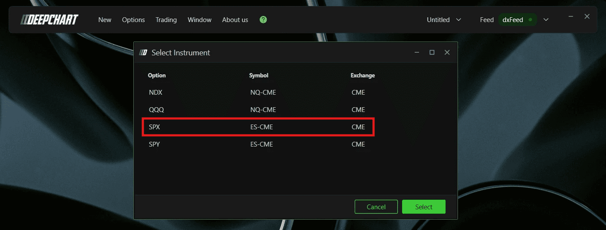

# 从哪里开始：产品、数据与图表配置

核验日期：2026-10-29。本文区分公开文档证据、截图观察与研究者建议。所有价格和交易情景例子均为假设，不是当日行情，也没有经过盈利回测。

若主要研究SPX／ES日内交易，建议先完成本篇的基础设置，再读[做市商分析主线](market-maker-framework.md)：从Summary与Profile建立环境和位置，再学习Hedging、Pressure、Sentiment，避免一开始堆满全部指标。

## 1. DeepGamma 到底提供什么

DeepGamma把期权市场信息放到价格图上，回答五类问题：哪里有活动集中、净风险怎样分布、环境偏稳定还是偏放大、正在发生什么流量，以及价格相对隐含波动范围走到了哪里。它不是一个“看见大单就跟单”的系统。

官方入口包含两套文档：原链接的桌面版目录有14项指标，Web目录有19项；新增5项是Net Flow、Dynamic Walls、Market Maker Pressure、Market Maker Sentiment与Exhaustion。Web有独立入口与界面，所以本指南为14项共通指标保留桌面配置，再用[Web差异表](../research/web-desktop-differences.md)补充Web配置；5项新增指标另有专篇。[桌面目录](https://www.deepcharts.com/helpcenter/deepgamma)、[Web目录](https://www.deepcharts.com/helpcenter/deepgamma-web/indicators)。

| 信息层 | 主要工具 | 首先回答的问题 |
|---|---|---|
| 活跃度 | Option Volume | 此时交易是否活跃？Calls还是Puts多？ |
| 交易流 | Option Delta、Big Flows、Net Flow | 哪类流量正在改变？是哪一方视角？ |
| 结构 | Profile、Levels、Envelopes及Advanced版本 | 哪些行权价重要？集中点是否迁移？ |
| 做市商风险 | GEX Profile、Heatmap、Summary Gex | 估计风险在哪些价格及期限集中？ |
| 条件反应 | Hedging Profile、Web模型 | 若价格继续移动，对冲可能顺势还是逆势？ |
| 波动范围 | Expected Move | 当前幅度相对期权隐含范围是否偏大？ |

## 2. 四个标的与两类数据

普通指标支持SPX、SPY、NDX、QQQ。CBOE参与者数据功能限定SPX；不要把SPX支持扩写成“全部美股、全部期权、ES期权均支持”。指数期权SPX与CME的ES期权是不同产品。

桌面选择器中，SPX/SPY行的Symbol为ES-CME，NDX/QQQ行为NQ-CME，Exchange为CME。这是官方图表选择器的关联显示，不能推出SPY等于ES、QQQ等于NQ，更不能用同一数值行权价直接下期货单。[官方选择步骤](https://www.deepcharts.com/helpcenter/article/option-levels)。

上图用于核对SPX选择行；其他指标页也有包含四个标的的选择器。最终以界面实际标的名、图表标题、坐标单位和合约月份同时确认。

数据口径分成三层：

1. **成交量与EOD OI模型**：交易量说明发生过多少交易；EOD OI是最近已发布的未平仓合约存量。用Call减Put并赋Gamma权重的传统模型有持仓符号假设。
2. **参与者分类数据**：官方称可识别SPX做市商参与者，避免只按Call/Put猜对手方。但Greek、聚合、对冲工具及市场影响仍需要估计，不能把营销中的“actual”翻译成“未来订单确定”。
3. **OI-R / OI (R.T.)**：DeepCharts根据实时分类流构建的持仓口径。它不等于交易所实时发布了清算OI。普通买卖净额也不等于全市场OI变化；开平分类、初始存量及覆盖范围是关键。

进一步推导见[期权与期货基础研究](../research/market-foundations.md)。来源：[GEX Profile](https://www.deepcharts.com/helpcenter/article/option-gex-profile)、[Levels Advanced](https://www.deepcharts.com/helpcenter/article/option-levels-advanced)。

## 3. 桌面首次配置

1. 在顶部 **New → Option Chart** 新建期权图表。
2. 选标的。需要做市商功能时选 **SPX**，再点Select。
3. 打开图表工具栏 **Indicator Add / Indicator List**，搜索指标名，点 **+**。
4. 点指标旁齿轮；先调Data source、Expiration和Carry，再调画面样式。
5. 先点Apply检查结果，再保存设置。截图中有Apply、Save、Indicator Template等控件，但公开指标文档没有完整说明所有保存作用域；不要把单指标保存与工作区保存混为一谈。
6. 在屏幕上标清“标的、Data source、期限、Carry状态、价格是否期货转换”。比较两个指标时，先令这些口径一致。

SPX数据为约1分钟层级，不能因为把图表切成更小周期就把它当成逐笔期权数据。[v16发布说明](https://www.deepcharts.com/changelog/v16)。桌面行情连接、订单流或交易权限由已有平台配置决定；没有登录用户账号或检查实际订阅，因此不承诺某个套餐自动包含所有行情。

## 4. 桌面模板快捷入口

| 底部按钮 | 功能 | 下一步检查 |
|---|---|---|
| C/P Σ | 普通Call/Put Profile | 当前源是原始量还是Gamma？ |
| C/P L / C/P Lev | Call/Put Levels | 线数、到期日、排名 |
| GAMMA-P | 普通Gamma Profile | 是Volume模型还是OI？ |
| GAMMA-E | Gamma Envelopes | Zero/Major/Minor显示 |
| OI (RT) / OI Lev. | 实时OI关键位入口 | 在设置核对是否Advanced及OI-R源 |
| GEX-P | 做市商Gamma剖面 | Gex MM还是MM C/P？ |
| GEX-H | 做市商热图 | 截断阈值与颜色标尺 |

这些是预置快捷入口，不是每个按钮对应一套新的Greek。右键模板按钮可进设置。官方发布说明与后续截图的短标签略有不同，因此按实际功能和数据源辨认。[模板栏和共享模板说明](https://www.deepcharts.com/changelog/v16)。

Option Chart共享模板的官方路径为 **Option Chart → Template → Shared**。工作区共享路径是 **Open → Shared**，可见内容依订阅等级而不同。普通Orderflow共享模板路径为 **Templates → Shared → OF Version**；不要把普通ES/NQ/GC模板当作已经包含DeepGamma权限。

## 5. 最小观察布局：研究者建议

**学习阶段**：一个SPX图表，1分钟或5分钟价格展示，添加Summary Gex、Levels Advanced、GEX Profile。先只保留一种期限，例如0DTE；手动统一Carry状态。记下开盘后、午间和尾盘同一行权价的变化。

**研究流量阶段**：增加Option Delta或Big Flows。一个显示净变化，一个筛大额交易；两者不是互相独立的证据。先用默认买卖颜色并读Tooltip，熟悉后才改Put配色。

**研究波动阶段**：再加Expected Move。若画面过密，分图显示，而不是继续提高热图透明度掩盖价格。

**跨期对比**：两个图分别用0DTE和All expirations。它们回答不同问题；不要因数值相反就认定某个坏了。0DTE属于All中的一部分，两个读数并非独立样本。

## 6. 最基本的读图顺序

先确认数据时间和价格坐标，再看总环境，再定位具体集中区，最后观察到达该区域后的真实价格反应。假设Summary Gex为负、下方存在负Gamma集中、Hedging也显示Amplifying，含义是“下行过程可能更不稳定”；只有价格真正下行并获得成交确认后，才构成研究中的顺势条件。若价格反而上行，同一负Gamma环境也可能放大上涨。

不把颜色当买卖指令，不把一个墙当不会破的支撑，不把一分钟数据当能够解释每个Tick。每篇后续指南都有反例、失效条件和可记录的复盘问题。

## 7. 文档边界

本次完成的是公开资料与媒体研究，没有进入付费账号实测，也未验证服务器精确计算、实时延迟分布、回填修正、提醒接口或自动交易能力。官方称桌面约9个月SPX历史、Web约1个月且持续扩充；这是截至核验日的产品描述，不是永久历史保证。[产品说明](https://www.deepcharts.com/features/deepgamma)。回放的具体操作看[Web平台指南](web-platform.md)，研究评估看[组合使用与复盘](15-workflows-and-risk.md)。
