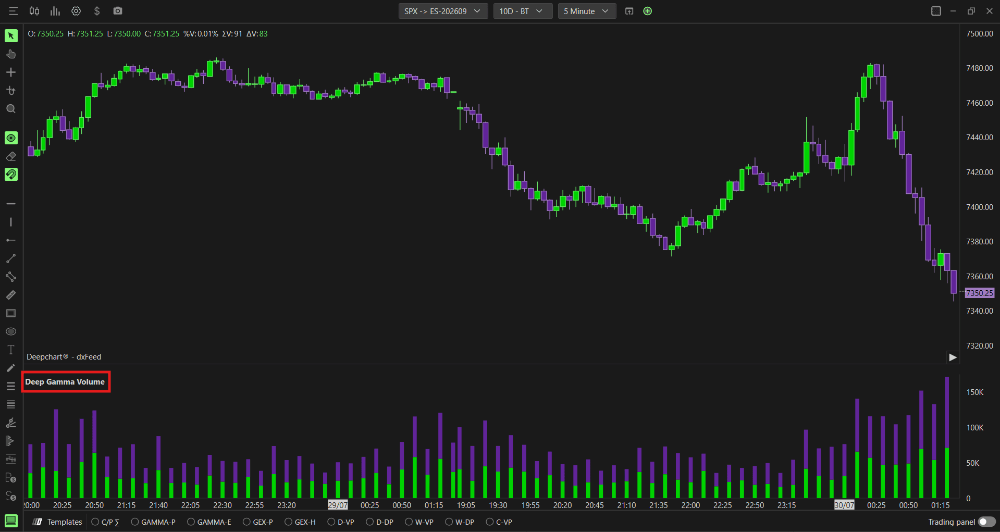

# Option Volume：期权成交量

**适用**：桌面SPX、SPY、NDX、QQQ。**回答**：何时活跃、哪类期权成交多。**来源**：[官方专页](https://www.deepcharts.com/helpcenter/article/option-volume)。核验日2026-10-29；Web差异另见[对照表](../research/web-desktop-differences.md)。

## 含义与添加

每根价格柱下统计期权活动，区分Call、Put，也有总量序列。成交量是一定时间内交易过的合约数量，不能直接等同净买入、开仓量或未平仓量。Call成交多可以来自卖Call策略，Put成交多也可以来自卖Put策略；只靠此指标无法判定方向。

桌面 **New → Option Chart → 选标的 → Indicator Add → 搜索Option Volume → + → 齿轮**。把它放副图，不要与价格混用坐标轴。完整通用显示字段见[参数词典](00-common-settings.md)。

## 计算与配置

| 字段 | 桌面公开设置 | 如何使用 |
|---|---|---|
| Expiration | All expirations默认；0DTE、≤1/2/3/4/5/6/7/31/91d可选 | 0DTE看当日到期活动；All看总体参与度 |
| Value | Contracts默认；Premium、Future contracts | 先用合约数；研究资金规模用Premium；期货等价量须确认换算口径 |
| Display mode | Splitted正文默认；可Stacked | 并排比两侧，堆叠比总量；官方截图显示Stacked，不能据此证明默认 |
| Total Volume (1) | Hidden默认，可Line；线宽1 | 想看合计趋势可打开，避免再与堆叠总高度重复理解 |
| Call Volume (2) | 绿、StackedBars、宽5 | 原始Call活动 |
| Put Volume (3) | 紫、StackedBars、宽5 | 原始Put活动 |
| 三序列共同 | Auto Color=None、Solid、Auto Center开 | 保持Call/Put颜色稳定；其余标签及背景按通用词典 |

在Contracts口径下，教学式为 `总量 = Call成交张数 + Put成交张数`。Premium应包含报价单位与合约乘数；例如SPX报价2.50、100张、乘数100时，名义权利金是25,000美元，不是250美元。官方帮助有简略“价格×量”表述，不能忽略其报价究竟已是美元还是点数。此例不代表产品底层实现已被验证。[乘数与单位研究](../research/market-foundations.md)。

Future contracts不表示期货市场已经成交这些张数；公开文档未给Delta、标的与合约乘数的具体换算式，不能把显示值直接与CME逐笔成交量一比一相减。

## 场景一：识别参与度扩张

假设同一5分钟柱，前一段Call 8,000、Put 7,000，这一段变为Call 25,000、Put 23,000，总量从15,000增到48,000。价格也突破已记录的Gamma位，说明参与度同步扩张；**不能只因Call略多就说净看涨**。接着用Delta或Big Flows核对买卖及开平，用价格回测是否接受突破区。

若价格突破、量不升，可能是流动性薄、低成交推动或过滤的期限不同，不等于突破必假。先核查数据刷新及期限，再记录后续走势。

## 场景二：把“量多”和“风险大”分开

假设A段10,000张、平均权利金0.20；B段2,000张、平均权利金5.00，均假设乘数100。A名义权利金200,000美元，B为1,000,000美元。Contracts视图A更大，Premium视图B更大。两者都没直接量出Gamma、Vega或最大亏损，不能把“更贵”简单解释为“更影响期货”。

0DTE与All对比可以判断新增热度是否主要来自当日到期；但两者重叠，不能当成两个独立确认信号。跨日比较最好选同一时段并保持周期一致，避免开盘与午间直接比柱高。

## 失效条件与复盘

重要数据发布后的跳价、到期前报价变化、多腿策略、交易所回补和分钟聚合都会削弱简单解释。看不到大柱也可能是筛选条件太窄。

每次记录：总量扩张发生在价格移动前还是后？Call/Put优势在Delta口径是否仍成立？换Premium后排序是否改变？若取消这一个量条件，研究规则的结果是否变化？用这些问题检验其增量信息，避免把所有行情都事后归因于期权量。

## 图像核验

已查看本页总览、参数及三个Subgraphs截图。截图显示Total Hidden、Call/Put StackedBars，参数示例为Stacked；这些是可见状态，默认值冲突已在表中保留。完整图见[图像联系表](../assets/contact-sheets/option-volume.jpg)。
