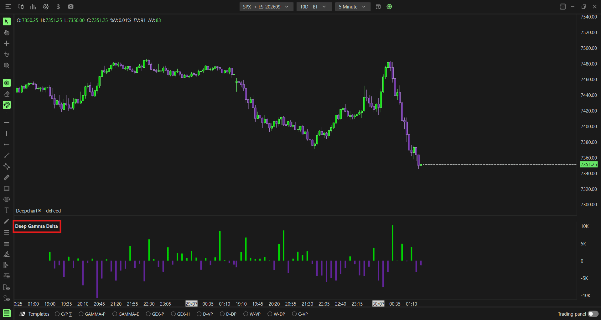

# Option Delta：方向流量、客户视角与做市商视角

**适用**：桌面SPX专用。**来源**：[官方专页](https://www.deepcharts.com/helpcenter/article/option-delta)。核验日2026-10-29。Web版本的Value和Option type变化较大，必须再读[Web配置差异](../research/web-desktop-differences.md)。

## 它测量什么

显示期权活动的净方向统计，可按每根柱或按交易日累计。名字中的Delta不能让所有Value选项都自动成为数学上的 `∂V/∂S`。桌面同时提供Contracts、Premium及Future contracts，经济单位不同。官方没有公布完整交易签名、分母及归一化公式，因此本篇用它观察方向统计的变化，不把每个数值都认定成完整存量Delta。

常见期权近似为 `期权价格变化 ≈ Delta × 标的变化`，Call多头Delta通常正、Put多头通常负；交易买卖和持仓多空还会改变符号。详见[基础研究](../research/market-foundations.md)。

添加路径：**New → Option Chart → SPX → Indicator Add → Option Delta → + → 齿轮**。

## 参数逐项配置

| 字段 | 桌面默认与选项 | 研究用途 |
|---|---|---|
| Expiration | All；另有0DTE、≤1/2/3/4/5/6/7/31/91d | 同一日内策略先固定一个期限桶 |
| Value | Contracts默认；Premium、Future contracts | 数量、美元、期货等价单位，不混用阈值 |
| Option type | Cumulative默认；可Call、Put | 这里Cumulative指合并两侧的净口径，不代表时间累加 |
| Revert | 关 | 关为客户视角；开为取反后的估计做市商视角 |
| Cumulative开关 | 关 | 关逐柱；开为交易日running total |
| Delta (1) | 绿/紫、Bars、Auto Color=+/−、Solid、宽5、Auto Center开 | 通用名称/数值标签、背景、第二色见词典 |

特别区分两个同名近似概念：**Option type=Cumulative**是Call/Put合并；**Cumulative开关**才是沿时间相加。只把前者设成Cumulative不会自动得到CVD式曲线。

| Revert | 时间累计 | 应如何命名读数 |
|---|---|---|
| 关 | 关 | 客户逐柱净流 |
| 关 | 开 | 客户本日累计净流 |
| 开 | 关 | 对手方取反的逐柱估计 |
| 开 | 开 | 对手方取反的本日累计估计 |

## 为什么Revert负值不代表做市商将卖期货

假设客户本次增加 `+600` 个“标的每点美元Delta”单位，做市商确为唯一对手且未通过别处抵消，则其期权新增Delta是−600。若同一时点用已核对到期月份的ES对冲，且近似 `dF_ES/dS_SPX≈1`，按每点50美元，建立约 `+12张ES` 才能回到中性。Revert显示负期权Delta，与对冲买期货的正Delta是相反的。

这说明：**期权簿敞口的符号**与**中性化交易的符号**不能混淆。现实还存在既有对冲、客户对客户、多工具风险抵销，不能从Revert一键反推实际买卖订单。该算例解释金融机制，不声称产品Contracts等于上述美元Delta单位。

## 逐柱与累计的数值练习

假设逐柱客户值依次 `+120、−50、+80`。时间累计为 `+120、+70、+150`。开启Revert后逐柱是 `−120、+50、−80`，累计为 `−120、−70、−150`。累计仍为正但开始下降，仅说明最近流量偏负，不说明累计已经转负。

研究价格创新高而累计流不创新高时，可标成背离候选。若价格随后站稳新高，背离并未形成反转；不要连续逆势加仓。反过来，客户累计流持续偏正而价格横盘，也可能是供给吸收或对冲与其他流相抵，不能保证补涨。

## 配置建议与组合

Web的`Net MM x gamma`表示MM交易活动的Gamma加权口径。即使打开时间累计，也不能直接把它当作Summary Gex当前净Gamma：期初持仓、既有仓位按当前价格/IV/时间重估，以及历史权重是否重估，都会影响二者关系。Delta加权累计同样不自动等于当前完整DEX；具体对照见[做市商分析主线](market-maker-framework.md)。

学习用Revert关、Cumulative关，核对单根流量与大额交易Tooltip。熟悉符号后另开第二个实例做时间累计，名称标清Customer-Cum；不要把两条取反曲线当两份证据。

结合Levels定位发生在哪里、Summary Gex判断风险反应环境。Delta流量是“新增方向活动”；Gamma是“方向风险对价格变化有多敏感”，两者不能替代。若转换Future contracts，先确认所对应的是ES还是其他规格，再考虑与期货比较。

## 图像与边界

已检查参数截图及Revert/Cumulative四种对比图。可以直接看到Revert开后柱符号翻转、Cumulative开后逐柱变为连续累积轮廓；截图无法证明实际对冲时刻或精确公式。[图像联系表](../assets/contact-sheets/option-delta.jpg)。缺数据先查SPX、订阅和时间，Web还需检查其八种Value与是否使用Cumulative sum，见差异表。
