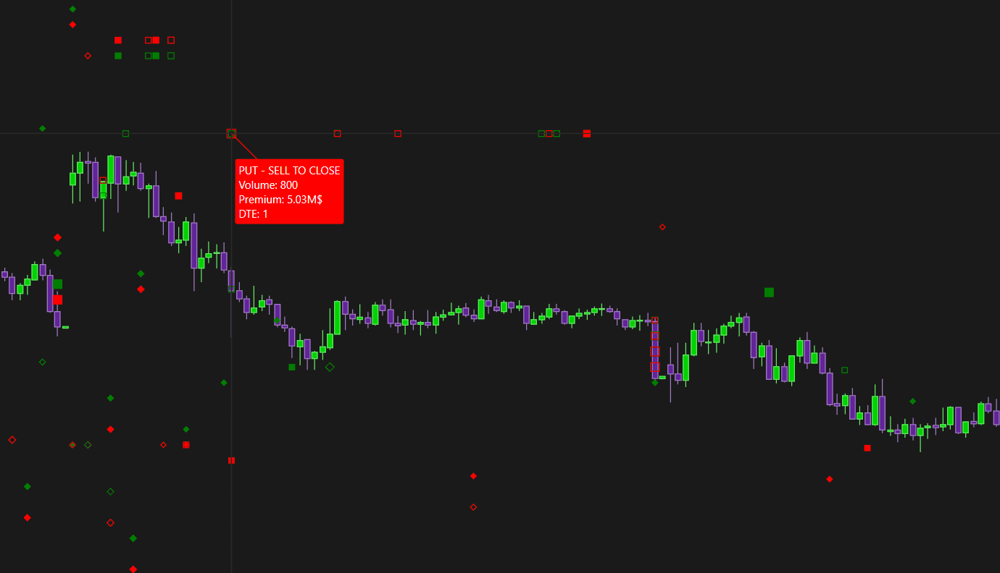

# Option Big Flows：大额权利金交易与开平仓

**适用**：SPX，需CBOE分类数据。**来源**：[官方专页](https://www.deepcharts.com/helpcenter/article/option-big-flows)。核验日2026-10-29；[Web差异](../research/web-desktop-differences.md)。

## 用它回答什么

把达到权利金阈值的交易画成标记，辅助辨认Call/Put、Buy/Sell、Open/Close。它描述交易事件，不直接公开交易者整个组合、真实意图或最终盈亏。大额期权交易可以用于保护、价差、滚仓，不能自动翻译成“机构知道方向”。

添加：**New → Option Chart → SPX → Indicator Add → Option Big Flows → + → 齿轮**。

## 标记语法先学会

| 视觉维度 | 官方桌面默认 | 要核对什么 |
|---|---|---|
| 形状 | Call=Diamond菱形；Put=Square方形 | 形状可自定义，不能只凭记忆 |
| 实心/空心 | 开仓Fill；平仓Hollow | Generic还有单独设置；示例图未必保持默认 |
| 颜色 | Buy绿、Sell红，两类期权相同 | 表示交易动作，不是自动看涨看跌 |
| Tooltip | 类型、买卖/开平、Volume、Premium、DTE等 | 这是识别动作最直接的可见证据 |

单腿新增风险的教学解释：买开Call偏正Delta、卖开Call偏负Delta；买开Put偏负Delta、卖开Put偏正Delta。买平Put是减少空Put正Delta风险，卖平Put是减少多Put负Delta风险；**平仓不能按开仓动机机械解读**。SPX是现金结算指数期权，“有权买入指数实物”也不是准确的结算描述，见基础研究。

部分官方示例中标记明显远离标的价格曲线。标记的纵向位置不能直接读成当时标的成交价；公开专页未完整解释所有摆放规则，应把交易事件的时间与Tooltip内容作为依据，不凭图上的点高低虚构期权或期货成交价。

## 全参数表

| 页签 | 字段 | 桌面公开默认／选项 |
|---|---|---|
| General | Expiration | 0DTE；可≤1/2/3/4/5/6/7/31/91d、All |
| General | Min. Premium (USD) | 1,000,000美元；只画超过门槛的交易 |
| General | Action - Enabled / Filter | 启用后按Buy或Sell筛；初始启用状态正文未明确，截图为关 |
| General | Hide call/put strike overlap | 开；隐藏同一行权价同时Call/Put活动 |
| Call Plot | Marker | Diamond默认，可Circle/Square/Text |
| Put Plot | Marker | Square默认，可Circle/Diamond/Text |
| 两Plot的Generic | Display mode、Buy、Sell | Fill/Hollow可选；颜色Buy绿、Sell红；Generic模式默认正文未指明 |
| 两Plot的Open | Display mode、Open buy、Open sell | Fill、绿、红 |
| 两Plot的Close | Display mode、Close buy、Close sell | Hollow、绿、红 |
| Size Settings | Text size / color | 12 / 白，仅Text型标记相关 |
| Size Settings | Marker min / max size | 60 / 120 |
| Size Settings | Marker max std dev | 1.0；缩放用的权利金标准差参数，非收益置信度 |

Overlap过滤可减少组合策略噪声，但不能证明被隐藏交易净Delta为零，也抓不全跨行权价、跨到期日或分时执行的多腿组合。需要研究完整流时关闭；需要简洁画面时开启并记录这个选择。

## 两种配色方案

默认方案保留“绿买红卖”，每次结合形状和Tooltip。另一个研究方案只把Put的Buy改红、Sell改绿，Call保持原色。这样更接近单腿开仓方向配色，但平仓与组合仍需解释；最好名称写“Put色已反转”。只改变显示不改变数据，不能让改色前后截图混用。

官方正文示例曾把红实心方形写作Put买开，而默认Put买色其实是绿；这一例只有在Put改色后才成立。实际截图还存在空心标记配“BUY TO OPEN”的情况，说明用户可修改样式。**读Tooltip优先于用填充颜色反猜交易。**

## 假设例子：看大额流是否改变结构

假设SPX在6000附近，出现Call BUY TO OPEN、2,000张、报价5.50点，按100乘数为110万美元权利金，足以超过100万美元门槛。它说明这笔交易规模大；不说明买方支付110万就一定有110万Delta风险。

先记录其DTE和发生时间，再看6000处GEX Profile是否改变、价格是否接受上方区间。若随后跌回6000且客户Delta持续走弱，原来的延续假设失效。若只是出现同色多点，但没有统计聚合、时间距离和重复成交去重口径，不能凭视觉声称“机构累计买了数千万”。

## 假设例子：平仓不是新增押注

看到PUT SELL TO CLOSE、950张，只知道原Put多头被减持；可能是获利了结、止损或换仓。必须与先前持仓和其他腿结合。若只把“Sell红”解释成新做空，将把平仓和开仓风险混为一谈。

## 阈值使用与局限

初学保留100万美元，先读出十个Tooltip；若整天无点，再排查0DTE、筛Buy/Sell、Overlap及数据，而不是立刻下结论市场没大单。降低阈值会多显示交易，增加阈值会漏掉分拆执行；两者都不直接提高预测准确率。

已识读总览、Call/Put设置、四个买开/卖开例子、Size和组合图。[图像联系表](../assets/contact-sheets/option-big-flows.jpg)。请以官方图为界面证据，本文教学数字均为自拟，不把样例行情当历史交易验证。
