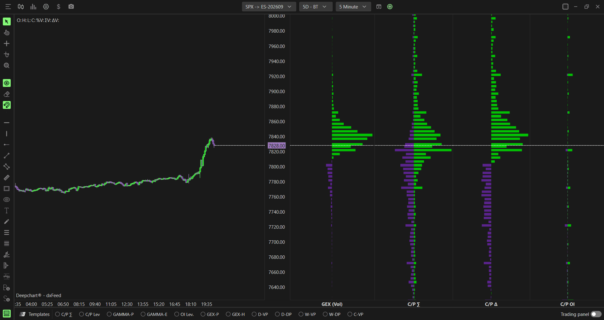

# Option Profile：原始量、Gamma模型与日终持仓的剖面

**适用**：SPX、SPY、NDX、QQQ。**来源**：[官方专页](https://www.deepcharts.com/helpcenter/article/option-profile-deepchart)。核验日2026-10-29；Web配置见[差异表](../research/web-desktop-differences.md)。

## 功能和读图

按行权价把活动画成横条，纵向是价格/行权价，横向长度是所选统计量。它与成交量剖面长得相似，却不一定是期货成交量。大Call集中称Call wall，大Put集中称Put wall；这些首先是统计峰，支撑阻力是需要验证的市场反应。

正文以Call绿、Put紫解释左右分布，但截图中有两侧反向、净值和堆叠等形态。**按图例、数据源、符号及设置认两侧，不把固定“左=Call”当跨模式规则。**

添加：**New → Option Chart → 选标的 → Indicator Add → Option Profile → + → 齿轮**。底部C/P Σ或GAMMA-P可快速加载不同预设，右键进设置。

## 数据源与基础设置

| Data source | 经济解释 | 适用问题 |
|---|---|---|
| Gex (Call − Put) | 传统Call减Put的Gamma模型；截图显示此选项 | 哪些成交具有较高Gamma权重？ |
| Call/Put Σ | 原始两侧成交量 | 今天哪些行权价最活跃？ |
| Call Σ − Put Σ | 两类成交量的差 | 哪些行权价的活动类型不均衡？ |
| Call/Put OI (Eod) | 前次日终未平仓存量 | 哪些行权价有较多遗留持仓？ |

专页只列这四种，不把其他指标有的Gamma-OI数据源擅自添到这里。桌面该页正文未明确标Data source默认；示例为Gex (Call−Put)，加载的模板可能不同。

| 字段 | 桌面公开默认 | 用法 |
|---|---|---|
| Expiration | All；0DTE、≤1/7/31/91d可选 | 当天活动和长期结构分图看 |
| Include Carry or Open Interest | 关 | 与别的Profile比较前统一 |
| Stack profile (if possible) | 关 | 只改变可支持模式的并排/叠放；不代表净额公式改变 |

## 画面配置全组

这里有Background/Text、Disputed、Plot Settings、Peak、Rolling Values、Summary；每个字段含义及所有默认数值见[通用Profile参数表](00-common-settings.md)。主要差异如下：

- Background绿/紫，文本关、11号白字；Disputed关。
- Width Automatic；当前Width/Offset=10/0，前日15/0；5个Profile、Opacity90、边框1、Solid、Show above/Align right/Always visible均关、Strike Ticks Height75%。
- Peak：Call/Put两组Enable默认开，Highlight关、Show Line开、线宽1、Dash；对应绿/紫色。
- Rolling M1/M5/M15/M30默认关、宽1，线型Dot/Dot/Dash/Solid；不同颜色由用户指定。
- Summary显示Net/Call/Put，总量含义跟着Data source变。截图有Enable Summary开关及文本/正负色、字号；正文未完整定义默认，不假定截图是初始状态。

研究者建议从1个Profile、峰线开、文本按需开、Rolling只开M5或M15开始。上述是学习布局，不是官方默认。若同时放多个不同数据源实例，名称直接写Vol/GEX-Vol/EOD-OI。

## 假设例子：不同口径的“墙”为什么不同

假设6000 Call成交30,000张、Gamma 0.005；6020 Call成交10,000张、Gamma 0.03，先忽略Put和其他权重。原始量峰在6000，但简化的量×Gamma为150和300，Gamma峰反而在6020。并非一个指标错误，而是测的量不同。

如果昨天OI峰在6050，今天新成交峰在6020，三者可同时成立。EOD仓位未必仍由同一方持有，成交量也未必都保留到收盘。先把“历史存量”“今日活动”“风险敏感性”三个问题分开。

## Rolling与Peak场景

M15线显示15分钟前的截面。假设6020当前横条比M15参照明显增长，且Peak从6000移到6020，可研究集中区向上迁移。如果只是窗口缩放导致条变宽，没有读取实际值，就不能宣称仓位增长。

峰值也会因其他档减少而“被动成为第一”。因此记录峰的绝对数值、次峰、时间与价格关系。Peak线用于减少扫图负担，不能把排名当统计显著性或成功率。

## 在交易研究中如何用

盘前看EOD结构，盘中看当前活动是否接近这些区域。价格上行接近Call wall，可以准备“受阻”和“接受后延续”两种观察条件，而不是直接挂空；若成交接受上方，原墙也可能成为回踩观察区。价格接近Put wall同理。

若需要做市商真实分类的Gamma，SPX可看GEX Profile；普通Profile的传统模型不能因横条很长就升格成做市商实际仓位。多个Profile从同一数据变换得来，也不应被当作独立的三次确认。

## 媒体核验与常见问题

已检查四种数据源展示、Stack示例、峰线、Rolling与Summary截图。[完整联系表](../assets/contact-sheets/option-profile-deepchart.jpg)。EOD剖面很小或看似空白时，先核期限、Carry、坐标范围和缩放；不能用放大画面“修复”缺失数据，也不能把Disputed当成交所错误提示。
