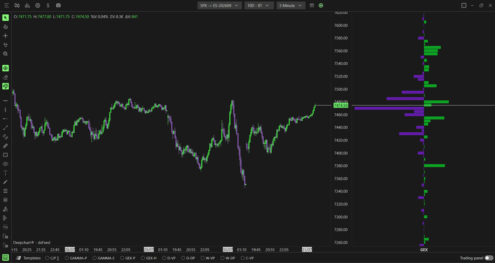
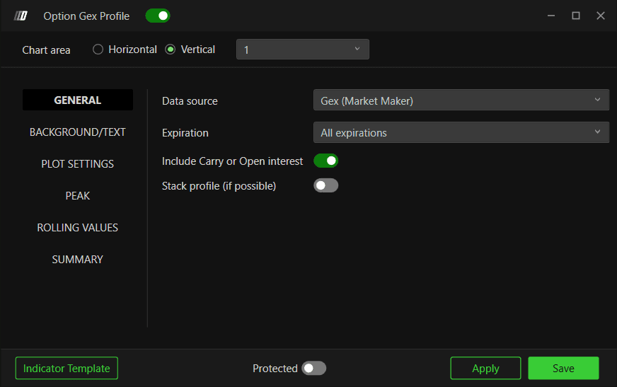

# Option GEX Profile：做市商Gamma的行权价分布

**适用**：SPX。**来源**：[官方专页](https://www.deepcharts.com/helpcenter/article/option-gex-profile)。核验日2026-10-29。Web字段与默认值见[详细差异](../research/web-desktop-differences.md)。

## 读懂剖面的三个层次

纵轴是行权价/价格，横条量化所选数据源，默认模型用绿和紫区分正负风险。一个很长的横条说明某档在当前口径下风险集中，并不直接告诉你下一根价格柱方向。

GEX是Delta对价格变化的敏感度聚合。**正Gamma做市商若动态维持Delta中性，一般上涨卖、下跌买；负Gamma一般上涨买、下跌卖**。这要以真实净仓位、其他风险变化和执行约束为条件。Call/Put分类与正负Gamma不是普遍同义词；Put多头本身Gamma也可为正，详见[基础研究](../research/market-foundations.md)。

添加：**New → Option Chart → SPX → Indicator Add → Option Gex Profile → + → 齿轮**；或底部 **GEX-P**，右键Settings。

## 六个数据源

| Data source | 统计对象 | 如何使用 |
|---|---|---|
| Gex (Market Maker)，默认 | 做市商净Gamma | 先定位净风险峰及正负区 |
| Gex (Market Maker C/P) | 做市商Gamma按Call/Put拆开 | 研究同一档两侧抵消；净值小不等于两侧都小 |
| Market Maker Net Flow | 做市商分类的净Delta流 | 看新增交易流，别按Gamma环境解释 |
| Call/Put OI-R | 平台实时持仓两侧 | 看未Gamma加权的集中度 |
| Dex (Market Maker) | 做市商Delta风险 | 研究方向风险；对冲与存量符号相反 |
| Gex (Call OI-R − Put OI-R) | 用OI-R构建的Call减Put Gamma模型 | 区别于按参与者净头寸的MM口径 |

“real CBOE data”是产品的来源说明，不表示每个源都直接是交易所发布的最终GEX。Greek、聚合、符号、单位仍有模型环节。横条标签中的M也不能在单位未确认时自行解释为“百万美元每1%”。

## General与可视化的完整配置

桌面正文只完整列出上表六源，没有给General的Expiration、Carry及Stack默认值；但原图中确实能看到 **Expiration=All expirations、Carry开、Stack关**。这是已观察的示例状态，不冒充出厂默认。若界面有这些开关，应按研究对象明确指定；Number of Strikes桌面正文没有列出，不借用Web参数假定桌面也有。

Background/Text、Disputed、Plot Settings字段逐项见[通用参数词典](00-common-settings.md)：绿/紫背景；文本关、11号白字；Disputed关；Automatic、当前10/0、前日15/0、Profile数5、Opacity90、边框1、Solid、Show above/Align right/Always visible关。截图还可见Strike Ticks Height75%，正文该段没有写出此字段，因此视作截图观察。

**Peak**：正负两组Enable关、Highlight关、Show Line开、线宽1、Dash，正绿负紫。**Rolling Values**：M1/M5/M15/M30默认关、宽1、Dot/Dot/Dash/Solid；截图演示开和宽2不代表默认。**Summary**：Enable Summary关、文字白、正绿负红、字号12。逐项用途见词典。

研究者建议：先用Gex MM，显示1个Profile、Peak两组启用，只开一条M5或M15滚动参照。另开MM C/P实例用于查抵消，避免在一个图不断改源忘了标记。

## 假设例子：净Gamma很小但两侧很大

同一行权价，假设参与者分类数据给Call部分+120、Put部分−110，单位一致。净GEX是+10，而不是+230。若Put部分稍后变成−150，净值转−30，Call并未消失。C/P拆分可以解释净值转号的来源；不能只看一个小净柱就认定该档“不重要”。这是教学算例，不重建平台隐藏公式。

## 假设例子：剖面在价上方不等于阻力

假设现价6000，上方6020有+500的Gamma集中。若做市商净长Gamma，价格从6000向6020上涨过程中对冲可能提供卖压，形成放缓候选。若新闻买盘远大于该卖压，价格仍可站上6020；若某档是负Gamma，继续上涨也可能伴随顺势买入。必须结合Summary Gex及Hedging，不能用“上方横条长”直接做空。

## Rolling、单位与失效条件

M5是五分钟前的风险截面，变动可能来自新交易、价格移动导致Gamma变化、IV变化、到期时间缩短和筛选变化。不能把全部变化归为“机构新开仓”。同样，切换窗口改变横条视觉比例，不能用像素长度替代读数。

失效/弱解释环境包括重大消息、离散跳价、换月基差误配、数据延迟以及净头寸在其他市场被对冲。若与Heatmap/Summary冲突，先检查同源同期限同Carry同时间，再判断是空间与总量差异还是数据问题。

## 图像证据

已识读净/拆分图、General、Background/Text、Plot、Peak、Rolling、Summary。[本页图像联系表](../assets/contact-sheets/option-gex-profile.jpg)。图中GEX (MM)与GEX (MM C/P)标签能区分模式；绿色紫色的左右方向不能跨模式固定。
