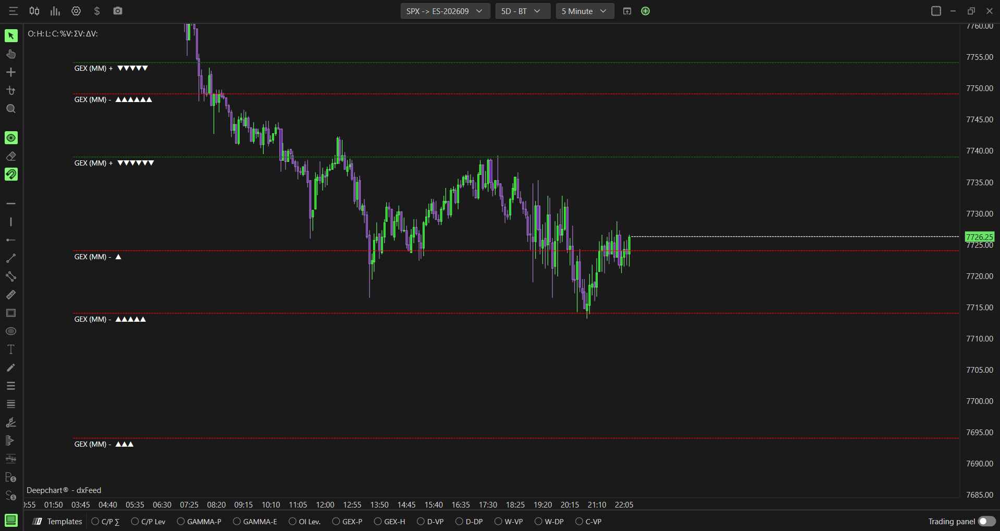

# Option Levels Advanced：做市商与实时持仓关键位

**适用**：SPX。**来源**：[官方专页](https://www.deepcharts.com/helpcenter/article/option-levels-advanced)。核验日2026-10-29；[Web差异](../research/web-desktop-differences.md)。

## 与普通Levels的差别

图形仍是带排名的水平位和黄色Zero Gamma，但计算源可选参与者分类Gamma、Delta、净流及OI-R。Advanced是数据口径升级，不能等同“每条线都会更准”或“触碰必反转”。

添加：**New → Option Chart → SPX → Indicator Add → Option Levels Advanced → + → 齿轮**。模板OI (RT)/OI Lev.可能加载实时OI预设，必须打开设置查看Data source，不能凭快捷按钮名称认定是MM GEX。

## 五种Data source

| 选项 | 含义 | 研究用途 |
|---|---|---|
| Gex (Market Maker)，默认 | 做市商Gamma集中 | 对价格变化最敏感的风险区 |
| Market Maker Net Flow | 做市商净Delta交易流 | 新增分类交易活动在哪 |
| OI (R.T.) | 平台实时持仓口径 | 当前存量集中在哪 |
| Dex (Market Maker) | 做市商Delta风险 | 方向风险集中，而非Gamma环境 |
| Gamma (Call OI-R − Put OI-R) | OI-R的传统两侧Gamma差 | 对比实时存量加权模型与MM口径 |

OI-R是平台统计，不能由“2卖1买”这个简化例子推出全市场OI=1；每笔交易都有买卖双方，清算OI变化取决于双方开平。[基础研究](../research/market-foundations.md)。

## 参数完整配置

| 字段 | 桌面公开默认／选项 |
|---|---|
| Expiration | All；0DTE、≤1/7/31/91d |
| Include Carry or Open Interest | 关 |
| Number of Strikes | 0，不限 |
| Number of sessions / levels | 1 / 2 |
| Extension mode | Till interaction；可None / Till end window |
| Text size / Custom header | 11 / 自定 |
| Align previous/current values on right | 开 / 关 |
| Positive/Negative/Zero color | 绿 / 红 / 黄 |
| Lines width / style | 1 / Dash |

字段详细作用、其他线型、三角排名与画线延伸规则见[普通Levels](07-option-levels.md)，不能把扩展到触碰误认为交易触发器。Zero Gamma独立于Number of levels，但在DEX、净流、OI等非Gamma源下其具体算法关系没有公开，建议使用MM GEX源来研究Gamma翻转，并与Summary Gex交叉核对。

研究者建议一个实例Gex MM、0DTE、明确Carry状态；第二个实例All/Carry开用于背景对照。为避免同名线重叠，在Custom header分别写MM0D-C0与MM-All-C1。普通与Advanced对比必须统一期限和Carry后再谈差异。

## 假设例子：用源切换区分新增流与存量

假设6000是OI-R最大档，但6020是当天Market Maker Net Flow最大档。含义是“原有存量集中在6000，新分类活动集中在6020”，不是两条线互相否定。若Gamma加权后峰又在6010，说明风险敏感度与张数不同。

若只关心交易日内新增活动，就不要把Carry开的数值与Carry关的净流机械比较大小。净流与库存也不能在单位不明时相加。

## 假设例子：同一线两种反应

假设价格5990，上方6000为MM正Gamma集中，Hedging绿色。接近后放缓符合逆势对冲的候选解释，但要观察实际拒绝；若突破站稳，记录“局部衰减不足以阻止外部买盘”。假设随后Summary转负、6000附近Hedging紫，则再次上行时可能加速。不能一直把6000叫“永恒阻力”。

负Gamma是方向放大倾向，不是做空信号；相同的6000被向上突破时也可能伴随买入对冲。

## 媒体与限制

已看General、Plot、三角方向和综合配置图，能直接辨认GEX (MM)标签与上下向三角。[联系表](../assets/contact-sheets/option-levels-advanced.jpg)。官方称它相对传统模型更可靠是产品主张，本次没有独立逐笔数据或回测证明其预测优势，不将其转写为统计结论。
