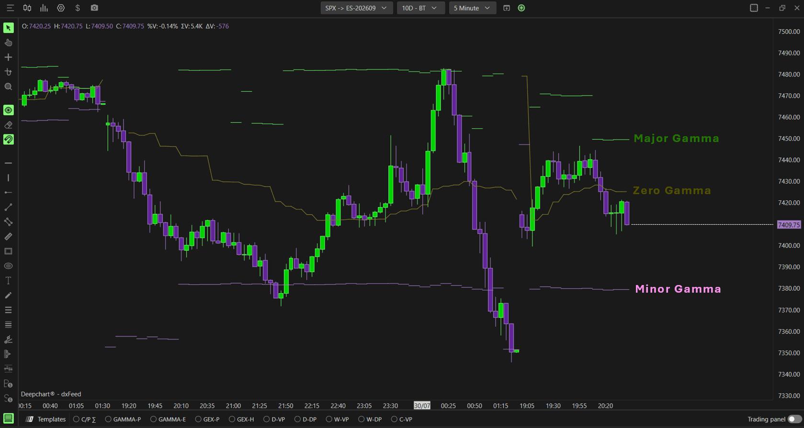
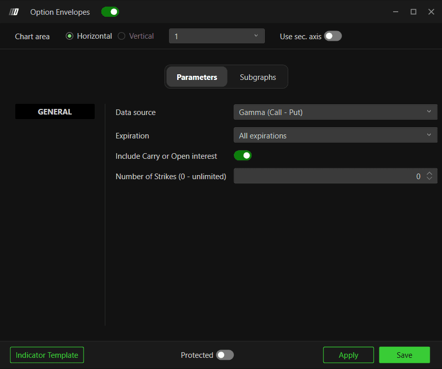

# Option Envelopes：Zero、Major、Minor Gamma动态参考线

**适用**：SPX、SPY、NDX、QQQ。**来源**：[官方专页](https://www.deepcharts.com/helpcenter/article/option-levels-envelopes)。核验日2026-10-29；[Web差异](../research/web-desktop-differences.md)。

## 与Levels和Expected Move不同

Envelopes在主图显示三类随数据变化的参考线，围绕Gamma/活动结构；Levels只提炼若干排名水平位；Expected Move是IV波动范围。外形相近不表示算法相同，Envelopes不是布林带，也不是隐含波动一个标准差。

Zero Gamma：官方将它解释为Gamma由正转负的参考分界。Major Gamma：桌面正文说是当前价上方的主要集中位。Minor Gamma：次级集中位；正文没有完整公式证明其必在价下方，也不能把它理解成固定第二大或必然更低的行权价。

添加：**New → Option Chart → 选标的 → Indicator Add → Option Envelopes → + → 齿轮**；或GAMMA-E模板。三条参考线可以呈阶梯状，不要求平滑。

## Data source五种口径

| 选项 | 默认／含义 | 研究用途 |
|---|---|---|
| Gamma (Call − Put) | 默认，成交量与Gamma权重 | 按传统模型看风险集中 |
| Call Σ − Put Σ | 两类原始成交量差 | 只研究活动类型不平衡 |
| Call/Put Σ | 本页正文称Call/Put比例 | 比两类相对活动；同标签在别页称原始量，公式待核实 |
| Call/Put OI (Eod) | 前次日终持仓 | 背景存量参考 |
| Gamma (Call OI-E − Put OI-E) | 日终OI作底的Gamma模型 | 与当日量模型比较 |

非Gamma数据源下仍显示Zero Gamma标签，并不能证明使用纯量或比率就恢复了真实Gamma零点。官方未公开每个模式如何生成三条线，应把它视为对应模式的结构参考；要研究严格做市商Gamma翻转，需看MM源和模型边界。

## General设置

| 字段 | 桌面正文默认 | 使用提醒 |
|---|---|---|
| Expiration | All；0DTE、≤1/7/31/91d | 与Summary/Profile对比前统一 |
| Include Carry or Open Interest | 关 | 参数截图却是开；先按明确需要手动设 |
| Number of Strikes | 0，不限 | 限制范围可能改变Zero和主次峰 |

## 三条Subgraph的配置

| 序列 | 色 | 样式正文默认／可选 | Auto Color / Line / Width / Auto Center |
|---|---|---|---|
| Zero Gamma (1) | 黄/金 | Line；可Hidden | None / Solid / 1 / 关 |
| Major Gamma (2) | 绿 | BrokerLine；可Line、Hidden | 同上 |
| Minor Gamma (3) | 紫 | BrokerLine；可Line、Hidden | 同上 |

各自还有2° Color、Short Name、Name/Value Label、Name/Value Background、Chart color for marker；作用见[参数词典](00-common-settings.md)。默认未明确的开关不补造。BrokerLine是显示方式，精确断线规则未公开，不能将它解释为经纪商订单线。

## Zero Gamma怎样使用才不误导

官方常用“价上正Gamma、价下负Gamma”简化说明。严谨地说，Zero Gamma应来自某个随假设标的价格变化而重新估值的总Gamma函数 `G(S)` 的根；净仓位、IV面、期限和覆盖范围都会影响这个函数。公开文档没有给出求根、多个根或无根处理方式。因此 **不保证所有市场永远只存在一个零点，也不保证零点上方必为正**。界面所给参考应与同口径Summary读数核对。

模型上，净长Gamma对冲可能逆势、净短Gamma可能顺势。Gamma正负不决定最初方向；正Gamma市场也可能因宏观消息突破，负Gamma市场也可能横盘。不能因跌破一根黄线就认定必跌。

## 假设情景：环境切换

假设Zero=6000、Major=6030、Minor=5980，现价6010。先把6030列为上方反应区，6000列为环境核对点。若价格突破6030并站稳，说明上方外部买压可能超过衰减，不能因为“Major”就反复逆势。

若价格跌至5990、Summary同口径转负、Hedging在下方为紫，可以记录下行放大候选。若黄线随后从6000移到5970，而价格并未继续跌，原先“仍在负环境”的判断需重新核对，不能用旧线替代实时状态。

## 研究配置与失效条件

研究者建议保留三色和None自动色，显示值标签，先用一个期限桶。想比日内新活动与存量，可双实例分别配置Gamma-Vol与Gamma-OI，名称清楚，不能只叠同色线。

主次峰突然跳变可能是排名切换、期限剔除或Greek变化，不一定是瞬间巨额新仓。重大消息、数据更新间隔、不同Carry和基差错误都可让价格与线关系失真。

已查看总览、General与三个Subgraph截图。[图像联系表](../assets/contact-sheets/option-levels-envelopes.jpg)。图能确认三色参考线随时间变动，不能证明模型能预知支撑或存在固定命中率。
