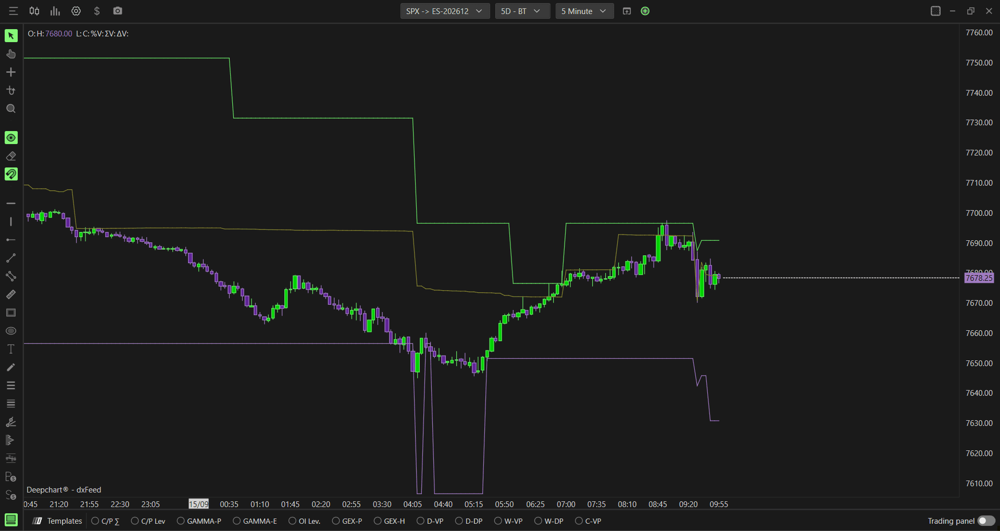

# Option Envelopes Advanced：OI-R口径的动态Gamma参考

**适用**：SPX。**来源**：[官方专页](https://www.deepcharts.com/helpcenter/article/option-envelopes-advanced-deepchart)。核验日2026-10-29；[Web差异](../research/web-desktop-differences.md)。

## 功能定位

同样输出Zero、Major、Minor三类参考，但用CBOE分类流构建的实时OI口径作底。它不等于把普通Envelopes的线变粗，也不等于GEX MM源：本页默认明确写Gamma (Call OI-R − Put OI-R)，仍需要理解两侧模型和参与者净Gamma之间的差别。

添加：**New → Option Chart → SPX → Indicator Add → Option Envelopes Advanced → + → 齿轮**。普通版的概念、Zero Gamma适用条件见[Envelopes](09-option-envelopes.md)。

## 计算参数

| 字段 | 桌面默认／可选项 | 用法 |
|---|---|---|
| Data source | Gamma (Call OI-R − Put OI-R)默认；另有OI (R.T.) | 前者加Gamma权重，后者看张数/实时持仓集中 |
| Expiration | 0DTE默认；≤1/7/31/91d、All可选 | 默认不同于普通版的All |
| Include Carry or Open Interest | 开 | 默认不同于普通版正文的关 |
| Number of Strikes | 0，不限 | 别在对比时一边截窄一边全量 |

“Advanced比普通线更准确”是官方对数据改进的定性描述，本研究没有独立验证其价格预测效果。OI-R的起始库存、开平净额及异常处理未公开；没有说明就不能把日内差额说成清算后的总持仓。

## 三个序列与样式

| 序列 | 桌面正文默认 | 经济读法 |
|---|---|---|
| Zero Gamma | 金黄、Line | 翻转参考，仍有模型限制 |
| Major Gamma | 绿、BrokerLine | 本页解释为价上主要集中；Web定义更宽，别擅断算法改变 |
| Minor Gamma | 紫、BrokerLine | 次级反应区，非固定第2名公式保证 |

三者Auto Color=None、Solid、线宽1、Auto Center关。Zero可Hidden，Major/Minor可Line或Hidden；每条都有第二色、名称、数值标签、背景、Chart color for marker，详见[通用参数](00-common-settings.md)。**本页截图中的Major/Minor展示Line，而正文写BrokerLine默认**，已作为证据差异保留。

研究者建议最初保留色和线宽，打开价格值标签；做模型对比时把普通与Advanced放两个图。先明确统一Expiration与Carry，否则默认差异就足以造成结果不同。

## 假设例子：量与实时持仓为何背离

假设6000一天成交20,000张，其中大量开平往返；6020只成交8,000张却留下较多未平仓。以Volume做底可能强调6000，以OI-R做底可能强调6020。不能据此说成交量源“坏了”，也不能据OI-R高就判定都是新买仓。

要研究差异，先令两图0DTE、Carry相同、Strikes相同，记录三条线及Profile在6000/6020的值。若只有Advanced出现跳变，复查OI-R与Gamma本身是否也变，避免把所有跳变都解释成大单。

## 假设例子：参考线迁移

假设早盘Zero=6000、Major=6040，午间Zero抬到6015、Major移到6030。现价6020虽然较早盘没变，距Zero只剩5点，距Major也更近。研究上应更新“距离结构位”的条件，而不能继续沿用早盘40点空间的计划。

若此时外部消息带来跳空，先记录原假说是否失效；线不是保护性止损，不能把“已到Minor”当自动亏损上限。若切成OI (R.T.)源，输出仍带相同标签，但公开文档没有给三条线如何由无Gamma持仓生成，按对应统计参考谨慎使用。

## 媒体核验

已看General（0DTE、Carry开）、三条颜色设置及运行图，识别三线阶梯迁移。[联系表](../assets/contact-sheets/option-envelopes-advanced-deepchart.jpg)。图能证实显示字段与示例状态，不能验证实时OI的完整重建，也不能证明某条线提前预测了拐点。
