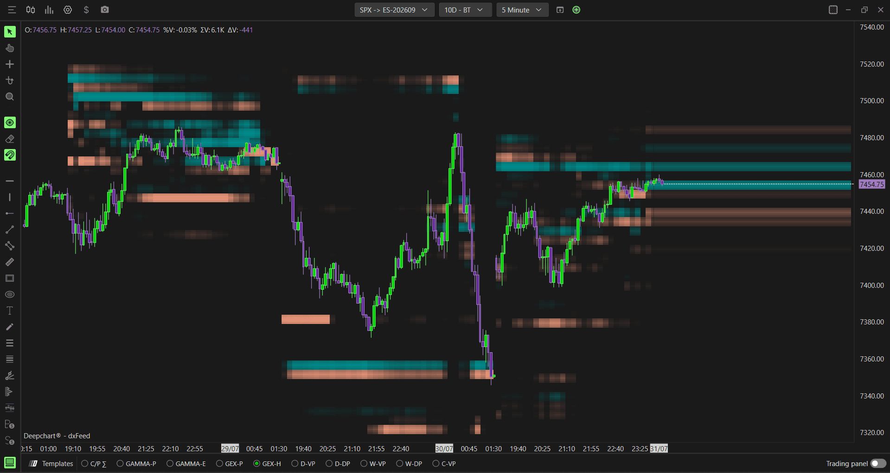
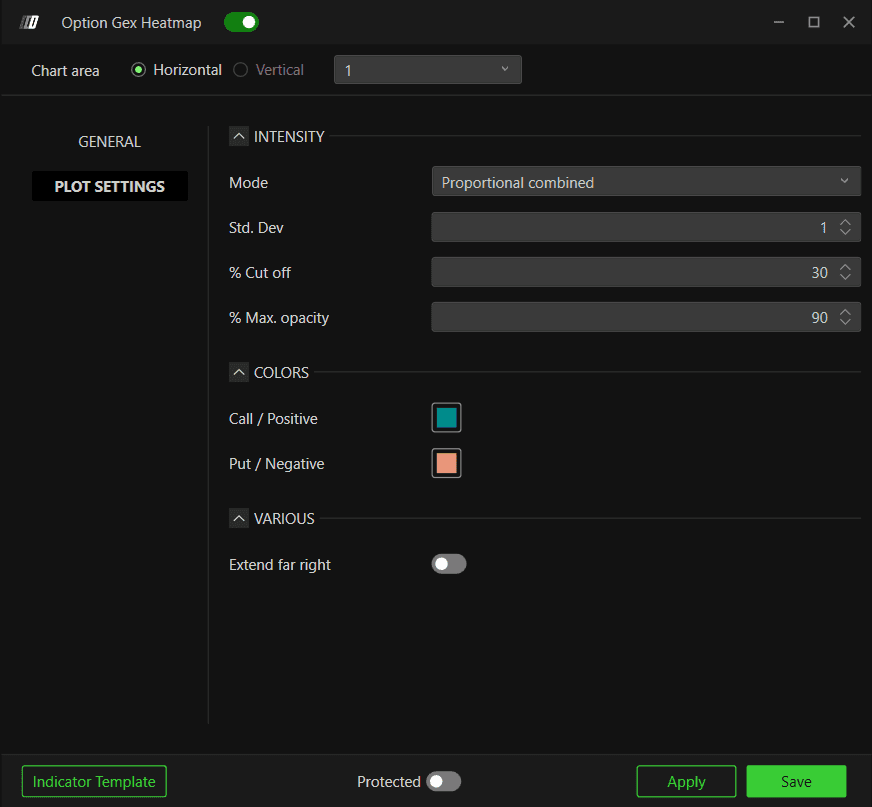

# Option Gex Heatmap：按价格与时间观察风险区

**适用**：SPX。**来源**：[官方专页](https://www.deepcharts.com/helpcenter/article/option-gex-heatmap)。核验日2026-10-29；Web默认显著不同，见[详细对照](../research/web-desktop-differences.md)。

## 两个坐标与一种相对颜色

横轴时间、纵轴价格/行权价，颜色区分两类值，强度反映按选定尺度归一化后的大小。默认正侧青/蓝绿，负侧橙/鲑红。热图描述期权统计，**不是DOM限价挂单热图**，色块也不是有人在此价格放了多少张ES买卖单。

如果使用MM GEX源，正/负应该结合净Gamma含义；切到DEX、净流、原始量时，不能继续用Gamma物理解释所有颜色。官方把Call/Positive、Put/Negative并写是界面标签，不是所有Put的Gamma天然为负。

添加：**New → Option Chart → SPX → Indicator Add → Option Gex Heatmap → + → 齿轮**。也可底部 **GEX-H**；右键Settings。

## 八种数据源

| Data source | 统计对象 | 用途 |
|---|---|---|
| Gex (Market Maker)，默认 | 分类做市商Gamma | 看净敏感度的时空区 |
| Gex (Call − Put) | 传统量×Gamma差 | 与MM口径比较，而非直接替代 |
| Dex (Market Maker) | 做市商Delta | 看方向敞口集中 |
| Gex (Call OI-R − Put OI-R) | OI-R Gamma模型 | 看带持仓基础的敏感度 |
| Market Maker Net Flow | 分类净Delta流 | 新流发生在哪些档 |
| Call/Put Σ | 两侧原始成交量 | 活动分布 |
| Call Σ − Put Σ | 两类成交量差 | 活动结构不平衡 |
| Call/Put OI-R | 实时持仓两侧 | 存量分布 |

## General与强度全参数

| 字段 | 桌面默认／可选 | 调整结果 |
|---|---|---|
| Option expiration type | 0DTE；≤1/2/3/4/5/6/7/31/91d、All | 改纳入的到期合约集合 |
| Include Carry or Open Interest | 关 | 纳入前期结转/持仓 |
| Number of Strikes | 0，不限 | 改计算覆盖，不只是画面裁剪 |
| Mode | Proportional combined默认 | 当前交易日与历史同时间均值各50% |
| Mode可选 | Proportional session | 当前交易日最大/相对强度参照 |
| Mode可选 | Proportional time average | 与前期相同时段比较，考虑日内季节性 |
| Std. Dev | 1 | 强度标准化参数；不是预期收益1σ |
| % Cut off | 30 | 低于相对阈值不画；调高减少弱区域 |
| % Max. opacity | 90 | 最大不透明度 |
| Call / Positive color | 青/蓝绿 | 正侧/Call标签色 |
| Put / Negative color | 橙/鲑红 | 负侧/Put标签色 |
| Extend far right | 关 | 把当前色块向右延伸作参考，不预测未来持仓 |

Web默认为Std.Dev=0.5、Cutoff=7、Opacity=75、Extend far right开，且Carry默认开。因此同一时刻两端画面可能相差很大；先统一这些再讨论模型差别。

## 怎样选Mode

**Session**适合研究当前日内部相对排名；即使全日都很弱，仍可能有一档被画得最亮。**Time average**适合比较这个时段是否比历史常见状态突出，但历史样本选择和长度没有公开，不能自行给出固定Z分数。**Combined**折中但仍是相对尺度。

假设两天最强档分别100和1,000，Session模式都可能很亮；不能看到相同亮度就说风险相同。Cut off=30也不是“30%概率”或“至少30%总持仓”，而是显示阈值，精确分母依内部标准化实现。

## 假设情景：色块迁移与价格反应

假设6000青区持续，价格从5980上涨至6000，出现放缓。可记录与长Gamma衰减一致的候选机制，仍需实际价格拒绝。若价格站上6000，色块仍在下方，也不自动变成可靠支撑。

若下方5980橙区，价格正下行，负Gamma条件下可能顺势卖出、加速下跌；橙块绝不能一律解释“Put墙必买”。官方热图例子一处把下方橙块描述成可能支撑，另一处又说负Gamma放大，这种简化必须依方向、净仓及当前源区分，详见[证据冲突清单](../research/evidence-and-media.md)。

## 假设情景：调阈值造成的假消失

假设某档绝对风险维持100，但全日最强档从200升到500，相对归一化后它可能低于Cutoff而消失。不能说该档所有仓位已经平掉。看Profile数值、源、时间及阈值，才能区分真变化与显示变化。

横向长块还可能代表持续时间/延伸显示，不能仅凭“更宽”推断更多风险；价格方向的厚度、时间跨度、透明度各有不同作用。调Extend far right也不会创造未来流量。

## 研究布局与排错

先保留Combined、固定一组期限与Carry，记录阈值。太杂可提高Cutoff，太暗先看Opacity；每次只改一项并保存前后图。用Summary判断总环境、Profile查绝对数值、Levels提炼少量位、Hedging看条件反应；它们共享数据，不能当四个独立信号。

看不到色块先查SPX、时间、订阅、Strikes、期限、阈值和刷新。已看General、强度页、模板按钮和运行图。[联系表](../assets/contact-sheets/option-gex-heatmap.jpg)。截图只证明显示功能，不证明每一段色块都能稳定产生支撑或阻力。
