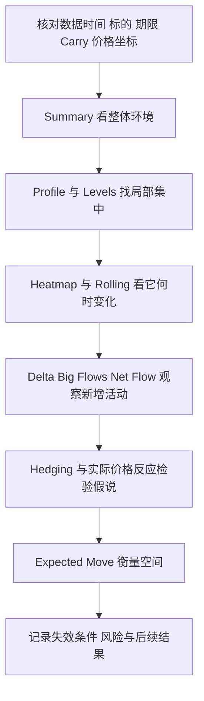

# 把DeepGamma用于交易研究：布局、场景、期货映射与复盘

核验日期：2026-10-29。本篇是基于各指标含义构建的研究流程，所有规则与数字均为教学设计，未经过策略回测；产品事实可沿各指标专篇及[基础来源](../research/market-foundations.md)核对。

以做市商风险为核心的学习顺序、数据层级、存量与净流算例，以及指标冲突表，见[做市商分析主线](market-maker-framework.md)。本篇进一步处理情景、执行坐标和验证。

## 1. 一次分析的阅读路径



这是一条阅读路径，不是“八个指标一致才买”的算法。多个工具共享CBOE数据或同一Gamma变换，信息高度相关；增加画面数量不等于增加独立样本。

## 2. 三个可以复现的研究布局

| 布局 | 组件与明确设置 | 研究问题 |
|---|---|---|
| SPX当日到期结构 | Summary Gex=MM GEX；Levels Advanced=MM GEX；GEX Profile=MM GEX；三个实例0DTE、Carry统一指定 | 同一到期范围的总体与局部风险怎样对应？ |
| 存量与新增活动 | 一个OI-R/Carry开Profile，一个Net Flow或Delta实例；源名、单位分开 | 今天活动发生在哪里，是否改变原有集中？ |
| 波动与反应 | Expected Move Daily-1SD、Hedging、少量Levels；Web可加Dynamic Walls/Pressure | 价格接近结构区时幅度与对冲反应怎样？ |

如果某指标没有公开Carry或Expiration控件，例如Hedging、Dynamic Walls，不能强称它已同步继承；在记录里写“无公开控件／上下文待确认”。Web全局Expiration只对使用Default继承的指标生效，手动覆盖的实例不会自动一致。

学习时可把Profile数量改为1、保留1条滚动快照、Levels只留少量线。它们都是研究者建议，非官方默认。之后保存Template与Workspace；桌面和Web保存入口见各平台篇。

## 3. 情景A：稳定环境中的区间反应

假设SPX现价6000，MM Summary在同期限下正Gamma，5980—6020附近有较高集中，Hedging在6020为Attenuating，Expected Move上沿6030。

研究假说：接近6020时可能出现逆势对冲，行情有放缓机会。需要记录价格实际接近路径、停留、回落与再测试结果；**不会因有一条绿线就确定做空**。若价格突破6020并接受其上方，或Summary转负，原来的稳定区间解释需要重新检查。

为了做可验证研究，可以事先定义“连续两根1分钟收盘在区外”为接受候选，再看下一段结果；这只是自拟分类方法，不能写成DeepGamma官方规则，也不能在看到结果后把两根改成三根。

## 4. 情景B：负Gamma环境中的顺势扩张

假设价格从6000下跌到5980，Summary为负，下方热图负风险集中，Hedging显示Amplifying，压力序列最近斜率向下。模型机制允许下行对冲增加卖压，可以研究跌破后回抽是否继续。

失效条件必须包括：价格重回5980上方并获得接受、Hedging改变、Summary符号改变或外部事件改变价格路径。**同样的负Gamma环境若价格反向上行，也可能放大上涨**；颜色没有替你决定方向。

如果读数还没更新，而价格先跳动，应按“数据待刷新”记录，不能把时间不同的指标错当背离。分钟数据不支持追溯每一个期货Tick的因果。

## 5. 情景C：流量与价格背离

假设价格突破6030，Delta累计或MM Pressure没创新高。可以登记为背离，但有三种后续：价格跌回突破区、流量随后补强、价格在外部资金推动下继续而背离长期存在。只有第一种才支持这一次突破失败，背离本身不是入场结论。

再检查是否用了同一期限、客户/MM视角以及同一单位。Big Flows门槛过滤、Net Flow按Premium、Delta按Contracts可能自然不同步，不应给所有差异都加上“聪明钱出货”的故事。

## 6. 情景D：Web模型一致或冲突

假设Dynamic Walls上方持续、Sentiment方向正、Pressure上升，三个画面一致可以形成待验证的上行情景。但它们可能共享底层数据，并不能证明三倍可靠。

假设此时Exhaustion显示Call侧标记，它表示某种衰竭候选，未必要求立刻反向。可先记录趋势速度是否真的下降、是否回到Walls内、Pressure斜率是否转弱。如果仅有标记而价格继续加速，反转假说没有成立。

如果Hollow来自Exhaustion，它只是该指标的外观，**不能套Big Flows的空心=平仓**。不同图形语法只在对应指标内有效。

## 7. 从SPX结构到ES/MES执行坐标

先分清数据来源与执行标的。SPX的期权结构不等于ES期权结构；把坐标转换到ES后，它仍来自SPX市场。Web To Futures Price是平台提供的偏移开关，自动选择期货到期合约，换月时可能与实际交易合约有短暂差异。[官方转换说明](https://www.deepcharts.com/helpcenter/deepgamma-web/article/deepgamma-web-platform-overview)

同步基差教学式：

```text
B(t) = ES指定月份(t) - SPX(t)
ES参考位(t) ≈ SPX结构位(t) + B(t)
```

假设同一时刻SPX=6000、交易的ES月份=6020，B=20；SPX墙6050映射约6070。若平台自动选另一个ES月份，其基差可能不同，不能一看到差价就说“官网数据错误”。也不能把上午B=20一直固定用到尾盘。

NDX→NQ同样先按同步基差比较。SPY/QQQ与指数/期货之间还涉及价格比例和分红等关系，不能只把SPY乘10、QQQ乘一个固定倍数；没有核验产品转换公式时，把它们保留在原坐标独立研究。详见[基础研究的基差章节](../research/market-foundations.md)。

## 8. 风险金额必须由合约规格算

稳定规格的教学对照如下；精确当期规则与交易费用仍需查CME及经纪商，来源见基础篇。

| 合约 | 每点美元 | 最小普通报价变动 | 每Tick美元 |
|---|---:|---:|---:|
| ES | 50 | 0.25点 | 12.50 |
| MES | 5 | 0.25点 | 1.25 |
| NQ | 20 | 0.25点 | 5.00 |
| MNQ | 2 | 0.25点 | 0.50 |

假设一个纯教学预算为100美元，价格失效距离8点，以MES计每张风险40美元；若另预留每张5美元费用与滑点，最多取 `floor(100/45)=2张`，预算内估计风险90美元。**停止单不能保证跳空时精确按失效价成交**，所以这个公式是预估而非最大亏损保证。若用ES，同样8点单张就400美元，不因为保证金足够就符合这个预算。

不要把Gamma墙当自动止损，不把期权Premium当期货保证金，也不要用历史截图中的“通常会反弹”替代账户风险规则。市场价格可以穿越任意模型区。

## 9. 若实际交易期权，还要补哪些判断

即使正确判断标的上行，买Call也可能因IV下降、Theta衰减、买卖价差和执行时点而亏损。相同净Delta的两个组合可以有不同Gamma、Vega和尾部风险。

教学对比：裸买Call通常有正Delta/正Gamma/正Vega、负Theta；看涨价差通过卖出更高行权价Call限制收益与风险敏感度；期货则主要是线性Delta，没有同样的期权时间价值结构。这些是普通结构的一般特征，实际Greeks随价位变化，不能由DeepGamma的一条线选定最适合的期权合约。

SPX现金结算与SPY/QQQ可能实物交割的期权制度不同，AM/PM结算和到期安排也不能混同。交易前应按具体合约核对；本研究提供含义，不替代合约条款。[官方合约资料索引](../research/market-foundations.md)。

## 10. 回放要避免把未来看进过去

官方宣传SPX桌面约9个月、Web约1个月且扩充的历史；实际可选日期以账号为准。Web Session选过去日期即可回放，Latest回实时；这与自动策略回测引擎不是同一概念。[产品页](https://www.deepcharts.com/features/deepgamma)、[Web平台](web-platform.md)。

研究方法：在当时先暂停、写下假说，再播放后续；不使用收盘才形成的Peak、最终范围或未来修正后的总量来决定早盘动作。保留发布时间、回放时间与数据时间；历史是否重估/回填没有完全公开，因此只凭回放不能保证还原逐笔当时状态。

样本先按日期隔离为规则探索与后续验证两组，避免在同一批走势上反复改阈值。统计每次出现机会，不只收藏成功截图。评价至少区分方向、环境、到达反应区后的最大有利/不利移动、滑点和费用；不要只报“碰到墙反弹次数”。

若要检验某个MM指标是否增加信息，先固定同一套价格触发、退出和风险规则，再比较“不加该过滤”与“加该过滤”的结果。过滤后交易更少可能提高表面胜率，却错过大行情或降低整体收益；需同时报告机会数、回撤、费用和未触发时段。此处是验证设计，当前文档没有执行该回测。

## 11. 可直接复制的观察记录

```text
样本日期与时区：
记录时刻 / 数据最新时刻 / 回放时刻：
产品版本 / 标的 / 期货月份：
Spot或To Futures Price / 同步基差：
图表周期 / ETH或RTH：
每个实例的Data source / Value / Expiration / Carry / Strikes：
颜色模式与热图标尺 / 截断 / 是否右延：
观察到的事实（数值、时间、行权价）：
基于事实的假说（写明方向与条件）：
确认条件 / 失效条件 / 自拟的观察窗口：
当时Expected Move上下界与模型带位置：
若做模拟执行：工具、数量、费用、滑点和预算假设：
后续结果（不得改写前面的假说）：
该指标是否提供了额外信息 / 有何替代解释：
对应原始截图与来源：
```

## 12. 排错顺序

| 现象 | 先核对 | 不应立刻得出的结论 |
|---|---|---|
| CBOE指标空白 | 是否SPX、权限、时间和连接 | 市场仓位为零 |
| 两端热图不同 | 版本、期限、Carry、Cutoff/StdDev/Opacity | 其中一个模型必错 |
| 墙突然消失 | 排名、Strikes、归一化阈值、Expiry、数据刷新 | 机构全部平仓 |
| 绿柱却在零下 | Auto Color是否Slope、实际数值 | 已正Gamma |
| SPX位与ES不吻合 | 价格模式、月份、同步基差、换月 | 恒定倍数可以解决 |
| 参数改完没变 | Apply、保存作用域、是否改了正确实例 | 指标没有作用 |
| 回放价格不动 | 历史数据加载、Play、时间轴 | 官网实时故障 |

缺少明确公开说明的提醒、API、自动下单或模型公式，见[覆盖与未知项](../research/coverage-and-unknowns.md)。不要从菜单名或产品营销语自行补齐能力。
