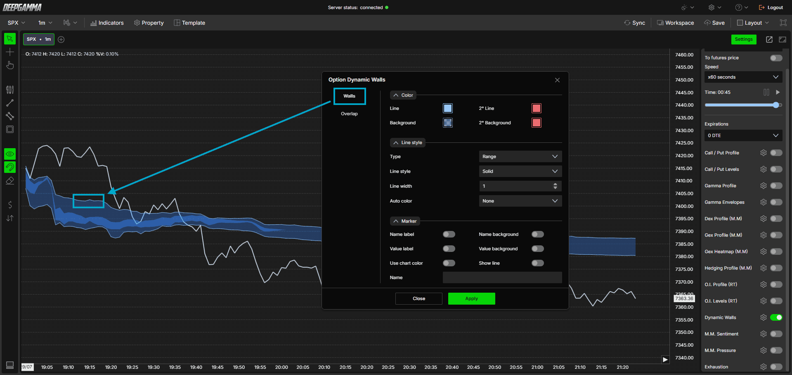

# Option Dynamic Walls：动态墙配置与使用

核验日期：2026-10-29。产品事实依据[官方指标专页](https://www.deepcharts.com/helpcenter/deepgamma-web/article/option-dynamic-walls)，以下交易情景为原创假设，不是历史回测。

## 作用与添加

这是 DeepChart 的专有动态价格带，仅在 SPX 图表上输出 CBOE 来源数据。它回答的是价格相对模型参考带的位置；不能将名称中的 Walls 直接理解成某个行权价有可执行的限价挂单。它也没有公开 Expected Move 那样的标准差概率定义。

添加：SPX 图 → `Indicators` → `Add indicator` → `Options (Cboe)` → `Option Dynamic Walls`。右侧 `Settings` 的 `Dynamic Walls` 开关可快速启停；齿轮进入设置，修改后按 `Apply`。

## 两条带如何读

`Walls` 是主参考带。价格持续处于上方，可作为向上趋势环境的观察条件；持续处于下方，则观察向下趋势；在带中运行时，先按中性、反复穿越的环境检查。强调“持续”是为了避免把一次触碰误当作确认，官方没有给出统一需要几根 K 线的规则。

`Overlap` 是伴随主带的另一层区域。官方解释它与更高的过滤有关，但公开设置只给出外观，没有公开可修改的计算过滤参数。不能把这句话写成存在某个可供调节的阈值，也不能断言重叠区域等于“机构成本区”。

识图：截图左侧是 `Walls`、`Overlap` 两个系列；右侧只有颜色、线型和标签。蓝带在价格波动中阶梯式变化，价格多次离带后并未立即回归，因此“价格必须回到带内”的解释不成立。

## 完整参数

两个系列使用相同的外观字段，差别主要是边线粗细。

| 位置 / 字段 | 官方文字默认值与选项 | 配置含义 |
|---|---|---|
| Color → Line / Background | 浅蓝边线、蓝色填充 | 分别改变边缘和区域，填充最好避免挡住价格 |
| Color → 2° Line / 2° Background | 文字描述为红色 | 备用颜色；需配合自动变色模式，不能直接解释成“卖出信号” |
| Line style → Type | Range；可选 Hidden | 显示区域或隐藏系列 |
| Line style → Line style | Solid；另有 Dash、Dot、Dash dot、Dash dot dot | 只改变外观 |
| Line width | Walls=1；Overlap=0 | Overlap 的 0 表示默认没有可见边线 |
| Auto color | None；另有 Slope、+/- | None 保持设定颜色；Slope 与斜率有关；+/- 与系列正负有关，具体对区域的应用未公开 |
| Marker → Name label / Value label | 均关 | 是否显示名称、价格轴数值 |
| Use chart color | 关 | 标签颜色跟随图表配置 |
| Name background / Value background | 均关 | 标签背景，不是交易背景 |
| Show line | 关 | 从标签延展的参考线 |
| Name | 空 | 自定义系列名称 |

识图差异：Overlap 截图的备用颜色看起来更接近橙色，正文写红色。色块只是配置示例，不足以证明某版本出厂色；本表将默认值明确归于官方文字。要复制外观，直接在自己的版本选择目标颜色。

## 两种可复现的观察配置

初学记录配置：Walls 保留 Range、Solid、宽度 1、Auto color=None；Overlap 保留 Range、宽度 0。先不自动变色，让“价格相对带的位置”承担解释，避免把线的颜色误当方向。若需要数字记录，可主动开启 Value label，并清楚标记上下边界。

拥挤图表配置：保留 Walls，暂时把 Overlap 改成 Hidden；比较一段回放后再决定是否恢复。隐藏只是减少视觉内容，不改变其他指标的计算。不要因为“带更窄”就缩小真实交易风险预算。

## 教学情景：突破与失效怎样区分

假设 SPX 带为 6000–6010，价格 6007，来回穿越主带。这时只知道价格尚在模型区域内，尚不能推出下一步涨跌。随后价格升至 6016，在自行规定的两根 1 分钟观察窗口内守在上边界外，同时 MM Pressure 的最近一段斜率上升。研究上可记录为“向上离带并得到流量变化配合”，下一观察点是回踩 6010 时能否维持。

若下一分钟价格跌回 6006，则前述“带上方持续运行”的假设失效。若价格仍在 6016，但带本身追随抬到 6015–6022，分类变化部分来自模型移动，不能当成发生了真实卖压。应同时记录当时价格、上下边界及模型更新时间。

另一种情景是价格远低于带后持续下降。此时“偏离很远”并不自动构成抄底理由；可用 GEX Hedging Profile 判断该区域是否有放大移动的模型状态，用 Exhaustion 提醒寻找实际减速迹象。

## 与其他工具的边界

| 工具 | 与 Dynamic Walls 的差别 |
|---|---|
| Option Levels / OI Levels | 显示选定数据源下的行权价集中位置；Dynamic Walls 显示动态带 |
| Option Envelopes | 明确命名 Zero/Major/Minor Gamma；不能把 Dynamic Walls 上下边界改叫 Zero Gamma |
| Expected Move | 以 IV 构建波动范围；Dynamic Walls 未公开置信度或标准差含义 |
| 盘口深度热图 | 展示订单簿数据；Dynamic Walls 不是订单簿挂单 |

公开资料没有算法、训练方法、分位数、DTE 过滤、延迟明细或历史修订规则。本文只确认公开界面和官方所述用途；首次使用应在回放中检查带何时改变，而不是用收盘后的整段带去解释过去的进场机会。
