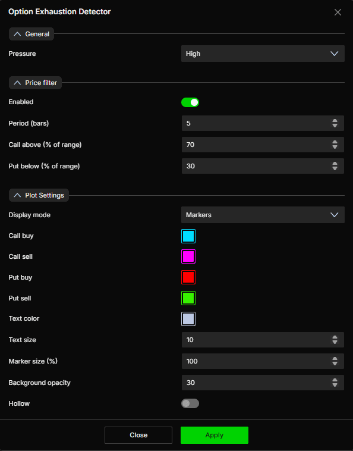

# Option Exhaustion Detector：衰竭检测配置与使用

核验日期：2026-10-29。产品事实依据[官方指标专页](https://www.deepcharts.com/helpcenter/deepgamma-web/article/option-exhaustion-detector)。交易场景和配置比较建议是本文的教学设计。

## 它能告诉你什么

指标在 SPX 主图标出可能出现移动衰竭的位置，使用 CBOE 数据。标记指向需要检查的状态，不能保证随后反转。`LONG PUT - exhaustion` 是对期权侧活动的标签，不能按字面当成要求你立即买 Put 的订单指令；`SHORT CALL` 同理。

添加：SPX → `Indicators` → `Add indicator` → `Options (Cboe)` → `Option Exhaustion Detector`。快捷栏开关名为 `Exhaustion`。设置后按 `Apply`。

## 识别四种颜色

| 活动类别 | 默认颜色 | 阅读动作 |
|---|---|---|
| Call buy | 青色 | 先读标签，确认对应的 Call 买方活动衰竭类别 |
| Call sell | 品红 | 不要与净看跌或卖出期货混同 |
| Put buy | 红色 | 关注对应期权活动是否伴随价格减速 |
| Put sell | 绿色 | 绿色不是无条件做多确认 |

所有标记默认是方形，悬停或其引线标签可显示类别。与 Big Flows 不同，这里的 Hollow 是全局外观开关，**不表示平仓**；颜色也不是 Big Flows 的默认红卖绿买体系。

识图：实图可直接读到 Pressure=High、Price filter 开启、Period=5、70/30、Markers、四个色块、字体 10、标记 100、透明度 30、Hollow 关闭。官方示例中下跌途中有连续多个标记，足以说明“出现一次就立刻反转”不是正确读法。

## 参数、默认值与调节后果

| 字段 | 默认 / 选项 | 如何使用 |
|---|---|---|
| Pressure | High；Low、Medium、High、Strong | 越低显示越多，越强保留越少；它是筛选强度，不是实际压力数值 |
| Price filter → Enabled | 开 | 保留价格位置过滤，减少无位置约束的标记 |
| Period (bars) | 5 | 价格过滤使用的条数，换时间周期后对应实际时间也改变 |
| Call above (% of range) | 70 | Call 标记的位置约束；不是“上涨概率 70%” |
| Put below (% of range) | 30 | Put 标记的位置约束；不是“下跌概率 30%” |
| Display mode | Markers；另有 Background | 标记或背景着色；背景模式更容易与 Summary/Sentiment 的背景重叠 |
| Call buy / Call sell / Put buy / Put sell | 青 / 品红 / 红 / 绿 | 独立配色，改色后应保留图例 |
| Text color | 浅灰蓝 | 标签文字 |
| Text size | 10 | 文字大小 |
| Marker size (%) | 100 | 标记缩放，增大不代表信号更强 |
| Background opacity | 30 | 官方文字指标签背景透明度；在 Background 模式下如何共同作用需本机观察 |
| Hollow | 关 | 空心外观，不编码开平仓 |

官方未公开 Pressure 各档对应的数值阈值，也未给出价格区间的完整计算公式、是否包含当前未完成 bar、信号确认时间或重绘规则。因此 5/70/30 只能作为已确认的界面配置，不能据此宣称可重建算法。

## 配置比较与使用场景

第一轮学习保留默认值，只记录标记类别和触发时价格。第二轮将 Pressure 从 High 改到 Strong，比较信号数量、出现时机和后来走势；不能仅比较图更干净便断言准确率提高。第三轮才对照 Medium，观察增加的标记集中在哪些阶段。其余参数保持一致，才能分辨变化来自哪项设置。

若用于观察一段延伸后的风险变化，可同时显示 OI Levels、Hedging Profile 和 MM Pressure。先有位置，再看衰竭提示，最后看价格是否实际失去延续性。用普通 1 分钟价格图的局部高低点也可以验证减速，不必假定 Web 内含逐笔足迹功能。

## 原创教学例子

假设 SPX 从 6000 连涨到 6030，接近先前标出的 Call 集中位置 6030；出现 Call 类衰竭标记，MM Pressure 仍向上但最近五分钟斜率明显减小。此时可提出“上行延伸可能转弱”的假设。随后若价格回到 6027，并未立即收复 6030，便出现价格层面的确认；若反而升到 6036且压力继续创新高，原假设无效，不能继续依据旧标记认定顶部。

再假设下跌中出现 `LONG PUT - exhaustion`，但 Hedging Profile 在下方显示放大移动类别，价格连续创新低。标记只是需要观察的点，没有得到减速证据，逆势抄底的依据仍不成立。应记录“提示出现但未形成反转”，保留失败样本。

## 回放记录模板

每个事件记：交易日期与时区、图表周期、价格坐标是否已转期货、Pressure 档位、价格过滤配置、标签全文、首次看到的时间、临近结构位、之后 1/5/15 分钟价格变化、最大顺向/逆向偏移，以及信号是否消失或改变。该记录是研究方案，不是官方已验证的统计结论。

不要只截取后来反转的标记，也不要把触发后的最低/最高点反推成可成交价格。专有信号是否会历史修订需要真实回放核验，静态宣传截图不能回答这一问题。
