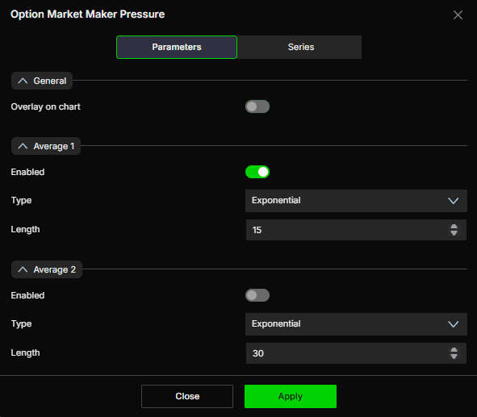

# Option Market Maker Pressure：做市商压力配置与使用

核验日期：2026-10-29。产品事实依据[官方指标专页](https://www.deepcharts.com/helpcenter/deepgamma-web/article/option-market-maker-pressure-deepgamma-web)。本文的例子是解释性假设。

## 作用与添加

该 SPX 专用指标由 CBOE 期权数据构建，在交易时段内累积。官方用 CVD 作类比，但未公开计算公式或标准化单位。因此它不是从 CME 期货逐笔成交直接计算的 CVD，也不能把读数除以某个常数就声称得到即将成交的 ES 手数。

添加：SPX → `Indicators` → `Add indicator` → `Options (Cboe)` → `Option Market Maker Pressure`。右侧快捷栏名为 `M.M. Pressure`。点齿轮后可见 `Parameters` 和 `Series`，修改后 `Apply`。

默认在独立副图，带压力主线和一条平均线。平台总览把它概括成可叠加的线，而专页与截图明确给出 `Overlay on chart` 选项，默认关闭；本文以专页为准。

识图：参数图显示 Overlay 关闭、Average 1 开启、Exponential、15；Average 2 关闭、Exponential、30。另一个官网示例主动打开 Overlay，把压力轴放到左侧；这证明叠加是显示方式，不意味着压力单位变成价格点。

## Parameters 完整配置

| 字段 | 默认与选项 | 交易研究中的含义 |
|---|---|---|
| Overlay on chart | 关 | 独立副图更容易分清单位；开启后与价格共处主图，但坐标不同 |
| Average 1 → Enabled | 开 | 第一条平滑线 |
| Average 1 → Type | Exponential | 均线方法，见下一段 |
| Average 1 → Length | 15 bars | 更短会更贴合，噪声也更明显 |
| Average 2 → Enabled | 关 | 需要比较较慢变化时再开启 |
| Average 2 → Type | Exponential | 默认同为 EMA |
| Average 2 → Length | 30 bars | 与第一条的周期作区分 |

两条均线可选 `Simple`、`Exponential`、`Weighted`、`Double exponential`、`Triple exponential`、`Hull`、`Smoothed`、`Least squares`。这些是对压力序列作平滑的方法，不会把原本未公开的压力模型变成已验证的成交预测模型。Length 按条数计；15 根 1 分钟 bar 和15 根 5分钟 bar 不代表同一观察窗口。

## Series 全字段

| 字段组 | MM Pressure 主线 | Average 1 / Average 2 |
|---|---|---|
| Color / 2° Color | 绿 / 浅紫 | 正文说橙 / 红；Average 1 截图更接近黄色，颜色示例有差别 |
| Type | Line，亦可 Hidden | Line，亦可 Hidden |
| Line style | Solid | Dash |
| 可选线型 | Solid、Dash、Dot、Dash dot、Dash dot dot | 同左 |
| Line width | 1 | 1 |
| Auto color | +/-；另有 None、Slope | None；另有 Slope、+/- |
| Name label | 关 | 关 |
| Value label | 开 | 关 |
| Use chart color | 关 | 关 |
| Name background | 关 | 关 |
| Value background | 开 | 关 |
| Show line | 关 | 关 |
| Name | MMP | 空 |

主线默认按读数正负变色，所以一条仍为紫色的线可以正在上升，一条仍为绿色的线也可以正在下跌。Slope 变色回答“最近在升还是降”，+/- 回答“当前在零轴哪边”，两者是不同问题。

## 怎样读：水平、斜率、变化率分别记录

Pressure不是DEX存量，也不是Summary Gex的时间差分；官方未给出这些等式。它与Sentiment方向不一致时，先核对数据时间，再区分连续读数与分类状态，不能把两者强行相减或认为某一个必错。该页也未公开Expiration/Carry控件及完整继承关系，不能仅因全局设0DTE就断言压力覆盖范围完全相同。联用方法见[做市商分析主线](market-maker-framework.md)。

读数低于零而开始上升，意味着累积压力在此前负值基础上回升；不能说已转正。读数大于零但持续下降，意味着仍有正的累积余额、最近变化却在减弱。跨日比较绝对数值还需相同重置、时间进度和数据范围，公开文档没有提供可直接跨日套用的强弱阈值。

均线可以帮助比较最近主线与较平滑背景的差异。主线上穿 EMA15 只是一种时序变化，未自动给出未来上行概率；均线有滞后，横盘时反复交叉。两条均线同时启用时主动换成不同颜色，否则默认近似配色容易混淆。

## 原创情景与失效

假设 10:00 压力为 -20，10:10 回升到 -8，主线抬升并越过 EMA15；SPX 同时从 6000 回到 Dynamic Walls 内部。可记录为“负的累积状态正在修复，价格也回到参考区域”，下一步观察压力能否继续上升与价格能否守住局部回踩，而不是立即把 -8 解读为买入八手期货。

假设价格突破 6030，但 Pressure 没有超过前一高点，形成观察上的背离。背离说明两个序列没有同步创新高，不证明价格必反转。如果后续压力快速补涨，背离解除；如果价格跌回 6030下方，才有价格层面的突破失败。若突破发生在数据刷新间隔内，应先等新读数到来，避免把延迟误作背离。

## 建议的研究配置

先用独立副图、EMA15、Average2 关闭，保持默认颜色，并显示 MMP 数值。观察复杂趋势时再加 EMA30，给第二条换色。若主图叠加便于你对照节奏，可以开启 Overlay，但应保留轴标识；一张图里两条线视觉交叉不等于数值相等。

将它与 GEX Profile 配合时，Profile 回答“哪里集中”，Pressure 回答“随时间怎样变化”。与 Sentiment 配合时，Sentiment 给出分类状态，Pressure 保留连续路径；不要把二者视为完全独立的数据源。官方未披露该指标具体使用哪些 Greeks、是否重新估值历史序列、准确单位、阈值和执行场所，不能补写成 Vanna/Charm 或真实期货成交量。
