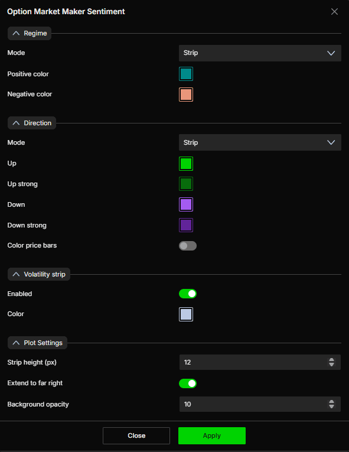

# Option Market Maker Sentiment：环境、方向与波幅状态

核验日期：2026-10-29。产品事实依据[官方指标专页](https://www.deepcharts.com/helpcenter/deepgamma-web/article/option-market-maker-sentiment)。下列组合解释和例子用于教学，未声称具有经验证的胜率。

## 三个独立问题

该指标由期权数据计算，在 SPX 图表上提供 CBOE 来源状态，不必另外打开副图。`Regime` 看 Gamma 环境，`Direction` 看模型方向类别，`Volatility strip` 提醒可能较宽的日内高低范围。三者不能互相代替：负 Gamma 不等于必跌，向上方向也不等于低波动。

添加：SPX → `Indicators` → `Add indicator` → `Options (Cboe)` → `Option Market Maker Sentiment`；或右侧 `Settings` → `M.M. Sentiment`。设置保存按 `Apply`。

官方说明模型持续计算 Regime，但只在其认为有意义时标示，所以部分时段可能空白；Direction 也可能不显示。空白不是“数值为零”的证据。先检查 SPX、连接与显示开关，再判断是模型未标记还是数据缺失。

识图：设置中 Regime、Direction 都为 Strip；方向有四种配色，Price bars 着色关；Volatility strip 开；条带高度 12、延伸到最右开、背景透明度 10。官方实例底部并非整段连续着色，因此不能把每处空白补成中性或上一个状态。

## 完整设置

| 区域与字段 | 默认与选项 | 配置解释 |
|---|---|---|
| Regime → Mode | Strip；可选 Disabled、Background | 条带、关闭或主图背景，先用条带便于与方向分开 |
| Regime → Positive color | 青绿 teal | 模型正 Gamma 环境 |
| Regime → Negative color | 鲑红 salmon | 模型负 Gamma 环境 |
| Direction → Mode | Strip；可选 Disabled、Background | 方向单独控制，关闭方向不会把环境算法关闭 |
| Direction → Up | 绿 | 一般向上类别 |
| Direction → Up strong | 深绿 | 较强向上类别，不是已校准概率 |
| Direction → Down | 紫 | 一般向下类别 |
| Direction → Down strong | 深紫 | 较强向下类别 |
| Color price bars | 关 | 开启后把方向色用于价格条，可能替代原有蜡烛颜色语义 |
| Volatility strip → Enabled | 开 | 模型条件满足时才会出现，不保证每天都有 |
| Volatility strip → Color | 浅灰蓝 | 波幅提示条颜色 |
| Plot Settings → Strip height (px) | 12 | 条带高度，增大只提高可读性 |
| Extend to far right | 开 | 视觉延伸，不是预测未来保持状态 |
| Background opacity | 10 | Regime 或 Direction 使用 Background 时的透明度 |

当 Regime、Direction 都用 Strip 时，官方从第一条起列出的顺序是 **Volatility → Direction → Regime**。实际位置应用名称和图例确认，不能仅凭某一绿色条的高度猜它是方向还是环境。

## 环境与方向的组合阅读

Regime可以作环境摘要，但不是已公开的“Summary Gex大于零就涂绿”公式。即使两者同屏，分类阈值与覆盖范围未完全披露，也不能要求每分钟一一相等。本页未公开Expiration/Carry控件或完整继承机制；比较前将这部分记为未知。与Pressure和Summary的冲突排查见[做市商分析主线](market-maker-framework.md)。

| Regime | Direction | 教学性理解与下一观察 |
|---|---|---|
| 正 | Up / Up strong | 向上偏向存在，但若对冲倾向抑制波动，可能是较温和上行；检查上方结构位 |
| 正 | Down / Down strong | 下行偏向与抑制波动并存；不能因正 Gamma 就认定只能涨 |
| 负 | Up / Up strong | 上行与可能放大移动的环境并存；负 Gamma 也能伴随快速上涨 |
| 负 | Down / Down strong | 下行与可能放大移动的环境并存；观察支撑穿越与扩张 |
| 空白 | 任意或空白 | 没有完整可读分类，避免自行补全模型结论 |

这里对 Gamma 的理解建立在做市商净持仓和动态对冲假设上，而不是“Call 一定正、Put 一定负”的期权类型定律。Sentiment 专页没有公布分类阈值、条件概率或精确重置规则，因此 Up strong 不能翻译成“上涨概率超过某个百分比”。

## 原创交易研究例子

假设 Regime 为负、Direction 为 Up，SPX 由 6000 升到 6015，同时 MM Pressure 抬升、上方 Hedging Profile 显示放大类别。可以提出“上涨可能获得更强延续”的观察假设，而不能因 Regime 为负就先做空。若价格后来跌回 6008且方向提示消失，应重新评估，旧颜色不能永久生效。

若当日 Volatility strip 首次出现，合理的研究动作是重新检查自己的波幅预期与 Expected Move，而不是机械把仓位放大。假设原来计划承受 4点逆向波动，后来结构允许的失效距离变成 8点；若研究中仍使用固定美元风险，示意上应把合约数量相应减半，而不是让风险翻倍。这是风险算术，不是模型给出的交易指令。

## 易错点与首次配置

先保持两个 Strip 和默认颜色，只打开必要图层。确认能区分正负环境与上下方向后，再决定是否用背景或价格条着色。若还打开 Option Summary 的 Marker 背景，两套背景可能重叠；通过逐个隐藏确认颜色来源。

波幅条表示条件性提示，不给出上涨/下跌方向，也不说明日内最高价与最低价分别在哪里。首次使用应记录提示何时首次出现、是否消失、当时已实现的高低范围，防止收盘后用完整日振幅倒推成盘前预测。官方没有公开模型公式、实盘时效、未来函数审计或绩效统计，不能把展示截图写成“准确识别趋势”的证明。
