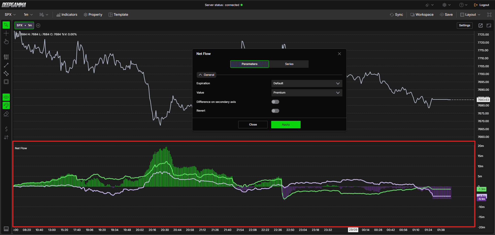

# Option Net Flow：累计期权净流配置与使用

核验日期：2026-10-29。产品事实依据[官方指标专页](https://www.deepcharts.com/helpcenter/deepgamma-web/article/option-net-flow)。例子和研究配置由本文设计。

## 作用、资格与添加

这是使用 CBOE 数据的 SPX 专用副图，显示交易时段内 Call、Put 两侧净流的累积变化，另以 Difference 展示两者的差距。它适合观察变化持续性，不能只看某根柱子就称其是当分钟新成交量；Difference 是累计状态之间的差，而不是总成交量。

添加：SPX → `Indicators` → `Add indicator` → `Options (Cboe)` → `Option Net Flow`。齿轮设置有 `Parameters` 与 `Series`，改完按 `Apply`。官方专页没有给出同名快捷栏开关，不要把 `M.M. Pressure` 当成 Net Flow 的另一个名字。

识图：默认参数示例为 Expiration=Default、Value=Premium、独立 Difference 轴关闭、Revert 关闭。图中 Call 与 Put 可分别在零轴上下运动，不能把 Put 系列当作固定为负数的普通 Put 成交量。

## Parameters 完整配置

| 字段 | 默认与选项 | 含义与选择 |
|---|---|---|
| Expiration | Default | 跟随快捷栏全局到期筛选；可单独覆盖 |
| 可选到期 | Default、All expirations、0 DTE、<=1d、<=7d、<=31d、<=91d | 比较指标前先统一范围；<=7d 包含更近到期，不是仅第七天 |
| Value | Premium；可选 Contracts、Delta | 分别关注权利金、合约数量或 Delta 口径；切换后数值不能直接横比 |
| Difference on secondary axis | 关 | 开启给差值独立轴，便于看细节，但视觉高度不再能与 Call/Put直接比较 |
| Revert | 关 | 从客户侧反转为估计做市商侧，不是观测期货对冲成交 |

Premium 强调期权价格与规模，较贵合约可能明显影响读数；Contracts 强调数量，较多低价合约可能占主导；Delta 强调方向风险相关口径。专页没有完整公开买卖归类、是否含乘数、复杂单处理及 Delta 的缩放，不能自行把三个选项解释成可精确互换的同一变量。

## Series 全部字段与默认值

| 字段 | Call | Put | Difference |
|---|---|---|---|
| Color / 2° Color | 绿 / 红 | 浅紫 / 红 | 绿 / 浅紫 |
| Type | Line | Line | Bars |
| 可选 Type | Line、Hidden、Broken line | 同 Call | Line、Bars、Hidden、Broken line |
| Line style | Solid | Solid | Solid |
| 可选线型 | Solid、Dash、Dot、Dash dot、Dash dot dot | 同左 | 同左 |
| Line width | 3 | 3 | 1 |
| Auto color | None | None | +/- |
| 可选 Auto color | None、Slope、+/- | 同左 | 同左 |
| Name label | 关 | 关 | 关 |
| Value label | 开 | 开 | 开 |
| Use chart color | 关 | 关 | 关 |
| Name background | 关 | 关 | 关 |
| Value background | 开 | 开 | 开 |
| Show line | 关 | 关 | 关 |
| Name | Call | Put | Diff |

表内默认值依据官方正文。官网 Difference 的设置截图却显示 Hidden、宽度3、Auto color=None、Name=Call，而画面仍可见差值柱，显然不能作为干净的出厂配置证据。本文保留这处矛盾，不把示例截图误当默认实机测试；首次打开可逐项检查当前版本。

## 怎样读三个序列

先读 Call、Put 各自最近的斜率，再读它们之间的差距是在扩大还是收窄，最后对照价格。两侧同时增长和只有一侧增长的组合不同；Call 明显占优也不证明所有 Call 活动都是裸买看涨。

官方把 Difference 描述为两条序列的差距。实际使用应通过同一时刻的悬停值检查差值的减法次序、Put 的带符号显示以及 Delta 口径，尤其不要把图上的两条高度相加就叫“净方向”。若开启独立轴，更要以读数比较，不能凭柱高判断比某条线大几倍。

Revert 只是反转展示的视角。客户正 Delta 的对手若是做市商，做市商可能持负 Delta；若其追求 Delta 中性，持仓对冲方向通常与做市商期权 Delta 相反。由此可见“做市商侧显示负值”不直接等于“做市商正在卖期货”。实际执行还涉及已有对冲、其他期权及现货组合，净流本身不提供这些信息。

## 原创教学例子

假设10:00 Call 读数+1200万、Put +400万，10:15分别变成+1800万、+500万；在相同配置和同一轴下，可记录 Call 增量+600万、Put增量+100万，Call相对领先扩大。这与“10:15新成交1800万”不同，后者把累计余额误当当期增量。若实际悬停确认 Difference=Call−Put，则这两时刻的差值分别为800万、1300万；这是按所确认口径的算术示例，不能替代平台单位核验。

假设价格突破6030，Call线也持续上行、两侧差距扩大，可以记录为“价格与客户侧Call净流同向扩张”。若下一段价格继续上涨而Call线回落、Put线抬升，则记录分歧并检查是否存在对冲或复杂策略，不能立即断定见顶。

再把同一回放的 Value 改成 Contracts，发现Call领先反而不明显。这不一定是数据错误，可能说明原先的权利金集中在较少且更贵的合约；只有在相同到期、视角、时间和单位下的变化才可比较。

## 首次配置与验证清单

先用 Default、Premium、Revert关、独立轴关，给 Call/Put/Diff 保留数值标签。之后为0DTE单独建一个固定到期的对照图；不要只修改全局到期而忘记某些指标已覆盖全局。研究做市商侧时明确在名称加 `MM view`，避免截屏后忘记反转。

将它与 Option Volume 配合可区分“总活动大”与“净流倾向明显”；与 Option Delta 配合可比较不同风险权重；与 GEX Profile 配合可把时序变化放回行权价分布。它们都不是独立完整的订单意图调查，不能证明某个机构的最终观点。净流计算细节、会话重置边界、历史修订和单位缩放仍属于公开资料未充分说明的项目。
