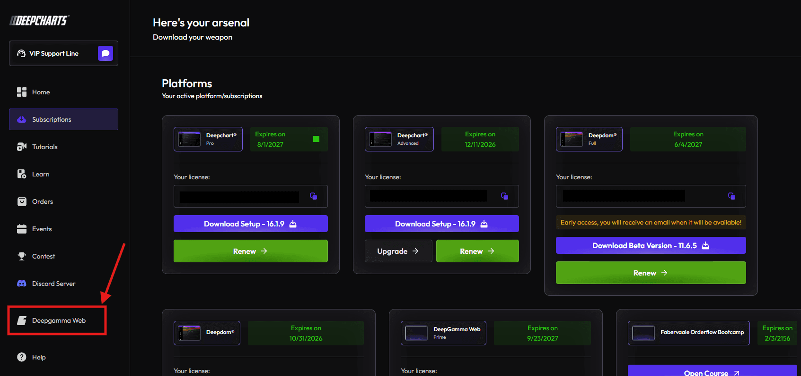
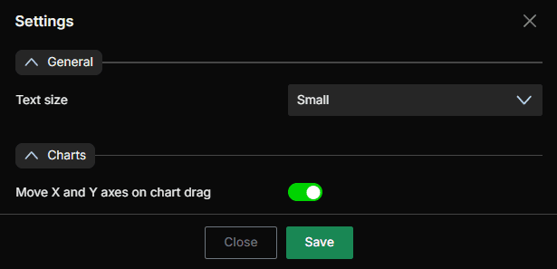
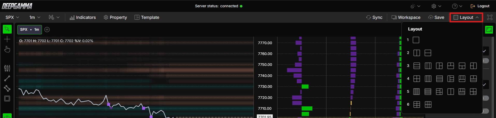
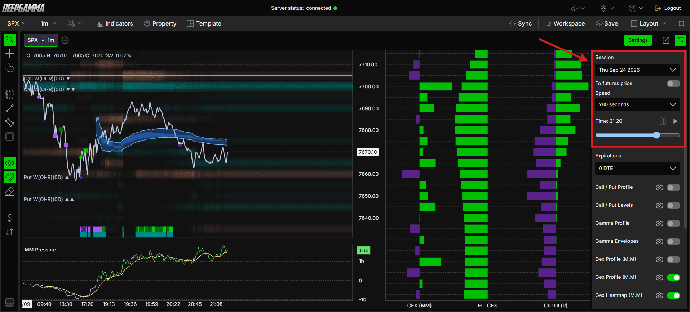
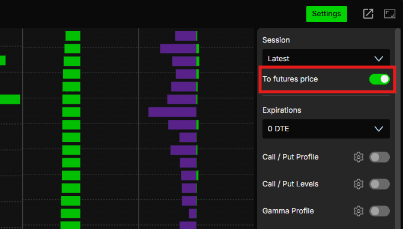
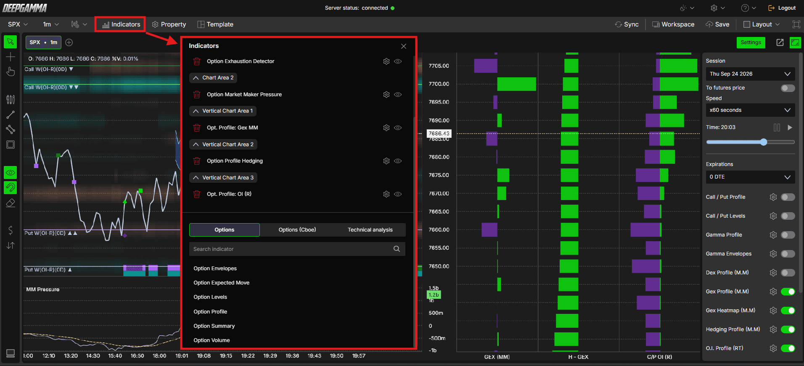

# DeepGamma Web 平台配置与使用指南

核验日期：2026-10-29。依据公开帮助中心、官方操作截图与免费演示入口；本次没有登录账户、注册演示或检验付费后的实时数据。产品行为与交易场景分开说明，示例均为教学假设。

## 1. 先选对版本与数据范围

DeepGamma Web 是浏览器产品，需要单独的有效订阅；从 DeepCharts 账户面板进入，不必另外连接交易所行情供应商。桌面软件与 Web 的设置界面、默认值存在差异，不能按同一套截图操作。[官方平台总览](https://www.deepcharts.com/helpcenter/deepgamma-web/article/deepgamma-web-platform-overview)

标准期权指标用于 SPX、SPY、NDX、QQQ；带 CBOE 参与者数据的组用于 SPX。Symbol 菜单还列出 VIX，但“可以打开 VIX 图”不等于“全部期权指标支持 VIX”。Web 指标大约每分钟刷新一次，放大图形或改为 1 分钟周期并不会得到逐笔更新。[官方平台总览](https://www.deepcharts.com/helpcenter/deepgamma-web/article/deepgamma-web-platform-overview)

交易上的直接含义：用它判断分钟级结构、到期日差异和潜在对冲区域；若要识别某一笔期货主动成交或订单簿队列变化，需要另外的相应数据，不能把热图色块误认成交易所挂单。

## 2. 进入平台与连接检查

1. 打开自己的 DeepCharts dashboard 并登录。
2. 左侧选择 **Deepgamma Web**。
3. 查看顶部 **Server status: connected** 及绿点，再检查图表日期与数据时间。
4. 默认符号是 SPX；先保留 SPX，便于学习 CBOE 组的全部功能。

连接状态只证明平台连接到服务器，不能证明正在看实时交易日。进入图表后仍需确认右侧 **Session = Latest**；历史日期代表回放。这个额外核对步骤是本指南的操作建议。[官方入口与连接说明](https://www.deepcharts.com/helpcenter/deepgamma-web/article/deepgamma-web-platform-overview)

免费演示的官方入口是 [Try DeepGamma Web for FREE](https://www.deepcharts.com/gamma-demo)。2026-10-29 实际页面要求填写姓名、邮箱并同意条款，明确限定 **replay mode only**。本次只查看该页面，没有提交信息，所以不能将演示注册后的行为写作已实测。

## 3. 顶栏：平台状态与个人显示

| 控件 | 配置与用途 | 学习/交易场景 |
|---|---|---|
| Server status | 绿点和 connected 表示连接 | 图形停滞时先检查连接，再核对时间和交易时段 |
| Theme | 深色/浅色切换 | 截图分享、不同显示器下提高线条可读性 |
| 齿轮 | General Settings、HotKey Settings | 统一字号、拖动方式和快捷键 |
| Help 问号 | Guides、Release notes、Calendar Events | 查说明、版本变化和事件日历；日历事件不等于已生成交易信号 |
| Logout | 退出 Web | 结束共用设备上的会话 |

General Settings 的 **Text size** 默认 Small；**Move X and Y axes on chart drag** 默认开，拖图时可移动时间和价格轴。官方截图显示窗口底部有 **Save**，修改后需保存。[官方设置说明及截图](https://www.deepcharts.com/helpcenter/deepgamma-web/article/deepgamma-web-platform-overview)

操作建议：先把文字调到能清楚读取行权价和指标单位的大小。若拖动导致价格轴偏离参考区，恢复视野后再判断“墙是否消失”，不要把显示位置变化当成数据变化。

## 4. 菜单栏：符号、周期、图形与外观

| 菜单 | 可用项目/默认值 | 如何使用 |
|---|---|---|
| Symbol | NDX、QQQ、SPX、SPY、VIX；启动默认 SPX | 搜索或选择符号；换符号后检查指标兼容性 |
| Timeframe | 1、5、10、15、30、45 分钟 | 选周期后点 Apply；较长周期合并显示，不增加基础数据精度 |
| Chart type | Candlesticks、Line、OHLC Bars；默认 Line | Line 适合观察期权区域；K线更方便定位高低点 |
| Countdown timer | 当前柱倒计时开关 | 提醒当前柱尚未完成，避免把形成中的图形当作收盘确认 |
| Auction filter | 开/关 | 官方未公开具体过滤算法，不能自行解释为某类期权成交过滤器 |
| ETH | 选中显示延长时段，关闭仅 RTH | 比较相同时段；RTH 与 ETH 的累计和可见范围可能不同 |
| Price settings / Property | 同一个价格图外观窗口 | 修改背景、边框、文字、最后价颜色与网格 |

Price settings 分 **General** 与 **Grid**：General 含 Back color、Border color、Text size、Text color、Last price color；Grid 控制是否显示网格、网格颜色和线型，线型默认 dotted。官方没有在总览中给出所有颜色值或交易时段定义；本指南不补造。[官方菜单说明](https://www.deepcharts.com/helpcenter/deepgamma-web/article/deepgamma-web-platform-overview)

例：研究 SPX 在某个行权价附近的走势时，用 1m 观察接近过程，再开 15m 图看整体方向。两图都必须核对 Session、Expiration 和价格坐标，不能只因符号相同就认为统计范围相同。

## 5. 多图、布局、同步与独立窗口

图表标签旁的 **+** 添加新图，选择符号后会出现如 `SPX · 1m` 的新标签。**Layout** 决定同时可见的图表排列；官方截图展示多种 1—6 图布局，但没有公开说明所有组合及上限，按实际菜单选择。[多图与布局说明](https://www.deepcharts.com/helpcenter/deepgamma-web/article/deepgamma-web-platform-overview)

**Sync** 的已确认作用是同步符号：一个图加载某符号，布局中的其他图随之加载该符号。官方没有说它会同步全部周期、到期日、回放时间或鼠标，所以不要据此假设这些也一致。需要比较 SPX 与 QQQ 时关闭符号同步；需要用同一 SPX 的不同周期时再打开。

**Detach window** 把当前符号图打开到独立窗口，适合第二块屏幕；**Fullscreen** 让平台占满屏幕。这两者影响显示方式，不改变数据口径。[官方窗口说明](https://www.deepcharts.com/helpcenter/deepgamma-web/article/deepgamma-web-platform-overview)

建议的三图学习布局：第一图为 SPX 1m，叠加 Levels 与 Heatmap；第二图为 SPX 较长周期，观察 Summary Gex；第三图查看 Profile 与 Hedging。先使用同一到期范围和 Carry 设置，再逐项比较。此为教学布局，并非官方预设或获利保证。

## 6. 保存：Template、Workspace、Save 的分工

| 功能 | 官方确认保存的对象 | 建议使用时机 |
|---|---|---|
| Template | 当前图表设置，包括已启用指标及参数 | 保存“0DTE 结构观察”“全到期 OI”等单图方案 |
| Workspace | 多个图表、指标和设置，下次打开恢复 | 保存日常多屏/多图研究环境 |
| Save | 保存当前 Workspace | 参数和排列确认完成后手动保存 |

推荐流程：先设置单图并保存 Template，再安排多图布局并保存 Workspace，最后点 Save。命名中写清数据源、到期范围与坐标，例如 `SPX_GEX-MM_0DTE_spot`。这个命名方法由本指南提出，有助于区分统计口径；官方未公开模板文件格式、云同步冲突规则和全部恢复细节。[官方保存说明](https://www.deepcharts.com/helpcenter/deepgamma-web/article/deepgamma-web-platform-overview)

目前 [Layouts & Templates](https://www.deepcharts.com/helpcenter/deepgamma-web/layouts-templates)、[How To](https://www.deepcharts.com/helpcenter/deepgamma-web/how-to)、[Features](https://www.deepcharts.com/helpcenter/deepgamma-web/features) 分类仍显示待补充文章。不能把分类名称当作已有更细操作文档。

## 7. Settings 快捷栏与 Session 回放

图表右侧绿色 **Settings** 按钮展开快捷栏，再点一次收起。这里集中放置 Session、回放、To futures price、全局 Expirations 与指标快捷开关。

**回放步骤**：Session 从 Latest 改成历史日期 → 等待数据加载 → 在时间轴设置起点 → 点 Play。返回实时查看时，重新选择 Latest。官方截图还可见 Speed 下拉、时间读数、播放/暂停按钮和时间滑杆；其中一张示例为 `x60 seconds`，它是截图中的设置，不能据此宣称全部可选倍速。[官方回放说明](https://www.deepcharts.com/helpcenter/deepgamma-web/article/deepgamma-web-platform-overview)

回放的交易含义在于验证“当时看到了什么”。建议在价格接近某墙前暂停，记录当时的正负 gamma、热图和流量，然后继续播放；不要先看全天结果再倒推当时必然应该做多/做空。每次至少记录：历史日期、回放时刻、符号、是否转换期货价格、到期范围、Carry、指标数据源。历史可选范围受产品当前提供的数据约束，不能由菜单截图的日期推断长期保证。

## 8. To Futures Price：现货与期货坐标转换

**默认关闭**。关闭时 SPX 图显示指数价格；开启后按指数与期货之间的差值平移到期货价格坐标。官方明确说期货到期合约由系统自动选择、不能手动改变；换月附近可能与自己的交易平台相差一两天。[官方转换说明](https://www.deepcharts.com/helpcenter/deepgamma-web/article/deepgamma-web-platform-overview)

教学例：同一时刻 SPX 为 6000，系统选定 ES 为 6020，假设转换差值为 +20，则 SPX 行权价 6050 的参考区在相同期货坐标中约为 6070。这个算例只说明“偏移”的读法；不证明所有符号都使用相同变换，也不公开平台的完整换算算法。

使用顺序：先确认交易的是哪一个 ES 到期合约 → 比较平台转换后最新价 → 记录偏差 → 再把墙和热图区转到执行图。不要固定使用 `SPY × 10`、`QQQ × 某常数`，也不要把指数行权价直接贴到未经核对的期货图。**To Futures Price 是坐标转换，不是把 SPX 期权变成 CME 的期货期权。**

## 9. 全局 Expirations 与单指标覆盖

快捷栏 **Expirations 默认 0 DTE**。大多数指标的设置里有 **Expiration = Default**，此时继承全局选择；明确选择 `0 DTE`、`<= 7d` 或 `All expirations` 则固定该指标的范围。[全局选择说明](https://www.deepcharts.com/helpcenter/deepgamma-web/article/deepgamma-web-platform-overview)

注意两个例外/边界：第一，Advanced Envelopes 的当前帮助页直接写默认 0DTE，没有列出 Default，不应硬说所有指标都能继承；第二，截图快捷菜单可显示 `7 DTE` 一类简写，而指标正文用 `<= 7d`，前者不能擅自解释成“仅第7天到期”。具体以该控件当前说明为准。各指标核验见 [Web 与桌面配置差异](../research/web-desktop-differences.md)。

例：全局 0DTE，GEX Profile 保持 Default，用于当天结构；另加一个 Profile 明确选 All expirations，观察跨到期持仓。给两者加不同名称。若一条墙来自 0DTE、另一条来自 All，两者不重合可能只是范围不同。

## 10. 指标添加、快捷开关与别名映射

统一入口：**Indicators → Add indicator → Options / Options (Cboe) / Technical analysis → 搜索 → 添加 → 齿轮设置 → Apply**。长设置窗口需向下滚动，不能把第一屏当成全部参数。Technical analysis 分类包括 ATR、Bollinger bands 等通用技术指标，不属于 DeepGamma 专有算法。[官方指标添加说明](https://www.deepcharts.com/helpcenter/deepgamma-web/article/deepgamma-web-platform-overview)

快捷栏名称常是同一个指标的特定数据源，不是另一套独立算法：

| 快捷栏名称 | 对应指标/数据源 | 适用符号 |
|---|---|---|
| Call / Put Profile | Option Profile，Call / put ∑ | SPX、SPY、NDX、QQQ |
| Gamma Profile | Option Profile，Gamma (call - put) | 同上 |
| Call / Put Levels | Option Levels 的成交量墙视图 | 同上 |
| Gamma Envelopes | Option Envelopes | 同上 |
| Dex Profile (M.M) | Option Gex Profile，Dex (market maker) | SPX |
| Gex Profile (M.M) | Option Gex Profile，Gex (market maker) | SPX |
| Gex Heatmap (M.M) | Option Gex Heatmap | SPX |
| Hedging Profile (M.M) | Option Gex Profile Hedging | SPX |
| O.I. Profile (RT) | 实时 OI 逐行权价视图 | SPX |
| O.I. Levels (RT) | Option Levels Advanced，OI (R.T.) | SPX |
| Dynamic Walls | Option Dynamic Walls | SPX |
| M.M. Sentiment | Option Market Maker Sentiment | SPX |
| M.M. Pressure | Option Market Maker Pressure | SPX |
| Exhaustion | Option Exhaustion Detector | SPX |

别名和快捷预设以平台总览及相应指标文章为据。例如从指标面板添加 Levels Advanced 默认是 GEX，而从 O.I. Levels (RT) 快捷开关添加则是 OI，名称相近并不表示数据源相同。[Levels Advanced 官方说明](https://www.deepcharts.com/helpcenter/deepgamma-web/article/option-levels-advanced-deepgamma-web)

切换到非 SPX 时，CBOE 开关会禁用、不能编辑；切回 SPX 后原设置保留。若从添加面板强行加到不支持的符号上，会没有数值。总览中一句“Only CBOE sourced indicators work on SPX”字面可能误导；结合标准组也支持 SPX 的多处说明，正确理解为 **CBOE 组仅支持 SPX**，不能据此排除标准组的 SPX 支持。[官方兼容性说明](https://www.deepcharts.com/helpcenter/deepgamma-web/article/deepgamma-web-platform-overview)

## 11. 绘图、标注与快捷键

左侧竖栏和图表右键菜单提供同一批常用工具：指针、十字线、手形拖动，以及水平线、垂直线、水平射线、趋势线、平行线、矩形、椭圆、文字、斐波那契回撤/投射、计数工具；还可显示/隐藏标注、吸附标注、清除绘图。[官方标注说明](https://www.deepcharts.com/helpcenter/deepgamma-web/article/deepgamma-web-platform-overview)

| 动作 | 官方列出的默认键 |
|---|---|
| Pointer / Crosshair / Hand / Zoom range | Alt+P / Alt+C / Alt+H / Alt+R |
| Line / Horizontal line / Parallel line | Shift+L / Shift+H / Shift+P |
| Rectangle / Text | Shift+R / Shift+T |
| Snap annotations | Ctrl+S |
| Indicators / Price settings (Property) | Ctrl+I / Ctrl+P |

HotKey Settings 中点击 **Record** 录入自己的键，**Clear** 清除，截图还显示 **Save**。截图能看到 Fibo Retracement 的 `Shift F`，但其余未明示键值不在此编造。浏览器或系统可能占用 Ctrl+S、Ctrl+P 等组合，若触发浏览器对话框，用菜单或自行重设快捷键；这属于操作上的兼容性考虑，并非官方保证的跨系统行为。

教学场景：在某行权价画水平线并写上 `GEX-MM / 0DTE / spot / 10:30`，后续对比时就知道线来自哪个时刻。手画线是自己的记录，不能视为自动更新的实时 gamma 水平。隐藏标注只改变显示；清除绘图会丢失当前手工标记，使用前先确认记录是否需要保留。

## 12. 常见排错顺序与资料边界

| 现象 | 先检查 | 下一步 |
|---|---|---|
| CBOE 指标空白 | 是否 SPX、订阅及连接状态 | 切 SPX，再检查 Session、到期范围和数值显示 |
| 指标不同步更新 | 约1分钟更新的设计、是否回放暂停 | 核对时间，不把一分钟间隔写成逐笔行情 |
| 两图墙不同 | Data Source、Expiration、Carry、Number of Strikes、回放时刻 | 统一计算范围，再比较差异 |
| 期货价对不上 | 转换开关、实际期货月份、换月 | 比较当前基差，不手动套固定倍数 |
| 改设置没生效 | 是否点 Apply | 再保存 Workspace，避免下次恢复旧配置 |
| 切到 QQQ 后开关变灰 | CBOE 组仅 SPX | 换标准组，或返回 SPX |
| 图形太挤/被遮挡 | Layout、profile宽度、透明度、Show above bars | 调显示参数；显示调整本身不增加或减少市场头寸 |

上表是基于已确认控件整理的排错流程，不表示本次逐个制造并复现了故障。本指南未核实付费后的额度、浏览器支持矩阵、数据授权明细、完整回放保留期、自动保存时机和专有模型计算公式。遇到这些问题应以当前账户界面和官方回复为准。

## 13. 识图记录与证据

已实际打开并识读官方平台总览的21幅操作截图，覆盖账户入口、顶栏、菜单、多图、设置、快捷键、回放、期货转换、到期范围和添加指标面板；其中状态绿点、平台齿轮菜单等窄幅图由相邻总图交叉核验。资源原始 URL 与本地路径保存在 [资源索引](../assets/web-platform/manifest.json)，本文内嵌了关键原图。

从截图确认的细节包括：General Settings 有 Save；回放控件含 Speed、时间和滑杆；Layout 示意多种分屏；添加面板按 Chart Area / Vertical Chart Area 分组；快捷栏每个指标旁有齿轮与开关。这些是界面观察，不代表其后台算法已被验证。平台总览没有教学视频；本文件没有声称观看未提供的视频。

主要一手来源：[平台总览](https://www.deepcharts.com/helpcenter/deepgamma-web/article/deepgamma-web-platform-overview)、[入门目录](https://www.deepcharts.com/helpcenter/deepgamma-web/getting-started)、[指标目录](https://www.deepcharts.com/helpcenter/deepgamma-web/indicators)、[免费演示页](https://www.deepcharts.com/gamma-demo)。
