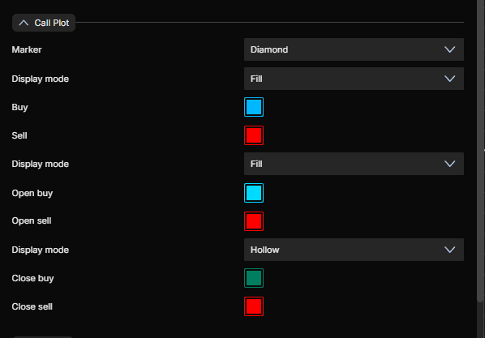
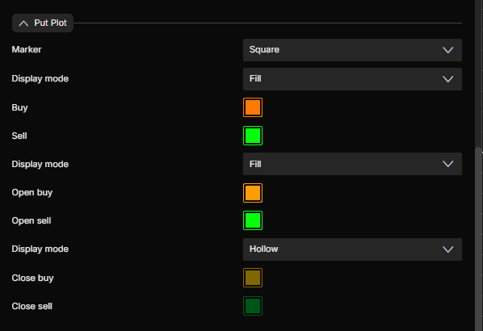
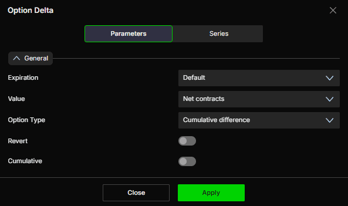
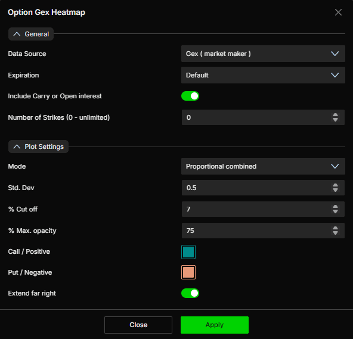
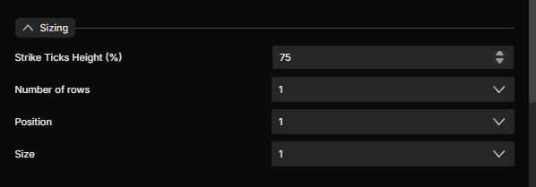
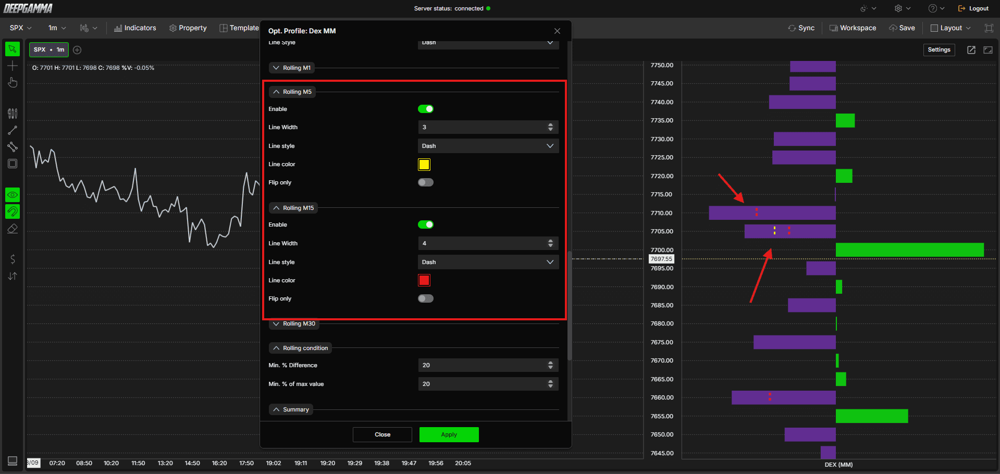
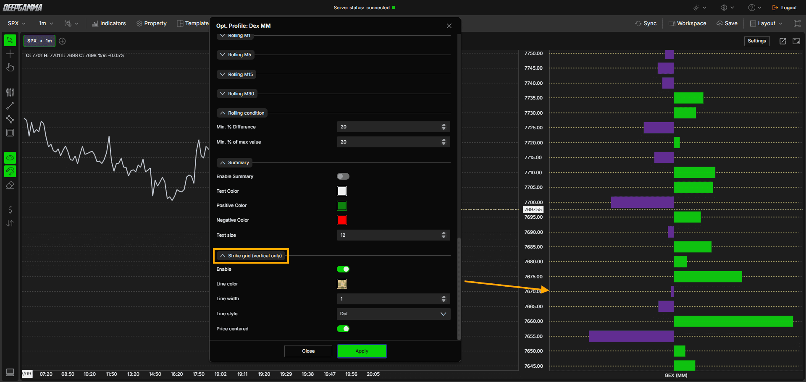

# DeepGamma Web 与桌面版：14 项共同指标的配置差异及补充指南

核验：2026-10-29。本文逐项对照 DeepCharts 桌面帮助页与 DeepGamma Web 帮助页。它是桌面各指标指南的 Web 补充，包含 Web 新增控件及不同默认值；指标的基础含义仍需结合主指南。**没有出现在桌面正文，不等于桌面软件一定没有该功能。**截图可能是作者已经调整过的示例，默认值优先按官方明确文字；存在冲突时同时记录。

## 1. 配置迁移前必须统一的项目

Web 从 `Indicators → Add indicator` 添加，CBOE 组先开 SPX，再选 **Options (Cboe)**；普通组选 **Options**。改设置后点 **Apply**。桌面则主要从 `New → Option Chart → Indicator Add` 添加；两端不能照搬菜单路径。[Web 平台总览](https://www.deepcharts.com/helpcenter/deepgamma-web/article/deepgamma-web-platform-overview)

Web 全局 **Expirations 默认 0DTE**，指标的 `Expiration = Default` 会继承它。桌面常见 `All expirations` 默认，不代表 Web 默认也是全到期。Web Advanced Envelopes 的正文明确默认 0DTE，未列 Default，应作为例外核对。显示 `<= 7d` 是到期范围过滤，不能擅自解释成只取第7天。

迁移时记录七项：版本、符号、时间/Session、Data Source、Expiration、Include Carry、坐标是否转期货。再核对 Number of Strikes 和显示样式。否则墙、峰值与总量不一致时，无法区分市场变化与设置差异。

### 总览

| 指标 | Web 主要变化 | 适用符号 |
|---|---|---|
| Option Big Flows | 开平买卖配色更细；Expiration 可继承全局 | SPX |
| Option Delta | 8种 Value；Option Type 新增 sum，需核对符号 | SPX |
| Option Envelopes | Carry 默认开；Series 命名；Expiration 继承 | SPX/SPY/NDX/QQQ |
| Option Envelopes Advanced | 默认仍0DTE和Carry开；Broken line 命名 | SPX |
| Option Expected Move | Average 改称 Normal；Series 界面 | SPX/SPY/NDX/QQQ |
| Option Gex Heatmap | 强度/截断/透明度/延伸的默认值不同 | SPX |
| Option Gex Profile | 更完整 General、Sizing、Flip only、Strike grid | SPX |
| Option Gex Profile Hedging | 主要是设置分组和配色名称差异 | SPX |
| Option Levels | Carry开、负值紫色、线型Solid | SPX/SPY/NDX/QQQ |
| Option Levels Advanced | 同上；OI快捷开关会改变数据源 | SPX |
| Option Profile | 新增OI加权源及完整多行/翻转/网格设置 | SPX/SPY/NDX/QQQ |
| Option Summary | Marker 作用在指标面板背景 | SPX/SPY/NDX/QQQ |
| Option Summary Gex | 同上；仍需区分GEX/DEX/Flow | SPX |
| Option Volume | Web正文未列Splitted/Stacked参数；默认堆叠序列 | SPX/SPY/NDX/QQQ |

## 2. Web 通用 Series 控件如何配置

Delta、Envelopes、Expected Move、Summary、Summary Gex、Volume 的 Web 设置通常分 **Parameters / Series**。桌面 `Subgraphs` 大致对应 Web `Series`，但不要假设所有枚举逐字相同。

| 分组/控件 | 含义与一般默认 | 何时调整 |
|---|---|---|
| Color / 2° Color | 主色和次色；通常次色红，正负振荡类次色紫 | 明确是在按方向、斜率还是固定系列着色 |
| Type | Line、Bars、Hidden、Ignore、Broken line或Range，依系列而定 | Hidden隐藏，Line连线；Broken line按平台的断线形式显示，不能由名称推导交易规则 |
| Line style / width | 常见Solid、宽1；柱状Delta宽5，Summary宽4 | 只调可读性，不改变计算 |
| Auto color | None / Slope / +/- | Slope按斜率；+/-按数值符号，两者含义不同 |
| Name label / Name background | 通常关 | 显示数据源、到期范围自定义名称，防止多实例混淆 |
| Value label / Value background | 通常开 | 显示当前值及其底色 |
| Use chart color | 通常关 | 让标记采用图表颜色 |
| Show line | 通常关 | 将当前值向右延伸，便于在价格/数值轴找到参考值；不会预测未来变化 |
| Name | 自定义系列名称 | 建议带上数据源和0DTE/All信息 |

各指标下方列出了适用于该指标的例外。官方没有列出某项默认值时，本文不补造。Web正文一般不再列桌面的 **Include on Auto Center**；这只说明文档不同，不证明图表不存在自动缩放行为。

## 3. Option Big Flows：默认配色已经不同

来源：[桌面](https://www.deepcharts.com/helpcenter/article/option-big-flows)、[Web](https://www.deepcharts.com/helpcenter/deepgamma-web/article/option-big-flows-deepgamma-web)。

Web 添加：SPX → Options (Cboe) → Option Big Flows。General 的 Expiration 有 Default、0DTE、<=1/2/3/4/5/6/7/31/91d、All；Default继承快捷栏。**Min. premium = 1,000,000 USD**；Action Enabled 默认关，Action Filter 默认 Buy；Hide call/put strike overlap 默认开。阈值以上才显示，不出现标记不能推断“没有任何期权交易”。

| 系列/状态 | Web默认 | 与桌面的区别 |
|---|---|---|
| Call Marker | Diamond | 形状一致；Circle/Square/Diamond/Text均可选 |
| Call generic Buy / Sell | 蓝 / 红 | 桌面 Buy 通常绿 |
| Call open Buy / Sell | 浅蓝 / 红，Fill | 开仓保持实心 |
| Call close Buy / Sell | 深绿 / 红，Hollow | 买平不再与买开同色 |
| Put Marker | Square | 形状一致 |
| Put generic Buy / Sell | 橙 / 绿 | 桌面按动作默认Buy绿、Sell红；Web已经不同 |
| Put open Buy / Sell | 橙 / 绿，Fill | 实心显示开仓 |
| Put close Buy / Sell | 深黄 / 深绿，Hollow | 空心显示平仓 |

Generic Display mode 默认 Fill，Open默认 Fill，Close默认 Hollow。Text Size 12、Text Color白、Marker Min Size60、Max Size120、Max Std Dev1。所有形状、填充和色彩都可改；不要依靠颜色判断实际动作，应同时读形状、空心/实心及提示文字。




操作例：若只想复查大额新增 put 买入，Expiration明确0DTE，阈值100万美元，Action过滤Buy；保留实心方块的橙色与空心买平的深黄色区别。关闭重叠过滤会把同价call/put同时成交也显示出来，适合复查组合腿，但它不能还原完整跨行权价策略。成交额大小也不能单独给出方向信心或持仓风险。

**迁移注意**：桌面指南中“为了表达情绪而反转Put颜色”的建议，不能在Web直接机械执行；Web默认Put买入橙、卖出绿已经与桌面不同。平仓行为尤其不能一律按“买call看涨/买put看跌”的单腿开仓叙事理解。

## 4. Option Delta：八种 Value 与 sum/difference 必须配套

来源：[桌面](https://www.deepcharts.com/helpcenter/article/option-delta)、[Web](https://www.deepcharts.com/helpcenter/deepgamma-web/article/option-delta-deepgamma-web)。

Web 是 SPX/CBOE 指标。Expiration有Default、0DTE、<=1/2/3/4/5/6/7/31/91d、All。桌面正文的 Value 是 Contracts、Premium、Future contracts；Web正文列的是下面八项，不应再按旧菜单选择“Future contracts”。

| Web Value | 比较的量 | 适用问题 |
|---|---|---|
| Net contracts，默认 | 净合约数量 | 买卖净活动在增加还是减少；不等于delta加权风险 |
| Net premium | 净权利金金额 | 少量高价合约是否带来较大资金量 |
| Net contracts x delta | 净数量乘delta | 流量携带多少方向敏感度 |
| Net contracts x gamma | 净数量乘gamma | 价格变化时delta敏感度可能如何变化 |
| Net contracts MM | CBOE做市商侧净数量 | 将客户侧叙事与MM侧活动分开 |
| Net premium MM | MM侧净权利金 | 做市商侧金额流量 |
| Net MM x delta | MM净数量乘delta | 在逐笔立即对冲假设下理解潜在标的对冲需求 |
| Net MM x gamma | MM净数量乘gamma | 对冲需求对价格变化的敏感程度 |

**名称是平台显示名称，不是单位保证**。官方未在这篇文章公开全部乘数、净额识别、货币缩放和期货换算公式，因此不能将某个数值自动称为“ES手数”或“美元GEX”。

Option Type 有四项：

| 选项 | 合并方式 | 使用提醒 |
|---|---|---|
| Cumulative difference，默认 | call值减put值 | 这里的Cumulative指call/put的组合，不是时间累计开关 |
| Call | 仅call | 定位单侧贡献 |
| Put | 仅put | 定位单侧贡献 |
| Cumulative sum | call值加put值 | 官方明确要求与x delta口径配合，因为call/put delta本身已有正负号 |

另有 **Cumulative** 时间累计开关，默认关，打开后把逐柱值在当前会话中累计；不要把它与 Option Type 的 Cumulative difference/sum 混为一谈。**Revert** 默认关，官方描述为从客户侧翻转到估计做市商侧。Value本身已经选MM时与Revert的联动没有进一步明确定义，不能盲目“双翻转”。



### 原创符号算例

仅为解释加减法，假设客户净买入call 100份，delta=+0.60；净买入put 80份，delta=-0.40。忽略乘数与对冲时滞：

```text
call delta贡献 = 100 × (+0.60) = +60
put  delta贡献 =  80 × (-0.40) = -32
正确的signed delta合计 = +60 + (-32) = +28
若再次call - put       = +60 - (-32) = +92  ← 对put重复取反
```

因此用 **Net contracts x delta + Cumulative sum** 才符合上述“已带符号delta”的组合逻辑。该算式不是对DeepGamma后台实现的逆向复现，也不能证明界面恰好显示28。若做市商恰好承接全部相反头寸，其新增期权delta约为-28，对冲标的的方向则约为+28；**做市商期权敞口符号与对冲订单方向相反**。若实际净数量、主动方、参与者范围或对冲工具不同，不能直接套用。

### 可复现配置例

1. 客户流量学习：Value=Net contracts，Option Type=Cumulative difference，Revert关，Cumulative关；看逐柱净活动。
2. 方向敏感度学习：Value=Net contracts x delta，Option Type=Cumulative sum，Revert关；先保持逐柱，再复制一个实例打开Cumulative看会话累计。
3. 做市商流量学习：Value=Net MM x delta，Option Type=Cumulative sum，先保持Revert关，并用名称注明MM；观察数值含义后再研究翻转，避免重复改号。
4. 同一组实例保持Expiration一致。把Net contracts图与delta加权图直接比较绝对高度，没有意义。

Series默认绿/紫、Bars、Solid、宽5、Auto color=+/-；名称及其背景关、值及其背景开、Use chart color关、Show line关。可改Line显示累计走势。累计曲线上升只说明所选统计的新增贡献为正，不意味着每笔都是call买开，更不是已确认的期货买单。

**累计流不自动等于当前风险**：`Net MM x gamma`的历史累计与Summary Gex的MM GEX，可能在初始库存和重估方式上不同；官方未充分公开历史Greek权重是否重算，不能要求两者数值相等。`Net MM x delta`也不自动给出当前DEX或待执行ES订单。算例见[做市商分析主线](../guides/market-maker-framework.md)。

## 5. Option Envelopes：Carry 与价格位置定义的差异

来源：[桌面](https://www.deepcharts.com/helpcenter/article/option-levels-envelopes)、[Web](https://www.deepcharts.com/helpcenter/deepgamma-web/article/option-envelopes)。

Web数据源五项：Gamma (call - put)，默认；Call ∑ - put ∑；Call / put ∑；Call / put OI (eod)；Gamma (call OI-E - put OI-E)。Expiration新增Default，其他0DTE、<=1/7/31/91d、All；**Carry Web默认开，桌面默认关**；Number of Strikes仍0=无限。

Zero Gamma默认黄色、Type=Line；Major默认绿、Minor默认紫，二者Type=Broken line（桌面叫BrokerLine）。三者Solid、宽1、Auto color=None；Series的标记设置按第2节。选择Show line可把当前水平向右延伸，作用是读图参考，不是未来曲线。

两端文档对Major的表述不同：桌面说“当前价上方的最高集中区”，Web写“最高集中区”，未限定上方；Minor写次级集中区。**无法仅凭文档措辞判断算法是否改变**，使用时应看当下实际线位，不能规定绿线永远在价格上方。

教学例：桌面仅当日成交量、Web含Carry，Major不同可能只是加入前日持仓。先把Carry统一、到期范围统一，再研究线位是否因新交易迁移。选原始OI/成交量数据源后，参考线的经济含义也随之变化，不能无条件把所有输出都当作真实净dealer gamma。

## 6. Option Envelopes Advanced：默认值大体一致，继承不可想当然

来源：[桌面](https://www.deepcharts.com/helpcenter/article/option-envelopes-advanced-deepchart)、[Web](https://www.deepcharts.com/helpcenter/deepgamma-web/article/option-envelopes-advanced-deepgamma-web)。

SPX专用。Data Source仍只有 **Gamma (call OI-R - put OI-R)** 默认，以及 **OI (R.T.)**。两端均默认0DTE、Carry开、Number of Strikes0。当前Web文章的Expiration列表为0DTE、<=1/7/31/91d、All，**没有列Default**；不要把通用的“继承全局”流程强行套到这一项。

Series配色、Type和标记控件同普通Envelopes；Web叫Broken line，桌面叫BrokerLine。Major定义也有“桌面提上方、Web未限定”的措辞差别，不能推断成算法更新。

使用例：保留0DTE与Carry开看模型中的实时持仓结构；复制实例改OI (R.T.)，比较“数量集中”与“gamma加权集中”。两条线不重合并不矛盾：一个统计数量，另一个考虑敏感度。OI-R是供应商推导口径，不宜把它当作交易所已结算的最终官方OI。

## 7. Option Expected Move：Average 改称 Normal

来源：[桌面](https://www.deepcharts.com/helpcenter/article/option-expected-move)、[Web](https://www.deepcharts.com/helpcenter/deepgamma-web/article/option-expected-move-deepgamma-web)。

Web **Value = Normal / 1 standard deviation / 2 standard deviations**，默认1标准差；桌面的Average对应Web文章的Normal描述。Interval默认Daily，另可选30 minutes（桌面写Thirty minute）。这项没有公开列出Expiration或Carry，不能因为快捷栏存在就自行补一项设置。

Series三组：Range默认为Range填色带；Range+与Range-默认Hidden，可改Line或Broken line；上界绿、下界紫，标签默认`0DTE R+`和`0DTE R-`；线型Solid、宽1、Auto color=None，其余标记设置按第2节。

教学例：为日内目标开Daily/1标准差，再复制一份30 minutes，用不同线型。两者时间尺度不同，不能把30分钟上界当全天目标。官方的约70%/95%属于模型化范围说明，不能解释成真实市场保证、触及概率或一定不会越界的硬边界。到界时应重新评估价格反应与IV，而不是自动反向下单。

## 8. Option Gex Heatmap：同一头寸可以被显示得很不一样

来源：[桌面](https://www.deepcharts.com/helpcenter/article/option-gex-heatmap)、[Web](https://www.deepcharts.com/helpcenter/deepgamma-web/article/option-gex-heatmap-deepgamma-web)。

SPX专用。Web八个Data Source与桌面同族：Gex (market maker)默认、Gex (call - put)、Dex (market maker)、Gex (call OI-R - put OI-R)、Market maker net flow、Call / put ∑、Call ∑ - put ∑、Call / put OI-R。选择DEX、数量、流量后，颜色不能继续机械解释成正负gamma。

| 项目 | 桌面正文默认 | Web正文默认 | 调整影响 |
|---|---|---|---|
| Expiration | Option expiration type=0DTE | Default，继承全局；另有逐日<=1—7、31、91、All | 改变到期范围 |
| Include Carry | 关 | 开 | 改变是否带入前期结构 |
| Number of Strikes | 0 | 0 | 限制计算行权价范围；0不限制 |
| Mode | Proportional combined | 同左 | 50%当日、50%历史同时间均值的相对强度 |
| Std. Dev | 1 | 0.5 | 强度缩放；官方未给出完整归一化公式 |
| % Cut off | 30 | 7 | 提高会隐藏更多较弱色块 |
| % Max. opacity | 90 | 75 | 只改变可见深浅上限 |
| Extend far right | 关 | 开 | 将当前区延伸作参考，不是预测未来头寸 |

Mode另可选Proportional session（按当日最大值缩放）和Proportional time average（历史同时间参考）。正色默认teal、负色salmon。Web低Cutoff会比桌面显示更多弱区；透明度较低又会显得颜色更浅。**不能仅凭截图更密/更亮就判断市场GEX更高。**



配置例：为了复查桌面截图，先把Web设为同一Data Source、Expiration与Carry，再统一Mode、Std.Dev、Cutoff、opacity和Extend。只想减少遮挡时先降透明度；想过滤弱区时再提高Cutoff，两者不是一回事。热图显示的是所选期权统计，不能解释成ES订单簿真实限价挂单。

## 9. 两个 Profile 的 Web 共用完整设置

本节适用于 **Option Profile 与 Option Gex Profile**，Hedging Profile另见第11节。来源：[Web Profile](https://www.deepcharts.com/helpcenter/deepgamma-web/article/option-profile-deepgamma-web)、[Web Gex Profile](https://www.deepcharts.com/helpcenter/deepgamma-web/article/option-gex-profile-deepgamma-web)。

### General、颜色与文字

Expiration有Default及0DTE、<=1/7/31/91d、All；Carry默认开；Stack profile (if possible)默认关；Number of Strikes默认0。Stack是显示组合，不能凭“堆叠”宣称两个统计已正确净额化。

Call/Positive绿、Put/Negative紫；Disputed highlight默认关，强调重叠/争议区域的颜色为深绿和浅紫。**Disputed不是交易所数据错误认证，也不是确定反转信号**，官方没有公布更详细判定算法。Text Enabled关、字号11、两侧文字浅灰蓝。

### 宽度、外观与多行

| 控件 | 默认 | 使用含义 |
|---|---|---|
| Width Type | Automatic | 自动随视野；可改Percentual period、Window width、Fixed bars |
| Current Width / Offset | 10 / 0 | 当前会话柱宽与横向偏移 |
| Previous Width / Offset | 15 / 0 | 历史会话柱宽与横向偏移 |
| Number Of Profile | 5 | 显示的会话剖面数量；不是到期日数量 |
| Opacity / Border Width | 90 / 1 | 可见度与边框 |
| Show Above Bars | 关 | 打开会覆盖价格图，更易遮挡 |
| Visual Style | Solid | 可用Hollow减少遮挡 |
| Align to the right / Always Visible | 关 / 关 | 右侧对齐；滚出范围仍显示 |
| Strike Ticks Height (%) | 75 | 每行行权价柱的高度 |
| Number of rows / Position / Size | 1 / 1 / 1 | 多种剖面同图分行时的行数、所在行与相对大小 |

Sizing适合把call、put、gamma多种数据并列，保存空间；它不改变参与者分类或模型。先用默认1行，确认每组含义，再设2行和Position1/2；官方未公开全部合法组合范围，按实际菜单限制调整。桌面Profile正文没有完整列出后三项，不能倒推软件一定不支持。



### Peak、Rolling、Summary 与行权价网格

Peak positive / negative：Web两者Enable默认关、Highlight关、Show Line开；线宽1、Dash，正线绿、负线浅紫。正Highlight深绿、负Highlight紫。Enable没开时，Show Line默认开不代表一定已经看得到峰值线。桌面普通Profile的两侧Peak Enable默认开，迁移后要显式打开；桌面GEX Profile两侧默认关。

Rolling M1/M5/M15/M30分别显示此前1/5/15/30分钟的剖面快照，Enable默认都关，线宽1，M1/M5默认Dot，M15 Dash，M30 Solid，线色灰。每一组新增 **Flip only**，默认关；开启后仅显示满足平台“翻转”条件的旧快照。**Rolling condition** 两个阈值默认都是20：Min. % Difference与Min. % of max value。前者要求变化比例，后者排除相对于剖面最大值太小的行权价。

官方没有公开百分比的分母、绝对值规则、符号翻转细节或不同数据源的完整适用性，所以不能写出一条声称精确复现平台的公式。提高阈值通常意味着筛选更严格，但不应把“没画出来”理解成“该处没有变化”。这个功能也不是“近期变化最大的行权价排行榜”。



教学例：先开M5、M15，Flip only关，查看完整迁移；再开Flip only，保留20/20观察被筛选的行。若某行从很小负值变为很小正值却没显示，可能被最小规模条件排除，不是平台必然漏掉成交。更改Data Source后，快照单位随之改变，应重新核对解释。

Summary默认关，Text白、Positive绿、Negative红、字号12。普通Profile汇总Net/Call/Put，GEX Profile汇总所选数据源的总值；这是同一数据的汇总视图，不应与独立Summary振荡器当作两条互相独立的证据。

**Strike grid (vertical only)**：Enable默认关、线宽1、Dot、Price centered默认开，可设线色。用于垂直区域中对齐行权价和价格轴。官方示例图把Enable开了，这是演示配置，不能覆盖正文“默认关”。网格线不是新增支撑阻力。



## 10. Option Gex Profile：更多明确参数，不是单纯“经典gamma柱”

来源：[桌面](https://www.deepcharts.com/helpcenter/article/option-gex-profile)、[Web](https://www.deepcharts.com/helpcenter/deepgamma-web/article/option-gex-profile-deepgamma-web)。

SPX专用。六个Data Source：Gex (market maker)默认；Gex (market maker C/P)；Market maker net flow；Call / put OI-R；Dex (market maker)；Gamma (call OI-R - put OI-R)。第一个按净额看，C/P拆开看call和put。**净额接近零可能掩盖两侧都很大，拆开视图适合排查抵消。**这不是所有put天生负gamma的证明。

快捷开关 **Gex Profile (M.M)** 和 **Dex Profile (M.M)** 都添加本指标，只是数据源不同。General及全部外观、Sizing、Rolling、Summary、Strike grid按第9节。桌面正文没有列Expiration、Carry、Number of Strikes，Web正文明确列了；应把这视作文档信息补足，不能冒称桌面默认也是Carry关。

使用例：一个GEX净额实例判断哪些价位敏感；另一个C/P实例判断是否抵消；再用DEX实例观察方向风险。三个实例共享范围，但量纲不同，不要比较柱长就宣称某种风险更大。开启Rolling后可复查集中区迁移，不能由其推定做市商下一分钟一定在某价位买卖。

## 11. Option Gex Profile Hedging：外观接近，但不是 Profile 全参数

来源：[桌面](https://www.deepcharts.com/helpcenter/article/option-gex-profile-hedging-de)、[Web](https://www.deepcharts.com/helpcenter/deepgamma-web/article/option-gex-profile-hedging-deepgamma-web)。

SPX专用。Web正文公开Colors、Width/Offset、Visual Appearance，没有公开给出自由选择Data Source、Expiration、Carry、Rolling、Peak或Summary；不要把GEX Profile的全套参数复制到这里。

Colors默认 **Attenuating绿 / Amplifying紫 / Neutral黄**；桌面Neutral写olive/yellow。宽度类Automatic、Current10/0、Previous15/0，Number Of Profile5、Opacity90、Border1、Show Above Bars关、Solid、Align right关、Always visible关、Strike Ticks Height75，两端大体相同。

配置例：保留颜色语义和默认宽度，减少历史剖面数量以聚焦当前会话（具体可选范围按界面）；用绿表示可能削弱当前运动、紫表示可能增强。上涨进入紫区和下跌进入紫区意味着增强的方向不同，**紫不等于固定做空**。该指标结合IV及Greeks的专有估计，正文未公开公式，不能称作确定的未来期货委托量。

## 12. Option Levels：Carry、颜色、线型均不同

来源：[桌面](https://www.deepcharts.com/helpcenter/article/option-levels)、[Web](https://www.deepcharts.com/helpcenter/deepgamma-web/article/option-levels-deepgamma-web)。

四个Data Source仍为Gamma (call - put)默认、Call / put ∑、OI (eod)、Gamma (call OI-E - put OI-E)。Expiration新增Default，另有0DTE、<=1/7/31/91d、All；**Carry桌面关、Web开**；Number of Strikes0。

Plot Settings：Number of sessions1、Number of levels2、Extension mode默认Till interaction，另有None、Till end window；Text size11，Web增加明确Text color默认浅灰蓝；Custom header可自定；Align previous right开、Align current right关。正色绿、Zero黄；**负色桌面红、Web紫；线型桌面Dash、WebSolid**，线宽都1。

较多三角形表示相对排名更强，不是成功率或保证反弹次数。Zero Gamma静态线独立于Number of levels。操作例：选择OI(eod)看昨日结构，再复制一个Call/put成交量实例看今日活跃区；标题写明数据源。Till interaction只决定线延伸到价格交互时结束，不能当作“首次触碰必定有效”的交易机制。

## 13. Option Levels Advanced：面板与快捷开关的默认数据源不同

来源：[桌面](https://www.deepcharts.com/helpcenter/article/option-levels-advanced)、[Web](https://www.deepcharts.com/helpcenter/deepgamma-web/article/option-levels-advanced-deepgamma-web)。

SPX专用。Data Source五项：Gex (market maker)默认；Market maker net flow；OI (R.T.)；Dex (market maker)；Gamma (call OI-R - put OI-R)。Expiration、Carry、Number of Strikes以及Plot Settings的Web默认值与第12节相同；它不因“Advanced”就有已公开不同的绘图排名机制。

**从 Indicators 面板添加默认Gex (market maker)；从 O.I. Levels (RT) 快捷开关添加默认OI (R.T.)。** 因此两个实例水平线不同可能完全正常。复现实验时打开齿轮核对Data Source，不要只读指标标题。

使用例：先用GEX看对冲敏感区，再用OI看数量集中区；若OI集中在远虚值而gamma集中在近平值，峰值不一样有经济含义。选择DEX/净流量后不能把线正负继续称作gamma正负。Carry是否开也决定是在读当前会话变化还是带历史结构的估计。

## 14. Option Profile：五个数据源与更多 Web 控件

来源：[桌面](https://www.deepcharts.com/helpcenter/article/option-profile-deepchart)、[Web](https://www.deepcharts.com/helpcenter/deepgamma-web/article/option-profile-deepgamma-web)。

Web五个Data Source：Gamma (call - put)默认、Call / put ∑、Call ∑ - put ∑、Call / put OI (eod)、**Gamma (call OI-E - put OI-E)**。最后一项在桌面这篇正文的Data Source列表没有列出；这属于文档差异，不能武断说桌面软件无此项。

快捷开关Gamma Profile用Gamma源，Call / Put Profile用原始成交量源；两者都叫Option Profile。General及完整外观按第9节；**Carry Web开、桌面关；Peak Enable Web关、桌面开；Web明确Number of Strikes、Sizing、Flip only、Rolling condition、Strike grid**。

普通Profile默认call左侧绿、put右侧紫；GEX Profile的C/P拆分说明则是call向右、put向左。**不要背一个“绿柱左/右”的固定方向规则，先看当前布局与数据源。**柱长是所选统计的相对大小，不是某价位挂单量。

配置例：开OI(eod)作为前日结构实例；另开Gamma(call-put)观察当日模型；两者到期范围保持一致。用Peak线标最集中行权价，用M15快照对比迁移。若研究真正净dealer gamma，普通call-put假设不能替代CBOE参与者数据；在SPX上可与GEX Profile交叉比较模型差异。

## 15. Option Summary：Marker 的着色位置要按版本理解

来源：[桌面](https://www.deepcharts.com/helpcenter/article/option-summary)、[Web](https://www.deepcharts.com/helpcenter/deepgamma-web/article/option-summary-deepgamma-web)。

Data Source只有Gex(call-put)。WebExpiration有Default及0DTE、<=1/7/31/91d、All；Carry两端都默认关。Marker：Enable关、正色Web深绿/桌面绿、负紫、Value阈值0、Opacity20。**Web正文明确染的是指标面板背景；桌面正文说价格图背景带。**不要在Web价格主图区寻找这一功能。

Series为Bars默认、绿/紫、Solid、宽4、Auto color=+/-，标记默认按第2节。例：Marker开、阈值0，学习该模型过零时刻；将其与价格图的Zero Gamma价格位分开：一个是汇总敞口随时间变化的零轴，一个是价格坐标的水平参考。两者不是同一个数值。

换到更宽到期范围可能使正负结论改变，应在标题写0DTE或All。该指标仍基于call-put约定，绿色不能证明所有做市商真实净多gamma。

## 16. Option Summary Gex：切换数据源后必须重命名含义

来源：[桌面](https://www.deepcharts.com/helpcenter/article/option-summary-gex)、[Web](https://www.deepcharts.com/helpcenter/deepgamma-web/article/option-summary-gex-deepgamma-web)。

SPX专用。四个Data Source：Gex (market maker)默认、Gex (OI R.T.)、Dex (market maker)、Market maker δ。WebExpiration可Default及0DTE、<=1/7/31/91d、All；Carry默认关。Marker与Series按第15节：Web指标背景染色，默认Enable关、阈值0、透明度20，Bars宽4。

可复现配置：建立GEX-MM、DEX-MM、MM-flow三个实例并分别命名；保持范围一致。第一个判断模型中的gamma状态；第二个看delta风险；第三个看做市商侧流量。**只有第一个和相应GEX源能按gamma解释正负，DEX过零不是gamma翻转。** 三者共用数据体系，不能把“都变色”当作三项完全独立证据。

## 17. Option Volume：Web 未公开独立 Display mode

来源：[桌面](https://www.deepcharts.com/helpcenter/article/option-volume)、[Web](https://www.deepcharts.com/helpcenter/deepgamma-web/article/option-volume-deepgamma-web)。

WebExpiration有Default及0DTE、<=1/7/31/91d、All；桌面还列<=2—6d。Value仍Contracts默认、Premium、Future contracts。**Future contracts换算公式未公开**，不要把显示值直接当做CME已经成交的期货手数。

桌面Parameters正文有Display mode=Splitted默认或Stacked；Web正文没有这一项，描述为堆叠柱状图。WebSeries三组：Total Volume默认Hidden，可选Line，宽1；Call Volume绿色、Put Volume紫色，两者Type=Stacked bars、宽5；Auto color=None、Solid，标记默认按第2节。隐藏总量线不等于总量未计算。

配置例：保留Contracts和堆叠柱，判断活动集中在哪些分钟；复制实例用Premium比较金额。5000份低价put与500份高价call，谁“更大”取决于Contracts或Premium，不由柱色决定。成交量不含净买卖信息，因此put量放大不能单独推出客户在买put，也不能推出做市商必卖期货。

## 18. 图像核验、冲突与没有证据的地方

实际识读了平台总览21幅截图，以及本文件14篇共同指标文章的全部106处非装饰性截图（97个不同图片资源）。14张文章联系表与原图均已保留；关键参数另外打开原图读取。资源源地址、alt标签、本地实际路径、downloaded、visually_inspected及识读方式见 [图像索引](../assets/web-platform/manifest.json)。同一图像在不同文章复用时保留各自引用；logo、分隔线等装饰资源不作为指标证据。原先未选择下载的截图已在本次审计补齐，当前索引里的全部资源文件均可找到；其他研究任务已下载的同名文件直接复用其实际路径。图片中某些总览把剖面标题写作DEX，而文章介绍GEX Profile，符合该指标可切换Data Source的设计；不能把截图标题误当作另一指标。

截图Rolling M5/M15示例的Enable为开、宽3或4、颜色黄/红，而正文说默认关、宽1、灰；本文保留“默认值”和“演示改动”的区别。Strike grid截图开、正文默认关同理。图表截图里的价格、日期、收益和走势只作为界面证据，不作为有效性回测。

补充全图审计发现：

| 原图证据 | 可确认的界面细节 | 不能进一步推断的内容 |
|---|---|---|
| Big Flows总览和例图 | 提示框显示`PUT - BUY TO CLOSE`或`CALL - SELL TO CLOSE`，并有Volume、Premium、DTE；标记可远离当时标的价格曲线 | 标记的纵坐标不能直接读成标的实际成交价格；若要精确确认其与行权价/映射价关系，仍需当前平台提示及官方说明 |
| Advanced Envelopes参数图 | Expiration实际显示0DTE，Carry开，与其正文的特殊默认值一致 | 未展开下拉框，不能靠截图排除将来或其他版本提供Default |
| Expected Move的Series例图 | Range+、Range-例图把Type改成Line以展示边界 | 例图的Line不能覆盖正文“边界默认Hidden” |
| Levels Advanced完整设置例图 | Data Source显示OI(R.T.)，正、负、Zero三个颜色都被设成黄色 | 该例图不代表默认全部黄色；正文默认仍绿、紫、黄，也支持从OI快捷开关进入会改变数据源的说明 |
| 普通Profile的Stack示例 | 切换Stack后展示位置/组合发生变化；例图中的call/put左右方向并非处处符合正文简写 | 不背固定左右方向；先看Data Source、系列名称与Stack设置 |
| Summary的Marker例图 | 有色背景明确只覆盖下方指标面板；另一个例图用Line代替Bars | 不将其误认为主价格图背景着色；Line是展示选择，Bars仍是文字默认 |
| Volume的Total Volume例图 | 总量线被打开且显示黄色，Call/Put仍有柱状图 | 不据此把总量默认隐藏改写为默认显示，也不把黄色写成已确认默认值 |

这轮全图检查没有发现需要补写的未记录重要计算参数；主要新增价值是核对演示设置与文字默认值的区别。联系表帮助定位界面，涉及具体小字时以原图为准。

尚未公开/未验证：x delta、x gamma显示单位的全部缩放；MM Value与Revert的联动；Flip百分比确切公式；各种非gamma源下“gamma flip”的严格定义；Carry在全部数据源中的精确合成规则；桌面正文未列字段是否存在于实际版本。研究可据已公开控件开展，但不应把上述空白包装成确定算法。
